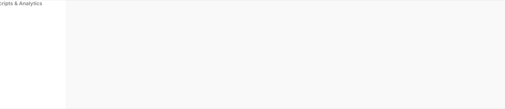

Design sets how your app looks to every family: a light or dark theme, your main brand color and the text color on your buttons.

**Where to find it:** **Website & App › App › Design**, or **Settings › Design** in the App builder.

<Frame>
  
</Frame>

## Change your app's design

<Steps>
  <Step title="Pick a theme">
    Next to **Theme**, click the sun for the light theme or the moon for the dark theme. Every family sees the theme you choose; they can't switch it.
  </Step>
  <Step title="Set your primary color">
    Click the color dot next to **Primary Color** to pick a color, or type a hex code such as `#1F3A93`. Your primary color fills main buttons and marks the selected menu item, links and highlights.
  </Step>
  <Step title="Set the button text color">
    **Primary Button Text Color** is the color of the words on those buttons. Use white (`#FFFFFF`) on a dark primary color and black (`#000000`) on a light one. If the two are too close, "Low contrast: button text may be hard to read." shows under it. You can still save; your app then shows the button text in black or white, whichever reads better (see below).
  </Step>
  <Step title="Click Update">
    Families see the new design the next time they open or refresh your app.
  </Step>
</Steps>

### Typing a hex code

- A color counts once it's a complete hex code, such as `#1F3A93`. While you're typing, the box keeps what you type and the last complete color stays saved.
- A short code such as `#fff` is accepted when you leave the box or press Enter, and shows as `#FFFFFF`.
- If you leave something that isn't a hex code, such as a color name or half a code, the box gets a red outline and says "Enter a hex color like #1F3A93." Your last complete color is kept; nothing turns black.

## Your logo

Your app's logo comes from your [Brand Kit](/website/brand-kit) (**Settings › Brand kit**), not from Design. Under **Where your logo shows**, three rows are about your app: **Your app on the web**, **Sign-in and group picker** and **Your app on iPhone and Android**. Each starts on **Auto**, which picks the logo that reads well on that background, and shows your business name or initials until you upload a logo. The iPhone and Android row reaches families with the next mobile app update. See [Where your logo shows](/website/brand-kit#where-your-logo-shows).

The Brand Kit's **Colors** also hold a theme, primary and button text color. They're the same app design as this page, so a change in either place changes your app.

## How your app keeps your brand readable

Your app adjusts a few small details so your branding stays readable, without changing your saved colors:

- **A color close to the background:** if your primary color is too close to the app background (dark navy on the dark theme, or gold on the light theme), small things drawn in that color, like profile initials and the selected menu icon, use a lighter or darker shade of it. Buttons keep your exact color.
- **Button text too close to the button color:** if your button text color is hard to read on your primary color, buttons in your app show their text in black or white, whichever reads better. Colors that already read clearly are used exactly as you chose them.
- **Wide logos:** a logo much wider than it is tall shows as your initials in small square spots, and in a wider rounded box on the group cards under **Settings › Groups** in your app. The full logo stays in the header.
- **Buttons in the mobile app** use your primary color with your button text color, including **Back to Programs** and **Next Lesson** in programs and **Update Redeemable Credits** on a client's credits. This reaches families and staff with the next mobile app update.

## Common questions

<AccordionGroup>
  <Accordion title="Can families choose their own theme?">
    No. The theme you choose applies to everyone who uses your app.
  </Accordion>
  <Accordion title="Does this change my website?">
    No. Your website has its own Design settings in the website builder, which can follow your Brand Kit. See [Website settings and design](/website/settings-and-design).
  </Accordion>
  <Accordion title="I changed my logo and the app still shows the old one">
    Ask the family to refresh the page or reopen the app. The iPhone and Android apps pick up a new logo choice from the Brand Kit after their next update from the App Store or Google Play.
  </Accordion>
</AccordionGroup>

## Related articles

- [Your app: overview](/app/overview)
- [App builder](/app/builder)
- [Brand Kit](/website/brand-kit)
- [Website settings and design](/website/settings-and-design)
