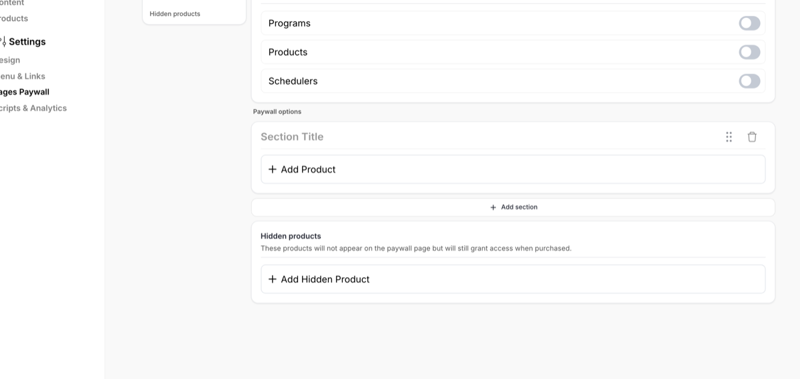

Page access lets you make whole pages of your app open only for families who've bought a qualifying product, usually a membership. Everyone else sees a paywall page with the products that unlock it.

**Where to find it:** **Website & App › App › Page access**, or **Settings › Pages Paywall** in the App builder.

<Frame>
  
</Frame>

## Before you start

- Create the products that should unlock the pages in [Payments › Products](/payments/product-overview). Memberships and one-time products both work.
- Make sure the pages you want to lock are showing in [Menu & Links](/app/menu-and-links). The paywall stands in front of a page; it can't show a page that's hidden.

## Set up page access

<Steps>
  <Step title="Choose the pages to lock">
    Under **Paywalled pages**, turn on **Programs**, **Products**, **Schedulers** (your Schedule page) or any mix.
  </Step>
  <Step title="Add the products that unlock them">
    Under **Paywall options**, click **Add Product** and pick one or more products. Buying **any one** of them unlocks the locked pages. Use **Add section** to group the options under headings, such as "Monthly" and "Season pass". Families see these sections on the paywall page.
  </Step>
  <Step title="Turn it on">
    Switch on **Active** at the top and click **Update**. The paywall applies straight away.
  </Step>
</Steps>

The gear at the top opens the paywall page's settings: its **Slug** (web address) and **Page Meta (SEO)**, the title and description shown in search results and link previews.

## What families see

A family without a qualifying product who opens a locked page sees the paywall: your products with their prices and descriptions, and buttons to buy them. Visitors who aren't signed in see the same paywall page, with a link to sign in, so a member can sign in and go straight in.

Families get access as soon as their purchase goes through, and keep it while the product is active. A membership counts while it's active or trialing. When it ends or its payment fails, the page locks again until it's paid.

<Note>
  The paywall only covers the pages themselves. A scheduler a family reaches through a form, a website button or a direct link stays bookable, and a program you shared directly with an athlete stays open. To charge for one scheduler, attach a product to it instead. See [Attach products to schedulers](/payments/attach-products).
</Note>

## How paywalls work for parents and children

When the **Schedulers** page is locked, access is checked for the whole family:

- **The parent holds the product.** The parent can open the Schedule page and book any of their children.
- **A child holds the product.** The parent can open the Schedule page and book that child.
- **Siblings don't share access.** Each booking is checked for the athlete it's for. One child's product never lets the parent book a sibling who doesn't have it. When a booking is refused for that reason, the message links to your membership options.
- **Archived purchases don't count.** If you archive the qualifying product on a client's profile, it stops unlocking the page.

If a parent says **Sessions** still looks locked after their child got the product, ask them to refresh once.

## Hidden products

**Hidden products** unlock the paywall in exactly the same way, but don't show on the paywall page. Families can't find or buy them there.

Use them for:

- **Grandfathered pricing.** You raise your membership from \$49 to \$69. Move the \$49 product to hidden products: current members keep their rate and access, and new families only see \$69.
- **Invite-only access.** A travel team or a tryout group gets a product only you hand out.
- **Free or discounted access** for staff, scholarship athletes or sponsors, without a \$0 option on your public paywall.

To add one, click **Add Hidden Product** under **Hidden products**, pick the product and click **Update**. The product must already exist in **Payments › Products**.

Because families can't buy a hidden product from the paywall, get it to them another way:

- Add it to the client yourself from their profile's **Products**. See [Client products](/people/client-profiles/client-profiles-products).
- Send them the product's link by message, email or text.

## Common questions

<AccordionGroup>
  <Accordion title="A family bought the product but the page is still locked">
    Check the purchase on their profile: it must be active (not canceled, ended or archived) and be one of the products on the paywall, visible or hidden. Then ask them to refresh, or sign out and back in.
  </Accordion>
  <Accordion title="Can I lock one program instead of the whole Programs page?">
    Not with the paywall; it works on whole pages. To limit one program, use the program's own sharing and access settings. See [Programs page](/app/content).
  </Accordion>
  <Accordion title="Can I lock different pages behind different products?">
    No. Every product on the paywall unlocks every locked page. For different levels, attach products to individual schedulers, or share programs with chosen athletes.
  </Accordion>
  <Accordion title="Does the paywall work in the mobile app?">
    Yes. Locked pages are locked on the web and in the iPhone and Android apps. Whether a family can buy inside the mobile app depends on their app version; if they can't, they buy on the web and come back.
  </Accordion>
  <Accordion title="How do I remove the paywall for a while?">
    Switch off **Active** and click **Update**. Your pages, products and sections stay set up for when you turn it back on.
  </Accordion>
</AccordionGroup>

## Related articles

<CardGroup cols={2}>
  <Card title="Products overview" icon="box" href="/payments/product-overview">
    How products work and where families find them
  </Card>
  <Card title="Product builder" icon="credit-card" href="/payments/product-builder">
    Create memberships and one-time products
  </Card>
  <Card title="Menu & Links" icon="bars" href="/app/menu-and-links">
    Show or hide your app's pages
  </Card>
  <Card title="Family accounts" icon="people-roof" href="/app/family-accounts">
    Parents, children and who holds what
  </Card>
</CardGroup>
