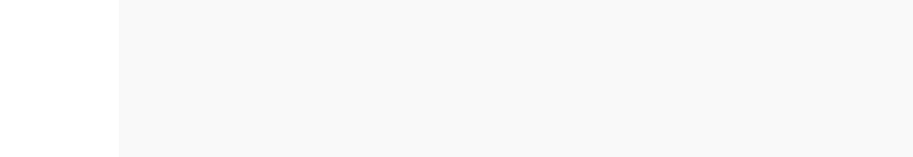

The App builder is where you build your app's pages and settings. Open it from **Website & App › App** and click **Edit app**, or click any row on the App page to jump straight to that part of the builder.

<Frame>
  
</Frame>

## The builder menu

The menu on the left has two groups:

- **App:** the three pages you fill with your own items.
  - **Schedule:** the schedulers families can book. See [Schedule page](/athlete-portal/schedule).
  - **Content:** your programs. See [Programs page](/athlete-portal/content).
  - **Products:** the products families can buy. See [Products page](/athlete-portal/products).
- **Settings:** how the whole app looks and works.
  - **Design:** theme and colors. See [Design](/athlete-portal/design-settings).
  - **Menu & Links:** which pages show, their web addresses and names, and your domains. See [Menu & Links](/athlete-portal/menu-and-links).
  - **Pages Paywall:** pages that open only for paying members. See [Page access](/athlete-portal/paywall-settings).
  - **Scripts & Analytics:** Google Analytics, Facebook Pixel and your own scripts. See [Scripts & Analytics](/athlete-portal/scripts-and-analytics).

**Exit Builder** at the top takes you back to CoachIQ. The back arrow beside a page's title takes you to the App page.

Channels (Announcements and Direct Message) has no builder page: you write announcements and messages in your **Inbox**. See [Channels](/athlete-portal/channels).

## The page bar

The Schedule, Content and Products pages share the same bar at the top:

| Control | What it does |
|---|---|
| **Active** | Turns the page on or off in your app |
| Copy page link | Copies the web address of this page in your app |
| Open page | Opens this page in your app in a new tab |
| Page settings (gear) | The page's name, web address and other settings |
| **Update** | Saves and publishes your changes |

## Sections and items

Each page is a list of **sections**, and each section holds **items**: schedulers on the Schedule page, programs on the Content page, products on the Products page. Families see each section as a heading with its items under it.

<Steps>
  <Step title="Add a section">
    Click **Add section** under the last section. Type a title in **Section Title**, for example "Private lessons" or "Summer camps".
  </Step>
  <Step title="Add items">
    Click **Add Schedule**, **Add Content** or **Add Products** in the section and pick what to show.
  </Step>
  <Step title="Put them in order">
    Drag a section by its handle (the dotted button beside the trash icon) to move it. Items have their own **Reorder** handle beside **Remove**; drag from the handle, not the rest of the row, so the boxes in the row stay easy to type in.
  </Step>
  <Step title="Remove what you don't need">
    Click the trash icon to delete a section, or **Remove** on an item. Removing an item only takes it off this page; the scheduler, program or product itself isn't deleted.
  </Step>
  <Step title="Click Update">
    Your changes reach families only after you click **Update**.
  </Step>
</Steps>

The list on the left of the page shows your sections by name. Click one to jump to it.

## Publishing

- **Update** publishes the page you're on. Families see the change the next time they open or refresh the page.
- Settings pages (Design, Menu & Links, Pages Paywall, Scripts & Analytics) have their own **Update** or **Save changes** button.
- There's no undo. To go back, change the page again and click **Update**.

<Warning>
  If you leave a page without clicking **Update**, your changes on that page aren't saved.
</Warning>

## Common questions

<AccordionGroup>
  <Accordion title="Why can't families see my changes?">
    Check that you clicked **Update**, that the page's **Active** switch is on, and that the page isn't hidden in [Menu & Links](/athlete-portal/menu-and-links). On the App page, a hidden page shows a **Hidden** label. Then ask the family to refresh the page.
  </Accordion>
  <Accordion title="What's the difference between a section and a scheduler?">
    A section is a heading you create to group items on a page, like "Elite training". A scheduler is something families can book, and it sits inside a section. You create schedulers in **Scheduling**; the Schedule page in the builder only chooses which ones to show.
  </Accordion>
  <Accordion title="A scheduler shows Inactive on the Schedule page">
    The scheduler is switched off, so families don't see it. Turn it on in **Scheduling › Schedulers** and it shows again.
  </Accordion>
</AccordionGroup>

## Related articles

<CardGroup cols={2}>
  <Card title="Your app: overview" icon="mobile" href="/athlete-portal/understanding-your-athlete-portal">
    What families see and where
  </Card>
  <Card title="Schedule page" icon="calendar" href="/athlete-portal/schedule">
    Show your schedulers in your app
  </Card>
  <Card title="Programs page" icon="book" href="/athlete-portal/content">
    Show your programs in your app
  </Card>
  <Card title="Products page" icon="credit-card" href="/athlete-portal/products">
    Sell products in your app
  </Card>
</CardGroup>
