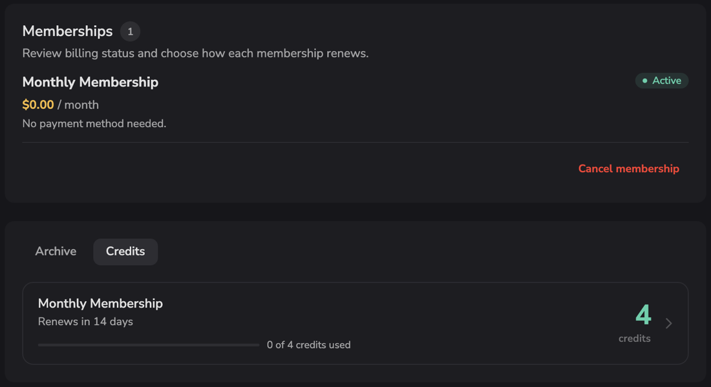

This page walks through the screens families use after they book or buy in your app, so you know what they're looking at when they ask for help. You set up what's for sale and bookable in the App builder; families manage their side here.

Families reach these screens from the menu (**Bookings** under Sessions, **Orders** under Products) and from their account menu at the top right, which has **Settings** and **Orders** above **Log out**.

## Bookings

**Bookings** (under **Sessions** in the menu) lists everything a family has booked, upcoming and past.

- **Whose booking it is:** each row is labeled **Me** or with the child's name. A parent with several athletes can filter with the chips at the top; when one athlete has nothing booked, the list says so with a **Book** button.
- **Actions:** each booking's buttons are labeled, and a completed session shows a green check. If a booking can't be canceled, for example because it's inside your cancellation notice window, the row says why.
- **Long lists:** **Show more** sits at the bottom while there are more upcoming bookings, and the next ones also load as the family scrolls. If loading fails, the list says "Couldn't load more bookings." with **Try again**.
- **On phones,** each booking shows the day, the date and its actions on one row. On tablets, the booking page puts the order summary beside the calendar.

### Cancel and reschedule

When a family cancels or reschedules, the window says what will happen before they confirm, such as the spot being released or a credit going back to them. **Reschedule** names the booking being moved. The safe choice is always in the same place, at every screen width.

What families can change follows each scheduler's rules: whether they can reschedule, and how close to the start they can still cancel. See [Edit and reschedule bookings](/scheduling/editing-rescheduling-bookings) and [Cancel bookings](/scheduling/canceling-bookings). A parent can change a child's booking; see [Family accounts › Changing a child's booking](/athlete-portal/family-accounts#changing-a-childs-booking).

## Checkout

Checkout is the same steps whether a family buys a product or books a paid session. On a phone, the step names sit in one row that scrolls sideways to the current step, and the **Continue** button always stays above the menu at the bottom, even when an error shows.

- **Log in / Sign up:** visitors who aren't signed in sign in or create an account first.
- **Joining your club:** someone signed in who isn't a member yet sees a **Ready to join?** card with one **Join Now** button, then carries on. This works the same for booking a session and buying a product.
- **Who it's for:** a parent picks which athlete the purchase or booking is for. If that child already has the product active, checkout says so before payment and doesn't charge again. See [Family accounts](/athlete-portal/family-accounts#registering-an-athlete-at-checkout).
- **Payment details:** the billing schedule shows the first charge and the renewal date. The first payment can differ from the renewal price because of a setup fee or a coupon, and a membership that starts billing later shows its billing date (that isn't necessarily a free trial). See [The amounts families see](/payments/product-builder#understand-the-amounts-clients-see).
- **Card:** the family picks one saved card or a new card, and the selected choice is clearly marked. The card marked **Default** in Billing is picked to start with. If saved cards are slow to load, the new-card form shows straight away with **Retry**.

## Settings › Billing

**Settings** has **Profile**, **Groups**, **Family** (parents only), **Calendar** and **Billing**. Billing is where families manage what they pay for.

<Frame>
  
</Frame>

### Payment methods

Saved cards, and bank accounts connected to memberships.

- **Set as default** chooses the card memberships and checkout use.
- **Remove card** removes a card, unless it's the only card paying for an active membership; then they're asked to add another card first. Memberships that used the removed card move to the default card and aren't canceled. They show **Updating** for a moment, then the default card; the removed card is never shown again.
- A family can change the card on a membership, including after a missed payment. A declined card shows the bank's reason.
- If cards can't load, the family sees "We couldn't load your saved cards" with **Retry**. Their cards are still on file.

You can't remove a family's card from their profile; they manage cards here.

### Memberships

Each membership shows its status, price, the card it bills to and how it renews, with **Cancel membership**.

- A membership bought for a child is marked **For** and the child's name, and keeps that line after it's canceled until its access ends.
- Access end dates and the dates in the cancel window show in the family's own time zone, for example "Access until Nov 25, 2026 at 11:22 AM PST". Your admin shows the same date.
- A membership with nothing to pay, such as a free one or one you granted, says "No payment method needed."
- A trial shows its end date next to the price. A membership whose payments you paused in Stripe shows **Payments paused**, and when they resume if you set a date; the family keeps their access, bookings and credits meanwhile.
- If memberships can't load, the family sees a notice with **Retry**, not an empty list. "No active memberships." only shows when there really are none.

**Cancel membership** shows when access ends before the family confirms: for a trial, the trial end date and that they won't be charged; for a paid membership, the end of the current period. It only shows when the product lets members cancel. When they can't cancel, the window says why, for example only the person who pays can cancel, or you need to cancel it, with a button to message you.

To change or cancel a family's membership yourself, see [Manage subscriptions](/payments/manage-subscriptions).

### Credits

Each credit pack shows what it's for, how many credits are left, a labeled bar of credits used, when it renews and when it expires (including "Expires today"). A pack with no cap reads **No limit**. Click a pack to see its details and history.

- **Credit use paused** with "Contact your coach" means a membership payment failed, so its credits can't be used until it's paid. See [Failed payments](/payments/failed-payments).
- A pack from a lapsed membership shows its status and a **Re-subscribe** button. One-time credit packs show **Active**, **Expired**, **Credits unavailable** or **No credits left** instead.
- When a pack's credits expire on different dates, the card names the next expiry and what has already expired.
- A parent sees their own packs first, then each child's packs marked **For** and the child's name.

### Archive

**Archive** lists past purchases and memberships, with dates and times in the family's own time zone. The first payment of a membership shows what was actually paid, for example "Initial payment \$15.00 (after \$5.00 credit)". A free trial canceled before it ended shows an initial payment of \$0.00. If the first payment can't be confirmed, the row says "Payment details unavailable" instead of guessing an amount.

## Orders

**Orders** (under **Products** in the menu, and in the account menu) lists a family's purchases, newest first, with who each one is for and the first payment, the same way as the Billing archive.

- If Orders can't load, the family sees a short message with **Try again**, not "No orders found".
- Someone who opens Orders from an old link after their sign-in expired sees "Sign in again to see your orders" with a sign-in link. Their orders show once they sign in.

## Helping a family

| They say | Check |
|---|---|
| "My membership isn't there" | Ask them to tap **Retry** on Billing. Then check the membership on their profile in **People**. |
| "My credits are paused" | A membership payment failed. See [Failed payments](/payments/failed-payments). |
| "I can't cancel my booking" | The row says why. Usually it's inside the scheduler's cancellation window, so they'll need to contact you. |
| "Checkout says my child already has this" | The child picked already has that product active. They don't need to buy it again. |
| "The dates look a day off" | Families see dates in their own time zone. A family in another region may see a different time than your club's clock. |

## Related articles

<CardGroup cols={2}>
  <Card title="Family accounts" icon="people-roof" href="/athlete-portal/family-accounts">
    Parents, children, and whose booking or purchase it is
  </Card>
  <Card title="Products page" icon="credit-card" href="/athlete-portal/products">
    What families can buy in your app
  </Card>
  <Card title="Your app on iPhone and Android" icon="mobile-screen" href="/athlete-portal/native-app-booking">
    Booking and buying in the mobile app
  </Card>
  <Card title="Credits overview" icon="coins" href="/payments/credits/credit-system-overview">
    How credit packs work
  </Card>
</CardGroup>
