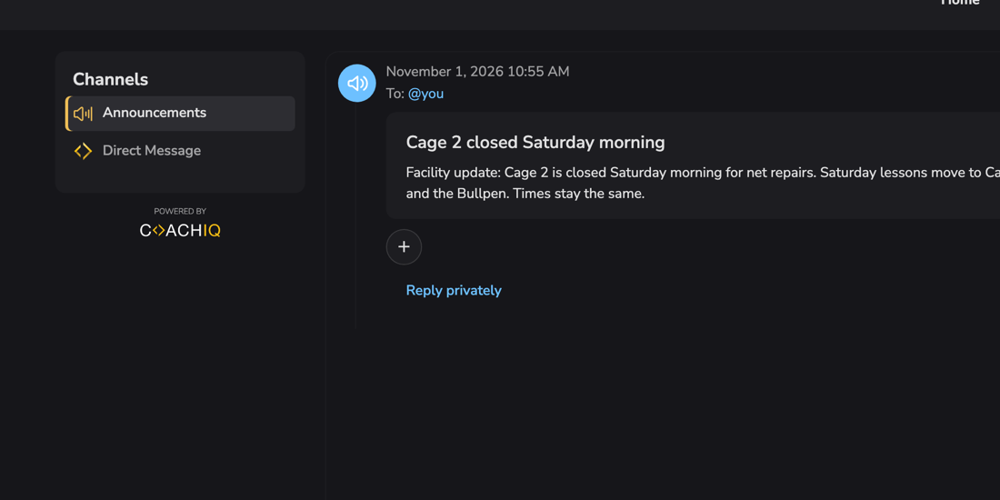

**Channels** is the messaging part of your app. It has two pages:

- **Announcements:** the posts you send to your whole club, a role, a tag or chosen people.
- **Direct Message:** private conversations between a family and your staff.

Channels is always on. There's nothing to set up in the App builder: you write announcements and messages from your **Inbox**, and families read and reply in your app. You can rename Channels and its two pages in [Menu & Links › Sidebar labels](/athlete-portal/menu-and-links#sidebar-labels).

<Frame>
  
</Frame>

## Announcements

In **Announcements**, families see each post with the date and time, who it was sent to (for example **To: @you**), the heading and your message, and any form, product, scheduler or media you attached as buttons.

- **React:** families add one of four reactions (👍 ❤️ 🙏 🔥) with the **+** button.
- **Reply privately:** opens a private message to you about the post, which arrives in your Inbox like any direct message.
- **Pinned:** the announcement you pin stays at the top, with the newest posts under it.

Each announcement also goes out as a push notification and an email. On a phone, the first announcements show on the first screen and the feed scrolls to the oldest one.

To post, edit, pin or delete an announcement, see [Announcements](/inbox/announcements).

## Direct Message

In **Direct Message**, a family sees their conversation with your staff and can write to you, with photos and videos. Messages you send from the Inbox arrive here with a push notification on their phone. Their replies land in your Inbox.

When you message several people at once, each person gets their own private copy. Nobody sees who else got it or anyone else's replies.

To send direct messages, see [Direct messages](/inbox/in-app-messages).

## Who can see Channels

Only accepted members of your club get your announcements and can message your staff:

- Someone who is signed in but hasn't joined your club sees the join card instead, and can't open your announcements, their reactions or their attachments, even from a direct link.
- When you remove someone from **People**, they lose your members' menus and announcements straight away. Messages they try to send to your staff aren't delivered.
- If you message someone who isn't an active member (their membership is incomplete, suspended or declined), you see "This person can't get messages until they are an active member of your club. Nothing was sent." Your draft stays in the box. Check their status in **People**.

## Common questions

<AccordionGroup>
  <Accordion title="A family says Announcements or Direct Message looks empty">
    An empty conversation says so. If messages can't load, the family sees **Try again** instead of a blank panel. Ask them to tap **Try again** or refresh before you send again.
  </Accordion>
  <Accordion title="Fewer people got my announcement email than I expected">
    Announcements only go to accepted members. People who never finished joining, or who are suspended or declined, are left out. See [Who gets an announcement](/inbox/announcements#who-gets-an-announcement).
  </Accordion>
  <Accordion title="Can families message each other?">
    No. Families can only message your staff.
  </Accordion>
  <Accordion title="Why isn't a family getting push notifications?">
    Push notifications need the mobile app with notifications allowed in the phone's settings. On the web, families see new messages when they open your app.
  </Accordion>
</AccordionGroup>

## Related articles

<CardGroup cols={2}>
  <Card title="Announcements" icon="bullhorn" href="/inbox/announcements">
    Post to your whole club, a role or a tag
  </Card>
  <Card title="Direct messages" icon="message" href="/inbox/in-app-messages">
    Message one family privately
  </Card>
  <Card title="Inbox overview" icon="inbox" href="/inbox/inbox-overview">
    Where you read and answer families
  </Card>
  <Card title="Your app: overview" icon="mobile" href="/athlete-portal/understanding-your-athlete-portal">
    What families see and where
  </Card>
</CardGroup>
