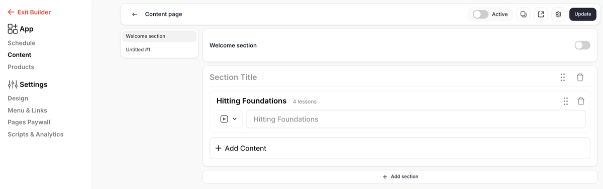
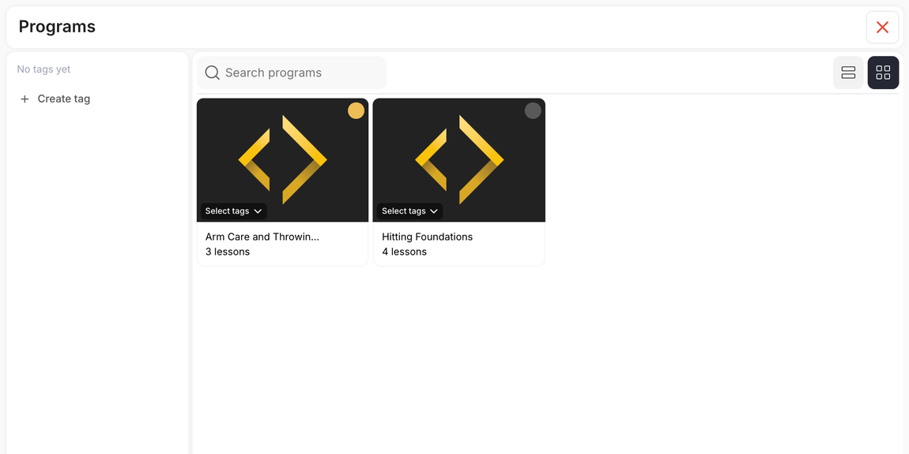
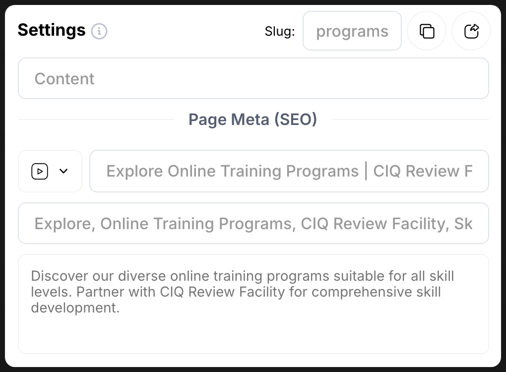

<Info>
  **Where to find this:** **Website & App › App**, click **Edit app**, then **Content** in the builder's left menu. The page is titled **Content page** in the builder; families see it as **Programs** unless you rename it.
</Info>

The Programs page is where families find your video programs and lessons. You build the programs themselves in **Content › Programs** (see [Programs overview](/content/programs-overview)); this page decides which of them show in your app, in what order and under which headings.

<Frame>
  
</Frame>

## Add programs to the page

<Steps>
  <Step title="Open the Content page">
    In the builder, click **Content** in the left menu.
  </Step>
  <Step title="Click Add Content">
    Inside a section, click **+ Add Content**. The **Programs** window lists every program, with its lesson count. Search by name, filter by tag on the left (or **Create tag**), and switch between list and grid view.

    <Frame>
      
    </Frame>
  </Step>
  <Step title="Pick programs">
    Select one or more programs, then click **Add Selected**. Each one shows as a row with its name and lesson count, and a title box you can change for this page.
  </Step>
  <Step title="Save">
    Click **Update** at the top right. Nothing changes in your app until you do.
  </Step>
</Steps>

A program only opens for the families who have access to it. Free, paid and private access are set on the program itself with **Share**. See [Sharing programs](/content/sharing-programs).

## Sections

Sections are the headings families see on the page, such as "Hitting" or "Arm Care".

- **Add a section:** click **+ Add section** under the last section, then type its name in **Section Title**.
- **Reorder:** drag a section or a program row by its handle (the six dots, named "Reorder" plus the section or program name for screen readers). Rows only move from the handle, so the boxes in the row stay easy to click.
- **Remove:** click the trash icon on a section or a row. This takes it off the page only; the program stays in your library.
- **Welcome section:** the switch at the top of the page turns on a welcome block above your sections.

The list on the left of the page jumps to each section.

## Turn the page on or off

The **Active** switch at the top turns the whole page on or off for families. You can also show or hide it, and change its address, in [Menu & Links](/athlete-portal/menu-and-links). To limit the page to paying members, use [Pages Paywall](/athlete-portal/paywall-settings).

## Page settings

Click the gear icon (**Page settings**) at the top right.

<Frame>
  
</Frame>

- **Page name** (the first box): what families see as the page title and in the menu, for example "Training". Leave it blank to use the default.
- **Slug:** the end of the page's web address, for example `/programs`. The buttons beside it copy the link and open the page.
- **Page Meta (SEO):** the image, title, keywords and description that show when someone shares a link to the page.

Click **Update** to save.

## What families see

- **Programs and lessons:** each program shows its picture, lesson count and progress. A lesson with no slides yet says "This lesson has no content yet." and still offers **Next Lesson**. If a lesson can't load, it says "Couldn't load this lesson." with **Try again**. In the mobile app, these two messages come with the next app update; until then a lesson with no slides can open straight on "Lesson Complete".
- **Buying for another child:** a parent who already has a program can buy it for another of their children with **Purchase for another child** under the program's title. It shows only when the program offers a family purchase. After paying, the confirmation links back to the program. In the mobile app this button comes with the next app update. See [Family accounts](/athlete-portal/family-accounts).
- **Behind a paywall:** a visitor who isn't signed in and opens a paywalled Programs page sees the same paywall a signed-in athlete sees, with its products and a link to sign in.

## Common questions

<AccordionGroup>
  <Accordion title="Where do I create or edit a program?">
    In **Content › Programs**. The builder only chooses which programs show here and how they're grouped. See [Programs overview](/content/programs-overview).
  </Accordion>
  <Accordion title="A family can't see a program. What should I check?">
    1. The Content page's **Active** switch is on and you clicked **Update**.
    2. Programs isn't hidden in [Menu & Links](/athlete-portal/menu-and-links).
    3. The program is on this page, in a section.
    4. The family has access: a private program must be shared with them, and a paid one bought. See [Sharing programs](/content/sharing-programs).
    5. If the page is paywalled, they hold a paywall product. See [Pages Paywall](/athlete-portal/paywall-settings).
  </Accordion>
  <Accordion title="Can I change a program's picture here?">
    No. The picture comes from the program. Change it in the program builder.
  </Accordion>
  <Accordion title="Does removing a program from this page delete it?">
    No. It only comes off this page. The program stays in your library, and access you've already given doesn't change.
  </Accordion>
</AccordionGroup>

## Related articles

- [Programs overview](/content/programs-overview)
- [Sharing programs](/content/sharing-programs)
- [Pages Paywall](/athlete-portal/paywall-settings)
- [Menu & Links](/athlete-portal/menu-and-links)
- [Family accounts](/athlete-portal/family-accounts)
