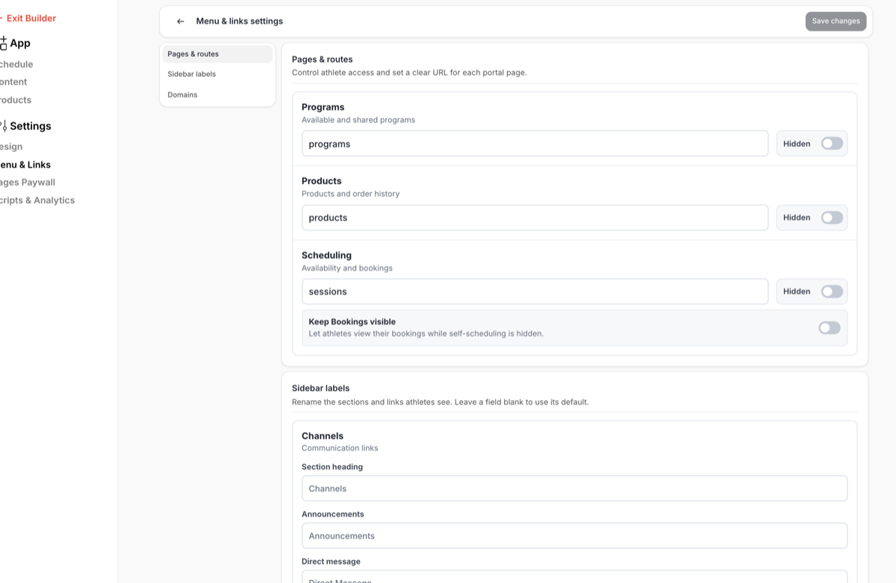

Menu & Links controls your app's menu: which pages families can open, the web address of each page, and the names families see.

**Where to find it:** **Website & App › App**, then **Domain** or any menu row, or **Settings › Menu & Links** in the App builder. The page has three parts, **Pages & routes**, **Sidebar labels** and **Domains**. Click one on the left to jump to it.

<Frame>
  
</Frame>

When you're done, click **Save changes** at the top.

<Note>
  Some labels on this page still say "athlete portal". That's your app.
</Note>

## Pages & routes

Three of your app's sections can be shown or hidden: **Programs**, **Products** and **Scheduling** (the Sessions section). Channels always shows.

For each one:

- **The switch** shows or hides the section in your app. A hidden section shows **Hidden** here and on the App page. Hiding a section doesn't delete anything: your schedulers, programs, products and families' bookings stay as they are, and turning it back on brings the section back.
- **The URL path** is the end of the web address, such as `programs` in `app.coachiq.io/your-business/programs`. Change it if you want the address to match a new name, for example `schedule` instead of `sessions`. Update any links to the old address you've shared, such as on your website or in emails.

### Keep Bookings visible

Under **Scheduling**, **Keep Bookings visible** lets families see their bookings while you've hidden self-scheduling. Use it when you book everyone yourself: families can't book new sessions, but they can still see their upcoming, past and canceled sessions under **Bookings**.

It only matters while Scheduling is hidden. When Scheduling shows, families have both **Available** and **Bookings**.

## Sidebar labels

Rename the sections and links in your app's menu, for example "Training" instead of "Programs" or "Book a lesson" instead of "Sessions". Leave a box blank to use the default name.

| Section | Section heading | Links |
|---|---|---|
| **Channels** | Channels | Announcements, Direct Message |
| **Scheduling** | Sessions | Available, Bookings |
| **Products** | Products | Available, Orders |
| **Programs** | Programs | Available, Shared with you |

**Use defaults** on a section clears its boxes so it goes back to the default names.

The names you choose show in the menu and as page headings on the web, and in the menu, tabs and headings in the mobile app. A blank name falls back to the default.

Each page's **Page settings** (the gear in the App builder) also has a page name and slug box for the same page.

<Note>
  Labels are set per group. If you run several groups, each group's app has its own names.
</Note>

## Domains

**Active domains** lists the web addresses your app answers on. Click one to open your app there.

To put your app on your own domain, such as `app.yourbusiness.com`, contact CoachIQ support.

## Common questions

<AccordionGroup>
  <Accordion title="Will hiding Scheduling cancel bookings?">
    No. Hiding Scheduling only takes the booking pages out of the menu. Existing bookings stay booked, and families can still see them if **Keep Bookings visible** is on.
  </Accordion>
  <Accordion title="Can I hide the Bookings page too?">
    Yes. With Scheduling hidden, turn **Keep Bookings visible** off and click **Save changes**.
  </Accordion>
  <Accordion title="I renamed a section but the mobile app still shows the old name">
    Ask the family to close and reopen the app. If the name still doesn't change, they may need the latest version of the app from the App Store or Google Play.
  </Accordion>
</AccordionGroup>

## Related articles

<CardGroup cols={2}>
  <Card title="Your app: overview" icon="mobile" href="/athlete-portal/understanding-your-athlete-portal">
    What families see and where
  </Card>
  <Card title="App builder" icon="compass" href="/athlete-portal/app-builder-navigation-and-interface">
    Edit pages and publish changes
  </Card>
  <Card title="Page access" icon="lock" href="/athlete-portal/paywall-settings">
    Open pages only to paying members
  </Card>
  <Card title="Sharing schedulers" icon="calendar" href="/scheduling/sharing-schedulers">
    Other ways to share a scheduler
  </Card>
</CardGroup>
