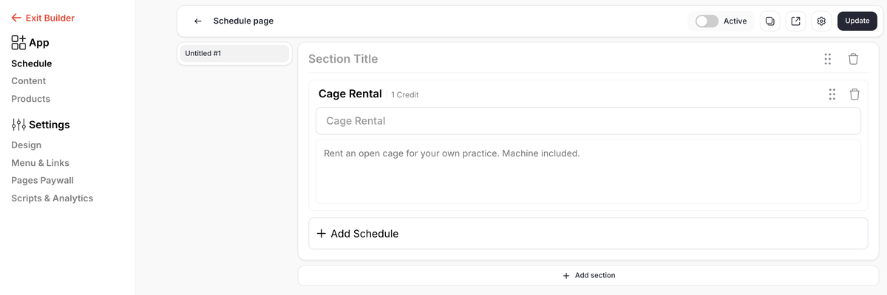
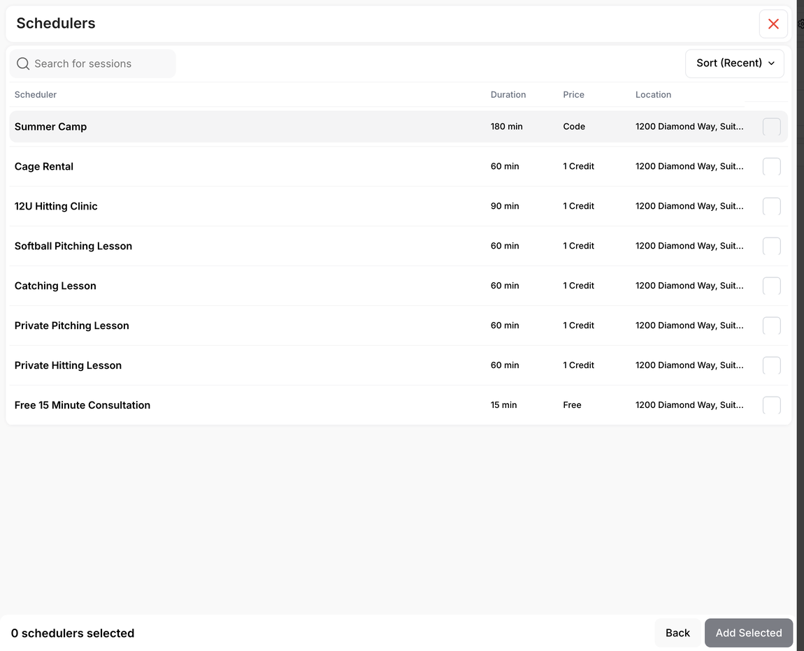

<Info>
  **Where to find this:** **Website & App › App**, click **Edit app**, then **Schedule** in the builder's left menu. The page is titled **Schedule page** in the builder; families see it as **Sessions** unless you rename it.
</Info>

The Schedule page is where families pick something to book. You create schedulers in **Scheduling › Schedulers** (see [Creating your first scheduler](/scheduling/creating-your-first-scheduler)); this page decides which of them families see, in what order, and with what title and description.

<Frame>
  
</Frame>

## Add schedulers to the page

<Steps>
  <Step title="Open the Schedule page">
    In the builder, click **Schedule** in the left menu.
  </Step>
  <Step title="Click Add Schedule">
    Inside a section, click **+ Add Schedule**. The **Schedulers** window lists every scheduler with its duration, price and location. Search with **Search for sessions** or change the order with **Sort**.

    <Frame>
      
    </Frame>
  </Step>
  <Step title="Pick schedulers">
    Tick one or more schedulers, then click **Add Selected**.
  </Step>
  <Step title="Set the card's title and description">
    Each scheduler shows as a card with its price (for example **1 Credit**), a title box and a description box. They start with the scheduler's own name and description. Change them to whatever families should read on this page.
  </Step>
  <Step title="Save">
    Click **Update** at the top right. Nothing changes in your app until you do.
  </Step>
</Steps>

<Note>
  Adding an inactive scheduler doesn't switch it on. It shows a grey **Inactive** badge in the builder, and families don't see it until you turn the scheduler on in **Scheduling › Schedulers**.
</Note>

## Sections

Sections are the headings families see, such as "Private Lessons" or "Cage Rentals".

- **Add a section:** click **+ Add section** under the last section, then type its name in **Section Title**.
- **Reorder:** drag a section or a scheduler card by its handle (the six dots, named "Reorder" plus the name for screen readers). Cards only move from the handle, so the title and description boxes stay easy to click.
- **Remove:** click the trash icon. This only takes it off the page; the scheduler itself isn't changed.

The list on the left of the page jumps to each section.

## Turn the page on or off

The **Active** switch at the top turns the page on or off for families. In [Menu & Links](/athlete-portal/menu-and-links) you can also hide the page while still letting families see their bookings (**Keep Bookings visible**). To limit booking to members, turn on **Schedulers** in [Pages Paywall](/athlete-portal/paywall-settings). Parents can book a child from a paywalled Schedule page when either the parent or that child holds a paywall product.

## Page settings

Click the gear icon (**Page settings**) at the top right.

- **Page name** (the first box): what families see as the page title and in the menu, for example "Book a Lesson". Leave it blank and families see **Sessions**.
- **Slug:** the end of the page's web address, for example `/sessions`. The buttons beside it copy the link and open the page.
- **Page Meta (SEO):** the image, title, keywords and description that show when someone shares a link to the page.

Click **Update** to save.

## What families see

- **Cards:** each card shows the title and description you set on this page, its price and **Book Now** or **Learn More**.
- **Learn More** opens the card's own title and description, so the words you wrote for this page show there too. Where you left the card's title or description blank, the scheduler's own text fills in that part.
- **Session details** show the session length. **Read More** shows only when the description is cut short.
- **After booking,** families manage their sessions from **Bookings**. See [Bookings, billing and orders](/athlete-portal/bookings-billing-orders#bookings).

In the mobile app, **Learn More** shows the card's title and description with the next app update.

## Add one session to a personal calendar

After booking, families can select **Add to Calendar** on the confirmation screen and choose **Google Calendar**, **Apple Calendar**, **Outlook.com** or the calendar file. Each option includes the session name, date, time and location. Apple Calendar downloads a file to open in Calendar.

## Subscribe to bookings in Google, Apple, or Outlook

Families can open **Settings › Calendar** in your app, turn on their calendar subscription and choose **Google**, **Apple** or **Outlook**. It's a private, read-only feed of their bookings; they still book and cancel in your app.

**Reset private link** replaces the link (they then subscribe again with the new one), and **Turn off** stops it. This is separate from your own Google Calendar sync. If a family gets both a Google invitation and the subscription, the same session can show twice.

## Common questions

<AccordionGroup>
  <Accordion title="Where do I create a scheduler or change its price?">
    In **Scheduling › Schedulers**. The price, duration, availability and booking rules all come from the scheduler. See [Creating your first scheduler](/scheduling/creating-your-first-scheduler).
  </Accordion>
  <Accordion title="A family can't see a scheduler. What should I check?">
    1. The Schedule page's **Active** switch is on and you clicked **Update**.
    2. The page isn't hidden in [Menu & Links](/athlete-portal/menu-and-links).
    3. The scheduler is on this page and isn't marked **Inactive**.
    4. The scheduler has open times, and the family can book it (for example, it isn't limited to a tag they don't have).
    5. If the page is paywalled, they or their parent hold a paywall product.
  </Accordion>
  <Accordion title="Can I show different schedulers to different families?">
    Everyone sees the same Schedule page. To limit who can book, use the scheduler's own settings, such as limiting it to a tag. See [Scheduling overview](/scheduling/overview).
  </Accordion>
</AccordionGroup>

## Related articles

- [Creating your first scheduler](/scheduling/creating-your-first-scheduler)
- [Credits overview](/payments/credits/credit-system-overview)
- [Bookings, billing and orders](/athlete-portal/bookings-billing-orders)
- [Menu & Links](/athlete-portal/menu-and-links)
- [Pages Paywall](/athlete-portal/paywall-settings)
