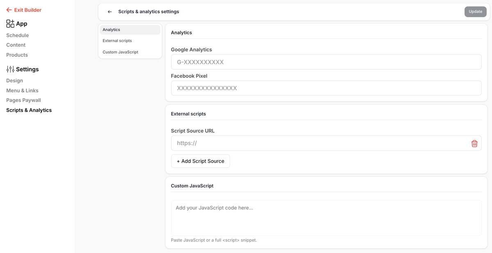

<Info>
  **Where to find this:** **Website & App › App**, then **Scripts & Analytics** under **App**. In the builder it's **Settings › Scripts & Analytics**, and the page is titled **Scripts & analytics settings**.
</Info>

Add Google Analytics, a Facebook (Meta) Pixel, script links and your own JavaScript to your app on the web. The page has three parts: **Analytics**, **External scripts** and **Custom JavaScript**. Click **Update** at the top right to save any of them.

<Frame>
  
</Frame>

<Note>
  These run only in your app on the web (in a browser). The iPhone and Android apps don't run custom scripts. Your website has its own Scripts & Analytics settings; see [Website analytics & tracking](/website/analytics-tracking/analytics-tracking).
</Note>

## Adding Google Analytics

Track athlete behavior, page views, and engagement metrics with Google Analytics.

### Get your Measurement ID

<Steps>
  <Step title="Open Google Analytics">
    Go to [analytics.google.com](https://analytics.google.com) and sign in.
  </Step>
  <Step title="Access Admin settings">
    Click the **Admin** gear icon in the bottom left corner.
  </Step>
  <Step title="Open Data Streams">
    Under **Property Settings**, click **Data Streams**.
  </Step>
  <Step title="Get or create a Web stream">
    Select your existing web stream, or click **Add stream** → **Web** to create one.

    Enter your app's web address (shown on **Website & App › App**, for example `app.coachiq.io/your-org/your-group`).
  </Step>
  <Step title="Copy the Measurement ID">
    Copy the **Measurement ID** - it starts with `G-` followed by letters and numbers (e.g., `G-ABC123XYZ`).

    <Tip>
      You only need the Measurement ID, not the full script code. CoachIQ handles the script injection automatically.
    </Tip>
  </Step>
</Steps>

### Add to CoachIQ

<Steps>
  <Step title="Paste your Measurement ID">
    In the **Analytics** section, paste your Measurement ID into the **Google Analytics** field.
  </Step>
  <Step title="Save your changes">
    Click **Update** in the top right corner.

    <Check>
      Google Analytics now runs on your app on the web.
    </Check>
  </Step>
</Steps>

### Check it's working

<Steps>
  <Step title="Open Google Analytics Realtime">
    In Google Analytics, go to **Reports** → **Realtime**.
  </Step>
  <Step title="Open your app">
    In another browser tab, open your app on the web.
  </Step>
  <Step title="Check for activity">
    You should appear as an active user in the Realtime report within a few seconds.
  </Step>
</Steps>

## Adding Facebook Pixel

Track conversions and build retargeting audiences with Facebook Pixel.

<Steps>
  <Step title="Get your Pixel ID">
    In Meta Business Suite, go to **Events Manager** → **Data Sources** → your Pixel.

    Copy the **Pixel ID** (a string of numbers, e.g., `1234567890123456`).
  </Step>
  <Step title="Add to CoachIQ">
    In the **Analytics** section, paste your Pixel ID into the **Facebook Pixel** field.
  </Step>
  <Step title="Save your changes">
    Click **Update**.
  </Step>
  <Step title="Check the pixel fires in your app">
    In Meta **Events Manager**, open **Test Events** and open a page of your app (your sign-up link, a form link or the Schedule page) in a browser. A PageView should appear within a few seconds.

    <Note>
      Your app fires the pixel separately from your website. If your website shows events in Test Events but your app doesn't, check the Pixel ID is saved here in the App builder's **Scripts & Analytics**, not only in the website builder.
    </Note>
  </Step>
</Steps>

## Adding External Scripts

Load third-party JavaScript libraries by URL. Use this for tools like Hotjar, Intercom, Drift, or any service that provides a script URL.

<Steps>
  <Step title="Get the script URL">
    From your third-party tool, copy the script source URL (starts with `https://`).
  </Step>
  <Step title="Add the URL">
    In the **External scripts** section, paste the URL into the **Script Source URL** field.
  </Step>
  <Step title="Add more scripts (optional)">
    Click **+ Add Script Source** to add additional script URLs.
  </Step>
  <Step title="Save your changes">
    Click **Update**.
  </Step>
</Steps>

<Warning>
  **Only add scripts you trust.** External scripts can read and change everything on your app's pages. Only use scripts from reputable services.
</Warning>

## Adding Custom JavaScript

Run your own JavaScript code for advanced integrations, custom tracking events, or specialized functionality.

<Steps>
  <Step title="Write your code">
    In the **Custom JavaScript** section, paste your code.

    <Tip>
      You can paste plain JavaScript or a full `<script>` snippet.
    </Tip>
  </Step>
  <Step title="Save your changes">
    Click **Update**.
  </Step>
</Steps>

### Example: Custom event tracking

```javascript
// Track when athletes click specific buttons
document.addEventListener('click', function(e) {
  if (e.target.matches('.book-session-btn')) {
    gtag('event', 'book_session_click', {
      'event_category': 'engagement'
    });
  }
});
```

## Common questions

<AccordionGroup>
  <Accordion title="Does this work on the mobile apps?">
    No. They only run in your app on the web, in a browser. The iPhone and Android apps don't run custom scripts.
  </Accordion>
  <Accordion title="Can I add multiple analytics tools?">
    Yes. You can use Google Analytics, Facebook Pixel, multiple external scripts, and custom JavaScript all at the same time.
  </Accordion>
  <Accordion title="Why isn't my tracking showing data?">
    Common causes:

    - **Not saved:** make sure you clicked **Update**
    - **Ad blocker:** turn it off while testing
    - **Wrong ID:** Google Analytics IDs start with `G-`; Pixel IDs are numbers only
    - **Old page:** do a hard refresh (Ctrl+Shift+R or Cmd+Shift+R)
    - **Pixel set only on the website:** the website builder and the App builder each have their own Scripts & Analytics. Add the Pixel ID here too
    - **Testing in the mobile app:** scripts only run on the web; open your app in a browser to test
  </Accordion>
  <Accordion title="Do I need to add the full Google Analytics script?">
    No. Just paste your Measurement ID (e.g., `G-ABC123XYZ`) into the Google Analytics field. CoachIQ automatically loads and configures the tracking script for you.
  </Accordion>
  <Accordion title="What's the difference between External scripts and Custom JavaScript?">
    - **External scripts** load a JavaScript file from a web address (for third-party tools).
    - **Custom JavaScript** runs code you paste in.
  </Accordion>
  <Accordion title="Will this affect my website tracking?">
    No. These settings only apply to your app. Your website has its own Scripts & Analytics in the website builder.
  </Accordion>
</AccordionGroup>

## Related articles

- [Your app overview](/athlete-portal/understanding-your-athlete-portal)
- [Website Analytics & Tracking](/website/analytics-tracking/analytics-tracking)
- [Design settings](/athlete-portal/design-settings)
