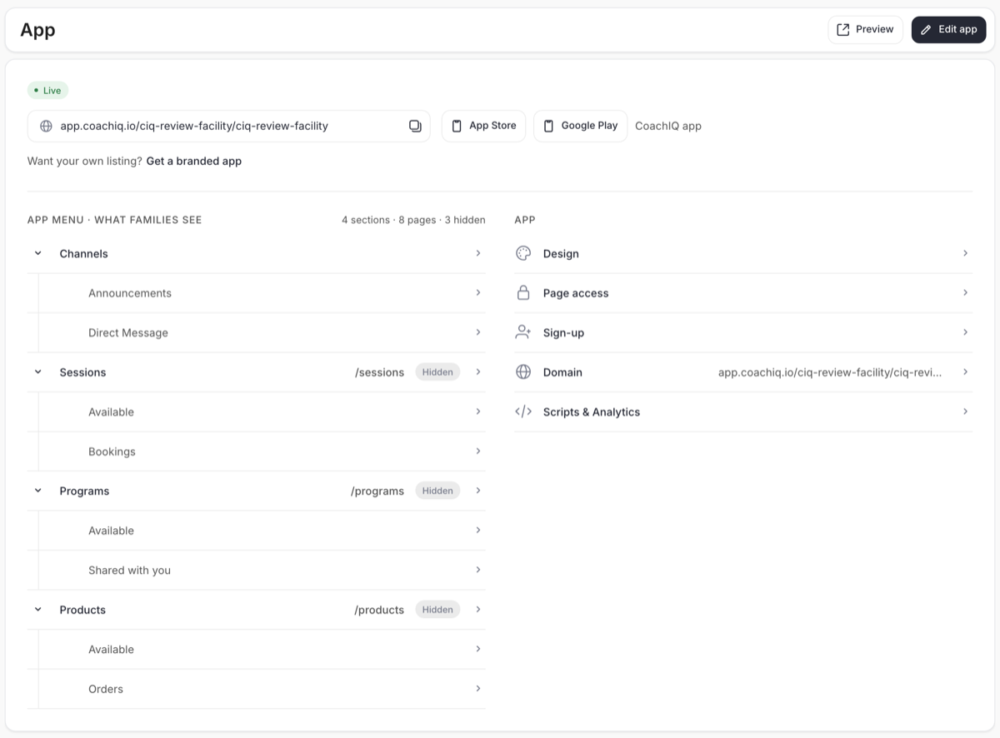
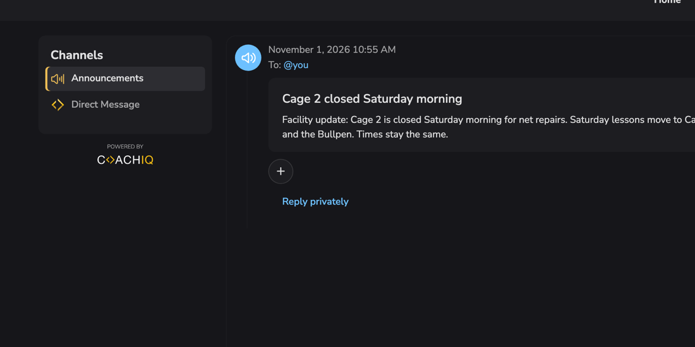

Your app is what your athletes and parents use: they book sessions, buy products, read your announcements, message you and follow your programs. It works in any web browser and in the iPhone and Android apps, with the same account everywhere.

You set it up from **Website & App › App** in the CoachIQ sidebar.

<Note>
  Some screens and older articles still call your app the **Athlete Portal**. It's the same thing.
</Note>

## The App page

**Website & App › App** shows your app at a glance.

<Frame>
  
</Frame>

- **Live** and your app's address. Click the copy button to copy the link to send to families or put on your website.
- **App Store** and **Google Play** open the store page families download from. If you have a [branded app](/power-ups/personalized-app), these are your own listings. Otherwise they're the CoachIQ app's listings, marked **CoachIQ app**, with **Get a branded app** under them.
- **App menu · What families see** lists the menu in the order families see it, with each page's web address and a **Hidden** label on pages that are turned off. Click any row to open that part of the App builder.
- **App** lists the app's settings: **Design**, **Page access**, **Sign-up**, **Domain** and **Scripts & Analytics**. Each one opens in the right place.
- **Preview** opens your app as families see it. **Edit app** opens the [App builder](/athlete-portal/app-builder-navigation-and-interface).

## What's in your app

Your app's menu has four sections. You choose which ones families see.

| Section | Pages | What families do there | Set it up |
|---|---|---|---|
| **Channels** | Announcements, Direct Message | Read your announcements and message you | [Channels](/athlete-portal/channels) |
| **Sessions** | Available, Bookings | Book sessions and manage what they've booked | [Schedule page](/athlete-portal/schedule) |
| **Programs** | Available, Shared with you | Follow your video programs and lessons | [Programs page](/athlete-portal/content) |
| **Products** | Available, Orders | Buy memberships, credit packs and other products, and see past orders | [Products page](/athlete-portal/products) |

Families also have **Settings**, where they manage their profile, family members, calendar and billing. See [Bookings, billing and orders](/athlete-portal/bookings-billing-orders).

You can rename the sections and their pages, change their web addresses and hide them in [Menu & Links](/athlete-portal/menu-and-links). You can make pages open only for paying members with [Page access](/athlete-portal/paywall-settings).

<Frame>
  
</Frame>

## Where families use it

- **On the web:** your app's address, shown on the App page. It works on phones and computers, and you can put it on your own domain (see [Menu & Links › Domains](/athlete-portal/menu-and-links#domains)).
- **On their phone:** the CoachIQ app from the App Store or Google Play, or your own [branded app](/power-ups/personalized-app).

Families sign in with the same account on the web and in the mobile app. Booking happens in the mobile app too. Whether a purchase can be paid inside the mobile app depends on the app version they have installed; when it can't, the app sends them to the web to pay. See [Your app on iPhone and Android](/athlete-portal/native-app-booking).

<Note>
  Changes to the iPhone and Android apps reach families with an app update from the App Store or Google Play. Changes on the web reach them straight away.
</Note>

## How families join

- **You add them.** Add athletes and parents in **People › Clients**, or import a list. They set a password the first time they sign in. See [Add and edit clients](/people/adding-editing-clients).
- **They sign up.** New families create an account from your app's or your website's sign-in, with the fields you choose in [Sign-up & Profile](/people/sign-up-and-profile). Click **Sign-up** on the App page to open those settings.

Athletes and parents sign in with email and password, a texted code, or Google where your site offers it. Someone who's signed in but hasn't joined your business sees a **Join Now** card. See [How clients sign in](/people/how-clients-sign-in).

## What families can and can't see

Families see only their own information: their bookings, credits, purchases and messages, and those of the children they manage (see [Family accounts](/athlete-portal/family-accounts)). They never see other families' details or bookings and can't message other families.

Only accepted members of your business get your announcements and can message your staff. Someone who isn't a member, or who you've removed, sees the join card instead of your members' menus and announcements.

## Common questions

<AccordionGroup>
  <Accordion title="How do I send families the link to my app?">
    Copy the address from **Website & App › App** with the copy button, or send them the **App Store** and **Google Play** links from the same page.
  </Accordion>
  <Accordion title="A page I set up isn't showing in my app">
    Check three things: the page is turned on in [Menu & Links](/athlete-portal/menu-and-links) (no **Hidden** label on the App page), the page is **Active** in the App builder and you clicked **Update**, and the family has access if the page is behind [Page access](/athlete-portal/paywall-settings).
  </Accordion>
  <Accordion title="Do athletes get logged out when CoachIQ updates?">
    No. If an update lands while someone is using the app, they're signed back in when it finishes. Anyone who still ends up logged out should update the app from the App Store or Google Play and sign in once.
  </Accordion>
  <Accordion title="What happens when an athlete asks to delete their account?">
    Athletes can request deletion from inside the mobile app. The request arrives in your **Inbox** as a message from them; nothing is deleted automatically. Confirm with the athlete, then remove them from their profile. See [Block or remove an athlete](/people/block-and-remove-athletes).
  </Accordion>
  <Accordion title="Can parents and athletes share one account?">
    A parent can manage younger athletes from their own account, and athletes can have their own sign-in. See [Family accounts](/athlete-portal/family-accounts).
  </Accordion>
</AccordionGroup>

## Related articles

<CardGroup cols={2}>
  <Card title="App builder" icon="compass" href="/athlete-portal/app-builder-navigation-and-interface">
    Edit your app's pages and settings
  </Card>
  <Card title="How clients sign in" icon="right-to-bracket" href="/people/how-clients-sign-in">
    Sign-in, sign-up and the join card
  </Card>
  <Card title="Bookings, billing and orders" icon="receipt" href="/athlete-portal/bookings-billing-orders">
    What families see after they book or buy
  </Card>
  <Card title="Branded app" icon="mobile-screen" href="/power-ups/personalized-app">
    Your own listing in the App Store and Google Play
  </Card>
</CardGroup>
