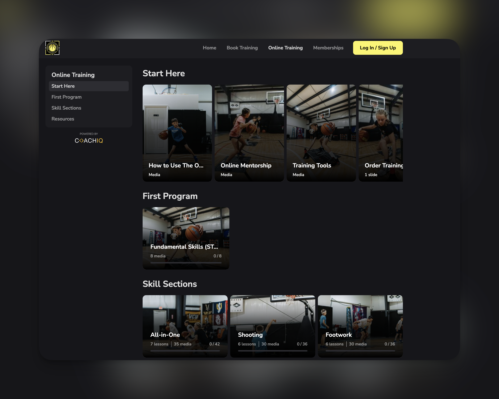
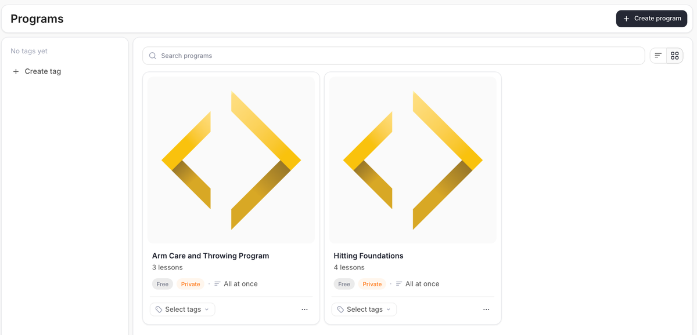

The Content section of CoachIQ is where you create, organize, and deliver online training programs to your athletes. Whether you're building follow-along workout videos, digital coaching courses, or skill development content—this is your hub for creating and selling training content that athletes access through the CoachIQ app.

<Info>
  **Where to find it:** **Content** in the sidebar, with **Media Hub**, **Programs** and **Video Analysis** under it.
</Info>

## How online coaching content works in CoachIQ

Think of CoachIQ's content system like building an online course: you gather your training videos and images ([Media Hub](/content/media-overview)), create engaging interactive lessons ([Lesson Builder](/content/lesson-overview)), and package everything into a training program your athletes can access ([Programs](/content/programs-overview)).

Here's the key insight: **Athletes only see Programs**. They never access your Media Hub or see your raw lessons—they open the program you've put together for them in [your app](/athlete-portal/understanding-your-athlete-portal).

<CardGroup cols={3}>
  <Card title="Media Hub" icon="photo-film">
    **Your storage**

    Upload and organize all your images and videos. This is your content library.
  </Card>
  <Card title="Lessons" icon="presentation-screen">
    **Your building blocks**

    Create interactive, swipeable experiences using your media. Think Instagram Stories for coaching.
  </Card>
  <Card title="Programs" icon="rectangle-history">
    **Your delivery**

    Package lessons and media into structured courses that athletes access in the app.
  </Card>
</CardGroup>

## How to create training content for athletes

<Steps>
  <Step title="Upload your media">
    Add videos, images, and training content to your Media Hub. Organize with tags for easy access later.

    _Example: Upload 10 shooting drill videos and tag them "Shooting Drills"_
  </Step>
  <Step title="Create lessons (optional but powerful)">
    Build interactive lessons using your media. Add text overlays, quizzes, buttons, and even let athletes upload their own videos for review.

    _Example: Create a "Shooting Form Basics" lesson with 5 slides—video demo, key points, quiz, and upload prompt_
  </Step>
  <Step title="Build your program">
    Combine lessons and standalone media into a structured program. Set the order, choose how content unlocks, and decide on pricing.

    _Example: Create "30-Day Shooting Program" with 10 lessons and 5 bonus drill videos_
  </Step>
  <Step title="Share with athletes">
    Make the program Free or Paid, open to everyone or only athletes you pick, and add it to [your app](/athlete-portal/content). See [Share and sell programs](/content/sharing-programs).

    _Example: Sell access for \$49, or assign it free to your current training clients_
  </Step>
</Steps>

## How athletes access your training programs

When an athlete opens your program in their app, they see:

- **Program overview**: Your thumbnail, title, and chapter list
- **Progress tracking**: Which chapters they've completed (e.g., "3 of 10 complete")
- **Lesson experience**: Swipeable, Instagram Stories-style content they tap through
- **Interactive elements**: Quizzes to answer, forms to fill out, videos to watch

<Frame>
  
</Frame>

## Understanding Media Hub, Lessons, and Programs

### Media Hub

Your library of videos, images and lessons. Upload or record files, tag them, and use them in lessons and programs. Replacing a file in Media Hub updates every lesson and program that uses it. See [Media Hub](/content/media-overview).

### Lessons

Slide-by-slide content athletes swipe through. Each slide can hold:

| Element    | What it does                                            |
| ---------- | ------------------------------------------------------- |
| **Media**  | Video or image from your Media Hub                      |
| **Text**   | Text with colors and backgrounds                        |
| **Upload** | Athletes send you a video, photo or file                |
| **Button** | Go to the next slide, open a link, or download a file   |
| **Quiz**   | Multiple choice question                                |
| **Form**   | Free-text answer                                        |

See [Create a lesson](/content/lesson-overview).

### Programs

The ordered list of lessons and media athletes open in your app. You choose how athletes move through it:

| Option            | How it works                         | Best for                               |
| ----------------- | ------------------------------------ | -------------------------------------- |
| **All at once**   | Every item opens right away          | Drill libraries, reference content     |
| **In order**      | Finish one item to open the next     | Courses where each step builds on the last |
| **On a schedule** | Items open on a set day or date      | Week-by-week plans, memberships        |

<Frame>
  
</Frame>

## How to sell or share your coaching programs

Each program has a **Price** (**Free** or **Paid**) and a **Who sees it** setting (**Everyone** or **Athletes you pick**). You can combine them, for example a Paid program only certain clients can buy.

<Info>
  **Connecting to payments:** a Paid program is unlocked by one or more [products](/payments/product-overview) from your club. Anyone who buys one of them can open the program. A Paid program can't be saved without a product. See [Share and sell programs](/content/sharing-programs).
</Info>

## Ways coaches use digital training content

<AccordionGroup>
  <Accordion title="Sell an online training course">
    Create a program with structured lessons covering your training methodology. Set it to **In order** so athletes work through content in sequence. Make it **Paid** with a one-time product or a membership.
  </Accordion>
  <Accordion title="Deliver bonus content to in-person clients">
    Upload workout videos and create programs your current athletes can access for free. Set **Who sees it** to **Athletes you pick** and pick those clients. They get at-home workouts that complement their in-person sessions.
  </Accordion>
  <Accordion title="Run a video analysis service">
    Create lessons with an Upload element where athletes send videos of themselves. Review their submissions in [Video Analysis](/content/video-analysis#review-athlete-submissions) and record your feedback. Great for remote coaching or form checks.
  </Accordion>
  <Accordion title="Build a certification program">
    Structure lessons with quizzes and forms to assess understanding. Use **In order** so athletes finish each section before the next. Track completion through program stats.
  </Accordion>
</AccordionGroup>

## Tips for creating online coaching content

<Warning>
  **No auto-save in builders:** save the lesson builder with **Save changes** and the program builder with **Update program**. Both ask before you leave with unsaved changes.
</Warning>

**Quick tips for success:**

- **Start with media**: Upload your videos and images first. Everything else builds on your media library.
- **Keep lessons focused**: Each lesson should cover one concept or drill. It's better to have more short lessons than fewer long ones.
- **Test as an athlete**: Use the preview feature to see exactly what athletes will experience before publishing.
- **Organize with tags**: Good tagging in Media Hub makes building lessons and programs much faster.

## Next steps

<CardGroup cols={2}>
  <Card title="Uploading & Organizing Media" icon="cloud-arrow-up" href="/content/media-overview">
    Start by getting your videos and images into CoachIQ's Media Hub.
  </Card>
  <Card title="Creating Interactive Lessons" icon="presentation-screen" href="/content/lesson-overview">
    Learn how to build engaging, swipeable lessons your athletes will love.
  </Card>
  <Card title="Building Programs" icon="rectangle-history" href="/content/programs-overview">
    Package your content into structured programs athletes can access.
  </Card>
  <Card title="Sharing & Selling Programs" icon="share-nodes" href="/content/sharing-programs">
    Configure pricing, access, and delivery options for your programs.
  </Card>
</CardGroup>

## Frequently asked questions about CoachIQ content

<AccordionGroup>
  <Accordion title="Do I need to create lessons, or can I just add videos to a program?">
    You can do either! Programs support both interactive lessons AND standalone media files. If you just want to share a collection of videos, add them directly as media. If you want a more engaging experience with text, quizzes, and athlete uploads, create lessons.
  </Accordion>
  <Accordion title="Can athletes download my videos?">
    By default, athletes stream content—they don't download it. If you want to provide downloadable files, use a Button element in a lesson with the "downloadable link" option.
  </Accordion>
  <Accordion title="Where do quiz and form responses go?">
    All responses from quizzes and forms within lessons are collected at the program level. You can view them in the Stats section of your Program Builder.
  </Accordion>
  <Accordion title="Can I use the same lesson in multiple programs?">
    Yes! Once you create a lesson, it appears in your Media Hub and can be added to any program. This is great for reusing foundational content across different courses.
  </Accordion>
  <Accordion title="What's the difference between Media Hub and Google Drive?">
    Media Hub is your replacement for Google Drive within CoachIQ. It's built specifically for coaching content—easier to organize, directly integrates with lessons and programs, and your athletes access content through a professional app experience rather than shared links.
  </Accordion>
</AccordionGroup>

## Related articles

<CardGroup cols={2}>
  <Card title="Understanding Products" icon="credit-card" href="/payments/product-overview">
    Create the payment products you link to paid programs.
  </Card>
  <Card title="Attach Products to Content" icon="credit-card" href="/payments/attach-products">
    Learn how to connect products to programs for paid access.
  </Card>
  <Card title="Your app" icon="mobile" href="/athlete-portal/understanding-your-athlete-portal">
    Configure the branded app where athletes access your programs and content.
  </Card>
  <Card title="Content in your app" icon="mobile" href="/athlete-portal/content">
    Manage which programs and content appear in your athlete app.
  </Card>
</CardGroup>