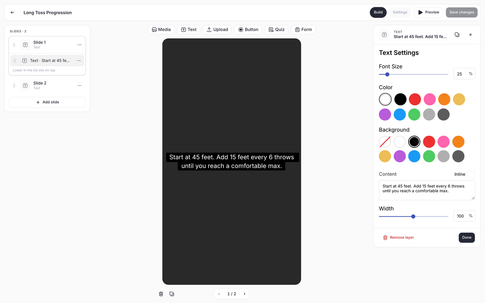
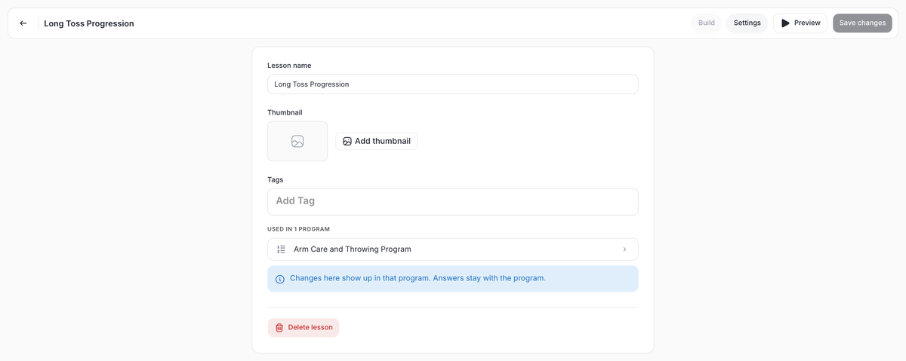

Lessons are interactive, slide-based content your athletes swipe through—like Instagram Stories, but for coaching. Each lesson can combine videos, images, text, quizzes, and more into an engaging experience that goes beyond just watching a video.

<Info>
  **Where to find it:** **Content → Media Hub → Create lesson**. Existing lessons are in Media Hub; filter by **Lessons** to see only them.
</Info>

## What lessons are for

Unlike a single video, a lesson lets you:

- **Put text and instructions** on top of your media
- **Ask quiz questions** to check understanding
- **Collect written answers** with a form
- **Have athletes upload** their own videos for you to review
- **Add buttons** that move to the next slide, open a web page or download a file

<Tip>
  **Best for:** skill breakdowns, drill explanations, form checks, and anything where you want athletes to do something, not only watch.
</Tip>

## Create a lesson

<Steps>
  <Step title="Start the lesson">
    Go to **Content → Media Hub** and click **Create lesson**. Choose **Blank** to start new, or **Copy Existing** and pick a lesson to start from a copy.
  </Step>
  <Step title="Name it">
    Click **Settings** in the top bar and fill in the **Lesson name**. Add a **Thumbnail** and **Tags** if you like (more in [Lesson settings](#lesson-settings)).
  </Step>
  <Step title="Add your first slide">
    Click **Build**. A new lesson starts with no slides and says **No slides yet**. Click **Add slide**.
  </Step>
  <Step title="Add content to the slide">
    Use the buttons above the slide: **Media**, **Text**, **Upload**, **Button**, **Quiz** and **Form**. Each one adds a layer to the slide. See the [lesson elements guide](/content/lesson-components) for each one.
  </Step>
  <Step title="Add more slides">
    Click **Add slide** under the slide list. Athletes swipe through slides in the order of the list.
  </Step>
  <Step title="Preview">
    Click **Preview** to see the lesson the way athletes do. Preview turns on once the lesson has at least one slide.
  </Step>
  <Step title="Save">
    Click **Save changes** at the top right.
  </Step>
</Steps>

<Warning>
  The lesson builder doesn't save on its own. If you click the back arrow with unsaved changes, CoachIQ asks whether to save or discard them.
</Warning>

## The lesson builder

<Frame>
  
</Frame>

| Area | What it does |
| --- | --- |
| **Build / Settings / Preview** (top bar) | Build edits the slides. Settings holds the name, thumbnail, tags and where the lesson is used. Preview shows it as athletes see it. |
| **Save changes** (top right) | Saves the lesson. |
| **Slides** (left) | Every slide, with its layers listed under it. Click a slide to edit it. |
| **Element buttons** (above the slide) | **Media**, **Text**, **Upload**, **Button**, **Quiz**, **Form**. |
| **Slide** (middle) | A phone-sized view of the current slide. Use the arrows under it to move between slides, and the icons to delete or duplicate the slide. |
| **Layer settings** (right) | Settings for the selected layer, with **Remove layer** and **Done**. |

## Work with slides and layers

- **Add a slide:** click **Add slide**.
- **Reorder slides:** drag a slide up or down in the list, or use its **⋯** menu.
- **Duplicate or delete a slide:** use the icons under the slide, or the slide's **⋯** menu. A deleted slide can't be brought back.
- **Layers:** each slide lists its layers. Lower in the list sits on top, so drag a layer down to put it in front. Media layers show the file's Media Hub title.

<Note>
  There's no limit on slides, but short, focused lessons (5 to 15 slides) tend to work better than long ones.
</Note>

## Lesson settings

Click **Settings** in the top bar.

<Frame>
  
</Frame>

- **Lesson name**, **Thumbnail** and **Tags**.
- **Used in**: the programs that use this lesson. Changes to the lesson show up in those programs. Answers stay with each program.
- **Delete lesson**: before anything is deleted, CoachIQ names the programs that will lose the lesson. Deleting a lesson from Media Hub shows the same warning.

## The six lesson elements

Each slide can contain multiple elements layered on top of each other. Here's a quick overview:

| Element    | Icon | Purpose                                      |
| ---------- | ---- | -------------------------------------------- |
| **Media**  | ▶    | Add videos or images from your Media Hub     |
| **Text**   | TT   | Add customizable text overlays               |
| **Button** | 👆   | Navigation buttons, links, or file downloads |
| **Quiz**   | ❓    | Multiple choice questions                    |
| **Form**   | 📋   | Free-text input fields                       |
| **Upload** | 📎   | Let athletes upload their own content        |

<Info>
  For detailed instructions on configuring each element, see the [Lesson Components Guide](/content/lesson-components).
</Info>

## How athletes experience lessons

When athletes open a lesson inside a [program](/content/programs-overview), they see:

1. **A full-screen view** of the first slide
2. **Progress dots at the top** showing how many slides are left
3. **Swipe or tap arrows** to move between slides
4. **Elements they can use**: answer quizzes, fill in forms, upload videos
5. **Completion tracking** so they know when they've finished

A lesson with no slides says **This lesson has no content yet.** with a button to the next lesson or back to programs. If a lesson can't load, athletes see **Couldn't load this lesson.** with **Try again**.

## Where lesson responses go

When athletes interact with your lesson elements:

| Element    | Where responses go                      |
| ---------- | --------------------------------------- |
| **Quiz**   | Collected in the parent Program's Stats |
| **Form**   | Collected in the parent Program's Stats |
| **Upload** | Collected in the parent Program's Stats |

<Note>
  Responses are tied to the Program, not the individual lesson. This means you access all athlete submissions from the Program Builder's Stats view.
</Note>

## Tips for creating effective lessons

<CardGroup cols={2}>
  <Card title="Start with media" icon="photo-film">
    Begin each slide with a video or image, then layer text and other elements on top. This creates visual interest and context.
  </Card>
  <Card title="Keep slides focused" icon="bullseye">
    One concept per slide. If you're explaining multiple things, split them across slides rather than cramming everything onto one.
  </Card>
  <Card title="Use buttons for pacing" icon="computer-mouse">
    Add a "Next" button instead of relying on swipe navigation. This ensures athletes acknowledge each slide before moving on.
  </Card>
  <Card title="Save often" icon="floppy-disk">
    Click Save changes as you go. The builder doesn't save on its own.
  </Card>
</CardGroup>

## Common lesson patterns

<AccordionGroup>
  <Accordion title="Drill breakdown lesson">
    **Slide 1**: Full video demonstration

    **Slide 2**: Key point #1 with text overlay on still image

    **Slide 3**: Key point #2 with text overlay

    **Slide 4**: Quiz checking understanding

    **Slide 5**: Upload element for athlete to submit their attempt
  </Accordion>
  <Accordion title="Educational content lesson">
    **Slide 1**: Introduction video from you

    **Slides 2-5**: Key concepts with images and text

    **Slide 6**: Quiz on the material

    **Slide 7**: Form asking athletes to reflect on what they learned
  </Accordion>
  <Accordion title="Form check / video review lesson">
    **Slide 1**: Example of correct form (video)

    **Slide 2**: Common mistakes to avoid (text + images)

    **Slide 3**: Upload element for athlete to submit their form video

    **Slide 4**: Thank you message with next steps
  </Accordion>
</AccordionGroup>

## Frequently asked questions about lessons

<AccordionGroup>
  <Accordion title="Can I use the same lesson in multiple programs?">
    Yes! Once created, lessons appear in your Media Hub and can be added to any program. This is great for reusing foundational content across different courses.
  </Accordion>
  <Accordion title="How do I edit an existing lesson?">
    In Media Hub, click the lesson to open it. Inside a program, open the lesson's **⋯** menu or panel and choose **Edit lesson**.
  </Accordion>
  <Accordion title="Can I add multiple elements to one slide?">
    Yes. Each slide can have unlimited elements layered on top of each other. For example, a video with a text overlay and a button at the bottom.
  </Accordion>
  <Accordion title="What's the difference between Quiz and Form?">
    **Quiz** provides multiple choice options—athletes tap to select their answer. **Form** provides a free-text field—athletes type their own response. Use Quiz for quick checks, Form for reflection and open-ended questions.
  </Accordion>
  <Accordion title="Are quizzes graded?">
    No. Quizzes in CoachIQ are for engagement and feedback collection, not formal assessment. There's no pass/fail or scoring—you simply see what athletes selected.
  </Accordion>
  <Accordion title="What's the Upload element for?">
    The Upload element lets athletes submit their own videos, images, or files. It's designed for them to upload content (like a video of themselves doing a drill), NOT for coaches to add content. Use the Media element to add your own videos and images.
  </Accordion>
  <Accordion title="Why did my changes disappear?">
    The lesson builder doesn't save on its own. If you closed the browser without clicking **Save changes**, the changes weren't saved. The back arrow always asks first when there are unsaved changes.
  </Accordion>
</AccordionGroup>

## Next steps

<CardGroup cols={2}>
  <Card title="Lesson Elements Guide" icon="layer-group" href="/content/lesson-components">
    Deep dive into configuring each of the six element types—Media, Text, Button, Quiz, Form, and Upload.
  </Card>
  <Card title="Build a Program" icon="rectangle-history" href="/content/programs-overview">
    Package your lessons into structured programs athletes can access.
  </Card>
</CardGroup>

## Related articles

<CardGroup cols={2}>
  <Card title="Uploading & Organizing Media" icon="video" href="/content/media-overview">
    Get your videos and images into Media Hub before building lessons.
  </Card>
  <Card title="Sharing & Selling Programs" icon="credit-card" href="/content/sharing-programs">
    Configure pricing and access for the programs that contain your lessons.
  </Card>
  <Card title="Programs in your app" icon="mobile" href="/app/content">
    Control which programs athletes see in your app.
  </Card>
  <Card title="Creating Your First Scheduler" icon="calendar" href="/scheduling/creating-your-first-scheduler">
    Pair your training content with scheduling so athletes can book sessions.
  </Card>
</CardGroup>