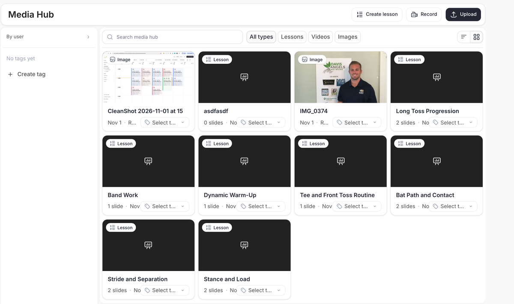
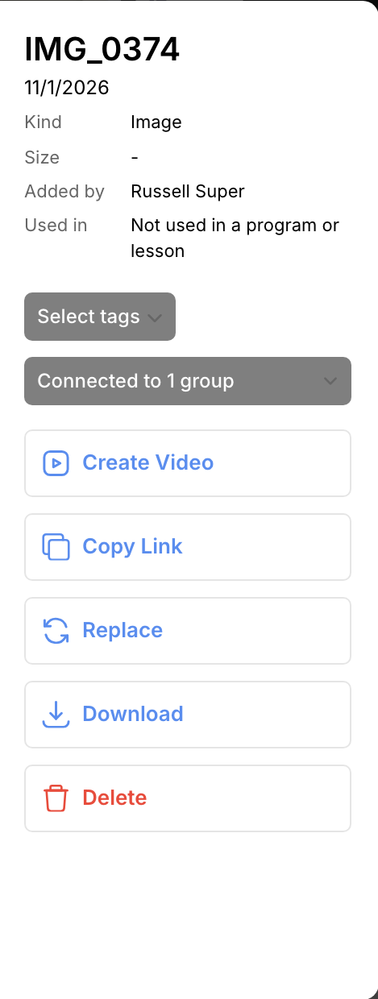

Media Hub is your central storage for all videos and images in CoachIQ. Upload your training content here, organize it with tags, then pull it into [lessons](/content/lesson-overview) and [programs](/content/programs-overview).

<Info>
  **Where to find it:** **Content → Media Hub**
</Info>

<Frame>
  
</Frame>

Media Hub holds three kinds of things: **videos**, **images** and **lessons**. The buttons at the top right add each one:

| Button | What it does |
| --- | --- |
| **Upload** | Upload videos, images or other files from your computer. |
| **Record** | Record your screen, a window or a tab, with your camera and microphone if you like. The recording is saved to Media Hub. |
| **Create lesson** | Opens the [lesson builder](/content/lesson-overview). |

## Upload files

<Steps>
  <Step title="Open Media Hub">
    Go to **Content → Media Hub**.
  </Step>
  <Step title="Click Upload">
    Click **Upload** at the top right and choose one or more files from your computer.
  </Step>
  <Step title="Wait for processing">
    Files upload and process on their own. A long video may show **Taking longer than expected**; leave the tab open and the tile turns into a playable video as soon as it's ready. **Check again** starts the check over.
  </Step>
</Steps>

<Note>
  Follow the file-type and size checks shown by the upload method you use. Imports through the CoachIQ AI connection have their own supported formats and limits; see [Import a file with AI](/settings/ai-workflows#import-a-file-from-a-public-link).
</Note>

### Files without an in-app preview

Some files cannot be previewed inside CoachIQ. The details view shows the file name and type with **Download File** instead of an unsupported preview. Use that control to open the original in an appropriate app.

### Organize media with ChatGPT or Claude

Once connected to CoachIQ, your assistant can find, rename, and tag media, import supported files from a public link, and attach media to a program step or lesson slide. See [AI workflows](/settings/ai-workflows#find-and-organize-media) for copyable prompts and the limits of usage checks. A usage lookup does not include every possible place a file has been used, including sent Inbox messages. When a connected app asks to remove a file or a tag, nothing changes until you approve it in **Settings → Connections → App activity**; see [Connections](/settings/connections).

## Find and filter media

| Control | What it does |
| --- | --- |
| **Search media hub** | Find files and lessons by name. Changing or clearing the search starts the list over from the top. |
| **All types / Lessons / Videos / Images** | Show everything, or only one kind. |
| **By user** (left) | Show only what one person added. Useful when several coaches upload. |
| **Tags** (left) | Show only items with a tag. |
| List and grid icons (top right) | Switch views. |

## Organize with tags

Tags keep a growing library manageable, for example **Drills**, **Game film** or **Hitting**.

- **Create a tag:** click **Create tag** in the left panel.
- **Tag one item:** use **Select tags** on its tile or in its details.
- **Tag several items:** select them, then use the bulk actions to tag them together.

Tags work the same way on lessons and on [programs](/content/programs-overview).

<Tip>
  Set up your main tags before uploading a big batch. It's easier to tag as you go than to sort later.
</Tip>

## File details

Click a video or image to open its details.

<Frame>
  
</Frame>

- **Kind**, **Size**, **Added by** and **Used in** (the programs and lessons that use the file, including programs that use it as their cover).
- **Select tags** and **Connected to … group**: which of your groups the file is shared with.
- **Create Video**: opens the file in [Video Analysis](/content/video-analysis).
- **Copy Link**: copies a link anyone can use to open the file. A link to a file that no longer exists says the file wasn't found.
- **Replace**, **Download** and **Delete** (below).

**Rename** and **Delete** show only to the person who uploaded the file and to club Admins. If a change is refused, you see a message and nothing changes.

## Using media in lessons and programs

Media you upload here is available throughout CoachIQ:

- **In the [Lesson Builder](/content/lesson-overview)** — Add media as slides in your interactive lessons
- **In the [Program Builder](/content/programs-overview)** — Add standalone videos or images directly to program chapters
- **On your Website** — Pull images and videos into website sections

<Info>
  Lessons, programs and messages point to the file in Media Hub, so replacing it there updates them all. Program covers, website sections and forms keep their own copy of the image and don't change.
</Info>

## Replace a file

Use **Replace** when you've made a better version of a video or image and want every lesson, program and message that uses it to show the new one.

1. Open the file and click **Replace**.
2. Choose the new file. An image can only be replaced by an image, and a video by a video.
3. The new file uploads into the same Media Hub item. Its name, tags, groups and **Used in** list stay the same. Videos process the same way as a new upload.

Program covers, website sections and forms that copied the file keep the old one. The Replace window reminds you.

## Share a file with your other groups

If you coach in more than one group, use **Connected to … group** in a file's details to share it. The list shows only groups where you're an accepted Admin or Coach, plus groups the file is already shared with. If a share is refused, the reason shows and the group isn't marked as shared.

## Delete files

Open a file and click **Delete**, or select several items and delete them together.

Before anything is deleted, the warning tells you what will lose the file: the lessons and programs that use it (including programs that use it as their cover) and any sent Inbox messages it's attached to. Deleting a lesson names the programs that will lose it. If the check can't list every use, the warning says "There may be more: the check could not list every use."

<Warning>
  Deleting a file removes it from the lessons, programs and sent Inbox messages that use it. Keep feedback videos in Media Hub for as long as athletes need them.
</Warning>

### Before deleting a file you have sent

If selected media is attached to sent Inbox messages, the delete confirmation shows how many messages will lose it and warns that recipients are affected. This applies to both single-file and bulk deletion. Review that warning before choosing **Delete anyway**.

If a conversation shows **Attachment no longer available**, the shared file may have been deleted. If you still have the original, upload it again and send a new message with the attachment. Re-uploading does not restore the old message attachment. See [Message attachments](/inbox/attaching-forms-schedulers-and-products#when-a-shared-file-is-deleted).

## Next steps

<CardGroup cols={2}>
  <Card title="Creating Interactive Lessons" icon="presentation-screen" href="/content/lesson-overview">
    Turn your media into engaging, swipeable lessons athletes tap through.
  </Card>
  <Card title="Building Programs" icon="rectangle-history" href="/content/programs-overview">
    Package lessons and media into structured programs athletes can access.
  </Card>
  <Card title="Video Analysis" icon="video" href="/content/video-analysis">
    Record and annotate video feedback for your athletes.
  </Card>
  <Card title="Content Overview" icon="photo-film" href="/content/content-overview">
    Learn how Media Hub, Lessons, and Programs work together.
  </Card>
</CardGroup>

## Related articles

<CardGroup cols={2}>
  <Card title="Lesson Elements Guide" icon="video" href="/content/lesson-components">
    Learn how each lesson element uses your media to create interactive experiences.
  </Card>
  <Card title="Sharing & Selling Programs" icon="credit-card" href="/content/sharing-programs">
    Configure pricing and access for programs that use your media.
  </Card>
  <Card title="Content in your app" icon="mobile" href="/app/content">
    Manage how athletes discover and access your content in the app.
  </Card>
  <Card title="Understanding Products" icon="credit-card" href="/payments/product-overview">
    Create payment products to monetize programs built from your media.
  </Card>
</CardGroup>
