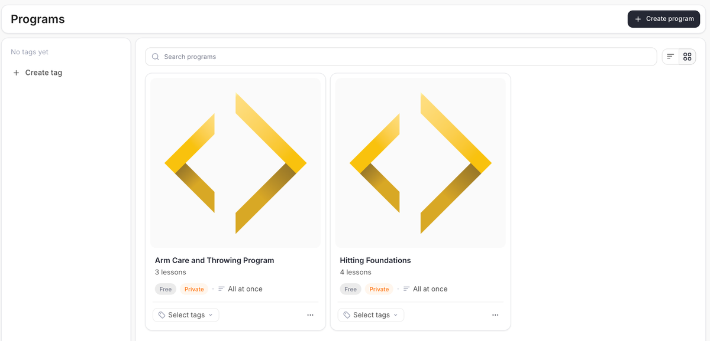
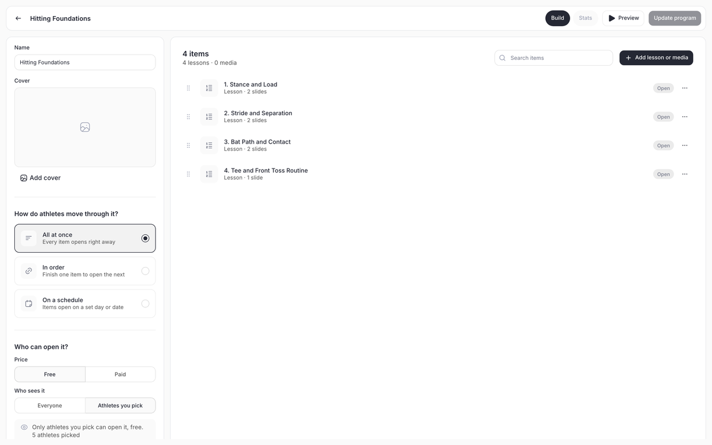
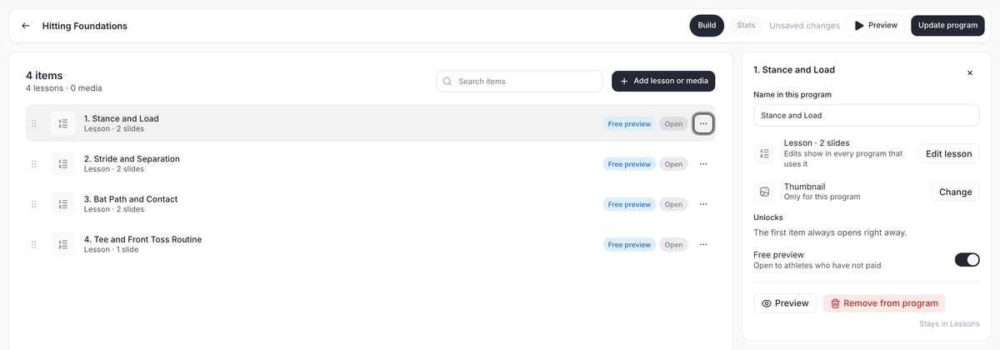
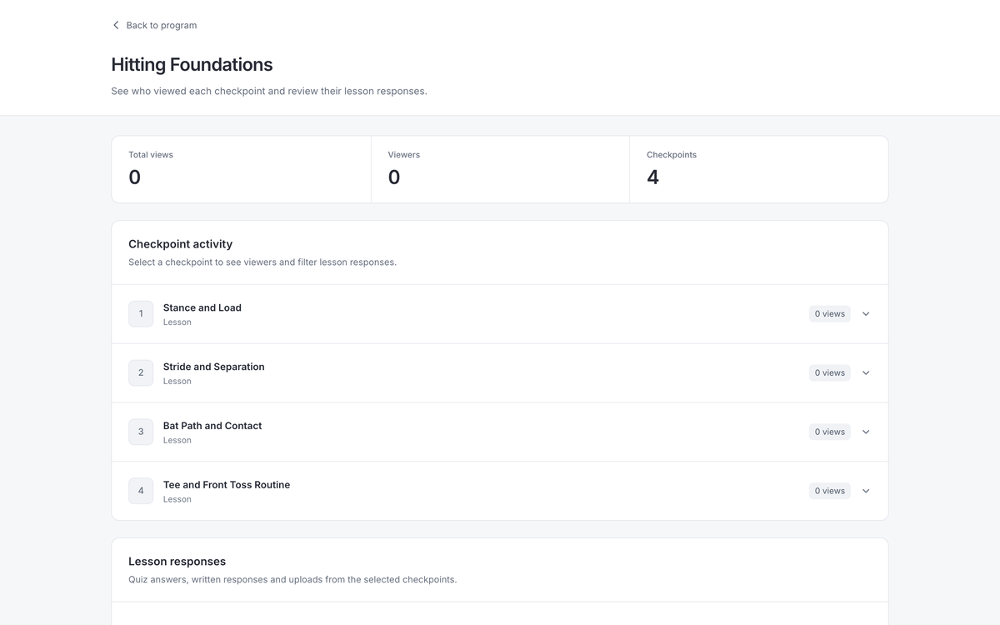

A program is what athletes actually open in your app. It holds an ordered list of [lessons](/content/lesson-overview) and [Media Hub](/content/media-overview) files, decides how athletes move through them, and decides who can open it. Lessons and files live in Media Hub; a program puts them in order and hands them to athletes.

<Info>
  **Where to find it:** **Content → Programs**
</Info>

<Frame>
  
</Frame>

## The Programs page

Each program shows as a card with its cover, name, number of lessons, its price (**Free** or **Paid**), **Private** when only athletes you pick can open it, and how athletes move through it (for example **All at once**). From the page you can:

- **Search programs** by name. If nothing matches you see **No programs match this search.** If the list fails to load you see **Programs could not be loaded.** with **Try again**.
- Filter by tag from the left panel, or **Create tag** to start one. Add tags to a program with **Select tags** on its card.
- Switch between the list and grid views at the top right.
- Open the **⋯** menu on a card for **Who can open it**, **View stats**, **Duplicate** and **Delete**.

Click a card to open it in the program builder.

## Create a program

<Steps>
  <Step title="Start a new program">
    On **Content → Programs**, click **Create program**. Choose **New** to start empty, or **Copy existing** and pick a program to start from a copy of it.
  </Step>
  <Step title="Name it and add a cover">
    Type the **Name** athletes will see and click **Add cover** to pick an image from Media Hub.
  </Step>
  <Step title="Add lessons and media">
    Click **Add lesson or media**, choose **Lesson** or **Media**, and pick what to add. Lessons with nothing on them yet are marked **No slides** in the picker.
  </Step>
  <Step title="Put the items in order">
    Drag items by the handle on the left, or use **Move up** and **Move down** in an item's **⋯** menu. Athletes see items in this order.
  </Step>
  <Step title="Choose how athletes move through it">
    Under **How do athletes move through it?**, pick **All at once**, **In order** or **On a schedule** ([see below](#how-athletes-move-through-a-program)).
  </Step>
  <Step title="Choose who can open it">
    Under **Who can open it?**, set **Price** and **Who sees it**. Paid programs need at least one product. See [Share and sell programs](/content/sharing-programs).
  </Step>
  <Step title="Save">
    Click **Update program**. The top bar shows **Unsaved changes** until you do.
  </Step>
</Steps>

<Note>
  A copied program starts with **no assigned athletes and no product links**, even if the original had them. Its items, order and timing are copied. Add athletes and products again in **Who can open it?** before you share it.
</Note>

<Warning>
  The program builder doesn't save on its own. If you click the back arrow with unsaved changes, CoachIQ asks whether to save or discard them. With no changes, back leaves right away.
</Warning>

## The program builder

<Frame>
  
</Frame>

| Area | What it does |
| --- | --- |
| **Build / Stats / Preview** (top bar) | Build edits the program. [Stats](#see-who-viewed-each-item) shows views and lesson responses. [Preview](#preview-the-program) shows it the way athletes see it. |
| **Update program** (top right) | Saves everything. |
| **Name** and **Cover** (left) | What athletes see on the program card. |
| **How do athletes move through it?** (left) | All at once, In order or On a schedule. |
| **Who can open it?** (left) | Price (Free or Paid) and who sees it (Everyone or Athletes you pick). |
| **Items** (right) | The lessons and media in the program, with **Search items** and **Add lesson or media**. Each row shows its type, slide count and when it opens. |

## Edit an item

Click an item, or choose **Settings** from its **⋯** menu, to open its panel on the right.

<Frame>
  
</Frame>

| Setting | What it does |
| --- | --- |
| **Name in this program** | The title athletes see for this item in this program only. |
| **Edit lesson** | Opens the lesson in the lesson builder. Lesson edits show in every program that uses the lesson. |
| **Thumbnail** → **Change** | The picture for this item in this program only. |
| **Unlocks** | When this item opens for an athlete (see below). The first item always opens right away. |
| **Free preview** | Shown when the program is Paid. Turn it on to let athletes open this item before they buy. |
| **Preview** | Opens the item as athletes see it. |
| **Remove from program** | Takes the item out of this program. The lesson or file stays in Media Hub. |

The **⋯** menu on each row also has **Edit lesson**, **Change thumbnail**, **Preview**, **Move up**, **Move down** and **Remove from program**.

## How athletes move through a program

| Option | What athletes get | Good for |
| --- | --- | --- |
| **All at once** | Every item opens right away. | Drill libraries, reference content |
| **In order** | They finish one item to open the next. | Courses where each step builds on the last |
| **On a schedule** | Items open on a set day or date. | Week-by-week plans, camps, ongoing memberships |

With **On a schedule**, open an item and set **Opens** to **Days after they start** (counted from the day each athlete starts the program) or **On a date**. Athletes see the real opening date and time for a future item, in their own time zone, and it stays locked until then.

When you switch options, CoachIQ asks you to confirm, for example **Switch to On a schedule?** The new rule applies once you click **Update program**. Anything an athlete already opened stays open.

## Preview the program

Click **Preview** in the top bar to see the program the way an athlete does: the cover, the list of items with their slide counts, and the **Begin Program** button. A lesson with nothing on it says **This lesson has no content yet.**

Admins of your club don't see athletes' locks when they open a program. Each item shows the rule athletes follow instead, so you can check every item without buying it.

## See who viewed each item

Click **Stats** in the top bar, or **View stats** in a program card's **⋯** menu.

<Frame>
  
</Frame>

- **Total views**, **Viewers** and **Checkpoints** (items) across the top.
- **Checkpoint activity**: select an item to see who viewed it and to filter the responses below.
- **Lesson responses**: quiz answers, written responses and uploads from the selected items. An upload shows once the file has finished saving to the athlete's lesson, with the time in your own time zone.

Each program keeps its own stats and responses, even when the same lesson is in several programs.

## What athletes see

- **Locked items** show a lock with the reason. On a Paid program, items that need the program to be bought say **Purchase to unlock**. Free preview items open for everyone.
- **Future items** on a schedule show the date and time they open.
- **Finished programs:** if an athlete's access to a paid program ends after they finished it, the program keeps its **Purchase Program** button and their completed lessons keep their checkmarks, with a note to purchase to open them again.
- **Families:** a program bought for a child opens for that child in the parent's account. When one child already has a program and another doesn't, the parent sees **Purchase for another child** under **Begin Program**.
- **Broken items:** if one item has lost its lesson or video, the program still loads and that item is left out.

## Delete a program

Open the **⋯** menu on the program's card and choose **Delete**. Deleting a program doesn't delete its lessons or files; they stay in Media Hub.

## Common questions

<AccordionGroup>
  <Accordion title="Can I use the same lesson in several programs?">
    Yes. A lesson can sit in as many programs as you like. Edits to the lesson show in all of them, and each program keeps its own answers. The lesson's **Settings** tab lists the programs that use it.
  </Accordion>
  <Accordion title="What's the difference between a lesson and a media item in a program?">
    A lesson is a set of slides with text, quizzes, forms, uploads and buttons. A media item is one video or image that athletes watch or view. Use a lesson when you want athletes to do something; use media when you only need them to watch.
  </Accordion>
  <Accordion title="Can I change how athletes move through a program after they've started?">
    Yes. Anything an athlete already opened stays open. Items they haven't reached follow the new rule after you click **Update program**.
  </Accordion>
  <Accordion title="Is there a limit to how many items a program can have?">
    Programs used to stop at 50 items. That cap was raised in August 2026. There is still an upper limit; if you reach it, contact support. Long programs often read better split into levels.
  </Accordion>
  <Accordion title="Why isn't my lesson in the Add lesson or media list?">
    Save the lesson in the lesson builder first. New lessons appear in the list once they're saved.
  </Accordion>
  <Accordion title="What happens if I delete a lesson that's in a program?">
    It comes out of every program that uses it. Before anything is deleted, CoachIQ names the programs that will lose it. An old link to a deleted lesson or program opens a **Lesson not found** or **Program not found** page with a way back.
  </Accordion>
</AccordionGroup>

## Related articles

<CardGroup cols={2}>
  <Card title="Share and sell programs" icon="share-nodes" href="/content/sharing-programs">
    Free or paid, everyone or athletes you pick, and free previews.
  </Card>
  <Card title="Create lessons" icon="presentation-screen" href="/content/lesson-overview">
    Build the slide lessons you add to programs.
  </Card>
  <Card title="Media Hub" icon="images" href="/content/media-overview">
    Upload and organize the files programs use.
  </Card>
  <Card title="Content in your app" icon="mobile" href="/athlete-portal/content">
    Choose which programs show in your app.
  </Card>
</CardGroup>
