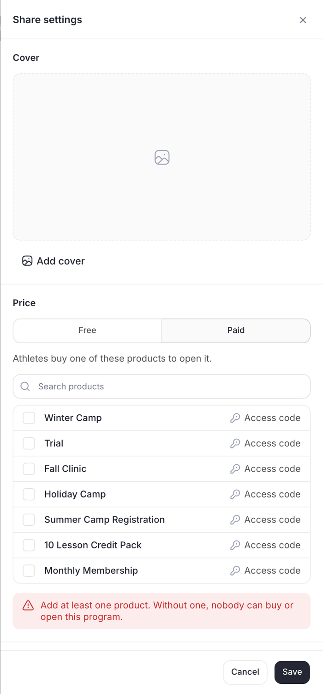

Every program has two access settings: whether it's **Free** or **Paid**, and whether **Everyone** or only **Athletes you pick** can see it. You set both in the program builder under **Who can open it?** To put the program in front of athletes, it also needs to be in your app's content.

## Choose who can open a program

<Steps>
  <Step title="Open the program">
    Go to **Content → Programs** and click the program. You can also choose **Who can open it** from the **⋯** menu on its card.
  </Step>
  <Step title="Set the price">
    Under **Who can open it?**, choose **Price**: **Free** or **Paid**.
  </Step>
  <Step title="Set who sees it">
    Choose **Who sees it**: **Everyone** or **Athletes you pick**. The line under the buttons says what you've set up, for example "Anyone in your app can open it after buying a product."
  </Step>
  <Step title="Pick products and athletes">
    Click **Choose products**, **Choose athletes** or **Products and athletes** to open **Share settings** (details below).
  </Step>
  <Step title="Save">
    Click **Save** in Share settings, then **Update program** in the builder.
  </Step>
</Steps>

| Price | Who sees it | What athletes get |
| --- | --- | --- |
| **Free** | **Everyone** | Anyone in your app can open it. |
| **Free** | **Athletes you pick** | Only athletes you pick can open it, free. |
| **Paid** | **Everyone** | Anyone in your app can open it after buying a product. |
| **Paid** | **Athletes you pick** | Only athletes you pick can open it, and they still buy a product first. |

## Share settings

<Frame>
  
</Frame>

- **Cover**: the program's cover image.
- **Price**: Free or Paid. With Paid, a searchable list of your products appears under "Athletes buy one of these products to open it." Tick every product that should unlock the program. Buying any one of them opens it.
- **Access**: turn on **Private program** ("Only athletes you assign can open it.") and pick the athletes. On a Paid program, athletes you assign still buy one of the products to open it.

Click **Save** to keep the changes, or **Cancel** to throw them away. If you go back with unsaved changes, CoachIQ asks whether to save. **Yes** saves exactly what's on screen; **No** keeps what was saved before.

Removing an athlete applies only to this program. If a removal can't be saved, you see an error with the reason, and nothing else changes.

## Paid programs need a product

A Paid program with no product can't be saved. The builder shows "Add at least one product. Without one, nobody can buy or open this program." and keeps your edits so you can fix it. Add a product, or switch to **Free**.

- Only products from this program's own club count. A product from another club can't make a program paid.
- CoachIQ never switches a Paid program to Free on its own.
- Create the products first in [Payments → Products](/payments/product-overview). One product can unlock several programs, which is how bundles and memberships work.

A product can still be linked to a **Free** program, for example after you switch a Paid program to Free, or when a product was attached from **Payments**. The builder and **Share settings** list that product and explain that a Free program opens without a purchase, so buying the product isn't needed. Unlink the product, or switch the program to **Paid** if it should be sold.

## Free previews

On a Paid program, each item in the list has a **Free preview** setting. Open an item and turn on **Free preview** ("Open to athletes who have not paid") to let athletes try it before they buy. Items without a free preview show a lock with **Purchase to unlock**.

## What people without access see

Athletes and visitors who haven't bought the program, been picked, or reached an item's opening date see the program's outline: its items, their order, slide counts and locks, with a way to buy. They don't get the lesson content or the full videos and files. The same rule applies to a direct link to a lesson, video or file in a paid program: buyers, picked athletes and staff can open it; everyone else is asked to buy first.

Access follows the person it was bought for. A program a parent buys for a child opens for that child. Archived purchases don't unlock programs.

## Put the program in your app

Access settings decide **who** can open a program. To show it in your app at all, add it to your app's content. See [Programs in your app](/app/content).

## Examples

<AccordionGroup>
  <Accordion title="Sell a course to anyone">
    1. Create a product in **Payments → Products**, for example "Shooting Course, \$79".
    2. In the program, set **Price** to **Paid** and **Who sees it** to **Everyone**.
    3. Click **Choose products**, tick the product and click **Save**.
    4. Turn on **Free preview** for the first lesson so people can try it.
    5. Click **Update program**, then add the program to your app.
  </Accordion>
  <Accordion title="Free extra content for your current clients">
    1. Set **Price** to **Free** and **Who sees it** to **Athletes you pick**.
    2. Click **Choose athletes**, pick each client and click **Save**.
    3. Click **Update program**.
  </Accordion>
  <Accordion title="A program library for members">
    1. Create a membership product, for example "Monthly Training, \$49/month".
    2. In each program, set **Price** to **Paid** and tick the membership in Share settings.
    3. Members can open every linked program. If their membership ends, access ends.
  </Accordion>
  <Accordion title="A paid program only certain clients can buy">
    1. Set **Price** to **Paid** and **Who sees it** to **Athletes you pick**.
    2. In Share settings, tick the product, turn on **Private program** and pick the clients.
    3. Only those clients see it, and they buy the product to open it.
  </Accordion>
</AccordionGroup>

## Common questions

<AccordionGroup>
  <Accordion title="I set up access but athletes can't see the program.">
    Check that the program is added to your app's content ([Programs in your app](/app/content)). Access settings decide who can open it; your app decides whether it shows.
  </Accordion>
  <Accordion title="Can I change the products after athletes have bought?">
    Yes. Athletes who already bought keep their access. New athletes buy one of the products linked now.
  </Accordion>
  <Accordion title="What happens if I switch a Paid program to Free?">
    It becomes free for everyone who can see it. People who already paid keep their access.
  </Accordion>
  <Accordion title="How do I remove someone from a program?">
    Open **Share settings**, remove the athlete from the picked list, click **Save**, then **Update program**.
  </Accordion>
  <Accordion title="Why doesn't a copied program have my athletes or products?">
    A copy starts with no picked athletes and no product links, so nobody gets access by accident. Add them in Share settings.
  </Accordion>
  <Accordion title="Can athletes share their access?">
    No. Access belongs to the athlete it was bought for or assigned to.
  </Accordion>
</AccordionGroup>

## Related articles

<CardGroup cols={2}>
  <Card title="Build a program" icon="rectangle-history" href="/content/programs-overview">
    Add lessons and media and choose how athletes move through them.
  </Card>
  <Card title="Create products" icon="credit-card" href="/payments/product-overview">
    Set up the products athletes buy to open paid programs.
  </Card>
  <Card title="Product builder" icon="credit-card" href="/payments/product-builder">
    Step-by-step product setup.
  </Card>
  <Card title="Programs in your app" icon="mobile" href="/app/content">
    Choose which programs show in your app.
  </Card>
</CardGroup>
