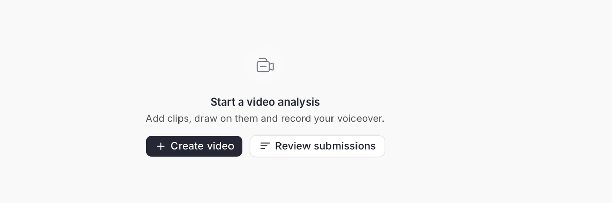
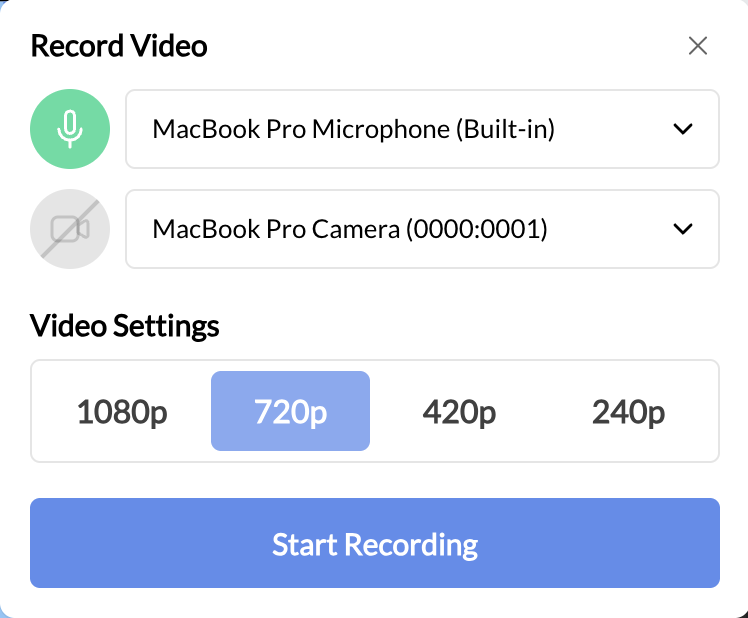
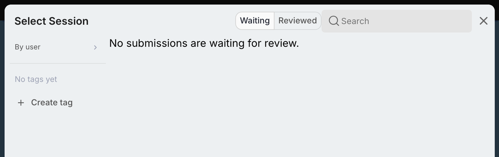
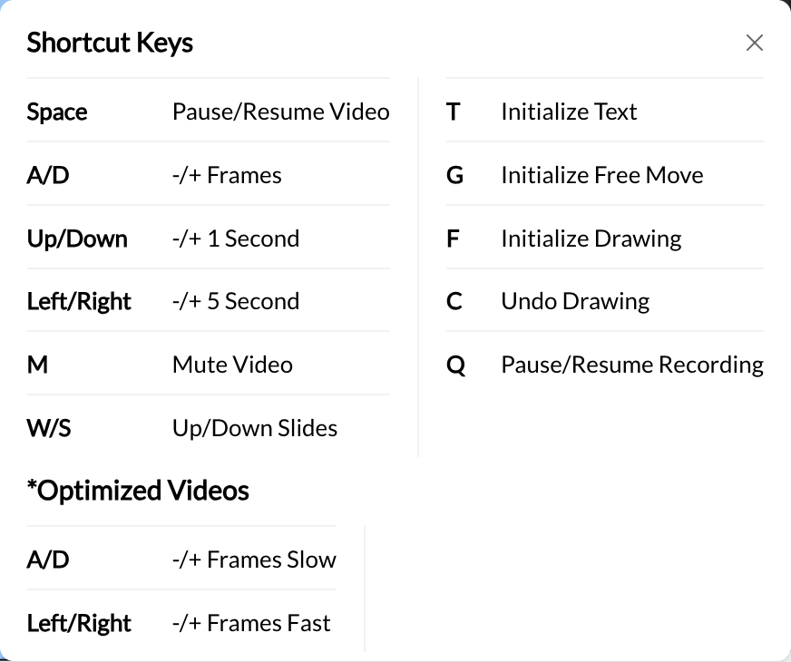

Use Video Analysis to explain a clip with playback controls, drawings, text, and recorded commentary. You can build several slides into one recording.

## Open the editor

- From **Content → Media Hub**, open a video and choose **Create Video** to load it for analysis.
- Or go to **Content → Video Analysis** and click **Create video**, then choose **Add Media** on the slide.
- To answer a video an athlete sent you, click **Review submissions** ([see below](#review-athlete-submissions)).

<Frame>

</Frame>

Wait for the source media to finish loading before recording. If you select several files at once and some can't be used (for example, a PDF with an image), Create Video skips them and opens the rest. If a file can't load, the editor explains why and offers a retry when one can help.

## Prepare the slides

Choose your orientation, layout, background, and optional logo before building the analysis. Add media to the slide, then use **Add slide** when you need another section. The slide strip on the right shows the current slide.

<Warning>

Changing the aspect ratio after preparing slides or drawings asks for confirmation. **No** keeps your work; **Yes** resets it to a blank slide. Choose the format first whenever possible.

</Warning>

Use the drawing, text, and move tools to prepare the points you want to explain. The **Camera** menu controls the camera presentation; recording setup lets you select the camera and microphone devices.

## Record your feedback

1. Choose **New Recording**.
2. Select the microphone and camera you want to use. Enable only the inputs you need.
3. Choose a resolution under **Video Settings**. The current options are **1080p**, **720p**, **420p**, and **240p**.
4. Choose **Start Recording** and confirm the timer starts.
5. Play or pause the source, move between slides, and draw or add text while explaining the clip. Use **Q** to pause or resume the recording.
6. Choose **Save** when your feedback is complete.

<Frame>

</Frame>

For long analyses, use shorter parts. A recording-size safeguard warns as the limit approaches and can stop and save the recording at the limit. The available duration depends on the video; it is not a fixed number of minutes.

## Save and check playback

Keep the editor open while the recording saves. Wait for processing, then play the completed video and check the sound, annotations, and ending before sharing it.

The saved analysis appears in **Media Hub**. If the tile says **Processing**, wait until the new recording is ready to play. A long recording may say **Taking longer than expected**; leave the tab open and it turns into a playable video once it's ready. You do not need a separate export step to add the saved recording to Media Hub.

After recording, the finished screen shows the video's title as text you can edit in place. Type a new title to rename it; the new title shows in **Media Hub**, including for an analysis made for an athlete. If the title doesn't save, you're told, and what you typed stays so you can try again.

<Warning>

An unfinished editor draft is not a saved recording. Before leaving or refreshing, save the completed recording and confirm it is available in Media Hub. Unfinished slides and drawings may be lost when you leave.

</Warning>

If a save fails after a connection problem, reconnect and choose **Retry Save** in the same editor. Keep the page open so the recording remains available for the retry.

## Share the saved analysis

After saving, use **Send to users** to choose the intended recipients, or **Copy Link** to copy the analysis link. Review the recipient selection and video before sending. You can also find the recording in **Media Hub**, copy its link, or download it.

To include the analysis in a structured training experience, add the saved media to a [lesson](/content/lesson-overview) or [program](/content/programs-overview).

## Re-record a saved analysis

This section is about analyses you made yourself in Media Hub or Video Analysis. For athlete submissions, see [Re-record a review](#re-record-a-review-the-athlete-already-has).

Choose **Re-record** in the analysis editor, record the replacement, and save it. Wait for processing and check that the new take plays.

<Warning>

Re-recording replaces the video inside the **same Media Hub item**. Its shared link stays the same, so people using that link will see the replacement after processing. Do not use Re-record when you want to keep two separate versions; create a separate analysis instead.

</Warning>

**Send to users** and **Copy Link** remain available after a re-record. A temporary **Processing** label does not mean the item was removed. If saving fails, reconnect and use **Retry Save**.

## Review athlete submissions

When a lesson asks athletes to upload a video, their submissions wait for you in Video Analysis. Only Admins can review submissions; Coaches see a note saying so.

1. Go to **Content → Video Analysis** and click **Review submissions**.
2. The **Select Session** window opens on **Waiting**: submissions that still need a review. **Reviewed** lists the reviews you've already sent. Each submission shows the athlete's name and the date it arrived.
3. Narrow the list with **By user**, a tag, or **Search**. Your filters stay when you switch between Waiting and Reviewed. When nothing matches, the window says why, for example "No submissions are waiting for review."
4. Open a waiting submission. The athlete's video loads into the editor. Record your review the same way as any analysis and submit it.

<Frame>

</Frame>

Opening a reviewed submission shows the finished review.

### Re-record a review the athlete already has

Choose **Re-record** on the review. CoachIQ asks **Re-record this review?** first. If you go ahead:

- The submission goes back to **Waiting** and the old recording is removed.
- Recording starts again from the athlete's original video, not from your old review.
- The athlete sees no review until you record and submit a new one.

**Cancel** leaves the review as it was. If the athlete's original video has been removed, **Re-record** is turned off and the editor says why, but you can still submit the review.

## Use keyboard shortcuts

Open **Shortcuts** in the editor to see the current list.

<Frame>

</Frame>

| Key | Action |
| --- | --- |
| Space | Pause or resume the source video. |
| A / D | Move backward or forward by frames. |
| Up / Down | Move backward or forward by one second. |
| Left / Right | Move backward or forward by five seconds. |
| M | Mute the source video. |
| W / S | Move up or down through slides. |
| T | Start the text tool. |
| G | Start the free-move tool. |
| F | Start drawing. |
| C | Undo a drawing. |
| Q | Pause or resume recording. |

For optimized videos, the shortcut panel lists frame-based movement for **A/D** and **Left/Right**. Muting the source video is separate from turning off your recording microphone.

## Troubleshoot without losing work

- **No microphone or camera:** check the selected input and the browser's permission for CoachIQ before recording.
- **Source still loading:** wait for the source download to finish before starting the take.
- **Source won't load:** read the message in the editor and use its retry option if one is offered. If it still fails, note the exact message for support.
- **Save failed:** keep the editor open, restore the connection, and use **Retry Save**.
- **Replacement still processing:** wait, then check playback from both the editor and Media Hub before sharing.
- **Need help:** note the approximate recording length, the exact error, and whether the problem occurs during source upload, recording, saving, or playback. These details help support investigate the right step.

See [Media Hub](/content/media-overview) for uploading and organizing source videos and [Inbox overview](/inbox/inbox-overview) for communication options.
