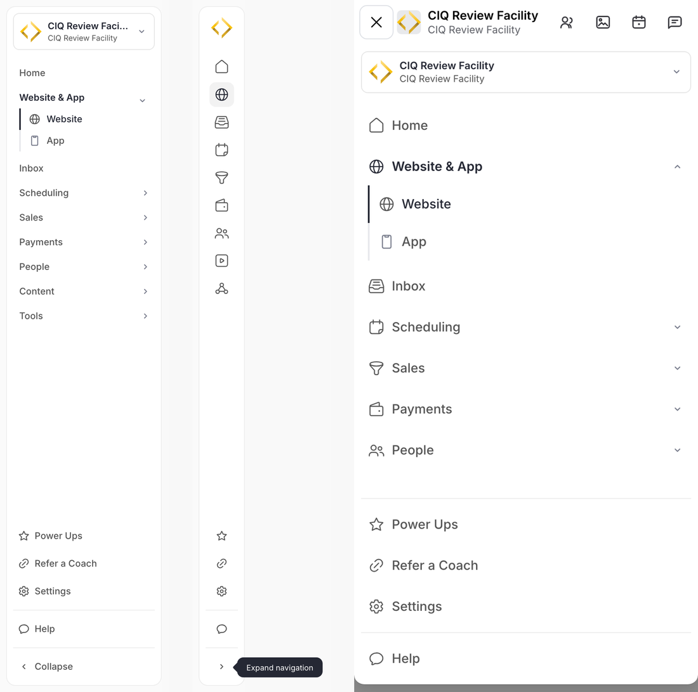
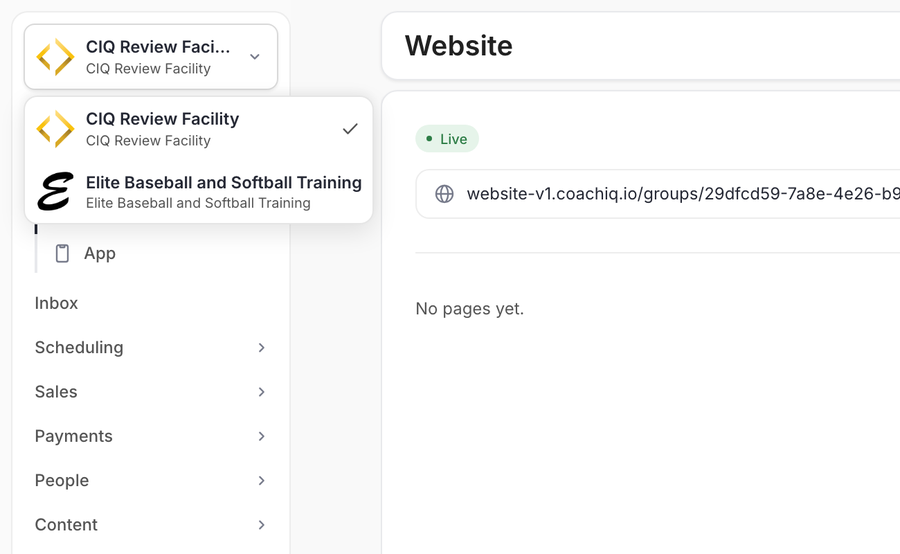

The CoachIQ admin (admin.coachiq.io) is where you and your staff run the business. Everything sits in one sidebar on the left, in the same order you'll usually work: your website and app, messages, the schedule, sales, payments, people, content and tools. Your account, business settings and help are pinned to the bottom.

<Frame caption="The sidebar on a computer (left), collapsed to icons (middle), and the menu on a phone (right).">
  
</Frame>

## Where you start

When you sign in, CoachIQ opens **Website & App → Website**: your site's status and address, its pages, and shortcuts into the website builder. Saved links to the old dashboard open this page too. See [Your website](/website/overview).

**Website & App → App** does the same for the app your families use. See [Your app](/athlete-portal/understanding-your-athlete-portal).

<Note>
  A new **Home** page is rolling out club by club. If your club has it, Home is the first item in the sidebar and you land there when you sign in. See [The Assistant](/tools/assistant/overview).
</Note>

## What's in the sidebar

Click a section to open its first page. The section expands to show the pages inside it, and the page you're on is highlighted.

| Section | Pages | Help Center |
|---|---|---|
| **Website & App** | Website, App | [Website](/website/overview), [App](/athlete-portal/understanding-your-athlete-portal) |
| **Inbox** | Messages, texts, email and announcements | [Inbox](/inbox/inbox-overview) |
| **Scheduling** | Calendar, Schedulers, Setup | [Scheduling](/scheduling/overview) |
| **Sales** | Pipeline | [Pipeline](/sales/pipeline) |
| **Payments** | Products, Transactions, Subscriptions, Coupons | [Payments](/payments/getting-started) |
| **People** | Clients, Staff, Sign-up & Profile | [People](/people/overview) |
| **Content** | Media Hub, Programs, Video Analysis | [Content](/content/content-overview) |
| **Tools** | Forms, Automations, Waivers, Sheets, Assistant | [Forms](/tools/forms/overview), [Automations](/tools/automations/what-are-automations), [Waivers](/tools/waivers/waivers), [Sheets](/tools/sheets/overview), [Assistant](/tools/assistant/overview) |

If your organization uses [Teams](/people/teams/overview), **Teams** appears with People.

At the bottom of the sidebar:

- **Power Ups**: services you can request from the CoachIQ team, such as a branded app or done-for-you ads, plus your connected apps. See [Power-Ups](/power-ups/index).
- **Refer a Coach**: tell us about another coach who could use CoachIQ. It opens a short form in a new tab.
- **Settings**: your account and the business settings. See [Settings](#settings) below.
- **Help**: opens CoachIQ support, where you can ask the team a question.
- **Collapse**: shrinks the sidebar to icons (computer only).

### Why your sidebar might look different

Each person sees only the pages they're allowed to use. Admins see everything. A coach whose access has been limited doesn't see the blocked pages at all, and opening one from a saved link takes them to the first page they can use. See [Staff access](/people/staff-access).

Sheets is for Admins. A coach only sees a sheet an Admin has shared with them.

## Switch between groups

If you work in more than one group or business, the card at the top of the sidebar shows the one you're in. Click it to see your other groups, then pick one to switch. A check mark shows the current group.

<Frame caption="The group switcher at the top of the sidebar.">
  
</Frame>

You can also switch from **Settings → Groups**. See [Groups](/settings/general#groups).

## Collapse the sidebar

On a computer, click **Collapse** at the bottom of the sidebar to shrink it to a strip of icons and give the page more room. Hover over an icon to see its name. To bring the full sidebar back, click the arrow at the bottom (**Expand navigation**).

## On a phone

The admin works in your phone's browser too. The top bar shows your organization and group, with shortcuts to **People**, **Media Hub**, **Calendar** and **Inbox**. Tap the menu button on the left to open the full menu, with the same sections as on a computer, and the **X** to close it.

For running your day from your phone, the CoachIQ app has the same information in a phone layout.

## Settings

**Settings** at the bottom of the sidebar opens your settings with their own menu, grouped the same way as this Help Center:

| Group | Pages |
|---|---|
| **General** | Account, Organization, Brand kit, Groups, Blocklist, Connections |
| **Developer** | API keys, Webhooks |
| **Communication** | Notifications, SMS number, Inbox settings |
| **Payments** | Billing, Stripe, Payment methods |
| **Data** | Shared calendar, Logs, Import people, Import bookings |

**Log out** is at the bottom of the Settings menu. See [Settings overview](/settings/index).

## Common questions

<AccordionGroup>
  <Accordion title="Where did the dashboard go?">
    The old dashboard is now **Website & App → Website** and **Website & App → App**, each focused on one thing. To see what a client has been doing, open their profile and choose [Activity](/people/client-profiles/client-profiles-activity). Payments are in [Payments → Transactions](/payments/transactions).
  </Accordion>
  <Accordion title="I can't find a page another staff member has">
    Your access is set by an Admin. Ask them to check your access under **People → Staff**. See [Staff access](/people/staff-access).
  </Accordion>
  <Accordion title="Which group am I working in?">
    The group name is on the card at the top of the sidebar, and in **Settings → Groups** under **Current group**.
  </Accordion>
  <Accordion title="The admin shows a message asking me to update my browser">
    Your browser is too old for the admin. Update it, or open the admin in a current version of Chrome, Safari, Edge or Firefox.
  </Accordion>
</AccordionGroup>
