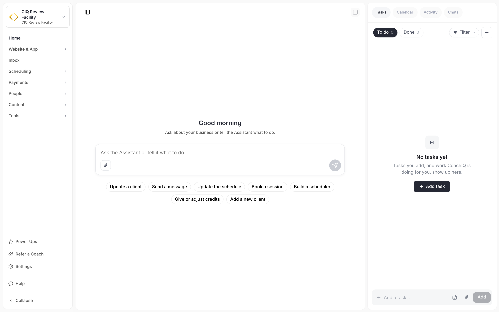
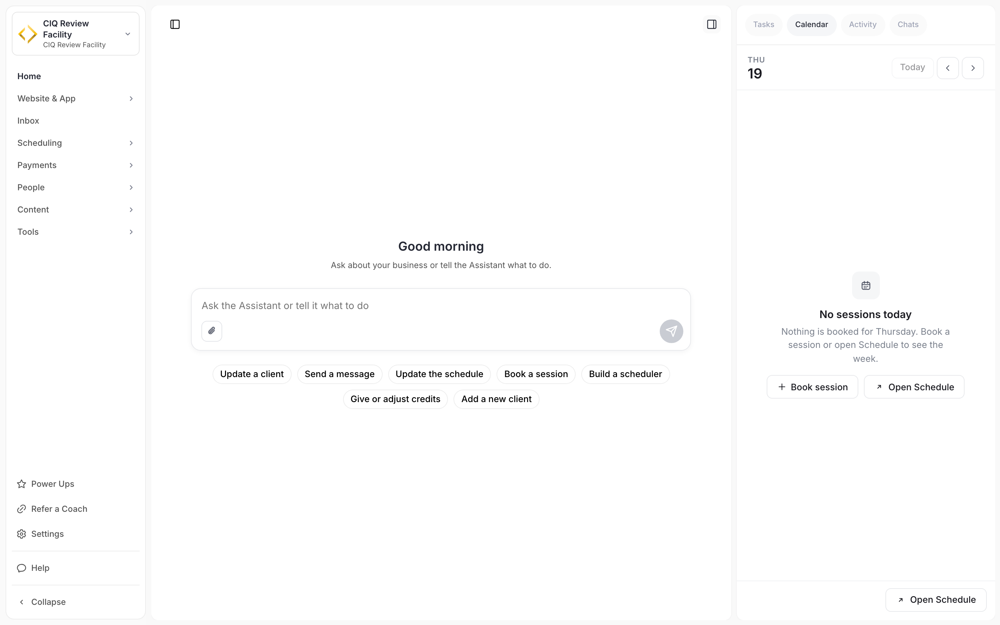
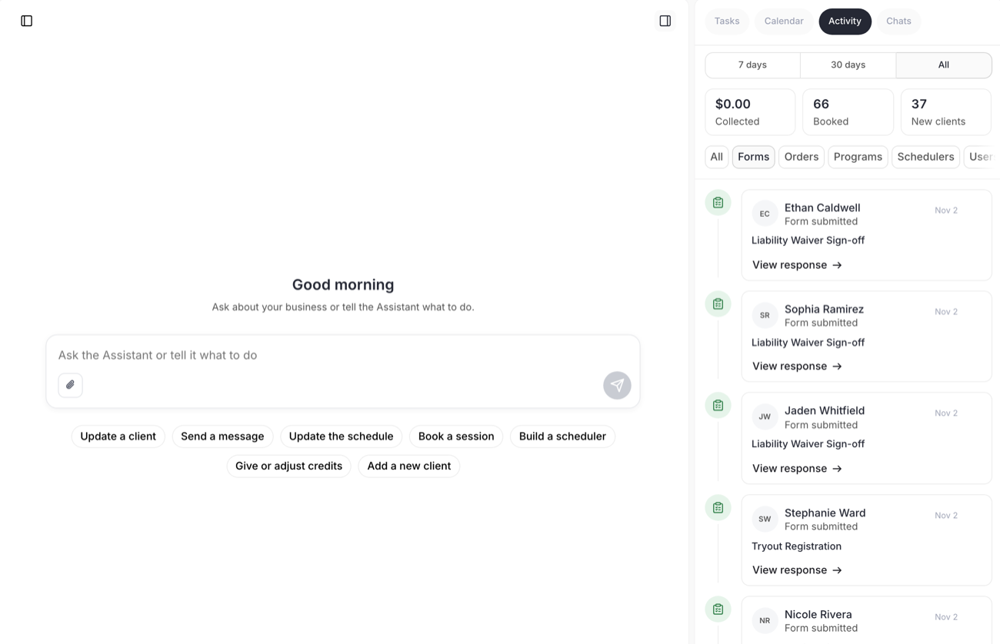

<Info>
  **Home is turning on club by club.** If your club has it, **Home** is the first item in the sidebar and CoachIQ opens it when you sign in. Want it now? Ask the CoachIQ team through **Help** at the bottom of the sidebar, or reply to any CoachIQ email, and we'll switch it on for your club. The Assistant is part of Home, so it arrives with it.
</Info>

Home is where your day starts. The [Assistant](/tools/assistant/overview) sits in the centre: ask it a question about your business or tell it what to do. On the right, four tabs keep the rest of your day in view: **Tasks**, **Calendar**, **Activity** and **Chats**.

<Frame caption="Home with the Tasks tab open on the right.">
  
</Frame>

## Ask the Assistant

Type in the box under the greeting, the way you'd ask a colleague: "Who's booked tomorrow?", "How much did we collect last month?", "Give Sam Lee 2 credits on her 10 Lesson Pack."

The buttons under the box are quick actions, such as **Book a session**, **Give or adjust credits** or **Add a new client**. Clicking one starts the request in the box for you to finish. It never sends anything on its own. Owners and Admins see actions for running the business; Coaches see actions for their own day.

Answers come from your own records. When you ask for a change, the Assistant shows it on a card, and **nothing saves until you approve it**. Bookings made in the chat don't take a payment or use credits.

To learn what to ask and how cards work, see:

<CardGroup cols={2}>
  <Card title="The Assistant" icon="robot" href="/tools/assistant/overview">
    Asking questions, attaching images, flagging a wrong answer and who can use it.
  </Card>
  <Card title="What the Assistant can do" icon="list-check" href="/tools/assistant/what-it-can-do">
    Questions it answers and changes it can make, by area, with example requests.
  </Card>
</CardGroup>

## The panels on the right

The icon at the top right hides or shows the panel, and the icon at the top left hides or shows the sidebar, so you can give the chat the whole screen.

### Tasks

Your to-do list. **To do** and **Done** show how many tasks are in each.

- Type in **Add a task** at the bottom, optionally pick a due date with the calendar button and attach files with the paperclip, then click **Add**. The **+** button at the top does the same.
- Tick a task to finish it. Finished tasks move to **Done**. The bin icon removes a task, with **Undo** for a few seconds.
- Click the name chip on a task you made to assign it to anyone on your staff. It then shows on their list too.
- **Filter** narrows the list by source, assignee, due date or attachments.
- **Add follow-up task** at the top of a chat turns the latest answer into a task. You can also type "Add a task to call Sam's mom on Friday." A task for your own list is added straight away, without an approval card, and never messages anyone.

Tasks marked **CoachIQ** are work the CoachIQ team is doing for you, or something we need from you. Everyone on your staff sees them, and only the CoachIQ team ticks them off.

### Calendar

One day of your schedule, starting today. Use the arrows to move a day at a time, and **Today** to come back. **Book session** opens the booking window, and **Open Schedule** opens the full [calendar](/scheduling/calendar-overview-and-navigation).

<Frame caption="The Calendar tab on a day with nothing booked.">
  
</Frame>

### Activity

What's been happening in your business: new bookings, orders, form responses, program activity and new clients, newest first.

- **7 days**, **30 days** and **All** set the period.
- Three numbers sit at the top. Owners and Admins see the money collected, sessions booked and new clients.
- The filters (**All**, **Forms**, **Orders**, **Programs**, **Schedulers**, **Users**) narrow the list to one kind of activity.
- Each item links to the record, for example **View response** on a form submission.

<Frame caption="The Activity tab filtered to Forms.">
  
</Frame>

### Chats

Your conversations with the Assistant: **Recent** and **Archived**, search, pin and archive, and **Start a new chat**. Chats belong to you; your colleagues don't see them. See [Your chats](/tools/assistant/overview#your-chats).

## Who sees Home

- Home appears only in clubs where it's turned on.
- **Admins** see everything on Home.
- **Coaches** use Home within their [staff access](/people/staff-access). An Admin can block the Assistant for a coach there.
- Families never see Home. They use [your app](/app/overview).

## Common questions

<AccordionGroup>
  <Accordion title="I don't see Home in my sidebar">
    Home isn't on for your club yet. Ask the CoachIQ team through **Help** in the sidebar to switch it on. The Assistant is part of Home, so it appears when Home does.
  </Accordion>
  <Accordion title="Where did Tools → Assistant go?">
    The Assistant moved to Home. There's no longer an Assistant page under Tools.
  </Accordion>
  <Accordion title="Does Home change anything for families?">
    No. Home is for your staff. Bookings and payments in your app work as before.
  </Accordion>
</AccordionGroup>

## Related

- [The Assistant](/tools/assistant/overview)
- [Approvals, undo and limits](/tools/assistant/approvals)
- [Find your way around](/getting-started/find-your-way-around)
