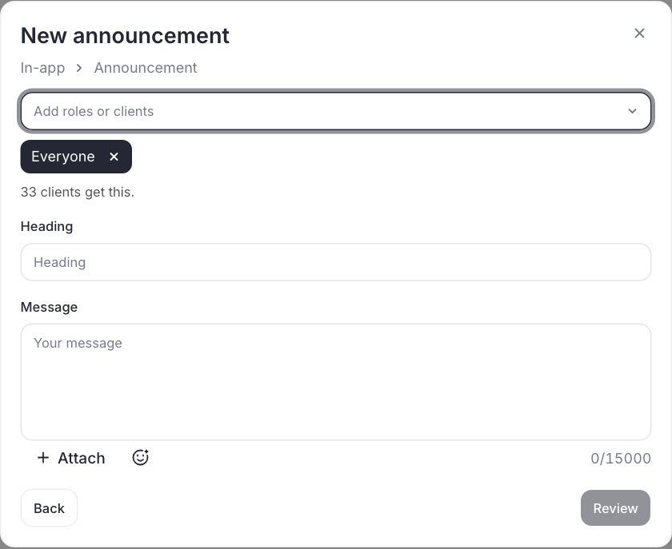
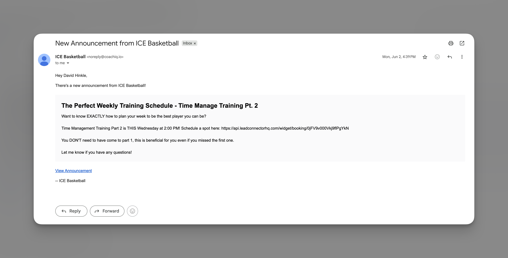

<Info>
  **Where to find this**: **Inbox** → **New message** → **Announcement**
</Info>

An announcement is one post that reaches a whole group: everyone in your club, a role, a tag or people you pick. It shows in your app's Announcements feed, and goes out as a push notification and an email.

The **New announcement** window in the Inbox has no email switch, so an announcement you send from there always goes out by email too. If an announcement is sent with email turned off (for example from another tool), no email copies go out and no messaging credits are used; the app post and the push notification still go out.

Use it for schedules, closures, registration deadlines and news. For a conversation with one person, use a [direct message](/inbox/in-app-messages).

## What announcements cost

The post in your app is free. Each email copy uses **0.1 messaging credit**, so an announcement emailed to 100 people uses 10 credits. The same rate applies when an automation or integration posts an announcement. See [Messaging credits](/inbox/sms-credits).

## Post an announcement

<Steps>
  <Step title="Open a new announcement">
    In **Inbox**, click **New message**, then **Announcement** under **In the app**.

    <Frame caption="A new announcement starts with Everyone and says how many clients get it.">

    

    </Frame>
  </Step>
  <Step title="Choose who gets it">
    The field starts with **Everyone**, and a line under it says how many clients get it. Remove **Everyone** and pick roles, tags, teams or people instead. See [Who gets an announcement](#who-gets-an-announcement).
  </Step>
  <Step title="Write a heading">
    The **Heading** becomes the email subject, the push notification title and the title in the app. Make it specific: "Cage 2 closed Saturday morning" beats "Update".
  </Step>
  <Step title="Write your message">
    Write the details in **Message**: what, when, where and what families need to do. Keep paragraphs short; most people read on a phone.
  </Step>
  <Step title="Attach something (optional)">
    Click **Attach** to add a form, media, a product or a scheduler. They show as buttons in the app and in the email. See [Message attachments](/inbox/attaching-forms-schedulers-and-products).
  </Step>
  <Step title="Review and send">
    Click **Review**. **Review announcement** shows how many clients get it, split into athletes and parents, and a preview. Click **See list** to check every name. Then click **Send to** and the number of clients, or **Back to edit**.
  </Step>
</Steps>

Announcements send right away. You can't schedule one for later.

## Who gets an announcement

- **Everyone, a role or a tag:** every accepted member who matches, plus the joined parents of athletes who match. People whose membership is incomplete, suspended or declined aren't included.
- **People you pick by name:** those people, plus the joined parents of each one. A parent who is also picked, or who has two children picked, gets it once. A parent who hasn't joined yet isn't added.

In **See list**, each parent sits under their child as "Parent of" that child. A child without their own login reads **No login**, with the parent it reaches.

Each announcement can go to up to 400 people by default. The [User Limit Expansion Power-Up](/power-ups/user-limit-expansion) raises it.

## How families see it

- **In the app:** in the Announcements feed, newest first, with the pinned announcement on top. It stays there, so families can scroll back to older posts.
- **Push notification:** the heading, on phones with the mobile app.
- **Email:** the heading as the subject and your message as the body. Attached products show as cards with the name, price, a short description and a **Purchase** button; forms, sessions and media show with **Open form**, **Book** or **View**. Archived or deleted products are left out.

<Frame>
  
</Frame>

### Replies

An announcement isn't a conversation. If someone replies to the email, the reply goes to your club's reply-to address (**Settings → Organization**), or to your main admin's email if that's blank. It doesn't show in the Inbox.

## Reactions

Families can acknowledge an announcement with one of four reactions: 👍 **Got it**, ❤️ **Love it**, 🙏 **Thanks** and 🔥 **Hype**. Each reaction shows as a count. Tapping the same reaction again removes it. There's no free emoji picker and no comment thread.

You see the same counts under the announcement in your Inbox. To get a head count, ask families to react 👍 and compare it with the number of clients it went to.

## Find a sent announcement

Click **Announcements** in the Inbox filters. Open one to see it as sent, with a line under the title such as "Nov 1, 10:55 AM · to 32 clients".

## Pin, edit or delete

Open the announcement and click **⋯** (**More actions**) at the top right:

- **Pin announcement** shows it first in the Announcements feed for everyone who could already see it. Pinning doesn't send it to anyone new. A group has one pinned announcement; pinning another replaces it, and you can clear the pin.
- **Edit announcement** fixes a typo or updates the details. The announcement keeps its place and original date in the feed, and shows an **Edited** date. Families see it as unread again. Its attachments stay unless you remove them. Emails and push notifications that already went out aren't changed, so send a follow-up if the change matters.
- **Delete announcement** removes it from your Inbox. Emails already sent stay in people's mailboxes.

## Common questions

<AccordionGroup>
  <Accordion title="Do families need the app to get an announcement?">
    No. They get the email copy without the app. Each email copy uses messaging credits. If your club runs out of credits, the post still appears in the app, but that doesn't mean the emails went out. See [Messaging credits](/inbox/sms-credits).
  </Accordion>
  <Accordion title="Can I see who has read an announcement?">
    Not yet. Reactions are the closest thing to a read receipt.
  </Accordion>
  <Accordion title="Can I pin more than one announcement?">
    No. Pinning a different one replaces the current pin.
  </Accordion>
  <Accordion title="Why did fewer people get my announcement than are in People?">
    Announcements go only to accepted members. People whose membership is incomplete, suspended or declined are left out, and people on your [Can't get email](/inbox/email#people-who-cant-get-your-email) list don't get the email copy.
  </Accordion>
</AccordionGroup>

## Related articles

- [Send a new message](/inbox/new-message)
- [Direct messages](/inbox/in-app-messages)
- [Texts](/inbox/sms-messages)
- [Message attachments](/inbox/attaching-forms-schedulers-and-products)
