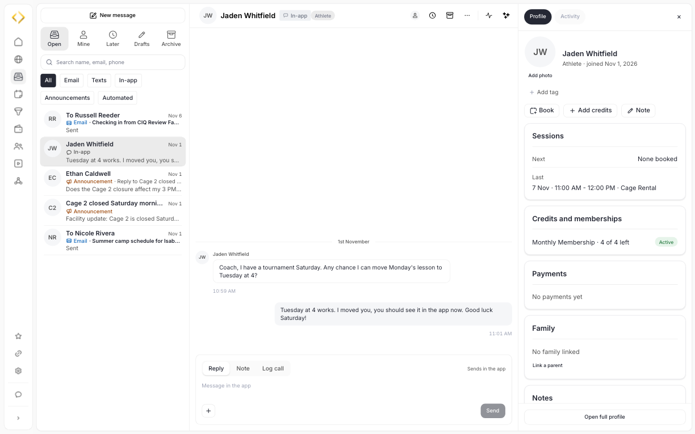
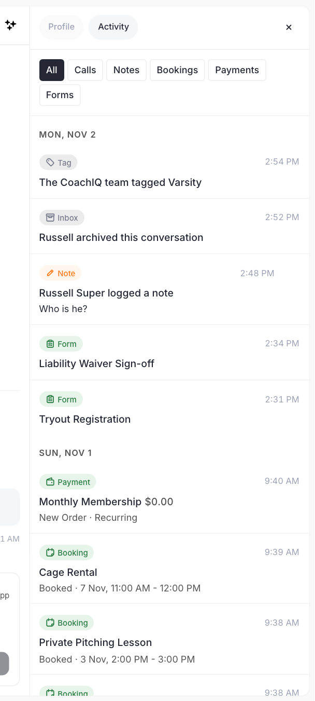

<Info>
  **Where to find this**: **Inbox** → open a conversation with a client → **Activity** (top right, or press **I**)
</Info>

Answer a client without leaving the Inbox. The side panel shows who you're talking to, what they've booked and paid, and everything your team has done with them. It's team-only: clients never see it.

The **Activity** button appears on conversations with one client. Staff who can't open **People → Clients** don't see it.

<Frame caption="The side panel opens on Profile: the person, quick actions, then sessions, credits and memberships, payments, family, notes, waivers and details.">

</Frame>

## Profile

The panel opens on **Profile**, one scrolling page about the person:

- **Top:** photo, name, role and when they joined, their tags (with **Add tag**), and three quick actions: **Book**, **Add credits** and **Note**.
- **Anything that needs attention comes first.** For example, if a waiver isn't signed, a warning shows with a **Resend waiver** button.
- **Sessions:** the **Next** booked session (or **None booked**) and the **Last** one.
- **Credits and memberships:** each active credit pack with how many are left, for example "8 of 10 left", and each membership with its status.
- **Payments:** recent payments. A balance shows only when the client has account credit or an amount due. For a child whose parent pays, it's the parent's balance.
- **Family:** linked parents, children and siblings, with a button to switch to each one. **Link a parent** when there's none.
- **Notes:** your team's notes. **Staff only.**
- **Waivers:** each waiver and when it was signed.
- **Details:** email and phone.

**Open full profile** at the bottom goes to the person's page in People.

### Resend a waiver

When a client hasn't signed a waiver, click **Resend waiver** on the warning. CoachIQ sends them a new request to sign by email and app notification. For an athlete whose account a parent manages, it goes to the parent who pays.

After sending, the warning shows when it was sent, and the button waits an hour before you can send it again. The warning stays until the waiver is signed. Admins, and coaches who can open **People → Clients**, can resend waivers. The same button is on each unsigned waiver in the client's profile under **Waivers**.

## Activity

Switch to **Activity** to see the client's history, newest first, grouped by day. Filter it with **All**, **Calls**, **Notes**, **Bookings**, **Payments** and **Forms**.

<Frame caption="Activity: tags, archive, notes, forms, payments and bookings in one timeline.">

</Frame>

Activity lists:

- **Notes and logged calls** from your team. See [Leave a note](/inbox/work-as-a-team#leave-a-note-for-your-team) and [Log a phone call](/inbox/work-as-a-team#log-a-phone-call).
- **Bookings, payments and forms**, such as a booking with its time or a signed waiver.
- **What happened to the conversation**: who took it ("Daniela took this conversation", naming who had it before), who handed it to whom, and who archived it.
- **Tags** added to the client, for example "Daniela tagged Billing".
- **Emails** your team sent the client from the Inbox, with the subject (last six months).
- **Messages your automations sent**: texts, in-app messages and tag or role announcements. Automation messages sent before the November 2026 update don't show.

Each kind of entry has its own icon and colour. If part of the history can't be loaded, the panel shows what did load and says **Some activity could not be loaded.**

When the client has a linked parent, child or sibling, chips at the top let you see activity for the whole family or one person. In the whole-family view, each entry says who it's about.

On a phone, the panel opens full screen. **Back** returns to the conversation.

## Draft a reply with the Assistant

The Assistant can write a first draft of your reply from what CoachIQ knows about the client.

1. Open a conversation with a client and click **Assistant** (the sparkle icon, or press **K**).
2. The Assistant panel drafts a reply using the client's remaining credits, your next open times and a booking link, and lists what it based the draft on.
3. Read the draft. Click **Insert** to put it in the reply box.
4. Edit it if you like, then send it yourself.

Nothing is sent automatically: the panel reads **Auto-reply stays off**. If the Assistant can't write a draft, it says **Assistant couldn't draft a reply.** with **Try again**.

## Related articles

- [Work through conversations as a team](/inbox/work-as-a-team)
- [Client profiles](/people/client-profiles/client-profiles)
- [Inbox overview](/inbox/inbox-overview)
