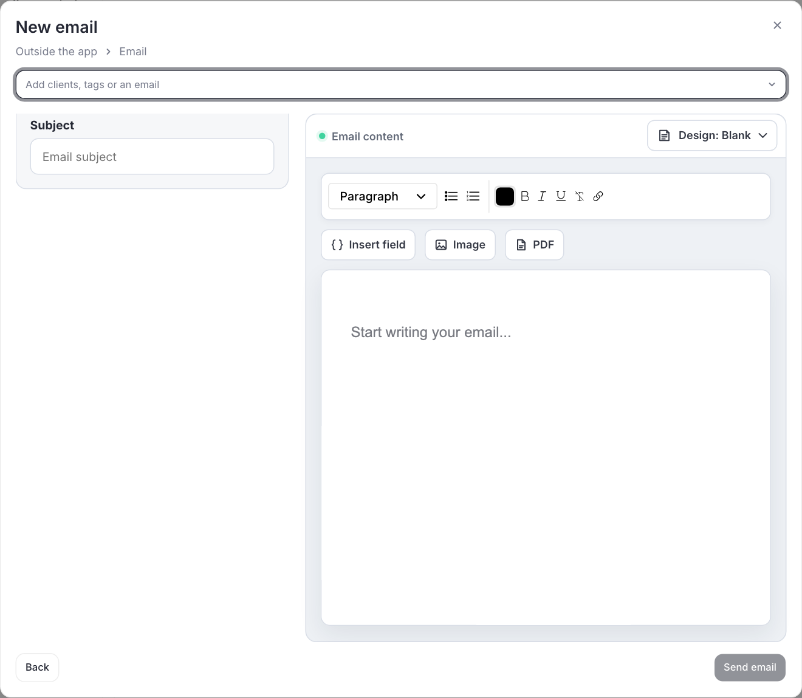
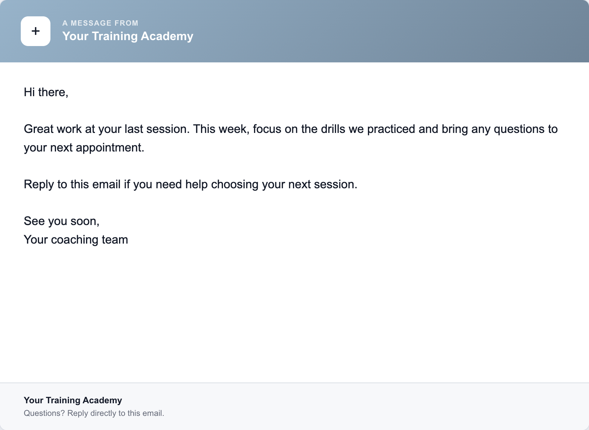

<Info>
  **Where to find this**: **Inbox** → **New message** → **Email**
</Info>

Send an email when a message needs a subject line, formatting, pictures or a document, or when the person doesn't use your app. You can email clients, everyone with a tag, or any email address.

## Send an email

<Steps>
  <Step title="Start a new email">
    In **Inbox**, click **New message**, then **Email** under **Outside the app**.
  </Step>
  <Step title="Choose who gets it">
    In **Add clients, tags or an email**, pick people, tags or roles, or type an email address. People without an email address show **No email address**. If an address you type belongs to someone in People, the email is linked to that person, so it shows under their name in your Inbox.
  </Step>
  <Step title="Add a subject">
    Write a clear **Subject**. Recipients see it first.
  </Step>
  <Step title="Write your email">
    Write under **Email content**. The toolbar has paragraph styles, lists, text colour, bold, italic, underline and links. Use **Insert field**, **Image** and **PDF** to personalize it and add files (see below).
  </Step>
  <Step title="Choose a design">
    Open **Design: Blank** to pick **Blank**, **Branded** or **Spotlight**. See [Choose a design](#choose-a-design).
  </Step>
  <Step title="Send">
    Click **Send email**. If the subject, the message or a recipient is missing, a red line next to the button says what's missing, and nothing is sent or lost. For a group, check the review step, then send.
  </Step>
</Steps>

<Frame caption="New email: recipients, Subject, the email content with Insert field, Image and PDF, and the Design menu.">

</Frame>

## Personalize with first names

Click **Insert field** and choose **First name** (the recipient's first name) or **Athlete first name**. Each person gets the email with their own names filled in, and nobody sees anyone else's. Use **Preview as** to see what a chosen recipient will get.

If a name is missing, the email still reads naturally ("there", "your athlete"). Emails sent through a connected AI app (ChatGPT or Claude) go out exactly as written, without names filled in.

## Add images

Click **Image** to add a picture from your [Media Hub](/content/media-overview) or upload one from your device. You can add up to 10 images to an email, in any design. Each image can be full width or small, and can link to a web address. iPhone photos (HEIC) and WebP images arrive as normal pictures. What you see in the editor is what recipients see.

## Attach PDFs

Click **PDF** to attach up to 5 PDFs, chosen from your Media Hub or with **Upload from device**. Recipients get them as attachments on the email.

## Choose a design

**Design** sets how the email looks. Your organization colour is applied automatically.

| Design | What it looks like |
| --- | --- |
| **Blank** | A simple, content-first email without branded framing |
| **Branded** | Your organization header and a reply-friendly footer |
| **Spotlight** | A high-impact gradient, for milestones and key updates |

Under **Suggested starter copy**, **Client check-in** and **Session follow-up** fill in a starting subject and message. They replace what you've written in both, so pick one before you start writing.

### Customize Branded and Spotlight

Branded and Spotlight show **Appearance** controls beside the email:

- **Theme:** Light or Dark.
- **Logo:** an image from **Media Hub**, **App logo**, or **None**. You can also click the logo on the email.
- **Colours:** the primary colour and the header, logo, body and footer backgrounds.
- **Header and footer:** click their text on the email to edit it. Spotlight adds a short heading above the title.
- **Reset** puts the defaults back.

By default, the email uses your group's logo from **Settings → Brand kit**, falling back to your organization logo. A logo you pick, or **None**, takes priority.

<Frame caption="Spotlight: a gradient header with a short heading above the title.">

</Frame>

## What email costs

Each email address uses **0.1 messaging credit**, so 10 emails use 1 credit. That covers Inbox emails, the email copies of announcements and automation **Send an Email** actions, counting every address including CC and BCC. Automatic notifications, such as booking confirmations and receipts, are free. See [Messaging credits](/inbox/sms-credits).

## Find emails you've sent

Click **Email** in the Inbox filters. Each row shows who it went to ("To Nicole Rivera", "To 3 clients"), the subject in bold, and **Sent**. An email that didn't reach everyone shows **Not delivered** or **Partly delivered**.

Open a row to see the email as sent: **From**, **To** and **Sent**, with the delivery status, then the message. Archive and restore sent emails like any conversation; they never count as unread. Everyone on your staff can see your club's sent emails. Emails sent before September 23, 2026 aren't listed.

## Replies to your emails

When a client replies to an Inbox email, the reply goes to your club's reply-to address (**Settings → Organization**), or your main admin's email if that's blank.

Under **Settings → Inbox settings → Email replies**, the option **Replies land in the Inbox** reads **Not available yet** while CoachIQ finishes setting up email for clubs. Once it's on for your club, replies will come into your Inbox. The **Signature** box on the same page is added to the end of every reply and forward.

## People who can't get your email

Your club keeps a list of people its emails skip:

- addresses that **bounced**
- people who marked your email as **spam**
- people who **unsubscribed** using the link in your emails

An email to one of them isn't sent, you see why, and no credit is used. A group email skips them, and the result says how many were skipped and why.

Admins find the list under **Settings → Inbox settings → Can't get email**, with the reason and date. Remove a bounced address once it's fixed. Only the person can undo an unsubscribe or a spam report: the unsubscribe link in your emails opens a page where they can resubscribe. Coaches don't see the list.

Receipts, sign-in, password reset, booking emails and other account emails still reach everyone.

## Email and your business mailbox

Designs change how an email looks. They don't create a mailbox or connect Gmail. For an address such as coach@yourbusiness.com, see [Professional email](/inbox/professional-email).

## Troubleshooting

- **No Appearance controls:** choose Branded or Spotlight; Blank has none.
- **Wrong logo:** check which group you're in, then choose **App logo** or a specific image.
- **Starter copy replaced your writing:** starter copy replaces the subject and message. Pick it first.
- **"Your organization doesn't have enough credits to send this email."** Your draft stays in the window. An admin can add credits on the **Credits** page (or ask CoachIQ support from **Help** if your club doesn't have it), then send again. See [Messaging credits](/inbox/sms-credits).
- **Someone didn't get it:** open the email under the **Email** filter and check the address and its status. Check whether they're on the **Can't get email** list, and ask them to look in spam or junk.

## Related articles

- [Send a new message](/inbox/new-message)
- [Announcements](/inbox/announcements)
- [Messaging credits](/inbox/sms-credits)
- [Professional email](/inbox/professional-email)
