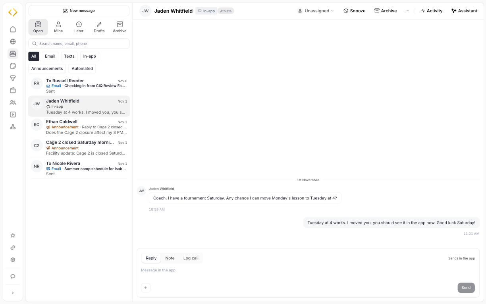
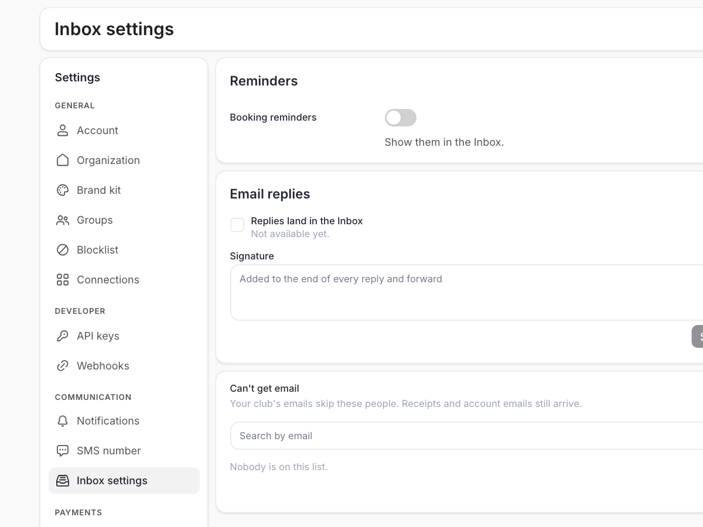

<Info>
  **Where to find this**: **Inbox** in the sidebar
</Info>

The Inbox is where you and your staff talk to clients. Direct messages, texts, emails and announcements all land in one list, and the whole team works from it together: one person can take a conversation, snooze it until later or archive it, and everyone else sees the change.

<Frame caption="The Inbox: folders and filters on the left, the open conversation on the right, with Reply, Note and Log call under it.">

</Frame>

## How the Inbox is laid out

### New message

**New message** at the top of the list starts a direct message, announcement, text or email. See [Send a new message](/inbox/new-message).

### Folders

The five folders across the top sort conversations by where they are in your team's work:

| Folder | What's in it |
| --- | --- |
| **Open** | Every conversation that still needs attention. New messages from clients land here. |
| **Mine** | Conversations assigned to you. See [Assign a conversation](/inbox/work-as-a-team#assign-a-conversation). |
| **Later** | Conversations someone snoozed. Each one comes back to Open at the time picked, or sooner if the client replies. |
| **Drafts** | Replies you started and haven't sent. Only you see your drafts. |
| **Archive** | Conversations your team has finished. A new message from the client brings the conversation back to Open. |

When something is unread, **Open** and **Mine** show a count next to their names, and the conversation shows a dot and a bold name. The count includes unread texts as well as in-app messages and email, and stops at 100.

### Search and filters

Search by name, email or phone. Under the search box, the filters narrow the list by channel:

- **All**: every channel.
- **Email**: emails your team sent from the Inbox. Each row shows who it went to and the subject. A delivered email reads **Sent**; an email that didn't reach everyone shows **Not delivered** or **Partly delivered**.
- **Texts**: text conversations with your business number. If your business doesn't have a number yet, this filter shows **Texts are not set up yet** with a **Request a number** button. See [Texts](/inbox/sms-messages).
- **In-app**: direct messages in the app.
- **Announcements**: announcements you've posted. See [Announcements](/inbox/announcements).
- **Automated**: shown only in Open. Messages your automations send wait here until the client replies. See [Automated messages](#automated-messages).

Switching to a folder or filter that doesn't contain the open conversation closes it, so you never see an empty list next to an old conversation.

### The conversation list

Each row shows the person's photo or initials, their name, the channel (**Email**, **In-app**, **Announcement** or a text with the number) and the latest message. Email subjects and announcement titles are in bold, and a group email reads, for example, "To 3 clients". If the conversation is assigned, the row shows who has it.

Right-click a row (or press and hold on a phone) for **Mark as unread**, **Archive**, **Assign to me**, **Snooze until tomorrow** and **Select**. **Select** lets you pick several conversations and act on them together. See [Work through conversations as a team](/inbox/work-as-a-team).

### The open conversation

Opening a row shows the conversation on the right, with the person's name, the channel and their role (for example Athlete or Parent) at the top. The icons beside it are **Assign**, **Snooze**, **Archive**, **More conversation actions**, then **Activity** and **Assistant**. Point at an icon to see its name and keyboard key.

Under a client conversation you'll find the reply box with **Reply**, **Note** and **Log call**. Announcements and sent emails don't have a reply box.

When nothing is open, the right side reads **No conversation open** with a **New message** button.

### Activity, Profile and the Assistant

**Activity** opens a side panel with the client's **Profile** (sessions, credits, payments, family, notes, waivers) and their **Activity** history. **Assistant** drafts a reply for you to check. Both are team-only. See [See the client beside the conversation](/inbox/client-profile-and-activity).

## Which message type to use

| You want to… | Use | Cost |
| --- | --- | --- |
| Talk one-on-one with a client in the app | [Direct message](/inbox/in-app-messages) | Free |
| Post one update for your whole group, a role or a tag | [Announcement](/inbox/announcements) | Free in the app; each email copy uses messaging credits |
| Reach someone fast on their phone, or someone who isn't on the app | [Text](/inbox/sms-messages) | About 1 credit per short text |
| Send a longer, formatted message with a subject, images or PDFs | [Email](/inbox/email) | Messaging credits per address |

The New message window shows which clients aren't on the app yet and offers **Text instead** or **Email instead** for them. See [Clients who aren't on the app yet](/inbox/new-message#clients-who-arent-on-the-app-yet).

## Automated messages

When an automation sends a client a message, such as a booking confirmation, the conversation waits under **Automated** instead of filling up **Open**. It moves to Open as soon as the client replies in the app. A reply by text or email doesn't move it.

- If the client already has a conversation in Open, it stays there at their last message, and the automation's message waits in Automated.
- Messages an automation sends to a staff member, and messages a person types, go to Open as usual.
- Automation messages sent before the November 2026 update stay where they were.

Session reminders are hidden from the Inbox by default. They're still delivered to the client. To see them in Automated, turn on **Booking reminders** under **Settings → Inbox settings → Reminders**. A reminder never reopens an archived conversation, and a reminder text never becomes the latest message in a family's text conversation.

## Keyboard shortcuts

Press **?** to see every shortcut. You can also open the list from **More conversation actions** (**⋯**) → **Keyboard shortcuts**.

| Key | Action |
| --- | --- |
| **A** | Assign |
| **S** | Snooze |
| **E** | Archive |
| **I** | Activity |
| **K** | Assistant |
| **?** | Keyboard shortcuts |

Shortcuts don't work while you're typing or while a menu or window is open.

## Inbox settings

Go to **Settings → Inbox settings** to:

- show or hide booking reminders (**Reminders**)
- add a **Signature** to the end of every email reply and forward
- see **Can't get email**, the people your club's emails skip because their address bounced, they reported spam or they unsubscribed. See [People who can't get your email](/inbox/email#people-who-cant-get-your-email).

<Frame caption="Settings → Inbox settings.">

</Frame>

## Who can use the Inbox

Admins can always use the Inbox. A coach can use it when the **Inbox** page is turned on in their staff access. A coach without Inbox access can't open it, send group messages, or be assigned conversations. They can still notify the people booked when they change a session from the Calendar.

## Start here

<CardGroup cols={2}>
  <Card title="Work as a team" icon="users" href="/inbox/work-as-a-team">
    Assign, snooze, archive, notes, logged calls, drafts and Send later
  </Card>
  <Card title="See the client beside the conversation" icon="id-card" href="/inbox/client-profile-and-activity">
    Profile, Activity and Assistant reply drafts
  </Card>
  <Card title="Send a new message" icon="pen-to-square" href="/inbox/new-message">
    Pick the type, the people, tags or teams, and review before sending
  </Card>
  <Card title="Messaging credits" icon="comment-dollar" href="/inbox/sms-credits">
    What texts and emails cost
  </Card>
</CardGroup>
