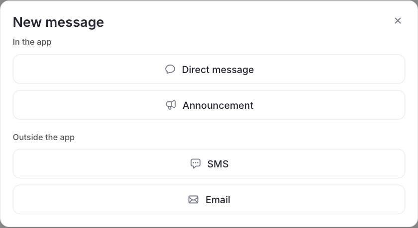
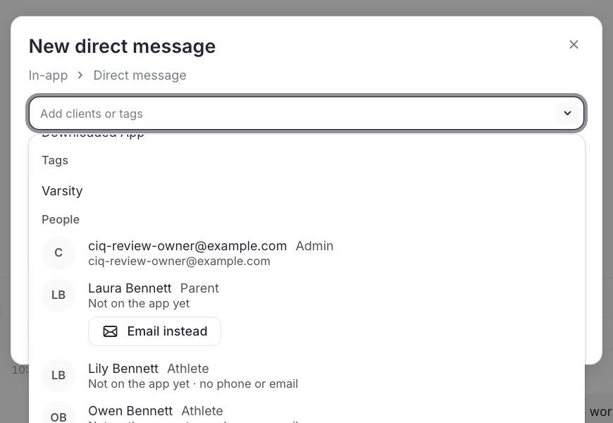

<Info>
  **Where to find this**: **Inbox** → **New message**
</Info>

Every new message starts the same way: pick what you're sending, pick who gets it, write it, and send. Group messages get a review step first, so you see exactly who it reaches.

## Step 1: Choose what you're sending

Click **New message**. The window asks for the type once:

| Group | Type | What it is |
| --- | --- | --- |
| **In the app** | **Direct message** | A private conversation in the app. Free. See [Direct messages](/inbox/in-app-messages). |
| | **Announcement** | One post for a group, shown in the app and emailed. See [Announcements](/inbox/announcements). |
| **Outside the app** | **SMS** | A text from your business number. See [Texts](/inbox/sms-messages). |
| | **Email** | A formatted email with a subject. See [Email](/inbox/email). |

<Frame caption="New message: choose In the app or Outside the app.">

</Frame>

The next window is titled with what you're writing, for example **New direct message**, with a short path under it (**In-app › Direct message**). **Back** at the bottom left goes back one step. The **X** at the top right closes the window. Once you've typed or picked something, only the **X** closes it, so a stray click outside doesn't lose your work.

## Step 2: Choose who gets it

Click the field at the top. It reads **Add clients or tags** (**Add roles or clients** for an announcement, **Add clients, tags or an email** for an email). Type to search, or scroll the list. It's grouped:

- **Roles and groups**: **Admin**, **Coach**, **Athlete**, **Parent**, **Customer** and **Downloaded App** (people who have the mobile app). Announcements also offer **Everyone**, which is picked to start with.
- **Teams**: picking a team adds the athletes on its current roster and their parents, as one item with the number of people. Teams show only when your club uses [Teams](/people/teams/overview).
- **Tags**: everyone with that tag. Sub-tags are listed under their parent tag, so you can message one team inside a program without the whole program.
- **People**: each person with their role beside their name. **Add client** at the end adds someone new to People.

Your picks show under the field as dark items. Remove one with its **×**. Removing a team takes its people off again but keeps anyone you added by hand.

<Frame caption="The To field, grouped into roles, tags and people. Clients who aren't on the app yet are marked.">

</Frame>

### Combining tags

Pick several tags and the message goes to anyone with **any** of them. Someone with two of the tags still gets it once. To build or check a tag first, see [Tags and filters](/people/tags-filters).

<Tip>
  Name tags by what they mean, not shorthand: "Tuesday Training" instead of "Tues". Nest them by season or program, then team ("Fall 2026 → U12 → Blue"), so a schedule change goes to one sub-tag and a closure goes to the parent tag.
</Tip>

### Clients who aren't on the app yet

Direct messages reach people who have signed in to your app, on the web or the mobile app. Someone who hasn't signed in yet shows **Not on the app yet** in the list, with buttons to reach them another way:

- **Text instead**, when they have a phone number
- **Email instead**, when they have an email address

Clicking one switches your message to a text or an email with that person already picked. If they have neither, the row reads **Not on the app yet · no phone or email**.

### Who's left out

CoachIQ only sends to people who belong to your club:

- Announcements and group emails go to accepted members. People whose membership is incomplete, suspended or declined are skipped.
- Direct messages can't go to someone who isn't an active member.
- Texts go only to people in your club, and never to someone who has turned texts off or has no mobile number.
- Emails skip people on your [Can't get email](/inbox/email#people-who-cant-get-your-email) list.
- Picking a team adds only people you could already pick by name. A short notice says how many were added and why anyone was left out.

## Step 3: Write and attach

Write your message in **Message** (announcements also have a **Heading**; emails have a **Subject**). A small counter under the box shows how much room is left: 15,000 characters for in-app messages and announcements, 1,400 for texts.

Click **Attach** to add a form, media, a product or a scheduler. See [Message attachments](/inbox/attaching-forms-schedulers-and-products).

## Step 4: Review and send

The send button says what will happen: **Send message**, **Send text** or **Send email**.

When a message goes to a group, you get a review step first: **Review message**, **Review text**, **Review email** or **Review announcement**. It shows how many clients get it, a preview, and **See list**, which names everyone it reaches. **Back to edit** returns to your message. The main button reads **Send to** and the number of clients.

Messages to a group are sent separately: each person gets their own copy and replies come back as separate conversations. Nobody sees anyone else's reply.

### Send limits

Each club has a limit on how many people one message can go to, per channel. The standard limit is 400 people for in-app messages, texts and emails. If your list is over the limit, narrow it or split it into two sends. The [User Limit Expansion Power-Up](/power-ups/user-limit-expansion) raises it. Limits are separate from your [messaging credits](/inbox/sms-credits).

## Messages started outside the Inbox

You can also message people from a team, a client's profile or a calendar session (**Message all**). These use the same review step, with **See list** to check who gets it. For a calendar session, choose **Athletes**, **Parents** or **Both** and how to send it.

## Common questions

<AccordionGroup>
  <Accordion title="Can I message athletes who don't have a tag?">
    Not in one pick. In **People**, filter for the clients you want, then add them by name, or give them a tag first.
  </Accordion>
  <Accordion title="Does a parent get messages meant for their child?">
    Picking a team adds the athletes and their parents. Announcements also reach the joined parents of anyone you pick; see [Who gets an announcement](/inbox/announcements#who-gets-an-announcement). For direct messages, texts and emails, pick the parent too.
  </Accordion>
  <Accordion title="What happens if I delete a tag?">
    The tag is removed from everyone who had it. Messages already sent to it don't change.
  </Accordion>
  <Accordion title="Do group messages show everyone's replies?">
    No. Each person replies in their own conversation with your team.
  </Accordion>
</AccordionGroup>

## Related articles

- [Direct messages](/inbox/in-app-messages)
- [Announcements](/inbox/announcements)
- [Texts](/inbox/sms-messages)
- [Email](/inbox/email)
- [Tags and filters](/people/tags-filters)
