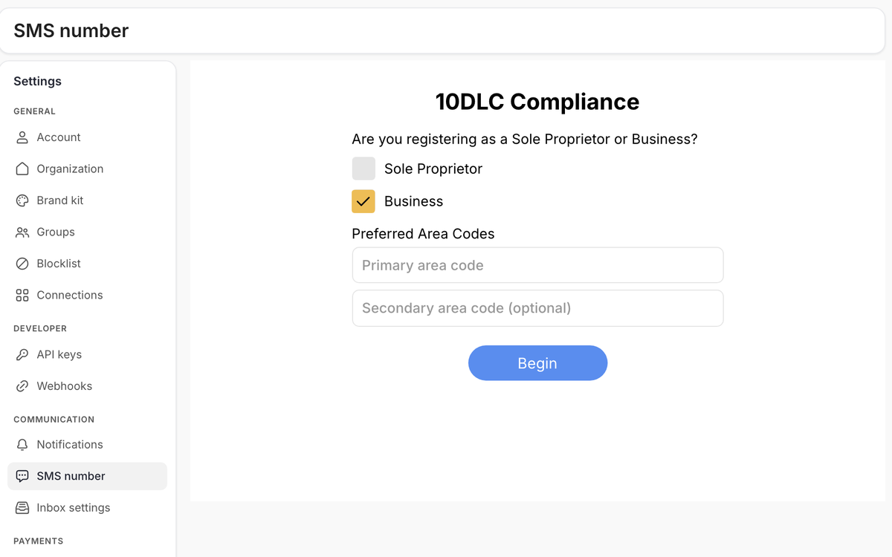

<Info>
  **Where to find this**: **Settings → SMS number** to set up your number. **Inbox → New message → SMS** to send.
</Info>

Texts reach anyone with a phone, including parents who never open the app. They come from your own business number, so your personal number stays private, and replies land in your Inbox.

## Get your business number

Until your club has a number, the **Texts** filter in the Inbox reads **Texts are not set up yet** with a **Request a number** button, and a new text shows "Texts go out from your SMS number. Request one to send texts." with **Request SMS Access**. Both take you to the same setup page.

<Steps>
  <Step title="Open SMS number settings">
    Go to **Settings → SMS number** (under **Communication**).

    <Frame>
      
    </Frame>
  </Step>
  <Step title="Choose your business type">
    Under **10DLC Compliance**, choose **Sole Proprietor** (an individual coach) or **Business** (a registered business, academy or facility). US carriers require this registration for business texting.
  </Step>
  <Step title="Add your preferred area codes">
    Enter the area codes you'd like your number to use, a first choice and a backup.
  </Step>
  <Step title="Click Begin">
    Your registration goes to the carriers for review. Approval usually takes about a week. Once it's approved, your number shows on this page and you can start texting.
  </Step>
</Steps>

### Your Privacy Policy and Terms

Carriers check a public Privacy Policy and Terms page during review. CoachIQ creates both for your app automatically, at your app address followed by `/privacy-policy` and `/terms-of-condition`. They load without a login and include what carriers ask for: how often you text, "message and data rates may apply", STOP and HELP instructions, and that agreeing to texts isn't a condition of purchase. You don't need to write anything. These are separate from any legal pages on your website (see [Legal pages](/website/pages-navigation/legal-pages)).

## Send a text

<Steps>
  <Step title="Start a new text">
    In **Inbox**, click **New message**, then **SMS** under **Outside the app**. To answer someone who texted you, open their conversation under **Texts** and reply there.
  </Step>
  <Step title="Choose who gets it">
    Pick people by name, or a tag, team or role for a group text. Only people in your club with a mobile number get texts. See [Send a new message](/inbox/new-message).
  </Step>
  <Step title="Write your message">
    A text to one person can be up to 1,400 characters; keep group texts short (155 characters). Sign it so families know who it's from.
  </Step>
  <Step title="Attach something (optional)">
    Attachments go out as links. A text to one person puts the item's name before each link, for example "Waiver Form: [link]". Group texts list the links without names.
  </Step>
  <Step title="Send">
    Click **Send text**. For a group, check the review step, then send.
  </Step>
</Steps>

### What texts cost

Each text you send uses messaging credits: about **1 credit for a short text**, and 100 credits cost \$1. Longer texts and texts with an emoji split into more parts and cost more. Replies from families are free. See [Messaging credits](/inbox/sms-credits).

## Replies and alerts

Replies land in your Inbox under **Texts**, as soon as they arrive, without reloading the page. Each person's replies are their own conversation; a group text never shows one family's reply to another.

When someone texts your number, the CoachIQ app sends you an alert with the sender's name, so you can tell who it is from the lock screen. The name shows only when the number is saved on the profile of a current member of that group. Otherwise, and for staff who can't open **People → Clients**, the alert shows the number. A text from a number that isn't in your club shows as a guest.

Turn Inbox alerts on or off under **Settings → Notifications**.

## Call forwarding

Families can call your business number, and the call rings through to a phone you choose. You can't make calls from the business number.

1. Go to **Settings → SMS number**.
2. Enter the **Call Forwarding Number**: the phone calls should ring.

To test it, call your business number from a **different** phone. If you call from the same phone the number forwards to, you'll hear: "This number forwards calls to the phone you are calling from. To test call forwarding, call this number from a different phone."

## Common questions

<AccordionGroup>
  <Accordion title="What if my registration is rejected?">
    Contact support to find out why and resubmit. Your app's Privacy Policy and Terms pages already include what carriers look for, so if a rejection mentions them, ask support to resubmit rather than editing anything.
  </Accordion>
  <Accordion title="Why didn't my text deliver?">
    Check two things: your number's registration is approved, and you have messaging credits. See [Texts aren't sending?](/inbox/sms-credits#texts-arent-sending). A person who has turned texts off, or has no mobile number, isn't texted.
  </Accordion>
  <Accordion title="Can I change my business number later?">
    Yes, but the new number goes through registration again. Your conversation history stays.
  </Accordion>
  <Accordion title="Can I delete a text I sent?">
    No. Texts can't be recalled once sent.
  </Accordion>
  <Accordion title="Can I text internationally?">
    Contact support for international texting and pricing.
  </Accordion>
</AccordionGroup>

## Related articles

- [Messaging credits](/inbox/sms-credits)
- [Send a new message](/inbox/new-message)
- [Direct messages](/inbox/in-app-messages)
- [Inbox overview](/inbox/inbox-overview)
