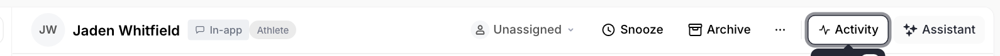
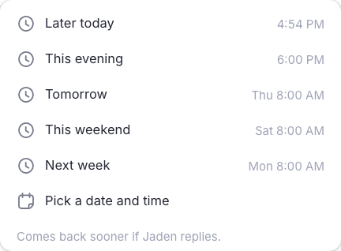
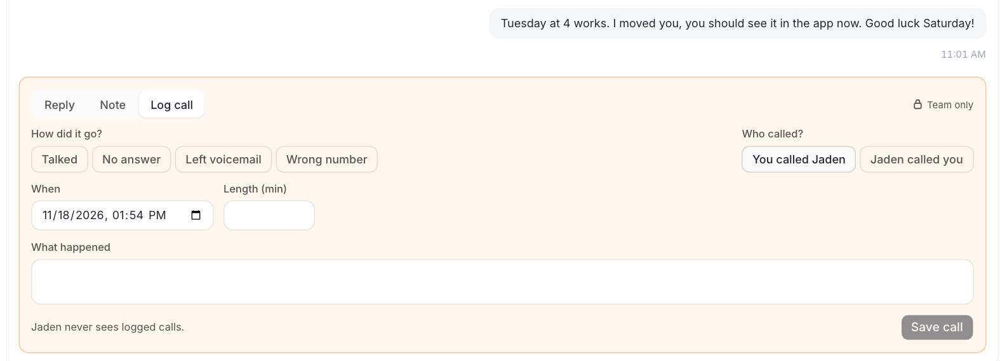

<Info>
  **Where to find this**: **Inbox** → open a conversation. The icons at the top and the reply box at the bottom hold everything on this page.
</Info>

Your Inbox is shared. When one person on your staff archives, assigns or snoozes a client conversation, everyone sees the change, so two coaches never answer the same question and nothing falls through because "someone else had it".

<Frame caption="The icons above a conversation: Assign, Snooze, Archive and More, then Activity and Assistant.">

</Frame>

## Assign a conversation

Assigning tells your team who is handling a conversation.

1. Open the conversation and click **Assign** (the person icon, or press **A**). It reads **Unassigned** until someone takes it.
2. Pick **You** or a staff member from the list.

The conversation now shows under **Mine** for that person, and their name shows on the row and at the top of the conversation. Two staff members with the same first name are told apart by last initial, for example "Sam L.". To take a conversation quickly, right-click its row and choose **Assign to me**.

Staff without Inbox access can't be assigned.

## Snooze until later

Snooze hides a conversation until you're ready to deal with it.

1. Click **Snooze** (the clock, or press **S**).
2. Pick **Later today**, **This evening**, **Tomorrow**, **This weekend**, **Next week**, or **Pick a date and time**.

The conversation moves to **Later** and comes back to Open at that time. It comes back sooner if the client replies. From the list, right-click a row and choose **Snooze until tomorrow**.

<Frame caption="Snooze choices. Times use your own time zone.">

</Frame>

## Archive and reopen

Click **Archive** (or press **E**) when a conversation is done. Archiving a client conversation archives it **for everyone on your staff**: it leaves Open and moves to every staff member's **Archive**. A message appears naming who archived it, with **Undo**.

An archived conversation shows "Archived by" and the person's name at the top, with **Reopen**. Reopening puts it back in Open for everyone. A new message from the client also brings it back to Open; an automated reminder doesn't.

If a teammate already archived or reopened the conversation a moment before you, CoachIQ tells you, and the list updates to show where the conversation is now.

<Note>
  A direct conversation between two staff members stays personal: archiving it only archives it for you.
</Note>

## Mark as unread

Right-click a conversation (or press and hold on a phone) and choose **Mark as unread** to flag it for yourself. Read and unread are personal: marking a conversation unread doesn't change it for your teammates. Opening the Inbox doesn't mark conversations as read; a conversation is marked read when you open it.

## Work on several conversations at once

1. Right-click any conversation and choose **Select**, or point at a row's picture and tick the box that appears.
2. Tick the other conversations you want.
3. Archive, assign, snooze or mark them read together. **Undo** reverses the last action.

Announcements, emails and staff chats can be archived and marked read, but not assigned or snoozed.

## Leave a note for your team

Notes are for your staff only. The client never sees them.

1. In the reply box, switch from **Reply** to **Note**. The box turns a soft colour and reads **Team only**.
2. Write the note and click **Save note**.

Notes show in the client's Activity panel and on their profile under **Notes and calls** (see [Staff notes](/people/client-profiles/client-profiles#staff-notes)). You can also add a note from the **Note** button in the [Profile panel](/inbox/client-profile-and-activity#profile).

## Log a phone call

Log calls you make or take on your own phone so the whole team knows what was said.

1. In the reply box, switch to **Log call**.
2. Choose **How did it go?**: **Talked**, **No answer**, **Left voicemail** or **Wrong number**.
3. Choose **Who called?**: you called them, or they called you.
4. Check **When**, add the **Length (min)** if you like, and write **What happened**.
5. Click **Save call**.

The client never sees logged calls. Each call shows in the client's Activity panel under **Calls**, and on their profile under **Notes and calls**, newest first, with who logged it.

<Frame caption="Log call: the outcome, who called, when, how long and what happened. Team only.">

</Frame>

### Who can add notes and log calls

Admins can always add and delete notes and calls. Coaches can while the **Coaches can add notes and log calls** switch is on. Admins find it at the top of a client's **Notes** tab on their profile; it's on by default. When it's off, coaches who can see clients still read notes and logged calls but can't add or remove them.

## Drafts

A reply you type in a conversation saves as a draft as you go (you'll see **Saved**). It stays with that conversation, so you can leave and come back, even after reloading the page. Only you see your drafts; a teammate opening the same conversation sees an empty reply box.

All your unsent replies are listed under **Drafts**.

## Send later

Schedule a reply to go out at a set time, for example first thing tomorrow instead of late at night.

1. Write your reply.
2. Open the menu attached to **Send** and choose **Send later**.
3. Pick the date and time. Times are in your own time zone.

The conversation shows when the reply will send, with **Edit** and **Cancel send**. The reply goes out once, at that time. If the draft changed somewhere else in the meantime (another tab or a teammate), CoachIQ says **Couldn't schedule. Try again.** or **Couldn't edit. Try again.** and loads the latest version.

## If a reply doesn't send

If a message fails, you see "Message not sent. What you typed is still in the box, so you can try again." Your text stays in the reply box with **Send** ready.

## Unsend an in-app message

Open the message's actions menu (beside the time) and choose **Unsend**. See [Unsend a direct message](/inbox/in-app-messages#unsend-a-direct-message). Texts and emails can't be recalled.

## Related articles

- [Inbox overview](/inbox/inbox-overview)
- [See the client beside the conversation](/inbox/client-profile-and-activity)
- [Send a new message](/inbox/new-message)
