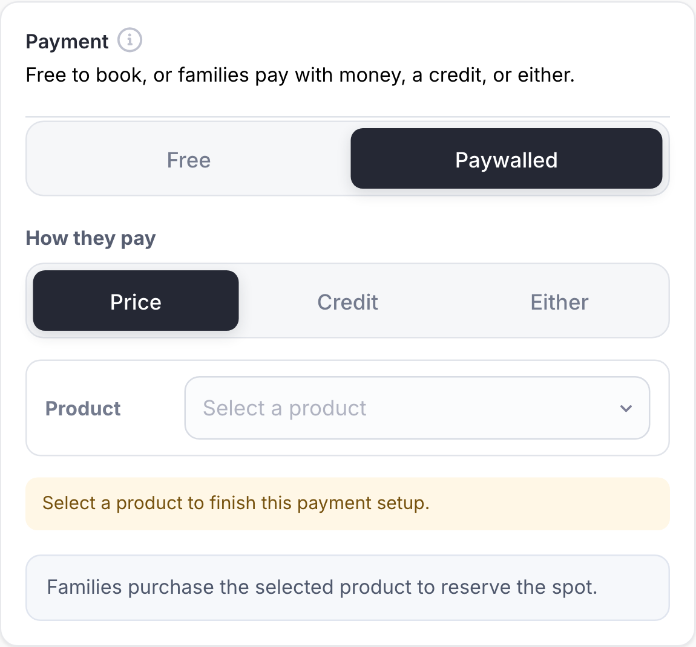
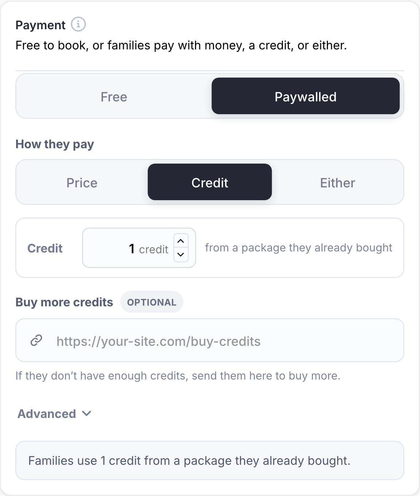
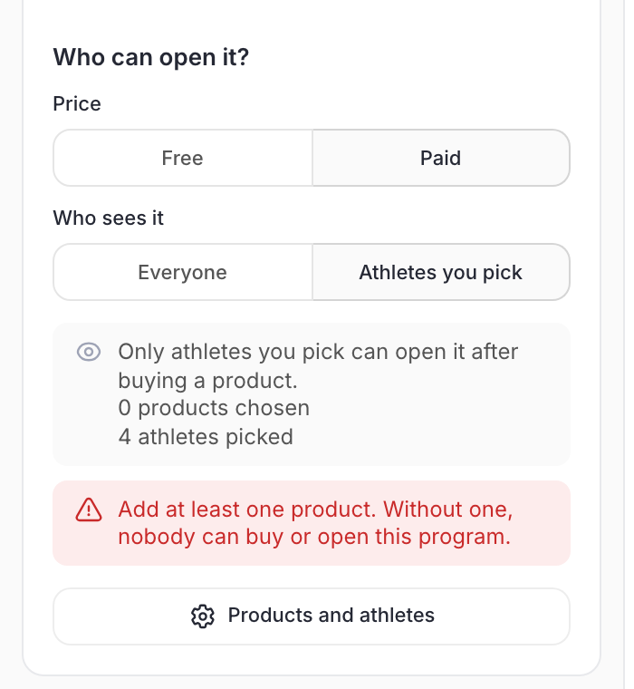
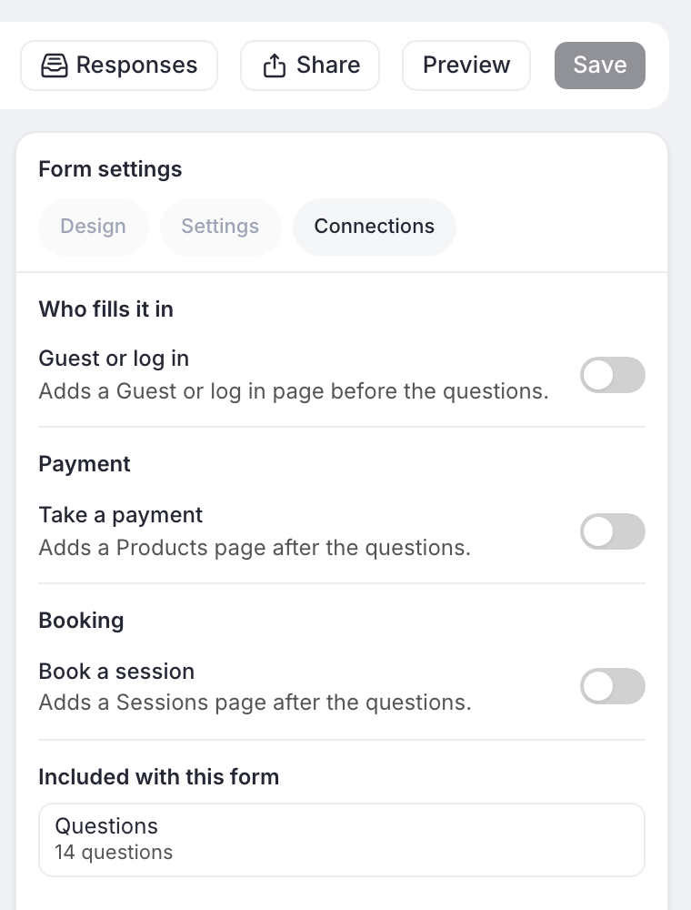

A product earns money once families can reach it. Besides your app's [Products page](/app/products) and the product's direct link, you can connect a product to three places:

| Place | What the family does | Where you set it |
| --- | --- | --- |
| **Scheduler** | Pays for a session, or uses credits from a package or membership | Scheduler → **Payment** |
| **Program** | Buys access to a Paid program | Program builder → **Who can open it?** |
| **Form** | Pays as part of a registration or sign-up form | Form builder → **Form settings** → **Connections** |

One product can be used in several places.

## Schedulers

Open the scheduler under **Scheduling → Schedulers** and go to **Payment**. Choose **Free** or **Paywalled**. For **Paywalled**, choose **How they pay**:

| Option | What families do | Product's role |
| --- | --- | --- |
| **Price** | Pay at booking | The product they buy at checkout |
| **Credit** | Use credits they already have | The package or membership that issued the credits |
| **Either** | Pay at booking or use credits | Both |

<Frame>
  
</Frame>

For credit booking, two settings must agree:

1. The scheduler's **Payment** is **Credit** or **Either**, with the credit cost per booking.
2. The product adds credits, and its **Credit Limits** allow this scheduler, or are left open to all schedulers.

<Frame>
  
</Frame>

Add a **Buy more credits** link pointing to the right product so families know where to top up.

The full steps, including prices by session length, are in [Set booking payments](/scheduling/setting-up-payment-options) and [Credits and schedulers](/scheduling/credits-and-schedulers).

<Tip>
  To make a session members-only, use **Paywalled → Credit** and sell the credits through a membership. Families without eligible credits can't book it.
</Tip>

Saving the scheduler doesn't publish it. Add it to your app or website, then book a test session through the link families will use. See [Share and publish schedulers](/scheduling/sharing-schedulers).

## Programs

<Steps>
  <Step title="Open the program's share settings">
    Go to **Content → Programs** and open the program. Its access settings are under **Who can open it?** on the left.
  </Step>
  <Step title="Set the price to Paid">
    Under **Price**, choose **Paid**. Then choose **Products and athletes** and select the products that unlock the program. Until you add at least one, the builder warns that nobody can buy or open the program.

    <Frame>
      
    </Frame>
  </Step>
  <Step title="Save">
    Select **Update program** at the top right.
  </Step>
</Steps>

A one-time product gives lasting access. A subscription gives access while it's active. Families open the program in the app, see that it's locked, and buy one of the products you selected to unlock it.

Full program sharing options, including private programs, are in [Share and sell programs](/content/sharing-programs).

## Forms

Open the form under **Tools → Forms**. In **Form settings** on the right, open **Connections** and turn on **Take a payment**. It adds a Products page after the questions, so families answer the form and then check out. Select **Save** at the top right.

<Frame>
  
</Frame>

To require a form whenever someone buys a product, start from the product instead: **Advanced → Add a form**. See [Attach a registration form to a product](/payments/product-builder#attach-a-registration-form-to-a-product) and [Forms with payments and bookings](/tools/forms/payments-and-bookings).

## Troubleshooting

<AccordionGroup>
  <Accordion title="The product isn't in the list">
    - Check the product isn't archived. On **Payments → Products**, set the status filter to **Archived**.
    - Check you saved the product.
    - Reopen the scheduler, program, or form so the list reloads.
  </Accordion>
  <Accordion title="A family can't pay">
    - Check [Stripe is connected](/payments/connecting-stripe) and the product's price is correct.
    - Check the product hasn't reached its purchase limit.
    - Open the link or page the family used and go as far as checkout yourself.
  </Accordion>
  <Accordion title="A family has credits but can't book">
    - The scheduler must be **Paywalled** with **Credit** or **Either**.
    - The product's **Credit Limits** must allow this scheduler.
    - The credits may have expired, or a per-scheduler limit may be reached for this billing period.
    - The credits may belong to a parent or a child depending on [who the purchase is for](/payments/product-builder#who-the-purchase-is-for).

    See [Credit usage limits and restrictions](/payments/credits/credit-usage-limits-restrictions).
  </Accordion>
</AccordionGroup>

## Related articles

- [Products overview](/payments/product-overview)
- [Product Builder reference](/payments/product-builder)
- [Credits overview](/payments/credits/credit-system-overview)
- [Transactions](/payments/transactions)
