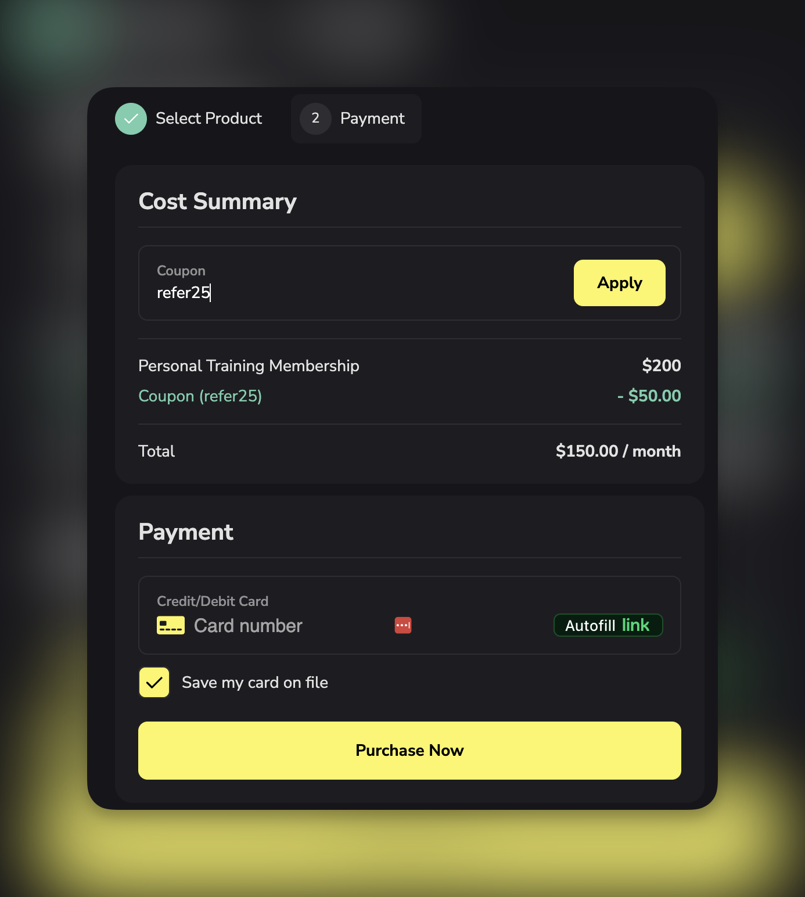
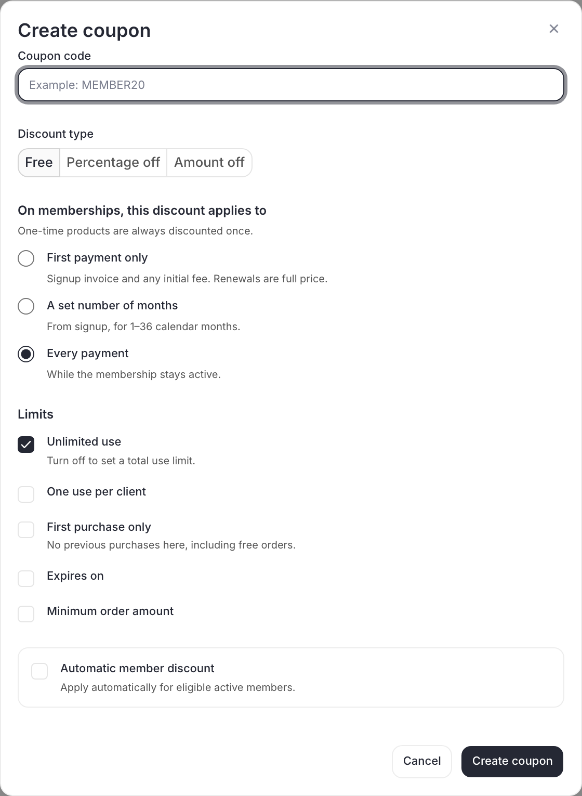
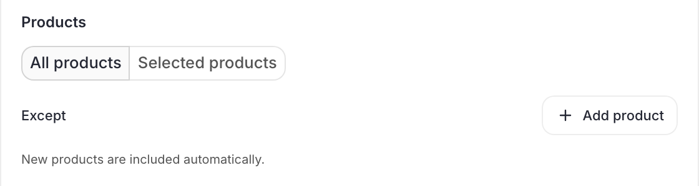
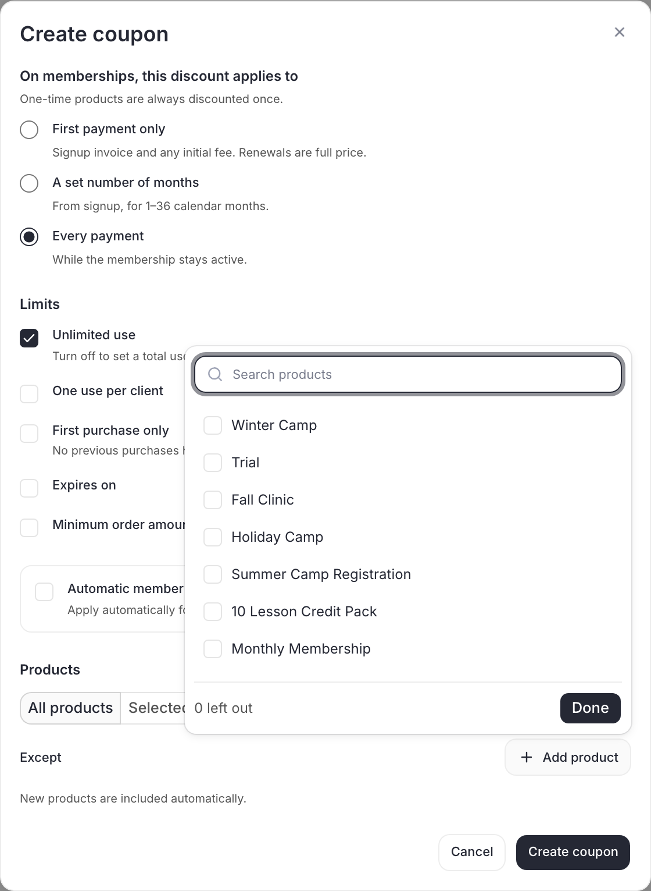
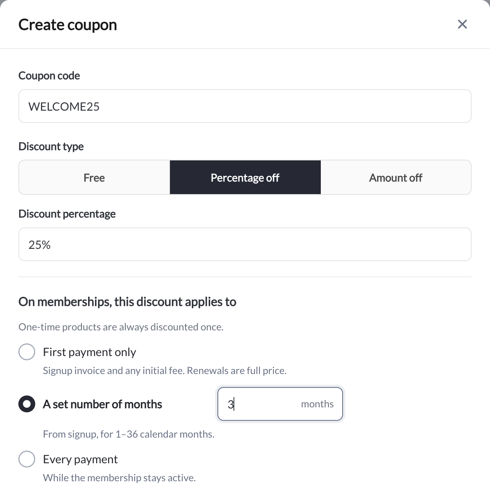

<Info>
  **Where to find this**: Payments → Coupons
</Info>

## What coupons are

Coupons are discount codes that reduce product prices at checkout:

- Percentage discounts (10%, 25%, 50% off)
- Fixed amount discounts (\$10, \$25 off)
- Free access (100% off)

Clients enter coupon codes during checkout to apply discounts automatically.

## The Coupons page

Navigate to **Payments → Coupons** to view all discount codes. Search by code, or use **Type** to show one kind of coupon.

The list has four columns:

- **Coupon**: the code clients enter
- **Discount**: the type and amount, with how long it lasts on memberships
- **Uses**: how many times it has been used, against its limit if it has one
- **Applies to**: what it covers, such as **All products**, **All products except 3**, or **2 products**

**Available actions:**

- **Create** a new coupon
- **Edit products** on an All products coupon, to change what it leaves out
- Delete a coupon using its row action

### Who can use the Coupons page

Admins always can. A coach can use it when their Staff Access covers all clients and the Coupons page is turned on for them. They can create, change, and delete coupons the same as an admin.

A coach limited to clients with certain tags doesn't get the Coupons page, because a coupon shows which clients used it. In Staff Access, Coupons shows as locked while their clients are limited.

## Three coupon types

<Tabs>
  <Tab title="Free">
    **100% off - No payment required**

    Product becomes free when coupon applied.

    **When to use:**

    - Promotional giveaways
    - Scholarship access
    - Sponsor/donor complimentary sessions
    - Contest prizes

    **Example:** FREESESSION code makes \$75 session free

    <Info>
      Free coupons still require checkout process to capture client info and issue credits.
    </Info>
  </Tab>
  <Tab title="Percentage Off">
    **Discount by percentage**

    Reduces price by specified percentage.

    **When to use:**

    - Promotional campaigns (25% off sale)
    - Referral rewards (20% off for referrals)
    - Seasonal discounts
    - Member benefits (for an automatic discount tied to a membership, use [Member discounts](#member-discounts) instead)

    **Examples:**

    - 10OFF = 10% discount
    - SPRING25 = 25% off
    - HALF = 50% discount

    <Tip>
      Percentage discounts scale with product price. \$100 product with 25% off = \$25 discount. \$200 product with 25% off = \$50 discount.
    </Tip>
  </Tab>
  <Tab title="Amount Off">
    **Fixed dollar discount**

    Reduces price by specific dollar amount.

    **When to use:**

    - Fixed-value promotions (\$10 off any purchase)
    - Bundle discounts (\$50 off packages)
    - Retention offers (\$25 off return visit)

    **Examples:**

    - SAVE10 = \$10 off
    - BUNDLE50 = \$50 off
    - TWENTYFIVE = \$25 off

    <Warning>
      Amount-off coupons can't reduce price below \$0. \$10 off a \$5 product results in \$0 charge, not negative.
    </Warning>
  </Tab>
</Tabs>

## Common use cases

<CardGroup cols={2}>
  <Card title="Promotions" icon="megaphone">
    Limited-time sales, seasonal offers, launch discounts
  </Card>
  <Card title="Referrals" icon="user-plus">
    Reward clients who refer friends with discount codes
  </Card>
  <Card title="Partnerships" icon="handshake">
    Corporate codes, sponsor access, organization discounts
  </Card>
  <Card title="Retention" icon="arrow-rotate-left">
    Win-back offers, loyalty rewards, comeback incentives
  </Card>
  <Card title="Influencer" icon="star">
    Unique codes for social media promoters and affiliates
  </Card>
  <Card title="Apology" icon="face-frown">
    Service recovery, issue compensation, goodwill gestures
  </Card>
</CardGroup>

## Coupon vs. Access Code product

**Two ways to offer special access:**

<Tabs>
  <Tab title="Coupon">
    **Discount applied to existing product**

    - Create one coupon
    - Works with any product
    - Client selects product, then applies coupon
    - More flexible - one coupon for multiple products

    **Example:** SUMMER25 code gives 25% off any product
  </Tab>
  <Tab title="Access Code Product">
    **Separate product requiring code**

    - Create Access Code product type
    - Works only for that specific product
    - Client enters code to see/purchase product
    - More controlled - specific product with specific code

    **Example:** CORPORATE2025 unlocks "Corporate Partner Sessions" product

    [Learn about Access Code products →](/payments/product-types)
  </Tab>
</Tabs>

<Tip>
  **General promotions:** Use coupons (one code for many products)

  **Specific partnerships:** Use Access Code products (controlled access to dedicated product)
</Tip>

## How clients use coupons

<Steps>
  <Step title="Client selects product">
    Client goes to booking page or product purchase and selects what they want.
  </Step>
  <Step title="Client enters coupon code">
    At checkout, client finds "Coupon Code" or "Promo Code" field and enters code.
  </Step>
  <Step title="Discount applies">
    The payment buttons wait until the new total appears, so the charge always matches the total shown. The applied coupon sits in one row with **Change** and **Remove**; removing it restores the original price.

    Client sees:

    - Original price (strikethrough)
    - Discount amount, in dollars and cents (for example \$20.00, - \$5.00, \$15.00)
    - New total, labeled **Due today** when it differs from the list price. A coupon larger than the price totals \$0.00, never a negative amount.

    <Frame>
      
    </Frame>
  </Step>
  <Step title="Client completes purchase">
    Client pays discounted amount and receives product/credits. The confirmation shows **Paid today** with the amount actually charged.
  </Step>
</Steps>

### When a code is refused

If a code can't be used, checkout says why and the total doesn't change:

| Message | What it means |
| --- | --- |
| "This coupon has reached its redemption limit." | The code's total use limit is used up |
| "This coupon does not apply to this product." | The product isn't one of the coupon's selected products, or it's left out of an All products coupon |
| "That code isn't valid for this order." | The code doesn't exist or can't be used on this order; check the spelling with the client |
| "We couldn't check that code. Please try again." | A passing connection problem. Selecting **Apply** again checks it |

A code that's turned down is never sent with the payment, so the price on the **Pay** button is the price charged. If one code is applied and a second is turned down, the first discount stays. When the real problem is the payment method or the athlete chosen, checkout shows only that message and doesn't call the code invalid; fix it and select **Apply** again.

A visitor who enters a code and then signs in during checkout has the code checked again for their account, so a member price or a code meant for them shows before they pay. A guest asked to set a password partway through keeps the code they entered.

\$0 products that only save a card on file don't show a coupon box.

## Coupon list columns explained

**Coupon**: the exact text a client enters. Share it exactly as created.

**Discount**: Free (100% off), Percentage off (10%, 25%, 50%), or Amount off (\$10, \$25). How long it lasts on memberships shows with it, such as Every payment.

**Uses**: how many times the coupon has been used. With a limit it shows both, so 15/100 means 15 uses out of 100.

**Applies to**: All products, All products except a number, or the number of selected products. Automatic member discounts also show which memberships qualify.

## Filter coupons

**Filter by type:**

- All coupons
- Free only
- Percentage off only
- Amount off only

Use the type filters beside the coupon list to narrow the table.

## Coupon limitations and controls

**Redemption limits:**

- Unlimited uses (default)
- Limited total uses (50, 100, 500, etc.)
- One use per client (requires sign-in)
- First purchase only (no previous purchases in this business, including free orders)
- An expiration date for new redemptions
- A minimum order amount

<Frame caption="Limits control who can use the code and when. Automatic member discount turns it into a standing member perk.">

</Frame>

## Choose which products a coupon covers

Under **Products**, pick one:

- **All products**: covers every product, including ones you create later. Use **Except** to leave some out.
- **Selected products**: covers only the products you pick. New products aren't covered until you add them.

<Frame caption="All products with an Except list. New products are included automatically.">

</Frame>

### Leave products out of an All products coupon

Use this when a discount should cover almost everything, for example 20% off all training for team members, but not team registration fees.

<Steps>
  <Step title="Choose All products">
    In **Create coupon**, under **Products**, select **All products**.
  </Step>
  <Step title="Add the products to leave out">
    Next to **Except**, select **Add product**. Search, tick the products to leave out, then select **Done**. Each one shows under **Except**, and you can remove them one at a time.
  </Step>
  <Step title="Create the coupon">
    Select **Create coupon**. Left-out products show their full price at checkout, with no discount line.
  </Step>
</Steps>

<Frame caption="Search and tick the products to leave out.">

</Frame>

To change what an existing All products coupon leaves out, open its row menu on the Coupons page and select **Edit products**. The code, discount, and qualifying memberships stay the same. The change applies to checkouts from then on. Orders already paid, and checkouts already under way, keep their price.

You can also do this from a product: when an All products member discount covers it, the [product builder](/payments/product-builder) shows a line under the price with **Leave out**. See [Member discounts](#member-discounts).

<Tip>
  Making team fees or other products that shouldn't get the member price? Check the line under the price in the product builder before you publish the product. New products are covered by All products coupons until you leave them out.
</Tip>

## Coupons and subscriptions

Choose how long the discount applies when creating the coupon:

| Duration | Effect |
| --- | --- |
| First payment only | Discounts the first invoice, then renews at the regular price |
| A set number of months | Discounts invoices within 1–36 calendar months from signup; this is not a count of sessions or payments |
| Every payment | Keeps the discount on future payments |

One-time products receive their discount once. Checkout shows the introductory amount and later renewal price. An expiration date controls when a code can be redeemed; it is separate from the duration of a discount already applied to a membership.

**Initial fees are discounted too.** If the membership has an [initial down payment](/payments/product-builder#section-2-payment-options), the coupon can reduce that up-front fee as well as eligible recurring charges within its discount duration. A 100%-off code on a month-to-month membership therefore makes the first payment genuinely free, rather than free on the recurring price only.

<Info>

  Use **First payment only** for an introductory offer instead of planning to remove a recurring discount manually. Automatic member discounts keep their ongoing membership rules.

</Info>

### Check the initial payment and renewal price

After a membership purchase, **Orders** shows the full **Initial payment**, including any discounted down payment, separately from the recurring rate. **Billing** also distinguishes the initial amount when it differs.

A **First payment only** coupon reduces the initial eligible invoice, then the membership displays the normal renewal rate. **Every payment** keeps the eligible recurring discount. For a limited-duration coupon, check its end before explaining future renewals. [Payment examples](/payments/product-builder#understand-the-amounts-clients-see).

## Member discounts

Member discounts are automatic: anyone who holds a specific membership pays less for your other products, with no code to enter. Set them up when facilities want team members to get member pricing on camps, clinics, rentals, or add-on memberships.

**How it works**

1. Open **Payments → Coupons → Create coupon** and set the discount.
2. Turn on **Automatic member discount** and choose the qualifying memberships. Anyone with one of them active gets the discount.
3. Choose which products it applies to: selected products, or all products. With all products, use **Except** to leave some out, such as team fees. The list can include other memberships and one-time products.
4. Select **Create coupon**. From then on, when an active member checks out on one of those products, the discount is applied automatically and shown in the price breakdown. This includes a parent paying for an athlete who holds the qualifying membership, on product checkout and session booking.

If a percentage member discount can't be saved because one of the qualifying memberships has a down payment, the message names the memberships to remove (up to three, then "and N more").

To change which products an All products member discount leaves out, use **Edit products** on its row, or **Leave out** and **Include** in each product's builder. Both change the same Except list. To change anything else (the discount, duration or qualifying memberships), delete it and create a new one.

### See member pricing in the product builder

When an All products member discount covers a product, the product builder shows a line under the price, for example "Members pay \$160: MEMBER20ALL covers all products", with a **Leave out** button. Select **Leave out** and the line changes to "Left out of MEMBER20ALL: members pay full price", with **Include** to undo it.

The line only shows when checkout would actually give the discount. A member discount that has reached its use limit doesn't show a member price. If checkout would refuse the discount, for example a percentage member discount on a membership with a down payment, the builder says so. A product you haven't created yet shows the line without the button until you save it.

**Coupon or member discount?**

| | Coupon | Member discount |
| --- | --- | --- |
| Who gets it | Anyone with the code | Anyone with the qualifying membership active |
| How it's applied | Client types the code at checkout | Automatically at checkout |
| Scope | Selected products, or all products with exceptions | Selected products, or all products with exceptions |
| Redemption eligibility | The code must meet its expiry, usage, product, and client rules | The qualifying membership must be active |

<Tip>
  Use a coupon for a time-limited promotion anyone can share. Use a member discount for a standing perk that should follow the membership without you handing out codes.
</Tip>

## Creating your first coupon

1. Open **Payments → Coupons → Create coupon**.
2. Enter the **Coupon code**, then choose **Free**, **Percentage off**, or **Amount off**. Enter the percentage or amount when required.
3. Under **On memberships, this discount applies to**, choose **First payment only**, **A set number of months**, or **Every payment**. Enter 1–36 months for a limited duration.
4. Under **Limits**, leave **Unlimited use** on or turn it off to set a total use limit. Add any per-client, first-purchase, expiry, or minimum-order restrictions.
5. Turn on **Automatic member discount** only for a membership-based offer, then choose the qualifying memberships.
6. Under **Products**, choose **All products** (add any exceptions under **Except**) or **Selected products** and pick them.
7. Review the code, discount, duration, and restrictions, then select **Create coupon**. **Cancel** closes the window without saving.

<Note>
  A deleted coupon's code can't be used again. If you try, you'll be asked to choose a different code. This stops a new coupon from picking up the old one's uses.
</Note>

<Note>
  Amount fields keep cents as typed: 0.50 saves as \$0.50. Before the October 19, 2026 release, a typed decimal point could be dropped, so a discount could save much larger than intended (0.50 became \$50). Apart from the products an All products coupon leaves out, coupons can't be edited. If one of yours looks too large, delete it and create a new one with a different code.
</Note>

<Frame caption="Example: WELCOME25 gives 25% off during the first three calendar months. This screenshot shows an unsaved example, not an active promotional code.">

</Frame>

## Tracking coupon performance

**Metrics to monitor:**

**Redemption count:** How many times used

**Revenue impact:** Total discount given away

**Conversion rate:** Coupon uses / Coupon impressions

**Most popular codes:** Which coupons clients use most

**Least used codes:** Which promotions aren't working

Use redemption data to:

- Measure campaign success
- Adjust discount amounts
- Identify effective channels
- Plan future promotions

## Best practices

**Code naming:**

- Make codes memorable (SPRING25, not XJ7H2K9)
- Include discount in name when possible (25OFF)
- Match campaign (REFER20 for referral program)
- Keep them short (under 15 characters)

**Discount sizing:**

- Test different amounts to find sweet spot
- Too small: Doesn't motivate action
- Too large: Erodes margins unnecessarily
- Common sweet spot: 20-30% for percentage, \$25-\$50 for amount

**Promotion timing:**

- Limited time creates urgency (48-hour sale)
- Seasonal alignment (SUMMER, NEWYEAR)
- Event-based (GRANDOPENING, ANNIVERSARY)

**Communication:**

- Clearly state terms (expires, limits, restrictions)
- Make codes easy to find and share
- Remind clients of expiration dates
- Celebrate redemptions (thank clients who use codes)

## Related articles

- [Product Types Explained](/payments/product-types)
- [Product Overview](/payments/product-overview)
- [Product Builder](/payments/product-builder)
