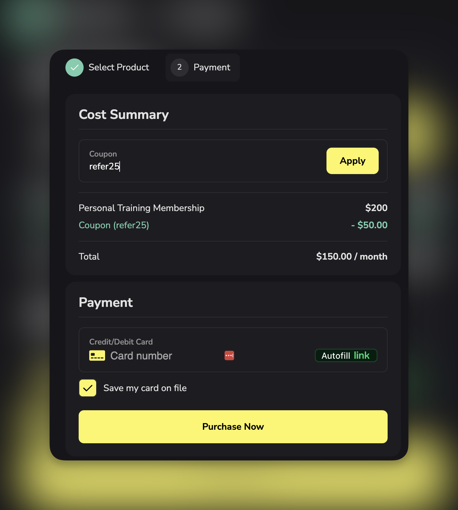
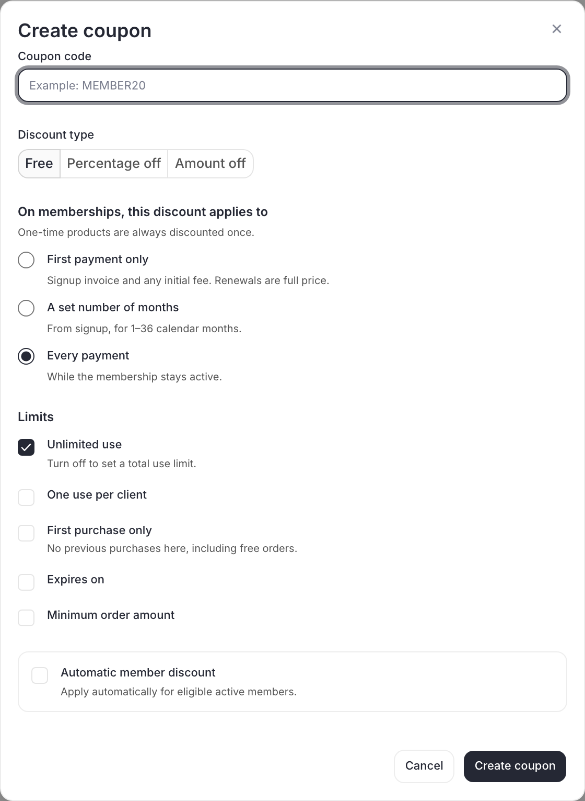
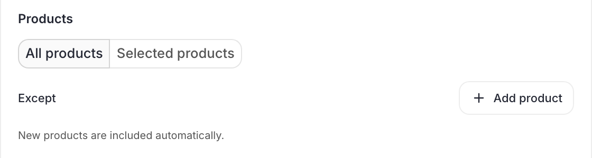
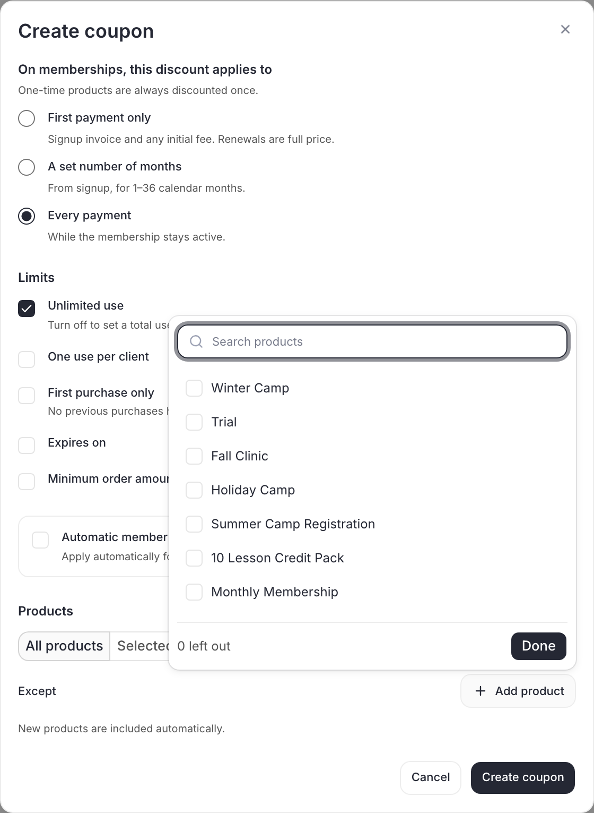

<Info>
  **Where to find this**: Payments → Coupons → Create coupon (**Limits**, **Automatic member discount**, **Products**)
</Info>

A coupon works for anyone who has the code, within the limits you set. To give a discount only to members, with no code, use a [member discount](#member-discounts).

## How clients use coupons

Share the code exactly as it shows in the **Coupon** column: in a text, an email, a social post or on your website. Clients enter it at checkout, including in the product payment pop-up and in checkout embedded on your website.

<Steps>
  <Step title="Client selects product">
    Client goes to booking page or product purchase and selects what they want.
  </Step>
  <Step title="Client enters coupon code">
    At checkout, client finds "Coupon Code" or "Promo Code" field and enters code.
  </Step>
  <Step title="Discount applies">
    The payment buttons wait until the new total appears, so the charge always matches the total shown. The applied coupon sits in one row with **Change** and **Remove**; removing it restores the original price.

    Client sees:

    - Original price (strikethrough)
    - Discount amount, in dollars and cents (for example \$20.00, - \$5.00, \$15.00)
    - New total, labeled **Due today** when it differs from the list price. A coupon larger than the price totals \$0.00, never a negative amount.

    <Frame>
      
    </Frame>
  </Step>
  <Step title="Client completes purchase">
    Client pays discounted amount and receives product/credits. The confirmation shows **Paid today** with the amount actually charged.
  </Step>
</Steps>

If a code is turned down, checkout says why. See [Coupon troubleshooting](/payments/coupon-troubleshooting).

## Limits and dates

**Redemption limits:**

- Unlimited uses (default)
- Limited total uses (50, 100, 500, etc.)
- One use per client (requires sign-in)
- First purchase only (no previous purchases in this business, including free orders)
- An expiration date for new redemptions
- A minimum order amount

An expiration date stops new redemptions. It doesn't end a discount already applied to a membership; that follows the coupon's [duration](/payments/create-coupons#coupons-and-subscriptions).

<Frame caption="Limits control who can use the code and when. Automatic member discount turns it into a standing member perk.">

</Frame>

## Choose which products a coupon covers

Under **Products**, pick one:

- **All products**: covers every product, including ones you create later. Use **Except** to leave some out.
- **Selected products**: covers only the products you pick. New products aren't covered until you add them.

<Frame caption="All products with an Except list. New products are included automatically.">

</Frame>

### Leave products out of an All products coupon

Use this when a discount should cover almost everything, for example 20% off all training for team members, but not team registration fees.

<Steps>
  <Step title="Choose All products">
    In **Create coupon**, under **Products**, select **All products**.
  </Step>
  <Step title="Add the products to leave out">
    Next to **Except**, select **Add product**. Search, tick the products to leave out, then select **Done**. Each one shows under **Except**, and you can remove them one at a time.
  </Step>
  <Step title="Create the coupon">
    Select **Create coupon**. Left-out products show their full price at checkout, with no discount line.
  </Step>
</Steps>

<Frame caption="Search and tick the products to leave out.">

</Frame>

To change what an existing All products coupon leaves out, open its row menu on the Coupons page and select **Edit products**. The code, discount, and qualifying memberships stay the same. The change applies to checkouts from then on. Orders already paid, and checkouts already under way, keep their price.

You can also do this from a product: when an All products member discount covers it, the [product builder](/payments/product-builder) shows a line under the price with **Leave out**. See [Member discounts](#member-discounts).

<Tip>
  Making team fees or other products that shouldn't get the member price? Check the line under the price in the product builder before you publish the product. New products are covered by All products coupons until you leave them out.
</Tip>

## Member discounts

Member discounts are automatic: anyone who holds a specific membership pays less for your other products, with no code to enter. Set them up when facilities want team members to get member pricing on camps, clinics, rentals, or add-on memberships.

**How it works**

1. Open **Payments → Coupons → Create coupon** and set the discount.
2. Turn on **Automatic member discount** and choose the qualifying memberships. Anyone with one of them active gets the discount.
3. Choose which products it applies to: selected products, or all products. With all products, use **Except** to leave some out, such as team fees. The list can include other memberships and one-time products.
4. Select **Create coupon**. From then on, when an active member checks out on one of those products, the discount is applied automatically and shown in the price breakdown. This includes a parent paying for an athlete who holds the qualifying membership, on product checkout and session booking.

Member discounts need an active **recurring** membership; a pass or credit pack doesn't qualify. If someone who doesn't qualify books a session with a member discount, the booking stops. See [A member discount stopped a booking](/payments/coupon-troubleshooting#a-member-discount-stopped-a-booking).

To change which products an All products member discount leaves out, use **Edit products** on its row, or **Leave out** and **Include** in each product's builder. Both change the same Except list. To change anything else (the discount, duration or qualifying memberships), delete it and create a new one.

### See member pricing in the product builder

When an All products member discount covers a product, the product builder shows a line under the price, for example "Members pay \$160: MEMBER20ALL covers all products", with a **Leave out** button. Select **Leave out** and the line changes to "Left out of MEMBER20ALL: members pay full price", with **Include** to undo it.

The line only shows when checkout would actually give the discount. A member discount that has reached its use limit doesn't show a member price. If checkout would refuse the discount, for example a percentage member discount on a membership with a down payment, the builder says so. A product you haven't created yet shows the line without the button until you save it.

### Coupon or member discount?

| | Coupon | Member discount |
| --- | --- | --- |
| Who gets it | Anyone with the code | Anyone with the qualifying membership active |
| How it's applied | Client types the code at checkout | Automatically at checkout |
| Scope | Selected products, or all products with exceptions | Selected products, or all products with exceptions |
| Redemption eligibility | The code must meet its expiry, usage, product, and client rules | The qualifying membership must be active |

<Tip>
  Use a coupon for a time-limited promotion anyone can share. Use a member discount for a standing perk that should follow the membership without you handing out codes.
</Tip>

## Tracking coupon performance

**Metrics to monitor:**

**Redemption count:** How many times used

**Revenue impact:** Total discount given away

**Conversion rate:** Coupon uses / Coupon impressions

**Most popular codes:** Which coupons clients use most

**Least used codes:** Which promotions aren't working

Use redemption data to:

- Measure campaign success
- Adjust discount amounts
- Identify effective channels
- Plan future promotions

## Best practices

**Code naming:**

- Make codes memorable (SPRING25, not XJ7H2K9)
- Include discount in name when possible (25OFF)
- Match campaign (REFER20 for referral program)
- Keep them short (under 15 characters)

**Discount sizing:**

- Test different amounts to find sweet spot
- Too small: Doesn't motivate action
- Too large: Erodes margins unnecessarily
- Common sweet spot: 20-30% for percentage, \$25-\$50 for amount

**Promotion timing:**

- Limited time creates urgency (48-hour sale)
- Seasonal alignment (SUMMER, NEWYEAR)
- Event-based (GRANDOPENING, ANNIVERSARY)

**Communication:**

- Clearly state terms (expires, limits, restrictions)
- Make codes easy to find and share
- Remind clients of expiration dates
- Celebrate redemptions (thank clients who use codes)

## Related articles

- [Coupons overview](/payments/coupon-overview)
- [Create a coupon](/payments/create-coupons)
- [Coupon troubleshooting](/payments/coupon-troubleshooting)
- [Product Builder](/payments/product-builder)
