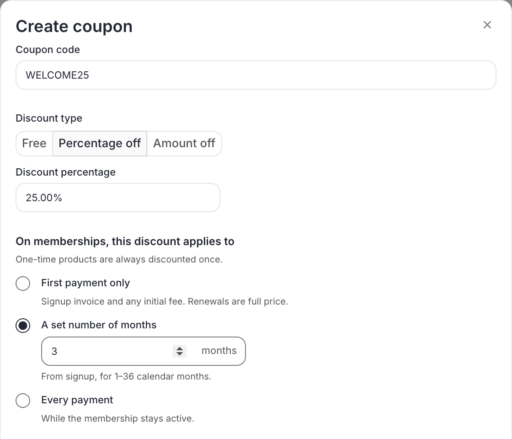

<Info>
  **Where to find this**: Payments → Coupons → Create coupon
</Info>

New to coupons? Start with the [Coupons overview](/payments/coupon-overview) for the three kinds and when to use each.

## Create a coupon

1. Open **Payments → Coupons → Create coupon**.
2. Enter the **Coupon code**, then choose **Free**, **Percentage off**, or **Amount off**. Enter the percentage or amount when required.
3. Under **On memberships, this discount applies to**, choose **First payment only**, **A set number of months**, or **Every payment**. Enter 1–36 months for a limited duration. See [Coupons and subscriptions](#coupons-and-subscriptions) below.
4. Under **Limits**, leave **Unlimited use** on or turn it off to set a total use limit. Add any per-client, first-purchase, expiry, or minimum-order restrictions. See [Limits and dates](/payments/coupon-sharing-and-limits#limits-and-dates).
5. Turn on **Automatic member discount** only for a membership-based offer, then choose the qualifying memberships. See [Member discounts](/payments/coupon-sharing-and-limits#member-discounts).
6. Under **Products**, choose **All products** (add any exceptions under **Except**) or **Selected products** and pick them. See [Choose which products a coupon covers](/payments/coupon-sharing-and-limits#choose-which-products-a-coupon-covers).
7. Review the code, discount, duration, and restrictions, then select **Create coupon**. **Cancel** closes the window without saving.

<Frame caption="Example: WELCOME25 gives 25% off during the first three calendar months. This screenshot shows an unsaved example, not an active promotional code.">

</Frame>

<Note>
  A deleted coupon's code can't be used again. If you try, you'll be asked to choose a different code. This stops a new coupon from picking up the old one's uses.
</Note>

<Note>
  Amount fields keep cents as typed: 0.50 saves as \$0.50. Apart from the products an All products coupon leaves out, coupons can't be edited. To change anything else, delete the coupon and create a new one with a different code. If an older coupon looks too large, see [Coupon troubleshooting](/payments/coupon-troubleshooting#common-questions).
</Note>

## Coupons and subscriptions

Choose how long the discount applies when creating the coupon:

| Duration | Effect |
| --- | --- |
| First payment only | Discounts the first invoice, then renews at the regular price |
| A set number of months | Discounts invoices within 1–36 calendar months from signup; this is not a count of sessions or payments |
| Every payment | Keeps the discount on future payments |

One-time products receive their discount once. Checkout shows the introductory amount and later renewal price. An expiration date controls when a code can be redeemed; it is separate from the duration of a discount already applied to a membership.

**Initial fees are discounted too.** If the membership has an [initial down payment](/payments/product-builder#section-2-payment-options), the coupon can reduce that up-front fee as well as eligible recurring charges within its discount duration. A 100%-off code on a month-to-month membership therefore makes the first payment genuinely free, rather than free on the recurring price only.

<Info>

  Use **First payment only** for an introductory offer instead of planning to remove a recurring discount manually. Automatic member discounts keep their ongoing membership rules.

</Info>

### Check the initial payment and renewal price

After a membership purchase, **Orders** shows the full **Initial payment**, including any discounted down payment, separately from the recurring rate. **Billing** also distinguishes the initial amount when it differs.

A **First payment only** coupon reduces the initial eligible invoice, then the membership displays the normal renewal rate. **Every payment** keeps the eligible recurring discount. For a limited-duration coupon, check its end before explaining future renewals. [Payment examples](/payments/product-builder#understand-the-amounts-clients-see).

## Next steps

- [Share and limit a coupon](/payments/coupon-sharing-and-limits): limits, dates, products it covers, and member discounts
- [Coupon troubleshooting](/payments/coupon-troubleshooting): why a code didn't apply
