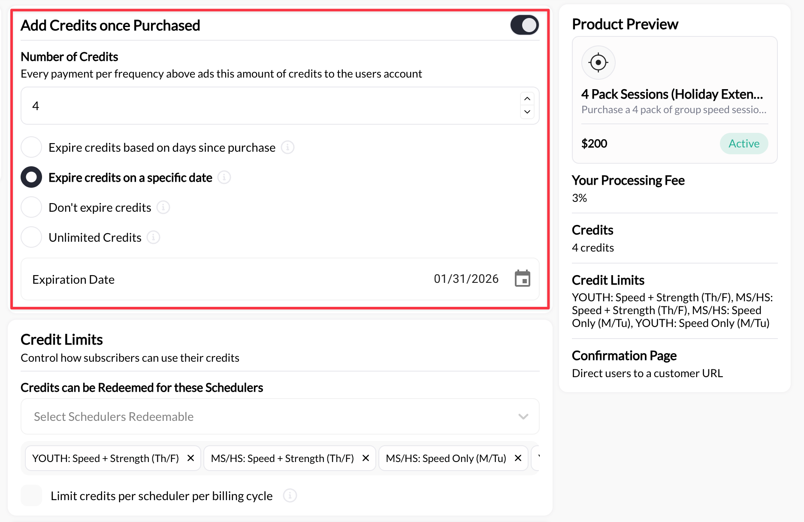
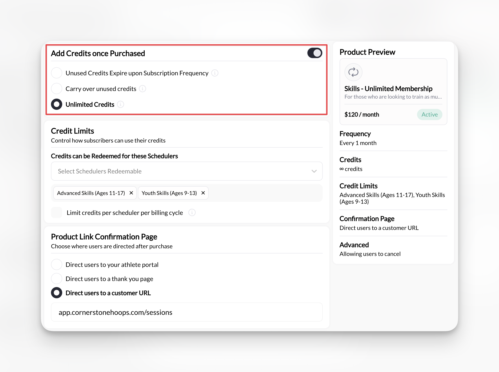
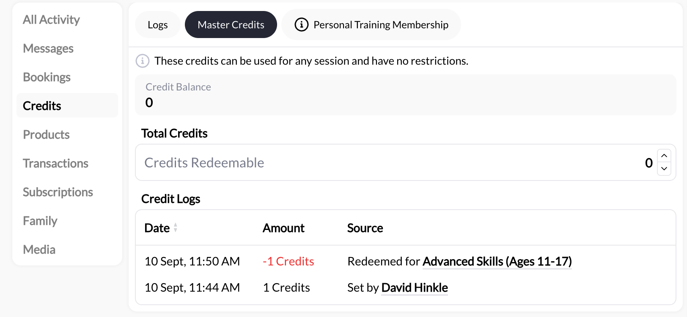
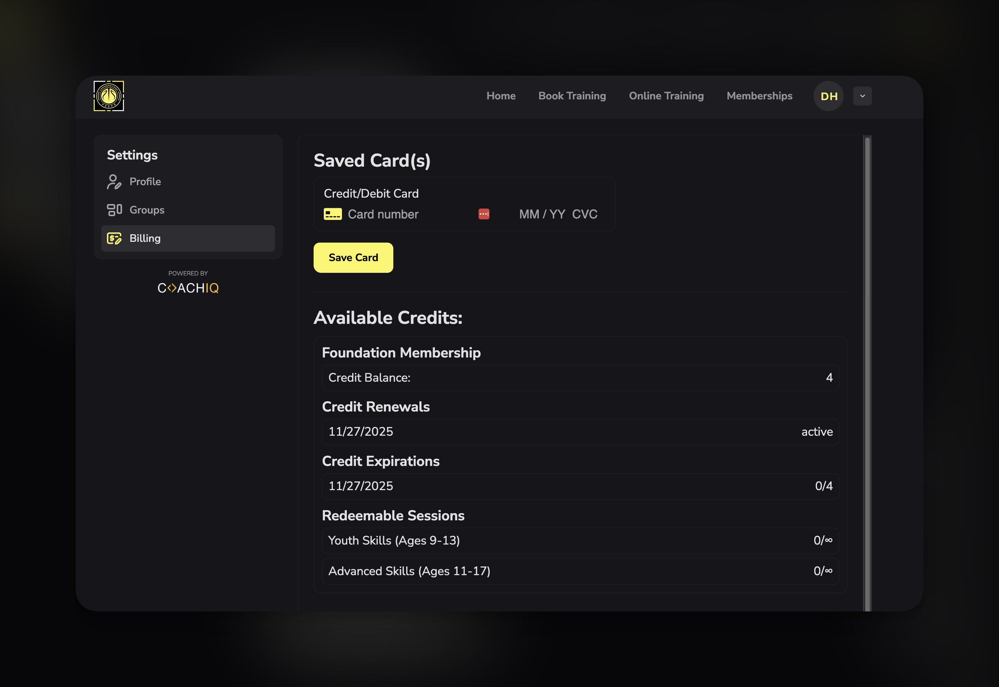

A **credit** is a prepaid session. Clients buy credits through a product, such as a 10-session pack or a monthly membership, and spend them to book sessions. You're paid up front, and clients book their own times without paying each time.

Credits always need two things set up:

| Side | What you set | Where |
| --- | --- | --- |
| **Product** | How many credits a purchase adds, when they expire, and which schedulers accept them | **Payments → Products** → the product's **Credits** and **Credit Limits** sections |
| **Scheduler** | That sessions cost credits, and how many | The scheduler's **Payment** settings: **Credit** or **Either** |

If either side is missing, families buy credits they can't use. Step by step: [Credits and schedulers](/scheduling/credits-and-schedulers).

## Where credits come from

<Tabs>
  <Tab title="One-time products (packs)">
    A single payment adds all the credits at once, for example "10-Session Pack, \$450". Each purchase is its own batch with its own expiry and its own limits, so two purchases of the same pack allow twice as much.

    In the product builder, turn on **Add Credits once Purchased** and set **Number of Credits**.

    <Frame>
      
    </Frame>
  </Tab>
  <Tab title="Subscriptions (memberships)">
    Each payment adds the membership's credits, for example 8 credits every month. You choose what happens to leftover credits at renewal. See [Membership credits](/payments/credits/recurring-credit-memberships).

    A membership can also give **Unlimited Credits**, shown as **∞**.

    <Frame>
      
    </Frame>
  </Tab>
  <Tab title="Credits you add by hand">
    From a client's **Credits** tab you can set a product's balance or add **Master Credits**, for example to make up for a canceled session. See [Client profile: Credits](/people/client-profiles/client-profiles-credits).
  </Tab>
</Tabs>

## Two kinds of credits

- **Product credits.** Every purchase creates a credit balance for that product on the client's account. If the product doesn't restrict schedulers, they work on any scheduler that takes credits. If it does, they only work on the schedulers you chose under **Credit Limits**.
- **Master Credits.** Credits you add by hand from the client's **Credits** tab. They work on any scheduler that takes credits.

<Frame>
  
</Frame>

## The order credits are spent

When a client books a session, CoachIQ spends credits in this order:

1. **Master Credits**
2. **Product credits that can pay for this session**: unlimited credits first, then the credits that expire soonest
3. **Product credits that never expire**, last

So an expiring membership credit is spent before a pack credit that never expires. A product whose weekly booking allowance is used up pays last. If a balance dropped in a different place than you expected, compare expiry dates on the client's **Credits** tab.

## Who owns the credits

The product's **Who is this purchase for?** setting decides whose account the credits land on:

- **Buyer** (default): credits belong to the person who paid. A parent buying for their children holds one family balance and spends it on whichever child they book.
- **Managed athlete**: checkout asks which child it's for, and the credits go to that child.

To let several athletes share one paid membership, see [Shared family memberships](/payments/shared-family-memberships). Details on booking for children: [Booking for multiple athletes](/scheduling/booking-for-multiple-athletes).

## How many credits a session costs

Each scheduler sets its credit cost in whole credits: 1 for a standard session, 2 for a longer or private one, and so on. A client with 1 credit can't book a 2-credit session; credits aren't split across bookings. Different session lengths can cost different amounts. See [Pricing by session length](/scheduling/pricing-by-session-length).

## When credits expire

- **Packs** expire a set number of days after purchase, on a date you choose, or never.
- **Memberships** either reset at each renewal, carry over, or carry over with each payment's credits expiring a set number of days after that payment.
- Turn on **Sessions must occur by expiration** if a credit should only pay for sessions held before it expires.

Settings and examples: [Product builder: Credits](/payments/product-builder#credits).

Credits stay usable through the end of their last day in your organization's time zone.

## When credits come back

- **Canceled booking:** whether the credit is returned depends on the scheduler's refund setting and, when you cancel, your choice in the cancel window. A returned credit goes back to the batch that paid for it and keeps that batch's expiry. See [Cancellation and credit refunds](/scheduling/credits-and-schedulers#cancellation-and-credit-refunds).
- **Refunded payment:** refunding money doesn't remove credits. Remove them from the client's **Credits** tab if needed.

## When a client can't use their credits

Credits can sit on an account without being spendable. The most common reasons:

- The scheduler isn't on the product's list under **Credit Limits**.
- The membership behind them is past due, canceled, or ended. Its credits are kept but paused, and come back if the membership becomes active again.
- A per-scheduler cap or the weekly booking allowance is used up.
- The credits expired, or the session is after their expiry with **Sessions must occur by expiration** on.

Full checklist: [Why a client can't book with credits](/payments/credits/credit-usage-limits-restrictions).

## What clients see

Clients see their credit balances in your app under **Settings → Billing**. Each card shows what the credits are for, how many are left, when they expire (including **Expires today**), and **No limit** for unlimited credits. A child's credits show the child's name. If credits can't be loaded, they see a message with **Try again** instead of a zero balance.

<Frame>
  
</Frame>

## Related articles

- [Credits and schedulers](/scheduling/credits-and-schedulers)
- [Membership credits](/payments/credits/recurring-credit-memberships)
- [Why a client can't book with credits](/payments/credits/credit-usage-limits-restrictions)
- [Client profile: Credits](/people/client-profiles/client-profiles-credits)
- [Product builder reference](/payments/product-builder)
