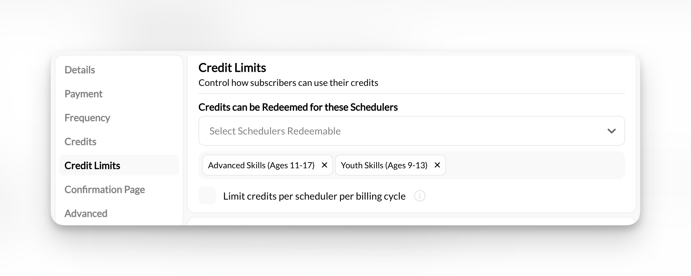

A product's credits can be limited in three ways, all in the product builder's **Credit Limits** section. Schedulers have their own booking limits too. This page covers each one, then how to work out why a client with credits can't book.

## The limits you can set

| Limit | What it does | Where |
| --- | --- | --- |
| **Credits can be redeemed for these schedulers** | Only the schedulers you pick accept this product's credits | Product → **Credit Limits** |
| **Limit credits per scheduler** | Caps how many of the product's credits can be used on one scheduler: per billing cycle on a membership, per purchase on a pack | Product → **Credit Limits**, on each picked scheduler |
| **Weekly booking allowance** | Caps how many credit-paid bookings a client can make each week, Sunday to Saturday, across all the schedulers the credits work on | Product → **Credit Limits** (memberships) |
| **Max bookings per athlete per day / week** | Caps bookings on one scheduler, whatever the client pays with | Scheduler → [Rules and limits](/scheduling/scheduler-settings-limits-and-permissions) |

A booking has to pass every limit that applies.

<Frame>
  
</Frame>

### Choose which schedulers accept the credits

Open the product, go to **Credit Limits**, and pick schedulers under **Credits can be redeemed for these schedulers**.

- **Leave it empty** and the credits work on every scheduler that takes credits.
- **Pick one or more** and the credits work only there. Other schedulers tell the client they have no usable credits.

Use it for tiered memberships (Basic covers group classes, Premium covers everything) or program packs (Elite credits only book Elite sessions). Name the product after what it unlocks, so families know before they buy.

<Warning>
  Removing a scheduler from the list takes effect right away for everyone who holds the credits. Tell families before you remove one.
</Warning>

### Cap credits per scheduler

After you pick a scheduler, set how many of the product's credits can be used there.

- On a **membership**, the cap resets each billing cycle. Example: an 8-credit membership with a cap of 4 on private lessons and 4 on group training.
- On a **pack**, the cap is per purchase. A client with two purchases of the same pack can use twice the cap.

When a client reaches the cap, they see a limit message, not an out-of-credits message, and can still book other schedulers with the remaining credits.

### Set a weekly booking allowance

**Weekly booking allowance** caps how many credit-paid bookings a client can make in a week, counted Sunday to Saturday by session date, across every scheduler the credits apply to. Leave it blank for no weekly cap. Use it for "2 sessions a week" memberships.

- Every session in a repeating booking counts in its own week. A new series that would go over the allowance in any week isn't created.
- A canceled booking frees its spot in that week.
- The allowance counts against whoever owns the credits. With a family balance owned by a parent, all the children's bookings from it count together.
- Bookings paid by card don't count.

Staff with permission can override the allowance when they book a client by hand.

## Why a client can't book with credits

Work through these in order. Open the client's profile and the **Credits** tab as you go.

<Steps>
  <Step title="Do they have credits for this scheduler?">
    Check the product's **Credits can be redeemed for these schedulers** list. If the list isn't empty and this scheduler isn't on it, the credits don't work here. Add the scheduler to the product, or give a [Master Credit](/people/client-profiles/client-profiles-credits) for a one-off.
  </Step>
  <Step title="Is the membership active?">
    If the membership behind the credits is past due, canceled, or ended, its credits are paused. The Credits tab says "Membership inactive" and **Credits Redeemable** shows 0. They come back when a payment goes through. See [Failed payments](/payments/failed-payments).
  </Step>
  <Step title="Are the credits on the right account?">
    With **Buyer** ownership, a parent's purchase is on the parent's account and covers their children. With **Managed athlete**, it's on one child's account and can't pay for a sibling. See [Who owns the credits](/payments/credits/credit-system-overview#who-owns-the-credits).
  </Step>
  <Step title="Do they have enough?">
    A 2-credit session needs 2 credits. Credits aren't split across bookings.
  </Step>
  <Step title="Have the credits expired, or is the session after their expiry?">
    With **Sessions must occur by expiration** on, the session date has to fall before the credits expire. See [Product builder: Credits](/payments/product-builder#require-sessions-to-happen-before-credits-expire).
  </Step>
  <Step title="Has a limit been reached?">
    Check the per-scheduler cap and the weekly booking allowance on the product, and the scheduler's per-athlete daily and weekly limits. The client's message names the limit.
  </Step>
  <Step title="Did you pause the product's credits?">
    On the Credits tab you can turn off credit use for one product. See [Turning off a product's credits](/people/client-profiles/client-profiles-credits#turning-off-a-products-credits).
  </Step>
</Steps>

## How limits and spend order work together

When more than one set of credits could pay, CoachIQ spends Master Credits first, then the product credits that expire soonest, and credits that never expire last. Credits held back by a limit are skipped, so a product whose weekly allowance is used up pays last. See [The order credits are spent](/payments/credits/credit-system-overview#the-order-credits-are-spent).

## Related articles

- [How credits work](/payments/credits/credit-system-overview)
- [Credits and schedulers](/scheduling/credits-and-schedulers)
- [Product builder: Credit Limits](/payments/product-builder#credit-limits)
- [Scheduler rules and limits](/scheduling/scheduler-settings-limits-and-permissions)
