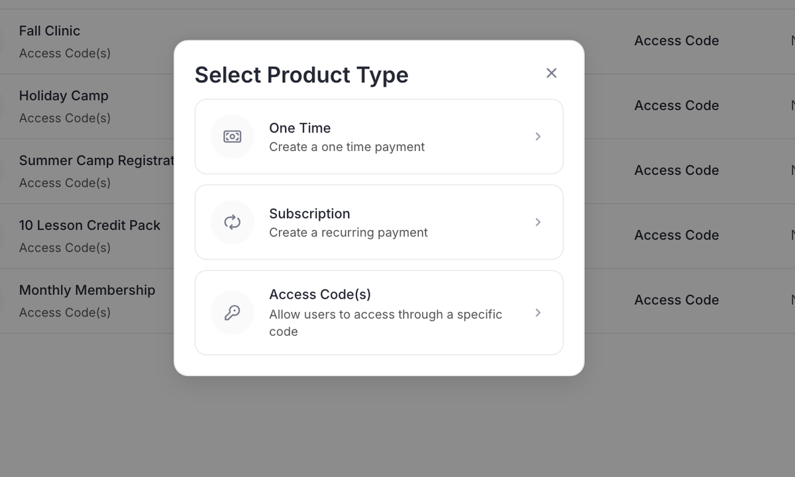

<Info>
  **Where to find this**: Payments → Products → Create → Subscription type
</Info>

## What you'll accomplish

Learn how to create and manage subscription-based credit products that generate recurring revenue—configure unlimited (∞) credit subscriptions, understand renewal behavior, handle inactive subscriptions, transition athletes from packages to subscriptions, and optimize your subscription business model.

<Note>
  **Prerequisites**:

  - Stripe account connected to CoachIQ ([Stripe Setup Guide](/payments/connecting-stripe))
  - Understanding of credit system basics ([Credit System Overview](/payments/credits/credit-system-overview))
</Note>

---

## Subscriptions vs packages: Understanding the difference

Before diving into subscription setup, understand how subscriptions differ from one-time credit packages.

### Core differences

<Tabs>
  <Tab title="One-Time Credit Packages">
    **Payment structure**: Single payment upfront

    **Credit issuance**: All credits issued immediately upon purchase

    **Credit behavior**:

    - Finite quantity (e.g., 10 credits)
    - Do not renew automatically
    - Athlete must manually purchase again when depleted

    **Revenue pattern**: Sporadic (depends on when athletes buy)

    **Example**:

    ```
    Product: "10-Credit Training Package"
    Price: $450 (one-time payment)
    Credits issued: 10 (all at once)
    Renewal: None (must repurchase)
    Expiration: 90 days (if configured)
    ```

    **Best for**:

    - New athletes testing your services
    - Athletes who prefer flexibility
    - Drop-in/casual training relationships
    - Gift purchases
  </Tab>
  <Tab title="Subscription Credit Products">
    **Payment structure**: Recurring billing (monthly/weekly/yearly)

    **Credit issuance**: Credits issued each billing cycle

    **Credit behavior**:

    - Can be finite (e.g., 12 credits/month) OR unlimited (∞)
    - Renews automatically each cycle
    - Active only while subscription active on Stripe

    **Revenue pattern**: Predictable recurring revenue (MRR)

    **Example**:

    ```
    Product: "Monthly Unlimited Training"
    Price: $400/month (recurring)
    Credits issued: Unlimited (∞) per month
    Renewal: Automatic monthly via Stripe
    Expiration: Credits reset each month (not expire, but renew)
    ```

    **Best for**:

    - Committed long-term athletes
    - Predictable business revenue
    - Athletes training 2+ times per week
    - Premium membership offerings
  </Tab>
</Tabs>

### Why subscriptions transform your business

The revenue examples below are illustrative, not CoachIQ benchmarks or promised results. Retention and time saved depend on your services, pricing, and follow-up.

<CardGroup cols={2}>
  <Card title="Predictable Revenue (MRR)" icon="chart-line">
    **One-time packages**: Sporadic \$450 payments

    **Subscriptions**: Recurring 400/month =  4,800/year per athlete

    **Compounding effect**:

    - Month 1: 10 subscribers = \$4,000 MRR
    - Month 6: 25 subscribers = \$10,000 MRR (with growth + retention)
    - Month 12: 50 subscribers = \$20,000 MRR

    **Business planning**: Predictable revenue enables hiring, facility expansion, equipment investments
  </Card>
  <Card title="Higher Lifetime Value (LTV)" icon="coins">
    **Package athlete**:

    - Buys 10-pack for \$450
    - Uses 8 credits, stops
    - LTV: \$450

    **Subscription athlete**:

    - Subscribes at \$400/month
    - In this example, stays 8 months
    - Revenue over those months: \$3,200

    **Why**: Recurring billing = passive renewal (friction-free)
  </Card>
  <Card title="Better Athlete Retention" icon="heart">
    **Package psychology**: "I have 2 credits left, then I'm done"

    **Subscription psychology**: "I pay monthly, might as well use it"

    Recurring billing removes the need to buy a new package each cycle. Track your own renewal and cancellation rates to see whether the membership is meeting athletes' needs.
  </Card>
  <Card title="Reduced Admin Burden" icon="clock">
    **Package model**:

    - Athletes run out of credits
    - You chase renewals
    - Manual sales conversations
    - Inconsistent cash flow

    **Subscription model**:

    - Automatic billing via Stripe
    - Credits renew automatically
    - Athletes self-renew (passive)
    - Consistent cash flow

    **Potential time savings**: Fewer manual renewal reminders. Measure the change against your own workflow.
  </Card>
</CardGroup>

---

## Understanding unlimited credits (∞ notation)

The infinity symbol (∞) in CoachIQ has a specific meaning that's critical to understand.

### What ∞ really means

<Warning>
  **Critical clarification**: ∞ does NOT mean unlimited forever. It means unlimited WITHIN the current billing cycle.
</Warning>

**Accurate interpretation**:

- **∞** = Unlimited credits this month/week/year (depending on subscription frequency)
- **At renewal**: Credits reset to ∞ for the new cycle
- **If subscription ends**: ∞ becomes 0 (credits disappear)

**Example timeline**:

```
Jan 15: Athlete subscribes to "Unlimited Monthly" 
Credits: ∞ (can book unlimited sessions until Feb 15)

Jan 16-Feb 14: Athlete books 12 sessions
Credits still show: ∞ (not decreasing)

Feb 15: Subscription renews, payment processes
Credits: ∞ (reset for February cycle)

Feb 16-Mar 14: Athlete books 10 sessions  
Credits: ∞ (unlimited continues)

Mar 15: Subscription payment FAILS (expired card)
Subscription becomes inactive on Stripe
Credits: 0 (unlimited credits now unusable)
```

### Credit  display variations

<AccordionGroup>
  <Accordion title="∞ with Usage Tracking (Subscription Credits)">
    **Display**: Under "Redeemable Schedulers" section

    ```
    Rising Stars Class (3/∞)
    Rising Stars Shooting Lab (0/∞)
    Rising Stars Open Gym (5/∞)
    ```

    **Meaning**:

    - Athlete has unlimited credits for these schedulers this cycle
    - Numbers show: (Credits used this cycle / Unlimited remaining)
    - **3/∞** = Used 3 times this cycle, unlimited still available

    **Resets**: At subscription renewal, all counters reset to 0/∞

    **Why track usage if unlimited?**:

    1. Coach monitoring (which sessions most popular?)
    2. Usage limit enforcement (if "max 3/week" limit exists)
    3. Athlete self-awareness (used 15 times this month—great engagement!)
  </Accordion>
  <Accordion title="Finite Credits That Display Differently">
    **Not ∞ but similar concept**:

    Some subscriptions issue finite credits monthly:

    ```
    Monthly 12-Credit Membership
    Credit Balance: 12 (not ∞)
    Renewal: Gets 12 fresh credits each month
    ```

    **Difference from ∞**:

    - Athlete sees decreasing count (12 → 11 → 10...)
    - When depleted to 0, must wait for renewal
    - ∞ never shows decreasing count

    **Same as ∞**:

    - Resets at renewal
    - Active only while subscription live
    - Tied to billing cycle
  </Accordion>
</AccordionGroup>

---

## Creating a subscription product

Step-by-step: Setting up recurring credit memberships.

<Steps>
  <Step title="Navigate to product creation">
    **Payments** → **Products** → Click **\+ Create**

    You'll see product type options
  </Step>
  <Step title="Select subscription type">
    **Choose**: "Subscription"

    **NOT**: "One-Time" (that's for credit packages)

    <Frame>
      
    </Frame>
    <Note>
      **Important**: This choice defines whether billing is recurring. Cannot change after creation—if you pick wrong type, must delete and recreate product.
    </Note>
  </Step>
  <Step title="Configure basic product info">
    **Required fields**:

    **Product name**: Clear, descriptive name

    - ✅ "Unlimited Monthly Training Membership"
    - ✅ "3x/Week Youth Program Subscription"
    - ❌ "Training" (too vague)
    - ❌ "Option 1" (meaningless to athletes)

    **Price**: Recurring amount (e.g., \$400)

    **Billing frequency**: How often to charge

    - **Monthly** (most common)
    - **Weekly** (less common, for frequent trainers)
    - **Yearly** (annual pre-pay, large discount)
    - **Custom** (every 2 weeks, quarterly, etc.)

    **Description**: Explain what subscription includes

    ```
    Example: "Train unlimited times per month at our group classes. 
    Includes access to all Rising Stars schedulers. Book up to 4 
    sessions per week. Cancel anytime with 30-day notice."
    ```

    <Tip>
      **Pricing psychology**: 399 feels significantly cheaper than 400. Use X97 or X99 pricing for better conversion.
    </Tip>
  </Step>
  <Step title="Configure credit issuance">
    Scroll to **Credits** section

    **Decision point**: Unlimited (∞) OR finite credits per cycle?

    <Tabs>
      <Tab title="Unlimited Credits (∞)">
        **Setting**: Enable "Unlimited Credits" toggle or checkbox

        **Result**: Athlete gets ∞ credits each billing cycle

        **Use when**:

        - Offering "all-you-can-train" membership
        - Want maximum simplicity (no credit counting)
        - Trust athletes not to abuse (or have usage limits configured)

        **Example configuration**:

        ```
        Monthly Unlimited Membership - $400/month
        Credits: Unlimited (∞)
        Redeemable schedulers: All group classes
        ```
      </Tab>
      <Tab title="Finite Credits Per Cycle">
        **Setting**: Enter number (e.g., "12 credits")

        **Result**: Athlete gets 12 fresh credits each billing cycle

        **Use when**:

        - Want defined usage expectations (12 = 3x/week)
        - More comfortable with finite limits
        - Easier to understand for athletes ("12 sessions/month")

        **Example configuration**:

        ```
        Monthly 12-Credit Membership - $350/month
        Credits: 12 per month
        Expiration: Unused credits expire at renewal
        Redeemable schedulers: All sessions
        ```

        <Note>
          **Expiration option**: Unused credits can either:

          1. **Expire** (athlete loses them at renewal)
          2. **Carry over** (athlete accumulates unused credits)

          Most subscriptions use **expire** to prevent credit hoarding.
        </Note>
      </Tab>
    </Tabs>
  </Step>
  <Step title="Set credit restrictions">
    **Redeemable Schedulers** section: Select which schedulers accept these credits

    **Example restriction strategy**:

    ```
    Basic Subscription ($250/month):
      ✓ Group Classes only
    
    Standard Subscription ($400/month):
      ✓ Group Classes
      ✓ Open Gym
      ✓ Clinics
    
    Premium Subscription ($600/month):
      ✓ All of the above
      ✓ Semi-Private Sessions (normally $75 each)
    ```

    <Tip>
      **Product tiering**: Use scheduler restrictions to differentiate subscription levels (Basic \< Standard \< Premium)
    </Tip>
    For detailed scheduler restriction setup, see [Article #26: Credit Usage Limits](/payments/credits/credit-usage-limits-restrictions).
  </Step>
  <Step title="Configure usage limits (optional but recommended)">
    **Usage Limits** section: Set daily/weekly/monthly booking caps

    **For unlimited (∞) subscriptions**:

    - **Recommended**: Weekly limit (e.g., "4 bookings per week")
    - **Prevents abuse**: Athlete can't book 30 sessions in Week 1
    - **Encourages consistency**: Spreads usage across month

    **For finite credit subscriptions**:

    - Often unnecessary (credit count is the limit)
    - Consider if: Enforcing program structure (e.g., max 2/week for 8-week program)
  </Step>
  <Step title="Set renewal and cancellation policy">
    **Renewal settings**:

    - **Auto-renew**: Enabled by default (this is how subscriptions work)
    - **Trial period**: Optional first-month discount or free trial
    - **Renewal reminder**: Auto-email 3 days before renewal (if available)

    **Cancellation policy**:

    ```
    Example policy:
    "Cancel anytime. Cancellations take effect at end of current 
    billing period (you keep access until paid-for period ends). 
    No refunds for partial months."
    ```

    **Important**: Document policy in:

    - Product description
    - Website terms of service
    - Confirmation email after purchase
    - Your app

    <Warning>
      **Legal requirement**: Clear cancellation terms required in most jurisdictions. Work with attorney if unsure.
    </Warning>
  </Step>
  <Step title="Save and activate">
    Click  **Create Subscription**

    **Verification checklist**:

    - ✅ Product appears in Payments → Products list
    - ✅ Product type shows "Subscription"
    - ✅ Price displays as "\$/month" (or chosen frequency)
    - ✅ Credit configuration correct (∞ or finite number)
    - ✅ Redeemable schedulers listed
    - ✅ Usage limits configured (if applicable)

    **Test**:

    1. Assign product to test athlete account
    2. Process test payment via Stripe
    3. Verify credits appear in athlete profile
    4. Test booking with subscription credits
    5. Verify Stripe shows active subscription

    <Check>
      **Success!** Your subscription product is live and ready for athletes to purchase.
    </Check>
  </Step>
</Steps>

---

## Subscription credit renewal behavior

Understanding how credits refresh each billing cycle.

### How automatic renewal works

<Steps>
  <Step title="Subscription renewal date arrives">
    **Example**: Athlete subscribed Jan 15, monthly frequency

    **Renewal date**: Feb 15 (one month later)

    **What happens**:

    1. Stripe attempts to charge athlete's saved payment method
    2. If payment succeeds: the membership stays active and adds the new period's credits
    3. If payment fails: the membership goes past due and its credits pause (more on this below)

    Each period's credits cover sessions through the renewal day itself, so a session on Feb 15 can still use January's credits. The renewal day follows the exact paid billing period, including after a scheduled start or a plan change made in Stripe.
  </Step>
  <Step title="Credits reset (if payment succeeds)">
    **For unlimited (∞) subscriptions**:

    - Credit balance: Still shows ∞
    - Usage tracking: Resets to 0/∞ for all schedulers

    **For finite credit subscriptions**:

    - Credit balance: Resets to original amount (e.g., 12)
    - Unused credits: Expire OR carry over (per configuration)
    - Usage limits: Reset to 0

    **Athlete sees**: Fresh credits available, can book again

    <Note>
      **Seamless transition**: Athletes typically don't notice renewal if payment auto-succeeds. Credits just "keep working."
    </Note>
  </Step>
  <Step title="Credit logs update">
    The client's **Credits** tab logs the renewal as a **Renewal** row with the credits added, and any leftover credits that ended as an **Expiration** row. See [Reading the transaction log](/people/client-profiles/client-profiles-credits#reading-the-transaction-log).
  </Step>
  <Step title="Stripe subscription status">
    In your Stripe dashboard:

    **Status**: "Active" **Current period**: Feb 15 - Mar 14 **Next billing date**: Mar 15 **Total charged to date**: Updated

    **Athlete's payment history**: Shows successful renewal charge
  </Step>
</Steps>

### Unused credit behavior at renewal

In the product's **Credits** section, choose what happens to leftover credits:

| Option | At renewal | Example: 12 credits a month, 4 left |
| --- | --- | --- |
| **Unused Credits Expire upon Subscription Frequency** | Leftover credits are removed, then the new period's credits are added | 12 |
| **Carry over unused credits** | Leftover credits stay and don't expire | 16 |
| **Carry over, and expire each payment's credits after a set number of days** | Leftover credits stay, but each payment's credits expire the number of days you set after that payment | 16, and the 4 from last month expire on their own date |
| **Unlimited Credits** | Nothing to carry: the client sees **∞** | ∞ |

**Expire each cycle** keeps it simple and stops credits piling up. **Carry over** is friendlier for clients who miss weeks, but balances can grow large. **Carry over with a per-payment expiry** is in between: credits roll over for a while (for example 45 days), then expire, and each payment's credits keep their own date. Credits you add by hand don't get a date.

Credits stay usable through the end of their last day in your organization's time zone. A client's **Credits** tab notes when the credits from each payment expire.

<Note>
  **Lowering a balance by hand.** On a membership whose credits expire each cycle, the credits left after you lower the balance still expire at the next renewal, so the client renews to the normal amount. If the client also has credits kept until used, lowering takes those first. On a pack or a per-payment-expiry membership, lowering takes credits from the batch that expires soonest.

  **Adding credits by hand.** On a membership whose credits expire each cycle, **Adjust balance** asks what happens to the added credits: **Expire with this cycle** (the default) or **Keep until used**. Kept credits stay through renewals and are used after the cycle's own credits. See [Managing credits](/payments/credits/managing-athlete-credits#granting-master-credits).
</Note>

---

## Managing subscription lifecycles

What happens at each stage of a subscription's life.

### Active subscription stage

**Status**: Subscription active on Stripe, payments processing successfully

**Athlete experience**:

- Credits available (∞ or finite amount showing)
- Can book sessions using subscription credits
- Automatic renewals happening seamlessly

**Coach actions**:

- Monitor usage (are athletes actually using subscriptions?)
- Engagement outreach if low usage (prevent voluntary cancellation)
- Upsell opportunities if high usage (upgrade to premium tier)

**Health metrics to track**:

- **Usage rate**: How much of the membership do athletes use? Compare with their goals and your own historical patterns before deciding who needs outreach.
- **Payment success rate**: How many renewals complete successfully? Review failed payments and trends rather than treating an example percentage as a universal benchmark.

---

### Payment failure (Involuntary churn)

**What triggers it**: Athlete's payment method fails at renewal (expired card, insufficient funds)

**What happens automatically**:

<Steps>
  <Step title="Stripe attempts charge">
    Renewal date arrives, Stripe tries to charge saved payment method

    **Result**: Payment declined/failed
  </Step>
  <Step title="Stripe retry logic">
    Stripe automatically retries failed payments on schedule:

    - Smart retries over 2-3 weeks
    - Varies by Stripe settings (customize in Stripe dashboard)

    **Athlete notified**: Stripe sends email "Your payment failed, please update"
  </Step>
  <Step title="The membership goes past due">
    At the first failed charge, the membership's status changes to **Past due**, and its credits pause right away:

    - The balance is kept but can't be used to book
    - The client can still sign in, and can book with Master Credits or by paying per session
    - When a payment goes through, the credits work again

    If Stripe's retries run out, Stripe cancels the subscription or marks it unpaid, depending on your Stripe settings.
  </Step>
  <Step title="Athlete sees error">
    When trying to book with subscription credits:

    **What they see**: In **Billing**, the membership reads "Membership inactive · Credits paused" with a note that the credits can't be redeemed while the membership is inactive. In your admin, the client's credit tab reads "Membership inactive. The balance is kept but can't be spent." with 0 redeemable.

    **Solution required**: the client updates the card on that membership from **Billing** in your app.
  </Step>
</Steps>

**Coach actions when payment fails**:

<AccordionGroup>
  <Accordion title="Week 1: Personal outreach">
    **Day 7-10 after failure**: If still not resolved, send personal message

    **Example message**:

    ```
    "Hey [Name], I noticed your membership payment didn't go through 
    this month. Just wanted to reach out personally—your subscription 
    is currently on hold. 
    
    You can update your payment method here: [link to your app]
    
    Let me know if you need any help, or if you'd like to discuss 
    your membership. I want to make sure you can keep training with us!"
    ```

    **Tone**: Helpful, not accusatory (athletes appreciate personal touch)
  </Accordion>
  <Accordion title="Week 2: Offer alternative">
    **Day 14-21 after failure**: If still unresolved, offer options

    **Example message**:

    ```
    "Hi [Name], I haven't heard back about your membership payment. 
    I want to help you continue training! Here are some options:
    
    1. Update payment method: [link]
    2. Switch to pay-per-session temporarily (no commitment)
    3. Pause membership for 30 days (keeps your rate when you return)
    4. Or if you need to cancel, I understand—just let me know
    
    What works best for you?"
    ```

    **Goal**: Understand if this is:

    - Temporary issue (expired card) → Help resolve
    - Financial hardship → Offer payment plan or pause
    - Voluntary cancellation → Exit gracefully
  </Accordion>
  <Accordion title="Week 3: Final notice">
    **Day 21-30 after failure**: Last attempt before cancellation

    **Example message**:

    ```
    "[Name], your membership has been on hold for 3 weeks due to 
    payment issue. I'll need to cancel the subscription by [date] 
    if we can't resolve this.
    
    I'd hate to see you go! If you want to continue, please update 
    your payment method ASAP: [link]
    
    Otherwise, let's connect to discuss next steps."
    ```

    **After 30 days**: Cancel subscription in Stripe (releases athlete from failed payment attempts)

    **Document**: Add a note on the client's profile (**PROFILE → Notes**) saying why the subscription ended (involuntary churn due to payment failure). [Staff notes](/people/client-profiles/client-profiles#staff-notes)
  </Accordion>
</AccordionGroup>

---

### Keep credit-funded sessions inside the billing cycle

For a membership whose credits expire each cycle, turn on **Sessions must occur by expiration** in the [Product Builder](/payments/product-builder#require-sessions-to-happen-before-credits-expire). Credits from that cycle can only cover sessions occurring within their validity period, including the expiration day. Rescheduling and every occurrence of a recurring booking must stay within the same period.

Leaving the setting off keeps the book-before-expiration rule. If a cancellation refunds a credit, it retains the original expiration; it does not gain a new cycle.

### Voluntary cancellation

Use the membership's cancellation controls or help the family with their request. In the admin, open the athlete's **Products** tab and choose **Cancel membership**. Review whether it ends immediately or at the end of the billing period before confirming.

A scheduled cancellation can continue to show active access until the displayed end date. Check each credit's expiration and the product's usage rules; do not assume canceling immediately removes every existing credit. Refunds are a separate decision under your published policy.

For example, a membership paid through February 15 and scheduled to end then can remain available after a February 3 cancellation request. Confirm the actual date and credit rules on the membership instead of calculating them from the request date.

Follow [Canceling and removing memberships](/payments/manage-subscriptions) for the full workflow. If one subscription covers siblings, use [Shared Family Memberships](/payments/shared-family-memberships) to remove one athlete without ending the others' memberships.

**Coach response to cancellation**:

<Steps>
  <Step title="Acknowledge promptly">
    Send confirmation within 24 hours:

    ```
    "Hi [Name], I've received your cancellation request. Your 
    subscription will remain active through [end date], and you 
    can continue training until then.
    
    I'm sorry to see you go! If you're open to it, I'd love to 
    hear what led to this decision. Your feedback helps me improve.
    
    Thanks for training with me, and the door is always open if 
    you want to return in the future!"
    ```

    **Tone**: Gracious, non-defensive, door open for return
  </Step>
  <Step title="Request feedback (optional survey)">
    **Option 1: Simple question**

    - "What was the main reason for canceling?" (open-ended)

    **Option 2: Multiple choice**

    - Financial reasons
    - Moving/relocating
    - Schedule doesn't fit anymore
    - Not seeing results I wanted
    - Prefer different training style
    - Other (please specify)

    **Use feedback**: Identify patterns, improve offerings
  </Step>
  <Step title="Offer win-back opportunity">
    If cancellation reason is resolvable:

    **Financial**: "Would a lower-tier membership work better for your budget?"

    **Scheduling**: "We just added morning sessions—would those fit better?"

    **Results**: "I'd love to discuss your goals—let's optimize your training plan"

    **Don't pressure**: One offer, then respect decision
  </Step>
  <Step title="Document and tag">
    **In athlete profile**:

    - Tag: "Former Subscriber"
    - Note: Cancellation date and reason
    - Flag: "Win-back candidate" (if reason was resolvable)

    **Use later**: Targeted re-engagement campaigns (e.g., "We miss you!" email 3 months later)
  </Step>
</Steps>

---

---

## Common questions

<AccordionGroup>
  <Accordion title="Can athlete have multiple subscriptions at once?">
    **Short answer**: Technically yes, but generally not recommended

    **How it works**:

    - Athlete purchases "Basic Subscription" (\$250/month)
    - Later purchases "Premium Subscription" (\$600/month)
    - Now paying \$850/month total for both

    **Platform behavior**: Athlete has 2 separate credit tabs, 2 separate subscriptions in Stripe

    **Why avoid**:

    - Confusing for athlete (which credits to use?)
    - Double billing (athlete likely didn't intend this)
    - Billing management nightmare

    **Better solution**:

    1. Cancel old subscription
    2. Switch to new subscription
    3. Single active subscription at a time

    **Exception**: Athlete wants base subscription + add-on

    - "Unlimited Classes" (400/month) + "Private Session Add-On" (150/month for 2 private sessions)
    - This is intentional stacking, clearly communicated
  </Accordion>
  <Accordion title="What if athlete wants to downgrade subscription?">
    Change the plan in Stripe, then move the subscription to the new product in CoachIQ. Steps: [Move a client to another membership](/payments/upgrade-membership). To switch at the end of the paid period instead, cancel the current membership at the end of its billing period and have the client buy the new one.
  </Accordion>
  <Accordion title="Should I offer refunds on subscriptions?">
    **Legal landscape**: Varies by jurisdiction

    **General guidelines**:

    **Pro-rated refunds**:

    - Not typically required if athlete has access through paid period
    - Example: Athlete pays \$400 for February, cancels Feb 10, has access through Feb 28 = no refund owed

    **When refunds make sense**:

    - Service issue (your fault): Full refund appropriate
    - Payment processing error: Issue refund + fix
    - Athlete charged accidentally (didn't mean to subscribe): Refund within 24-48 hours

    **When refunds DON'T make sense**:

    - Athlete simply changed mind after using service
    - "I didn't train this month" (athlete's choice, not your fault)
    - Buyer's remorse after 7+ days

    **Your refund policy** (example):

    ```
    "Subscription refunds available within 48 hours of first charge 
    if no credits used. After 48 hours or if credits used, no 
    refunds—cancel anytime to stop future charges."
    ```

    <Warning>
      **Document clearly**: Refund policy must be visible at purchase, in terms of service, and in confirmation email.
    </Warning>
  </Accordion>
  <Accordion title="Can I change subscription price for existing subscribers?">
    Changing a product's price only affects new buyers. Existing members keep their price until you change each subscription in Stripe. Give members notice first. Steps and options: [Grandfather pricing](/payments/grandfather-pricing).
  </Accordion>
</AccordionGroup>

---

## What's next

You've now completed the full credits section! Explore related features:

<CardGroup cols={2}>
  <Card title="Managing Athlete Credits" icon="hand-holding-usd" href="/payments/credits/managing-athlete-credits">
    View balances, grant credits, read logs, handle athlete requests
  </Card>
  <Card title="Credit Usage Limits" icon="shield-alt" href="/payments/credits/credit-usage-limits-restrictions">
    Set restrictions, daily/weekly limits, multi-credit sessions
  </Card>
  <Card title="Credit System Explained" icon="info-circle" href="/payments/credits/credit-system-overview">
    Understand core credit concepts and business benefits
  </Card>
</CardGroup>

---

## Related articles

<CardGroup cols={3}>
  <Card title="Products Overview" icon="shopping-cart" href="/payments/product-overview">
    Complete guide to CoachIQ products system
  </Card>
  <Card title="Stripe Setup" icon="stripe" href="/payments/connecting-stripe">
    Connect Stripe for payment processing
  </Card>
  <Card title="Manual Booking" icon="user-plus" href="/scheduling/manually-booking-athletes">
    Book athletes using subscription credits
  </Card>
  <Card title="Scheduler Payment Options" icon="credit-card" href="/scheduling/setting-up-payment-options">
    Configure schedulers with different payment options
  </Card>
  <Card title="Automations" icon="bolt" href="/tools/automations/what-are-automations">
    Automate subscription workflows
  </Card>
</CardGroup>

---

<Check>
  **You now know how to**: Create subscription products, configure unlimited (∞) credits, set up recurring billing, understand renewal behavior, manage subscription lifecycles, transition athletes from packages to subscriptions, optimize subscription revenue, and build a predictable recurring revenue business model.
</Check>

<Info>
  **Need help designing your subscription model?** Our support team can review your business goals and help structure the right subscription offerings. [Contact Support](https://support.coachiq.com)
</Info>
