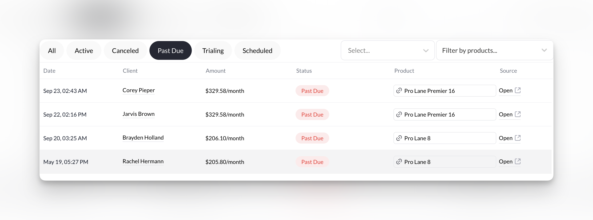
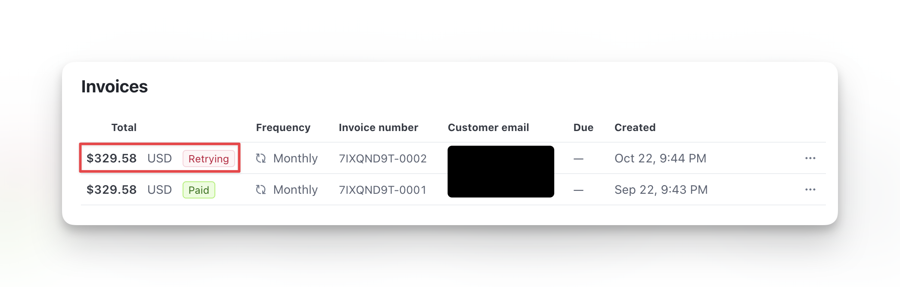
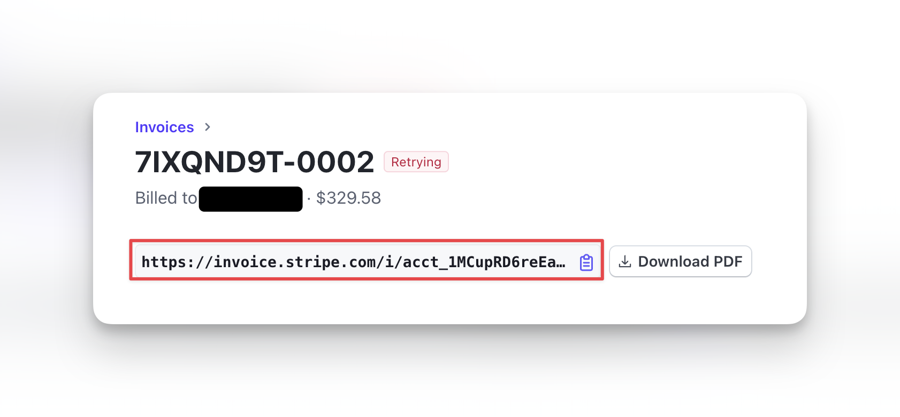

<Info>
  **Where to find this**: **Payments → Subscriptions** or **Payments → Transactions**, status filter set to **Past due**
</Info>

## Why payments fail

Common reasons for payment failures:

**Card issues:**

- Expired card
- Insufficient funds
- Card declined by issuer
- Incorrect card details
- Card reported lost or stolen

**Bank issues:**

- Fraud prevention triggered
- Daily spending limit exceeded
- International transaction blocked
- Bank requires authentication

**Technical issues:**

- Network timeout
- Processing error
- Stripe API issue

<Note>
  Most failures are card-related and resolve when client updates payment method.
</Note>

## How failed payments appear

<Tabs>
  <Tab title="Subscription payments">
    **Subscriptions page shows Past Due status**

    When subscription payment fails:

    - Status changes to "Past Due" (red)
    - Last attempted payment shows as failed
    - The membership's credits are paused, so the athlete can't book with them until a payment goes through

    <Frame>
      
    </Frame>
  </Tab>
  <Tab title="One-time payments">
    **Transactions page shows the declined attempt**

    When a one-time payment fails:

    - The attempt shows under **Past due** or **Blocked**, with the reason under the status, such as **Card declined**, and who tried to pay
    - No automatic retries for one-time payments
    - Client didn't receive product or credits
    - No access granted

  </Tab>
</Tabs>

## How Stripe retries membership payments

**Memberships only.** Stripe retries a failed membership payment on the schedule set in your Stripe account (**Settings → Billing → Subscriptions and emails** in Stripe). Your Stripe settings also decide what happens when the retries run out: the subscription is canceled or marked unpaid.

While it's past due, the membership's credits are paused. They come back when a payment goes through.

<Warning>
  Don't wait for the retries. Contact the client as soon as a payment fails.
</Warning>

## Recovering failed subscription payments

<Steps>
  <Step title="Identify Past Due subscriptions">
    Go to **Payments → Subscriptions** and filter by **Past Due** status.

    <Frame>
      
    </Frame>
  </Step>
  <Step title="Review failure reason">
    Click subscription to view details in stripe.

    Check Payment History for failure reason:

    - Card declined
    - Insufficient funds
    - Expired card
    - Requires authentication

    Understanding why helps you communicate with client.
  </Step>
  <Step title="Contact client immediately">
    Send message through Inbox or email:

    **Message template:** "Hi [Name], your recent payment for [subscription] was declined. To avoid service interruption, please update your payment method here: [payment update link]"

    <Tip>
      Act fast. The sooner client updates payment, the sooner Stripe retries successfully.
    </Tip>
  </Step>
  <Step title="Send payment page update link">
    From subscription details:

    1. Click **Open** on the subscription under the **Source** column
    1. Scroll to the **Invoice** section
    2. Click the Invoice labeled **Retrying**
    3. Copy the Payment Page link
    4. Send link to client

    <Frame>
      
    </Frame>
    <Frame>
      
    </Frame>
  </Step>
  <Step title="Client updates card">
    Client clicks link, enters new payment details and checks out.
  </Step>
  <Step title="Monitor retry success">
    Check subscription status:

    - **Active** = Retry succeeded, subscription recovered
    - **Past Due** = Still failing, follow up again
    - **Canceled** = All retries failed, subscription lost

    <Check>
      **Payment recovered.** Subscription returns to Active status. Credits renew. Service continues.
    </Check>
  </Step>
</Steps>

## Recovering failed one-time payments

One-time payments don't retry automatically. You must manually recover them.

<Steps>
  <Step title="Find failed transaction">
    Go to **Payments → Transactions** and set the status filter to **Past due** or **Blocked**.
  </Step>
  <Step title="Contact client">
    **Message template:** "Hi [Name], your payment for [product] didn't process successfully. You can complete your purchase here: [new payment link]"
  </Step>
  <Step title="Provide new payment link">
    **Option 1: Resend product link**

    - If client has product URL, they can try purchasing again
    - Client re-enters payment details

    **Option 2: Manual payment (not recommended)**

    - Client pays via alternative method (Venmo, check, etc.)
    - You manually record transaction
    - Manually grant access/credits

    <Tip>
      Option 1 is simplest. Just send the original booking or product purchase link again.
    </Tip>
  </Step>
  <Step title="Verify payment success">
    After client attempts payment again, check Transactions page for successful charge.

    If successful: Grant access, issue credits, confirm with client.
  </Step>
</Steps>

## What clients see when payment fails

**Subscription failure:**

- May receive email from Stripe about failed payment
- May receive notification from you
- Their membership credits are paused until a payment goes through
- They can change the card on that membership from **Billing** in your app

**One-time payment failure:**

- Transaction doesn't complete
- No confirmation email
- No access to product/credits
- Must attempt payment again

<Info>
  Client experience varies based on your notification settings. Configure Stripe email notifications in Stripe Dashboard.
</Info>

## Communication best practices

**When payment fails:**

✅ **Do:**

- Contact immediately (within 24 hours)
- Be helpful and non-judgmental
- Provide clear next steps
- Include payment update link
- Offer assistance if needed

❌ **Don't:**

- Wait for automatic retries
- Shame or blame client
- Threaten immediate cancellation
- Use aggressive language
- Send multiple messages in one day

**Sample messages:**

**Professional and helpful:** "Hi [Name]! Just a heads up - your payment for [subscription] didn't go through. This happens sometimes with expired cards or fraud protection. You can update your payment method here: [link]. Let me know if you need any help!"

**Too aggressive:** "Your payment FAILED. Update your card immediately or your account will be canceled."

<Tip>
  Most payment failures are accidental, not intentional. Keep tone friendly and assume client wants to resolve it.
</Tip>

## Preventing payment failures

**Proactive strategies:**

<AccordionGroup>
  <Accordion title="Monitor card expirations">
    Check upcoming expirations in Stripe Dashboard.

    **Action:** Contact clients 30 days before card expires with payment update link.

    Result: Prevent failures before they happen.
  </Accordion>
  <Accordion title="Send payment reminders">
    **For subscriptions:** Remind clients 3-5 days before billing date.

    **Message:** "Your [subscription] renews on [date] for \$[amount]. Your card ending in [last 4] will be charged. Need to update payment info? [link]"

    Result: Gives clients heads-up and chance to update card if needed.
  </Accordion>
</AccordionGroup>

## When payment recovery fails

If client doesn't respond or can't/won't update payment:

**Subscriptions:**

- Stripe runs out of retries, then cancels the subscription or marks it unpaid, depending on your Stripe settings
- Client loses access and credits
- Must resubscribe to resume service

**One-time payments:**

- Transaction remains failed
- No product or credits issued
- Client must attempt purchase again
- Can write off as lost sale

<Note>
  Document failed recovery attempts for your records. Some coaches have policies about re-allowing clients who frequently fail payments.
</Note>

## Troubleshooting specific failure reasons

<AccordionGroup>
  <Accordion title="Card declined - Generic">
    **Reason:** Bank declined without specific reason

    **Solution:**

    - Ask client to contact their bank
    - Bank can provide specific reason
    - Client may need to authorize charge
    - Try different card
  </Accordion>
  <Accordion title="Insufficient funds">
    **Reason:** Not enough money in account

    **Solution:**

    - Wait for client to add funds
    - Offer payment plan if appropriate
    - Next retry may succeed when funds available
  </Accordion>
  <Accordion title="Expired card">
    **Reason:** Card past expiration date

    **Solution:**

    - Send payment update link
    - Client enters new card with current expiration
    - Usually quick resolution
  </Accordion>
  <Accordion title="Card reported lost or stolen">
    **Reason:** Card flagged by issuer

    **Solution:**

    - Client must use completely different card
    - Old card won't work even after "update"
    - Client needs to contact bank for replacement
  </Accordion>
</AccordionGroup>

## Next steps

1. [Issue refunds](/payments/issuing-refunds) - Process refunds for recovered payments if needed
2. [Manage subscriptions](/payments/manage-subscriptions) - Handle subscription modifications
3. [View transactions](/payments/transactions) - Monitor all payment activity

## Related articles

- [Manage a client's subscription](/payments/manage-subscriptions)
- [The Subscriptions page](/payments/subscriptions-dashboard)
- [Refunds and account credit](/payments/issuing-refunds)
- [The Transactions page](/payments/transactions)