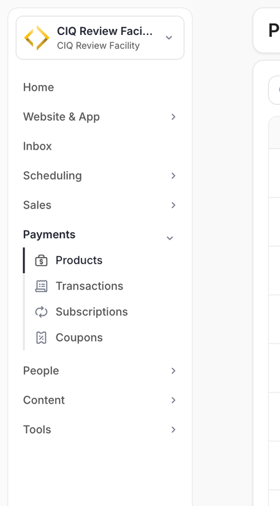

<Info>
  **Where to find this**: Payments section in the left sidebar
</Info>

## What CoachIQ Payments does

CoachIQ Payments handles all revenue operations for your coaching business:

- Accept one-time and recurring payments
- Manage subscription billing automatically
- Issue and track session credits
- Apply discounts with coupons
- Track all transactions in one place
- Send payment receipts to clients

All payment processing runs through Stripe, which deposits funds directly into your bank account.

## How money flows

<Steps>
  <Step title="Connect Stripe">
    Link your Stripe account to CoachIQ to enable payment processing.
  </Step>
  <Step title="Create products">
    Build products for sessions, memberships, programs, or access codes.
  </Step>
  <Step title="Attach to offerings">
    Connect products to:

    - Session schedulers (for bookings)
    - Programs (for content access)
    - Forms (for registrations)
  </Step>
  <Step title="The client pays">
    Client selects offering → Payment screen → Completes purchase
  </Step>
  <Step title="Money deposited">
    Stripe processes payment → Deposits to your bank account (typically 2 business days)

    <Check>
      You receive funds automatically. CoachIQ lists every payment on the Transactions page.
    </Check>
  </Step>
</Steps>

## Key concepts

<CardGroup cols={2}>
  <Card title="Products" icon="box" href="/payments/product-overview">
    One-time purchases, recurring subscriptions, or access code redemptions
  </Card>
  <Card title="Transactions" icon="receipt" href="/payments/transactions">
    Complete record of all payments, refunds, and failed charges
  </Card>
  <Card title="Subscriptions" icon="rotate" href="/payments/subscriptions-dashboard">
    Recurring billing that renews automatically on schedule
  </Card>
  <Card title="Credits" icon="ticket" href="/payments/credits/credit-system-overview">
    Pre-purchased session credits clients can redeem for bookings
  </Card>
  <Card title="Coupons" icon="tag" href="/payments/coupon-overview">
    Discount codes for promotions, partnerships, and special offers
  </Card>
  <Card title="Products Usage" icon="link" href="/payments/attach-products">
    How to attach products to sessions, programs, and forms
  </Card>
</CardGroup>

## Three ways clients pay

**Direct purchase** Client books session → Selects time → Pays with card → Confirmed

**Subscription billing** Client subscribes → Card charged monthly → Receives credits/access automatically

**Credits** Client buys a package or membership with credits → Spends credits to book sessions

**Access code** Client enters a code you gave them → Gets the product without paying. To lower a price instead, use a [coupon](/payments/coupon-overview).

## Payment methods at checkout

Checkout is powered by Stripe, so your clients can pay with more than a card. The methods a client sees are the ones that are active for your organization:

| Method | What the client sees | Works on |
| --- | --- | --- |
| **Card** | Credit or debit card form | Everything: products, subscriptions, scheduler bookings, guest checkout |
| **Apple Pay / Google Pay** | Wallet button on a supported device or browser | Same as cards, including athlete portals on a custom domain |
| **US Bank Account (ACH)** | "Bank" option; the client connects their bank account | One-time products and recurring memberships |
| **Afterpay, Klarna, Cash App Pay** | Buy-now-pay-later or wallet option where Stripe offers it | One-time purchases only, where the method is enabled |

**Where to turn methods on and off**

Once Stripe is connected, your admin settings include a **Payment Methods** list (**Settings → Payment Methods**). Each method is labeled **Active** or **Inactive**, and the label reflects what clients can actually use at checkout. A method has to be enabled on your Stripe account as well; if a method you expect is missing, check it in Stripe from **Settings → Stripe Portal**, then confirm it shows as Active here.

**ACH in practice**

- ACH is the lower-fee option for larger camp, team, and membership payments. Where separate ACH fees are switched on, you can pass on a different processing fee for ACH than for cards; see [Fees for ACH payments](/payments/processing-fee#fees-for-ach-payments).
- New recurring memberships offer every active method, including bank account. Memberships bought through athlete checkout between late April and early September 2026 were created card-only; see [Payment methods on recurring memberships](/payments/manage-subscriptions#payment-methods-on-recurring-memberships).
- A client who has already paid once has their saved methods, and which one is default, listed on the **Payment Methods** tab of their [client profile](/people/client-profiles/client-profiles-subscriptions#payment-methods-on-file).
- Bank payments take 3–5 business days to clear. Until then the payment shows as **Processing**; wait for **Succeeded** before treating it as paid. The **How to enable** help next to ACH in **Settings → Payment Methods** explains this too.

<Note>
  Checkout follows your athlete portal's theme, so a dark-mode portal gets a dark checkout with matching contrast. Coupons, waivers, and processing fees behave the same whichever method the client picks.
</Note>

### What families see at checkout

- **Saved cards:** checkout preselects the card the client marked **Default** in **Billing**. **Use a new card** opens the card fields and keeps saved cards available to switch back. A declined card shows the bank's reason.
- **Totals:** when the charge differs from the listed price (coupon, member discount, processing fee, down payment or access code), **Your Order** shows **Due today** during checkout and **Paid today** on the confirmation. Amounts always show cents.
- **Free trials and later starts:** a free trial shows **Due today \$0.00**, then the recurring price and the trial length. A membership with a later first charge shows \$0.00 due today and the **Billing starts** date. Any plan that keeps a card on file tells the buyer the card is saved for future charges.
- **Free products:** a \$0 product that doesn't collect a card ends on a **Review** step with **Complete purchase** and "No payment is due."
- **Access codes:** a product sold only by code has a single **Redeem code** button.
- **Purchase limits:** a buyer who has reached a product's per-person limit is told so; **Sold out** appears only when the product's total limit is reached.
- **Confirmation:** **Payment Successful** appears right away and stays if the page is refreshed.

## Your first three steps

<Steps>
  <Step title="Connect Stripe">
    Enable payment processing by linking your Stripe account.

    [Connect Stripe →](/payments/connecting-stripe)
  </Step>
  <Step title="Create a product">
    Build your first product for a session, membership, or program.

    [Create Product →](/payments/product-builder)
  </Step>
  <Step title="Attach to sessions">
    Link your product to a session scheduler so clients can book and pay.

    [Attach Products →](/payments/attach-products)
  </Step>
</Steps>

## Where everything lives

Navigate the Payments section from your left sidebar:

- **Products**: Create and manage all payment offerings
- **Transactions**: View all payment activity and history
- **Subscriptions**: Monitor recurring billing and active memberships
- **Coupons**: Create and track discount codes

<Frame>
  
</Frame>

## Payment processing fees

Every card payment has Stripe's processing fee (2.9% + 30 cents at Stripe's standard US rate), and your organization may also have a CoachIQ platform fee. Both come out of your payout. The product builder shows what you receive from each payment, under **You receive about**.

For each product you can:

- Absorb the fees (you receive a little less)
- Add a processing fee so the client pays it. **Cover my fees** fills in a fee so you receive about your full price.

See [Processing fees](/payments/processing-fee).

<Note>
  International rates and currency conversions may differ from Stripe's standard US rate.
</Note>

## What you need to know

**Stripe handles everything**: CoachIQ doesn't store card numbers or process payments directly. Stripe manages all payment security, PCI compliance, and fraud prevention.

**Stripe sync**: Payments and memberships sync from Stripe to CoachIQ automatically. If something you see in Stripe is missing in CoachIQ, use **Resync Stripe** on the Transactions or Subscriptions page. See [When Stripe and CoachIQ don't match](/payments/stripe-coachiq-reconciliation).

**Bank deposits**: Stripe deposits funds to your bank account on a rolling basis. First payout takes 7-10 days; subsequent payouts are typically daily or weekly based on your Stripe settings.

**Refunds**: Refund all or part of a payment from the client's **Transactions** tab. Money returns to the client's original payment method. See [Refunds and account credit](/payments/issuing-refunds).

## Common questions

<AccordionGroup>
  <Accordion title="Do I need a business bank account?">
    No. You can connect Stripe to any bank account—personal or business. However, a business account is recommended for accounting and tax purposes.
  </Accordion>
  <Accordion title="Can I accept payments without Stripe?">
    No. Stripe is the payment processor for CoachIQ. You must have a Stripe account to accept payments through the platform.
  </Accordion>
  <Accordion title="What currencies are supported?">
    Choose your organization's currency in **Settings → General**: USD, AUD, CAD, EUR, GBP or NZD. Set it before you build products. A checkout total below Stripe's minimum charge for your currency is refused before anything is charged.
  </Accordion>
  <Accordion title="How do taxes work?">
    CoachIQ doesn't calculate or collect sales tax automatically. You're responsible for:

    - Determining if you need to collect sales tax
    - Setting prices that include tax
    - Reporting and remitting taxes to appropriate authorities

    Consider consulting a tax professional for your specific situation.
  </Accordion>
</AccordionGroup>

## Ready to start?

Begin by connecting your Stripe account to enable payment processing.

[Connect Stripe →](/payments/connecting-stripe)