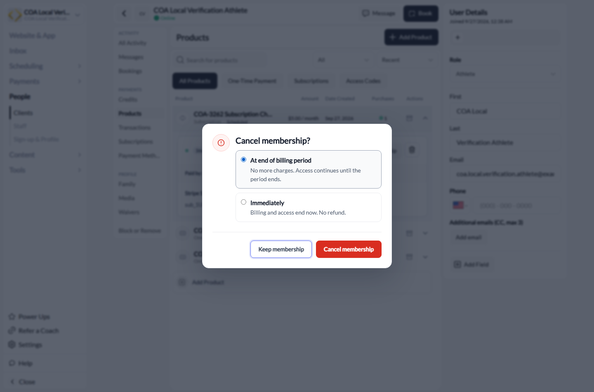
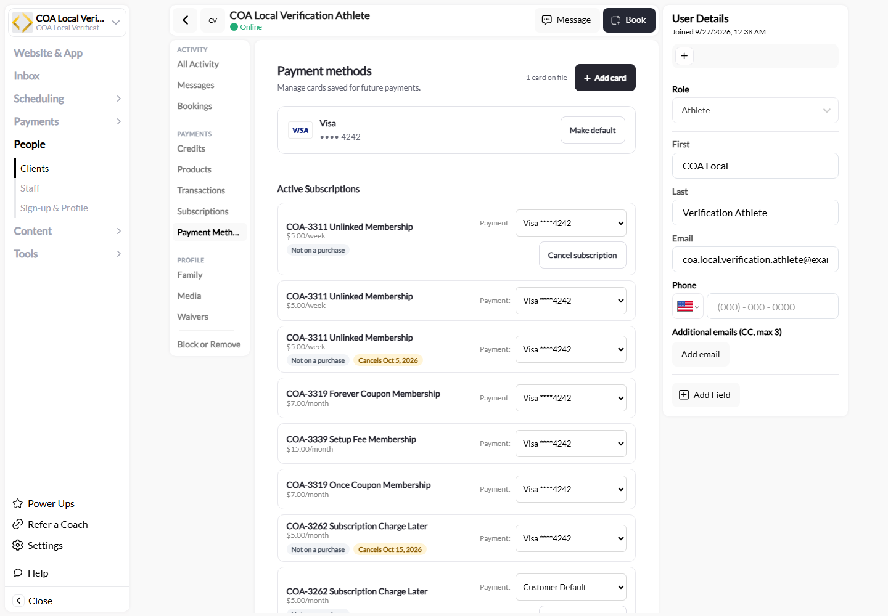

<Info>
  **Where to find this**: **People → Clients → open the client → Products**. Use **Payments → Subscriptions** to review billing status across clients.
</Info>

## Canceling subscriptions

Two ways to cancel a subscription:

<Tabs>
  <Tab title="Cancel at period end">
    **Recommended approach**

    Client keeps access through current billing period. Subscription ends on next billing date.

    **What happens:**

    1. Client retains access until period ends
    2. Credit access follows the purchase and its configured expiration rules
    3. No refund issued
    4. No future charges
    5. Subscription status changes to "Canceled" on end date

    **When to use:** Default cancellation method. Fair to client who already paid for current period.
  </Tab>
  <Tab title="Cancel immediately">
    **Instant termination**

    Client loses access right now. Subscription ends today.

    **What happens:**

    1. Client loses access immediately
    2. Check the purchase's credit expiration rules before promising any remaining balance
    3. No refund is issued. Refund separately if you want to
    4. No future charges
    5. Subscription status changes to "Canceled" now

    **When to use:** Client requests immediate cancellation, fraudulent account, terms violation.

    <Warning>
      Immediate cancellation without refund may frustrate clients who prepaid. Use carefully.
    </Warning>
  </Tab>
</Tabs>

## How to cancel a subscription

<Steps>
  <Step title="Open the client's purchase">
    Open **People → Clients**, select the client, and choose **Products**. Find the membership you intend to end.
  </Step>
  <Step title="Choose Cancel membership">
    Use **Cancel membership** on that purchase. Staff can use this control even when the product does not allow members to cancel themselves.
  </Step>
  <Step title="Choose when it ends">
    Select **At end of billing period** to keep access through the paid period, or **Immediately** to end billing and access now. Neither option automatically refunds a payment.
  </Step>
  <Step title="Confirm and check the result">
    Choose **Cancel membership** to proceed, or **Keep membership** to leave it unchanged. Reopen the purchase and check its status and end date. Use the client's **Subscriptions** tab or **Payments → Subscriptions** to verify the billing record.
  </Step>
</Steps>

<Frame caption="Test-account example showing the two cancellation timings.">
  
</Frame>

<Note>
  If the subscription pays for more than one athlete, canceling it would affect the other memberships. Follow [Shared family memberships](/payments/shared-family-memberships#remove-one-athlete) to remove one athlete instead.
</Note>

## A subscription is not on a purchase

If a client reports charges for a membership missing from Products, check **Client profile → Payment Methods → Active Subscriptions**.

1. Find the subscription marked **Not on a purchase** and verify its name and amount.
2. Choose **Cancel subscription** on that record.
3. Select **At end of billing period** or **Immediately**, then confirm.
4. Check the end date or Canceled status in **Payments → Subscriptions**. The missing purchase does not need to be recreated to stop billing.

<Frame caption="Test records illustrate subscriptions that need billing management even though they are not linked to a purchase.">
  
</Frame>

A membership still linked to a purchase is managed from **Products → Cancel membership**. If checkout has only just completed, the app may temporarily block cancellation while it finishes processing; follow the displayed explanation before trying again.

## Canceling versus removing a purchase

**Cancel membership** controls future billing and when membership access ends. **Remove** or **Archive** changes the purchase on the client's profile. A membership that is still billing cannot be removed first.

Cancel and verify the outcome before removing or archiving. To preserve access through the paid period, leave the purchase in place until its end date. Removing a purchase is not a payment refund. One-time purchases do not require a subscription-cancellation step.

## What happens after cancellation

**Access:**

- Cancel at period end: Access until period expires
- Cancel immediately: Access ends now

**Credits:**

Credit expiration depends on the product's configuration. Check [Product Builder → Credits](/payments/product-builder#section-3-credits) and the client's balance; do not assume cancellation creates a credit or payment refund.

**Payments:**

- No future charges
- Past payments remain (no automatic refund)

**Resubscribing:**

- Client must purchase subscription product again
- Creates new subscription (not reactivation of old one)
- New subscription ID and billing schedule

<Note>
  A membership scheduled to end stays **Active** or **Trialing**, with **Cancels [date]**, until it ends. It remains in that filter and count; it appears under **Canceled** after ending. Open its details for **Cancels on** (the end date) and **Cancel requested** (when cancellation was requested).
</Note>

## Refunding subscription payments

Canceling doesn't refund anything, and refunding doesn't cancel. To give money back for a membership payment, refund it from the client's **Transactions**. See [Refund a payment](/payments/issuing-refunds#refunding-a-membership-payment).

## See a membership's billing details

On the client's **Subscriptions** tab, select **Manage** on a membership to see who pays, the card it charges, the amount, the next payment, and the latest invoice.

A membership that one parent pays for on behalf of two children opens from the parent's page or either child's page. Because a change would affect both children, the panel doesn't offer cancel there and explains why. Make that change in Stripe, or see [Shared family memberships](/payments/shared-family-memberships).

## Payment methods on recurring memberships

At checkout for a recurring membership, athletes see every payment method that is active for your organization: card, Apple Pay and Google Pay, and **US Bank Account (ACH)**. Bank account is the lower-fee option for higher-priced memberships, and you can set a separate [processing fee for ACH](/payments/processing-fee#fees-for-ach-payments). Where methods are enabled: [Payment methods at checkout](/payments/getting-started#payment-methods-at-checkout).

<Note>
  Subscriptions bought through the athlete checkout between late April and early September 2026 were created card-only, even where ACH was enabled, so an athlete on one of those memberships could not switch it to a bank account. New memberships bought since then offer every active method. If an athlete on an older membership wants to pay by bank, contact support with the subscription.
</Note>

## Updating client payment methods

A client needs to update their card for future charges, or you want to see what they have on file.

**Client updates from your app**

Instruct client:

1. Sign in to your app
2. Click profile picture in top right hand corner
3. Navigate to **Billing**
4. Add or update card

Check the **default** label separately from whether the new card was added. Confirm the intended payment method is selected for the membership before relying on it for the next renewal.

Clients can also change the card on a specific membership from **Billing**, including after a missed payment or after the old card was removed. If a change can't be made, they see the reason. They can remove a saved card, even their only one, unless it's the only card paying for an active membership; then they're asked to add another card first. Removing a card moves its memberships to the default card and doesn't cancel them.

If a client can't cancel a membership themselves, **Billing** tells them why: only the person who pays can cancel, or the coach has to cancel it (with a button to message you).

**You check what's on file**

Open the client's profile and click the **Payment Methods** tab. It lists every saved card with the default marked, and shows which card each membership will actually charge, so you can confirm a new card landed (or that an expiring one is still the default) without opening Stripe. Details: [Payment methods on file](/people/client-profiles/client-profiles-subscriptions#payment-methods-on-file).

## Handling failed subscription payments

When a membership payment fails, its status changes to **Past due** and Stripe retries the charge on the schedule set in your Stripe account. While it's past due, the membership's credits are paused, so the athlete can't book with them until a payment goes through. See [Failed payments](/payments/failed-payments).

## Common subscription management scenarios

<AccordionGroup>
  <Accordion title="Client wants to downgrade from unlimited to limited sessions">
    **Current approach:**

    1. Cancel current subscription (at period end)
    2. Client purchases new subscription product after period ends
    3. New subscription starts with different pricing/credits

  </Accordion>
  <Accordion title="Client paid but wants immediate refund and cancellation">
    **Steps:**

    1. Issue full refund for current period
    2. Open the membership in **Client profile → Products**
    3. Choose **Cancel membership → Immediately**, confirm, and check the result

    Client gets money back and loses access now.
  </Accordion>
  <Accordion title="Client wants to pause subscription for 2 months (injury, travel)">
    **CoachIQ doesn't support pause directly.**

    **Options:**

    1. Cancel now, client resubscribes when ready (loses pricing if changed)
    2. Pause payment collection on the subscription in the Stripe Dashboard
    3. Let subscription continue, client just doesn't book sessions

    Most coaches use option 3 for short pauses.

    <Note>
      When you pause payment collection in Stripe, CoachIQ shows it. **Payments → Subscriptions** shows **Payments paused** under the status, with the resume date if you set one, and paused memberships are counted separately from Active and left out of MRR. The member sees "Payments paused" and when payments resume in **Billing** and **Orders**. They keep their access, bookings and credits while paused. CoachIQ has no pause button of its own yet. [Paused memberships](/payments/subscriptions-dashboard#payments-paused)
    </Note>
  </Accordion>
  <Accordion title="Client's card expires next month">
    **Proactive approach:**

    1. Check upcoming card expirations (visible in Stripe)
    2. Send payment update link before expiration
    3. Avoid failed payment entirely

    Better than waiting for failure and dealing with Past Due status.
  </Accordion>
  <Accordion title="Client disputes subscription charge with bank">
    **Bank chargeback process:**

    If client disputes with bank (not you), Stripe notifies you of chargeback.

    **Your response:**

    1. Check Stripe Dashboard for chargeback details
    2. Provide evidence (subscription terms, usage logs, confirmation emails)
    3. Stripe submits evidence to bank
    4. Bank makes final decision (can take 60-90 days)

    **If you lose:** Money is returned to client + chargeback fee (\$15)

    **If you win:** You keep the payment
  </Accordion>
</AccordionGroup>

## Resubscribing canceled clients

When client wants to restart canceled subscription:

**Process:**

1. Client purchases subscription product again (like a new client)
2. New subscription created with new ID
3. New billing schedule starts
4. Old subscription remains canceled in history

**You cannot:**

- Reactivate old canceled subscription
- Restore previous subscription ID
- Resume old billing schedule

<Note>
  Each subscription is independent. Cancellation is permanent. Resubscribing creates entirely new subscription.
</Note>

## Next steps

1. [Handle failed payments](/payments/failed-payments) - Recover Past Due subscriptions
2. [Issue refunds](/payments/issuing-refunds) - Process subscription refunds
3. [The Subscriptions page](/payments/subscriptions-dashboard) - Monitor all subscriptions
