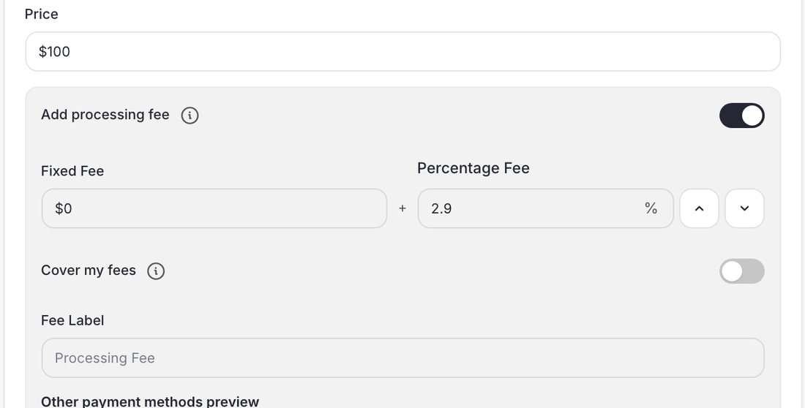

Every paid transaction has two fees:

- **Stripe's processing fee.** The standard US card rate is 2.9% + \$0.30. Your rate depends on your Stripe account, the payment method, and the card's country.
- **The CoachIQ platform fee**, if your organization has one. It comes out of your payout and isn't added to the buyer's total. The product builder shows it as **CoachIQ Platform Fee**.

Once you enter a price, the product builder's **Payment** section shows your payout from a card payment: the platform fee, **Estimated card processing**, and **You receive about**. On a subscription it reads **Your payout per recurring card payment**.

Each product decides who covers the fees. By default you absorb the fees. Turn on **Add processing fee** to charge the buyer a fee on top of the price.

## Example

For a \$100 product, with Stripe at 2.9% + \$0.30 and a platform fee of 1% + \$0.20:

| | You absorb the fees | Buyer pays a 3.9% + \$0.50 fee |
| --- | --- | --- |
| Buyer pays | \$100.00 | \$104.40 |
| You receive | \$95.60 | Slightly under \$100 |

When the buyer pays the fee, Stripe's percentage applies to the whole \$104.40, so you receive slightly less than the full price. **Cover my fees** works this out for you.

## Add a processing fee to a product

<Steps>
  <Step title="Open the product">
    Go to **Payments → Products**, then select **+ Create** or open an existing product.
  </Step>
  <Step title="Turn on Add processing fee">
    In the **Payment** section, turn on **Add processing fee**.
  </Step>
  <Step title="Set the amounts">
    Enter the **Fixed Fee** and **Percentage Fee**, or turn on **Cover my fees**. Cover my fees fills in the fields so you receive about your full price after card processing and any CoachIQ platform fee. You can still change the numbers. Set the **Fee Label** buyers see, such as "Processing Fee".

    <Frame>
      
    </Frame>
  </Step>
  <Step title="Check the preview and save">
    The preview shows the price, the processing fee, and the total the buyer pays, and **You receive about** shows your payout. The estimate uses Stripe's standard US card rate; your actual rate can differ by country, card, and currency conversion. Save the product.
  </Step>
</Steps>

At checkout, the fee appears as its own line under the price.

## Fees for ACH payments

If your organization accepts **US bank account (ACH)** payments, the processing fee settings include a separate fee for ACH. Bank payments usually cost less than cards, so you can charge bank payers a lower fee, or none, on the same product. Checkout applies the fee that matches the method the buyer chooses.

1. Turn on ACH for your organization. See [Payment methods at checkout](/payments/getting-started#payment-methods-at-checkout).
2. In the product's **Payment** section, set the card fee as usual.
3. Set the ACH fee to cover what a bank payment costs you, using your Stripe pricing, or leave it at zero.

The ACH fee option appears only after ACH is enabled, and only on a product that already exists. On a new product the builder says **Set an ACH fee after creating**: create the product, then open it again to set the bank fee. If your account can't take bank payments, the builder doesn't mention an ACH fee at all.

Separate ACH fees aren't switched on for every organization yet. If the builder says a separate bank processing fee isn't available, your product keeps its standard processing fee and any fee you saved before stays as it was. Contact CoachIQ support if you need it.

<Tip>
  Charging card payers a fee and bank payers none encourages families to pay large camp or season registrations by bank.
</Tip>

## Changing a product's fee

A change applies to new purchases. Past transactions and existing subscriptions aren't changed. Tell families before you change the fee on a product they buy regularly.

## Before you add fees

- Some US states restrict or prohibit card surcharges, and card networks have their own disclosure rules. Check the rules where you operate before passing card fees on.
- Say in the product description that a processing fee is added, so it isn't a surprise at checkout.
- Stripe can charge more for international cards, currency conversion, and disputes. These aren't included in the fee fields. See your Stripe pricing.

Absorbing fees keeps checkout simple; you can raise the price slightly to cover them. Passing fees on keeps your price lower but adds a line at checkout. Both work. Pick one approach and use it consistently across similar products.

## Related articles

- [Product Builder reference](/payments/product-builder)
- [Payment methods at checkout](/payments/getting-started#payment-methods-at-checkout)
- [Revenue sharing](/payments/sharing-rev)
- [Transactions](/payments/transactions)
