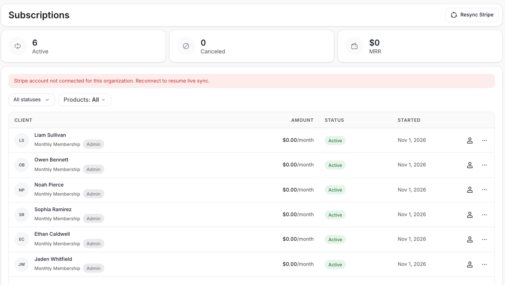
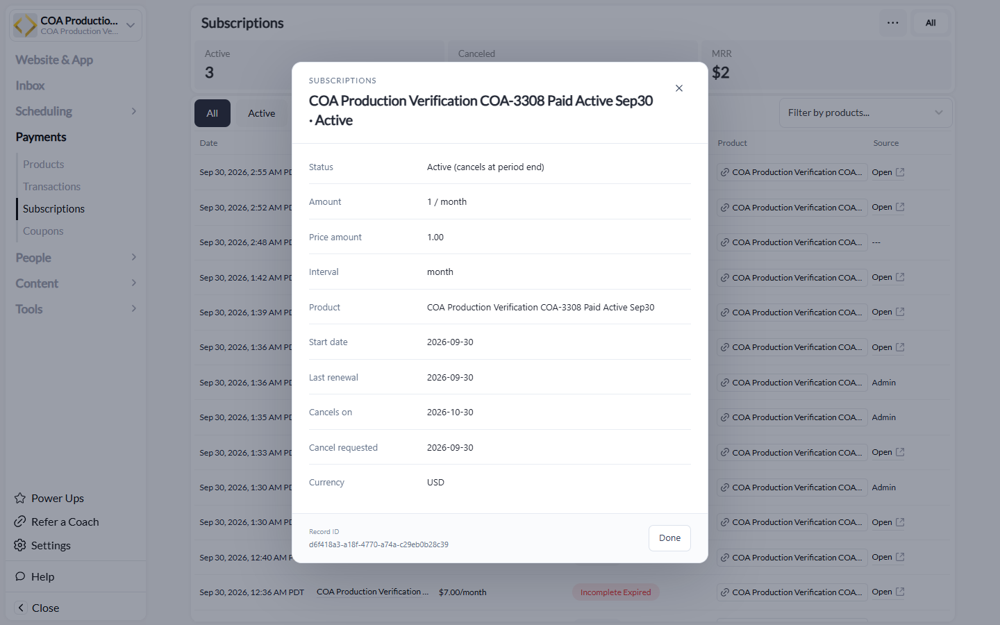

**Payments → Subscriptions** lists every membership your clients pay for on a schedule, with its status, amount, and start date. Use it to see who's paying, who's in a trial, whose payment failed, and what you bring in each month.

<Note>
  In organizations with several groups, Subscriptions shows only the current group's memberships, and the counts and MRR include only that group's sales. If some rows couldn't be checked, the page says "Some subscriptions could not be checked. Refresh to try again." and leaves those rows out.
</Note>

<Frame>
  
</Frame>

## The summary cards

- **Active**: memberships that are billing now, including trials and memberships scheduled to start later. Past due and paused memberships aren't counted.
- **Canceled**: memberships that have ended.
- **MRR**: monthly recurring revenue from active memberships. Yearly and other periods are converted to a monthly amount. Paused memberships are left out.
- **Payments paused**: shown only when some memberships have payment collection paused. See [Payments paused](#payments-paused).

## The list

Each row shows:

| Column | What it shows |
| --- | --- |
| **Client** | The client's name, the membership product under it, and where it came from |
| **Amount** | What it bills and how often, for example \$200.00/month |
| **Status** | Active, Trialing, Scheduled, Past due or Canceled, with notes under it such as **Trial ends [date]**, **Ends [date]**, **Cancels [date]**, **Billing starts [date and time]** or **Payments paused** |
| **Started** | When the membership started |

On a computer every note under the status shows on its own line. On a phone the row shows the first note, and the rest are in the subscription's details.

At the end of each row:

- The person button opens the client's profile.
- The **⋯** menu has **View subscription**, which opens the subscription's details (status, amount, product, start date, currency), and **Open product**, which opens the product in the builder.

The list loads more rows as you scroll. A client whose account was deleted shows as **Removed client**.

## Filter the list

- **Status** (**All statuses** by default): **Active**, **Canceled**, **Past due**, **Trialing or scheduled**, or **Unsynced**. **Payments paused** is added when some memberships are paused.
- **Products**: pick one or more subscription products. Each one becomes a chip; select **Apply** to filter.

If nothing matches, the page says "No subscriptions match these filters." with **Clear filters**.

## Resync Stripe

If a membership you expect isn't listed, select **Resync Stripe** at the top right. CoachIQ checks your Stripe account again and tells you whether the resync started, is still running, or found everything up to date. The totals stay on screen while they update. If the resync fails, select **Try again**.

If Stripe isn't connected, the page shows "Stripe account not connected for this organization. Reconnect to resume live sync." See [Connect Stripe](/payments/connecting-stripe).

## Subscription status types

<Tabs>
  <Tab title="Active">
    The membership is billing on its schedule. Check for **Cancels [date]** before assuming another payment is due.
  </Tab>
  <Tab title="Trialing">
    The client is in a free trial. Their card is on file but hasn't been charged. The row shows **Trial ends [date]**, and the first payment runs then. The client can cancel during the trial without being charged.
  </Tab>
  <Tab title="Scheduled">
    The membership was bought with a later first charge (**Schedule charges for later** in the product). The row shows **Billing starts** with the date and time of the first charge, as accepted at purchase. Changing the product later doesn't move it. A scheduled membership canceled before its first charge shows "Access until [date] · no charge" to the member.
  </Tab>
  <Tab title="Past due">
    The last payment failed and Stripe is retrying it, following your Stripe retry settings.

    <Warning>
      While a membership is past due, its credits are paused, so the athlete can't book with them until the payment goes through. Contact the client to update their card. See [Failed payments](/payments/failed-payments).
    </Warning>
  </Tab>
  <Tab title="Canceled">
    The membership has ended. A membership set to cancel later stays Active or Trialing, with **Cancels [date]**, until its end date.
  </Tab>
</Tabs>

## Scheduled cancellations

A membership ending at period end shows **Active — Cancels [date]** or **Trialing — Cancels [date]**. It stays in its current filter and count while access continues. It moves to **Canceled** when it ends.

Open the row to distinguish **Cancels on**, the membership's end date, from **Cancel requested**, when the cancellation was requested. The record does not show another renewal when it is scheduled to end.

<Frame caption="A production test membership with a scheduled end. Names and amounts are test examples.">
  
</Frame>

A **Not on a purchase** label means billing is not linked to a purchase on the client's profile. Use [Payment Methods to manage that subscription](/payments/manage-subscriptions#a-subscription-is-not-on-a-purchase).

## Payments paused

If you pause payment collection for a membership in the Stripe Dashboard, CoachIQ shows it:

- The row shows **Payments paused** under the status, with the resume date if you set one.
- The **Payments paused** filter lists only paused memberships, and a separate paused count sits next to Active and MRR.
- Paused memberships aren't counted as active revenue.
- The member sees "Payments paused" and when payments resume in **Billing**, **Orders** and **Archive**.

Members keep their access, bookings and credits while payments are paused. Nothing is charged or canceled by the pause itself. A membership that is already set to cancel shows its cancel date instead of the pause.

<Note>
  Pausing and resuming are done in Stripe. CoachIQ doesn't have its own pause button yet.
</Note>

## Check for unsynced subscriptions

An **unsynced** subscription exists in CoachIQ but isn't linked to Stripe, so CoachIQ can't bill it, add its credits, or track its renewals. Set the status filter to **Unsynced** to list them.

For each one, check:

- Does the client have an active subscription in Stripe? If so, it needs relinking.
- Was it a product added by hand that was never connected to billing?
- Did an import or account transfer drop its Stripe link?

If one should be billing, contact [CoachIQ support](mailto:info@coachiq.io) to get it relinked.

<Warning>
  An unsynced subscription can give a client access without billing them. Check this filter after imports and account transfers.
</Warning>

## Subscriptions or Transactions?

- **Subscriptions** shows the ongoing membership: its status, amount, and dates.
- **[Transactions](/payments/transactions)** shows each payment, including every membership charge, one-time purchases, and refunds.

## Related articles

- [Manage a client's subscription](/payments/manage-subscriptions)
- [Failed payments](/payments/failed-payments)
- [When Stripe and CoachIQ don't match](/payments/stripe-coachiq-reconciliation)
