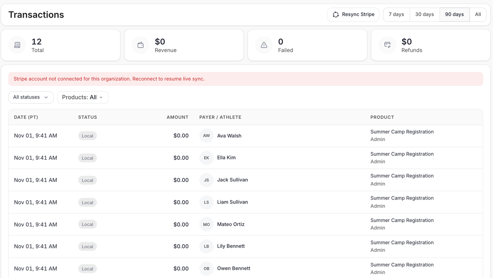

**Payments → Transactions** lists every payment your business takes: one-time purchases, membership charges, refunds, declined attempts, and payouts to your bank. Use it to check what came in, find a client's payment, and spot failed charges.

<Note>
  In organizations with several groups, Transactions shows only the current group's records, and the totals include only that group's sales. If some rows couldn't be checked, a notice says so.
</Note>

<Frame>
  
</Frame>

## Pick a date range

Use the buttons at the top right: **7 days**, **30 days**, **90 days**, or **All**. The cards and the list follow the range.

## The summary cards

- **Total**: how many transactions are in the range.
- **Revenue**: money actually collected, including one-time purchases, membership charges, and purchases you marked paid by cash, check or other. Membership rows with no charge yet add \$0. A payment linked to two purchase records is counted once.
- **Failed**: payments that failed for good or were canceled. Declines that Stripe can still retry aren't counted here; they show under **Past due** and **Blocked**.
- **Refunds**: money returned to clients.

Revenue doesn't take an estimated card fee from a \$0 payment. Paid amounts use an estimate (2.9% plus 30 cents) until Stripe reports the real fee.

When you filter by status, the cards are labeled **Totals: all statuses**, because they still count every status, not just the rows shown. If the totals fail to load, the page says "Totals couldn't load." with **Try again**.

If you leave the page open in another browser tab while you change a purchase elsewhere, the list and totals reload when you come back to the tab.

## The list

| Column | What it shows |
| --- | --- |
| **Date** | When it happened, in your time zone. The header names it, for example **Date (PT)** |
| **Status** | Success, Processing, Past due, Blocked, Payout, Refunded, and others. A retryable decline shows the reason under it, such as **Card declined**; hover it for Stripe's full message |
| **Amount** | The amount |
| **Payer / Athlete** | Who paid and, when different, who it was for. A declined attempt also shows who tried to pay, while that person is still a member |
| **Product** | What was bought, with its source on the line under it (see below) |

Long statuses and dates, such as "Requires payment method" or "Trial ends Nov 12, 2026", wrap onto a second line instead of being cut off. The list loads more rows as you scroll.

**Membership rows with no charge yet** say why instead of reading as collected money: **Trial ends [date]**, **Scheduled** with **Starts [date]**, **Cancels [date]** or **Canceled**, with **No charge yet** or **No charge**.

**\$0 rows.** These show as \$0 rows and count in **Total**: access-code orders, 100%-off coupon orders (including a membership with a 100% off forever coupon, which shows its coupon code), and a membership that costs \$0 bought through checkout. They stay listed after the membership is canceled or archived. Free products you add to a client yourself don't appear.

## Filter the list

- **Status** (**All statuses** by default): **Processing**, **Success**, **Past due**, **Blocked**, or **Payout**.
- **Products**: pick one or more products. Each becomes a chip; select **Apply** to filter. The product filter resets when you reload the page.

### Find a bank payment that is still processing

Set the status filter to **Processing** to see bank (ACH) transfers that haven't settled. Parents see a bank-payment processing message while they wait. Access and purchase automations run after the payment is confirmed.

A processing payment isn't a completed purchase or a reason to pay again. **Success** only includes payments that went through. A bank payment that fails can show under **Past due**, **Blocked**, or **All**, with any related refund under **Blocked**. If a transfer has settled but access is missing, contact support with the transaction details.

## Where each payment came from

The line under the product shows the source:

| Source | What it means |
| ------ | ------------- |
| **Open** | The payment has a Stripe ID. Select **Open** to see the charge in Stripe. |
| **Admin** | Transaction was created by an admin — no Stripe charge is mapped. This appears when a purchase is manually added through the dashboard (e.g., comping a client, granting a free trial) or when a Stripe ID has been manually removed from a subscription. |
| **Coupon** | A coupon code was applied to the transaction. |
| **Access Code** | The order was placed with an access code, including codes on recurring products. These orders also appear under the Access Code filter. |
| **Cash · Paid**, **Check · Paid**, **Other · Paid** | A product you added to a client and marked paid outside Stripe. The amount is what you confirmed in **Amount**, and it counts toward Revenue. [Recording cash, check and other payments](/people/client-profiles/client-profiles-products#recording-cash-check-and-other-payments) |

<Note>
**"Admin" does not mean the admin was charged.** It means an admin created the transaction manually without a Stripe payment. This is normal for comped access, free trials granted by the coach, or manual adjustments.
</Note>

<Note>
  **"Admin" doesn't mean the admin was charged.** It means the purchase was added by hand without a Stripe payment, for example comped access or a free trial you granted.
</Note>

## Resync Stripe

If a payment you see in Stripe isn't listed, select **Resync Stripe** at the top. CoachIQ says "Resync started. New transactions can take a few minutes to appear." or that everything is up to date. If the resync fails, select **Try again**.

If Stripe isn't connected, the page shows "Stripe account not connected for this organization. Reconnect to resume live sync." See [Connect Stripe](/payments/connecting-stripe).

## See the full charge in Stripe

For a Stripe payment, select **Open** to see it in your Stripe Dashboard: card, Stripe fee, net amount, and the payment's history.

To refund a payment, open the client's profile and use their **Transactions** tab. See [Refund a payment](/payments/issuing-refunds).

## Common questions

<AccordionGroup>
  <Accordion title="Find one client's payments">
    Open the client's profile from **People** and select the **Transactions** tab. It shows only that client's payments, with the same totals for that client.
  </Accordion>
  <Accordion title="A payment shows in Stripe but not here">
    - It may not be linked to a CoachIQ product, for example a charge made directly in Stripe.
    - It may not have synced yet. Select **Resync Stripe** and wait a few minutes.
  </Accordion>
  <Accordion title="A client says they paid but nothing is listed">
    1. Check whether they used a different email or account.
    2. Set the status to **Past due** or **Blocked**: their card may have been declined.
    3. Check Stripe for the charge.

    If their card was charged but checkout closed before it finished, CoachIQ records the purchase once on its own, without charging again. If it can't, the payment is held for the CoachIQ team to review, and nothing is refunded automatically.
  </Accordion>
  <Accordion title="The amount doesn't match the product price">
    A processing fee, a coupon, an account credit, or a partial refund changes the amount. Select **Open** to see the breakdown in Stripe.
  </Accordion>
</AccordionGroup>

## Related articles

- [Refund a payment](/payments/issuing-refunds)
- [Failed payments](/payments/failed-payments)
- [The Subscriptions page](/payments/subscriptions-dashboard)
