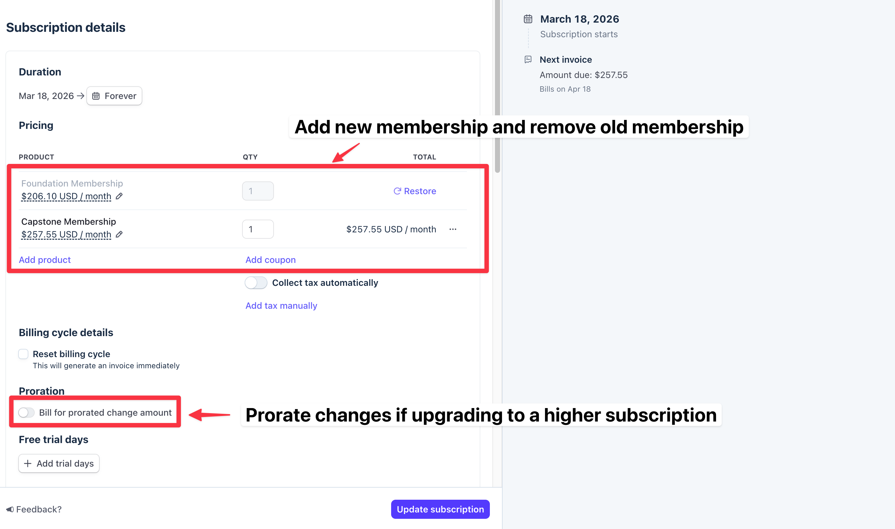
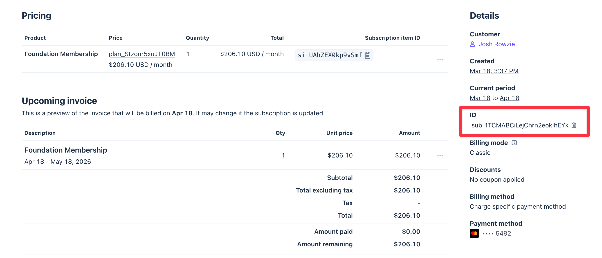
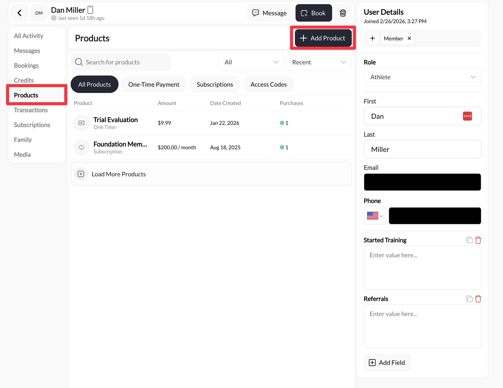
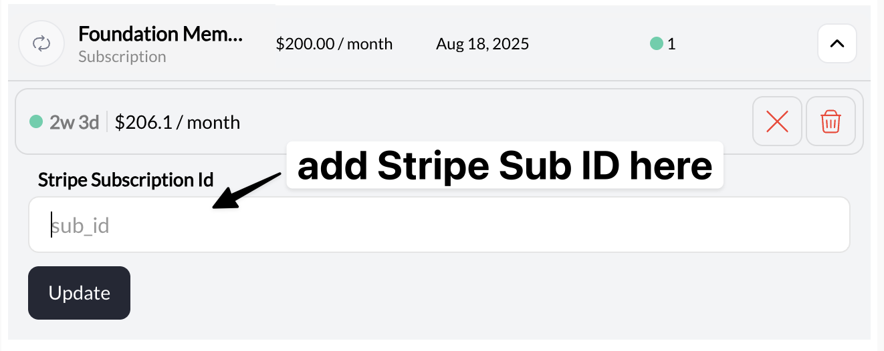
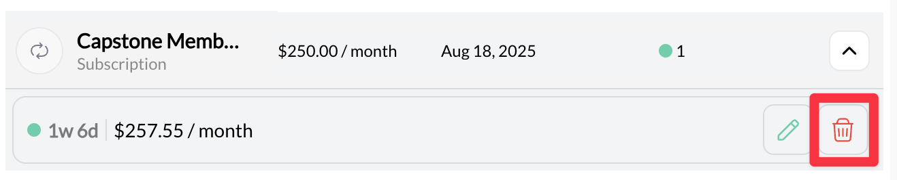

To move a client from one membership to another, change the plan in Stripe, then move the Stripe subscription in CoachIQ from the old purchase to a new one. Upgrading in Stripe keeps the same subscription ID (it starts with `sub_`), and CoachIQ lets only one purchase hold a subscription ID. So you clear it from the old purchase before adding the new one.

<Info>
  **Where:** your Stripe Dashboard, then **People → open the client → Products**.
</Info>

## Move a membership

<Steps>
  <Step title="Change the plan in Stripe">
    In your Stripe Dashboard, open **Customers**, find the client's subscription, and update it to the new plan's price.

    <Frame>
      
    </Frame>
  </Step>
  <Step title="Copy the subscription ID">
    Copy the subscription ID from the subscription's page in Stripe. It starts with `sub_` and doesn't change when you update the plan.

    <Frame>
      
    </Frame>
  </Step>
  <Step title="Clear the ID from the old purchase">
    In CoachIQ, open the client's profile and the **Products** tab. Edit the old membership purchase, delete its **Stripe Subscription ID**, and save.

    <Frame>
      
    </Frame>
  </Step>
  <Step title="Add the new membership with the ID">
    Select **Add Product**, choose the new membership, and paste the subscription ID into the Stripe ID field. Confirm.

    <Frame>
      
    </Frame>

    <Check>
      The new membership shows as active, and its next renewal adds the new plan's credits.
    </Check>
  </Step>
  <Step title="Archive the old purchase">
    Once the new one shows correctly, archive the old membership purchase so the client doesn't have two.

    <Frame>
      
    </Frame>
  </Step>
</Steps>

<Note>
  Adding a product by hand doesn't run its purchase automations unless you tick **Run purchase automations** when you add it.
</Note>

## Common issues

<AccordionGroup>
  <Accordion title="&quot;This Stripe subscription is already linked to…&quot;">
    The old purchase still holds the subscription ID. Edit the purchase the message names, delete its **Stripe Subscription ID**, save, then add the new membership again.
  </Accordion>
  <Accordion title="The new membership isn't showing">
    Check that the subscription ID you pasted matches the one in Stripe exactly, including the `sub_` start. If the field holds something that isn't a Stripe ID, **Confirm & Add** puts the cursor back in it with a hint, and nothing is saved.
  </Accordion>
  <Accordion title="The client has two memberships showing">
    Archive the old purchase from the **Products** tab. A purchase that's still billing can't be removed, so clear its subscription ID first.
  </Accordion>
  <Accordion title="I changed the plan in Stripe but not in CoachIQ">
    Stripe keeps billing the new price, but CoachIQ still shows the old product and adds its credits. Do steps 3 to 5.
  </Accordion>
</AccordionGroup>

## Related articles

- [Manage a client's subscription](/payments/manage-subscriptions)
- [The Subscriptions page](/payments/subscriptions-dashboard)
- [Grandfather pricing](/payments/grandfather-pricing)
