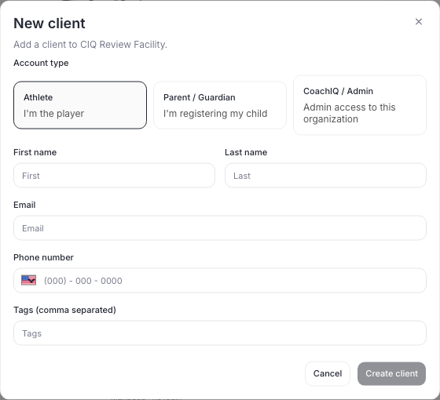
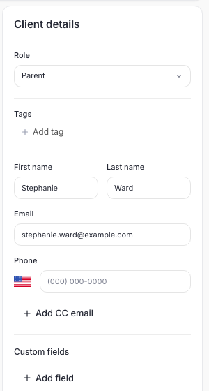

<Info>
  **Where to find this**: **People › Clients** › **New client** (top right). Client details are edited on the right side of each client's profile.
</Info>

Most families add themselves when they sign up on your website or app, book, buy or fill in a form. Use this page when you need to add someone yourself, bring over a list from another system, or fix someone's details.

## Add a client

<Steps>
  <Step title="Open New client">
    Go to **People › Clients** and click **New client**. The window reads "Add a client to" followed by your business name.
  </Step>
  <Step title="Pick the account type">
    - **Athlete**: "I'm the player". Use this for adult clients and athletes who hold their own login.
    - **Parent / Guardian**: "I'm registering my child". The parent holds the login and payment method. Add their children from the parent's [Family section](/people/client-profiles/client-profiles#family) once the parent is created.
    - **CoachIQ / Admin**: admin access to your business. To add coaches, use [Staff](/people/managing-staff) instead.
  </Step>
  <Step title="Fill in their details">
    Enter **First name**, **Last name**, **Email** and **Phone number**. The phone field has a country picker and saves the number with its country code, so texts reach the right phone. Any fields you've made required in [Sign-up & Profile](/people/sign-up-and-profile) show here too.

    Add tags in **Tags (comma separated)**, for example `Varsity, Tuesday group`.
  </Step>
  <Step title="Create the client">
    Click **Create client**. They appear at the top of your Clients list, and you can book them, sell them a product or message them right away.
  </Step>
</Steps>

<Frame>
  
</Frame>

**What can stop a new client from saving:**

- The email already belongs to someone in CoachIQ. The existing account is added to your business instead of creating a second one, and their existing name and role are kept.
- The phone number already belongs to a different account. Use another number or leave it blank.
- A required sign-up field is empty.

<Note>
  Tags you add in **New client** start any active **User Tag Added** automations, the same as adding the tag from the profile later. Each tag starts the automation once. Check your automations before tagging a new client if a tag sends a message. See [Triggers and actions](/tools/automations/triggers-actions-reference).
</Note>

### Help a new client set their password

A client you add has no password yet. On their profile, the **Sign-in** part of **Client details** reads **Has not set a password yet** with a **Send set-password email** button.

1. Click **Send set-password email**. The line under it shows when the link was sent, for example "Link sent 6:47 PM", and the button changes to **Send again**.
2. If you click **Send again** within 10 minutes, a note tells you when another link can be sent.

Clients can also sign in with a code texted to their phone, or with Google where your site offers it. See [How clients sign in](/people/how-clients-sign-in).

## Import a list of clients

To bring clients over from a spreadsheet or another system, use **Settings › Data › Import People**. Download the formatted CSV, fill in one row per person with an email, and upload it. Rows whose email already exists are matched to the existing person instead of creating a duplicate, and one bad row doesn't stop the rest. See [Import People](/settings/data#import-people).

<Tip>
  Import a test file of five people first, then check them in **People › Clients** before you upload everyone.
</Tip>

Children without an email are added from the parent's **Family** section with **Add child**, not through the import.

## Edit a client's details

Open the client from **People › Clients**. **Client details** sits on the right of the profile (on a phone it's its own section).

<Frame>
  
</Frame>

| Field | What to know |
|---|---|
| **Role** | Athlete, Parent, Coach or Admin. Changing it takes effect right away. Making someone a Coach puts them on your Default coach access. |
| **Tags** | **Add tag** to pick or create a tag; remove one with its x. |
| **First name**, **Last name**, **Email**, **Phone** | Edit the field and it saves. A person's name, email and phone belong to their CoachIQ account, so the change also shows in any other business they belong to. If the person's sign-in is also used by another organization or a staff account, you can't change their email, phone or CC emails: "This email is this person's sign-in for another organization or a staff account too, so it can't be changed here. They can change it themselves from their own account." Their name and photo still save. |
| **Add CC email** | Send copies of this client's emails to another address, such as a second parent. |
| **Sign-in** | Shows whether they've set a password, with the set-password email button. |
| **Custom fields** | Your own fields, such as shirt size or school. |

<Warning>
  If you change someone's email, they sign in with the new email from then on. Tell them before you change it.
</Warning>

**What coaches can edit.** A coach whose access doesn't block **Clients** can edit a client's name, email, phone and custom field values. Staff members' details are read-only for coaches, and a coach can't change the email, phone or CC emails of a client who also belongs to another business. Only admins can add a new client, and a coach limited to tagged clients doesn't see **New client**.

## Custom fields

Custom fields hold anything else you need on a profile: emergency contact, date of birth, position, school, shirt size.

- **Add a field.** In **Client details**, click **Add field** under **Custom fields**, name it and enter the value. The field is then available on every client's profile; fill it in only where it matters.
- **Edit a value.** Each custom field is one text box. Type and it saves.
- **Field menu.** The menu next to a field's name has **Copy field ID** and **Delete field for everyone**. Only admins see **Delete**.
- **Ask for it at sign-up.** Turn a custom field on in [Sign-up & Profile](/people/sign-up-and-profile) so families fill it in when they create an account.

<Warning>
  **Delete field for everyone** removes the field and its values from every profile, and takes it off your sign-up form too. New families can still sign up and you can still add clients afterwards. If you only want to stop asking for it, turn it off at sign-up instead.
</Warning>

## Export your client list

On **People › Clients**, click **Export**. The download is named "Clients" and includes the people your current search, role and tag filters show. Exported files hold personal details, so store them carefully.

## Common questions

<AccordionGroup>
  <Accordion title="Can I add a child who doesn't have an email?">
    Yes. Add the parent first, open their profile, go to **Family** and click **Add child** › **New child**. The child is a managed athlete with no login of their own. See [Family](/people/client-profiles/client-profiles#family).
  </Accordion>
  <Accordion title="Can clients edit their own details?">
    Yes. In your app, clients can change their name, email, phone, password and photo. Roles, tags, credits and purchases are yours to manage.
  </Accordion>
  <Accordion title="How do I make a client a coach?">
    Add them from **People › Staff** › **Add**. An existing client can't be turned into staff from the Add window; change their **Role** to Coach on their profile instead. See [Add and manage staff](/people/managing-staff).
  </Accordion>
  <Accordion title="How do I remove a client?">
    From the client's row menu choose **Remove client**, or open the profile and use **Block or remove**. See [Block or remove a client](/people/block-and-remove-athletes).
  </Accordion>
</AccordionGroup>

## Related articles

<CardGroup cols={2}>
  <Card title="Find and organize clients" icon="tags" href="/people/tags-filters">
    Search, sort, views and tags
  </Card>
  <Card title="Client profiles" icon="id-card" href="/people/client-profiles/client-profiles">
    Every section of a client's profile
  </Card>
  <Card title="Sign-up & Profile" icon="id-badge" href="/people/sign-up-and-profile">
    Choose the fields new families fill in
  </Card>
  <Card title="How clients sign in" icon="right-to-bracket" href="/people/how-clients-sign-in">
    Passwords, texted codes and Google
  </Card>
</CardGroup>
