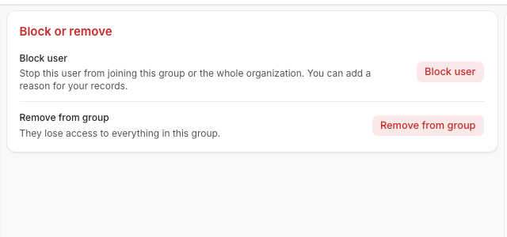
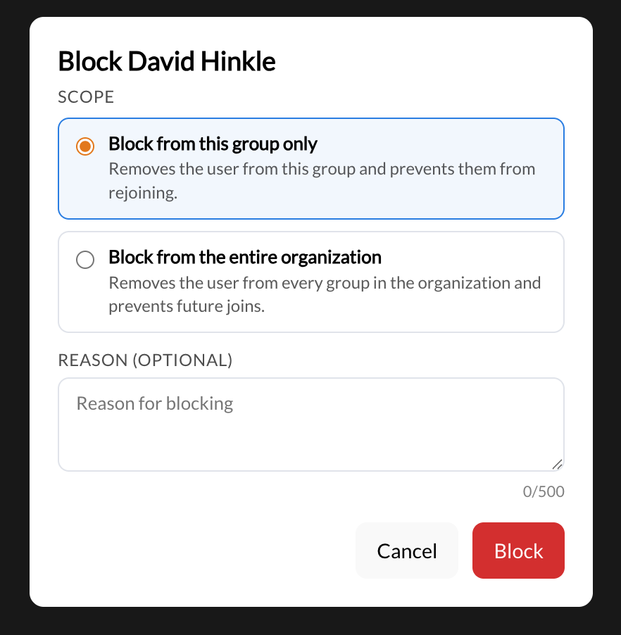
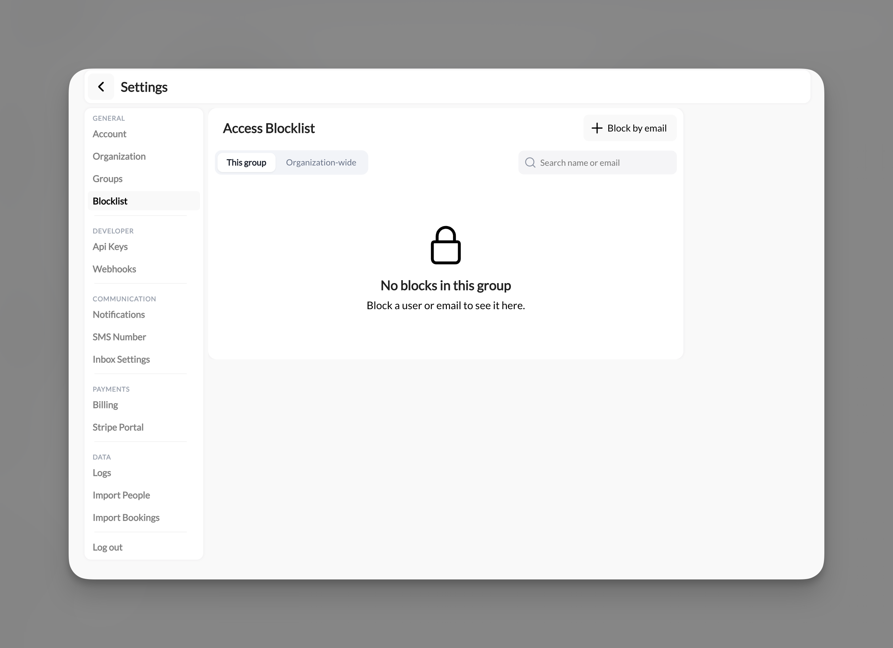

Use **Block or remove** when someone should no longer book, see your content or receive your messages.

<Info>
**Where to find this:** open the client's profile and click **Block or remove** at the bottom of the section list. From the Clients list, the row's **...** menu also has **Block client** and **Remove client**.
</Info>

<Frame></Frame>

| | What it does | Use it when |
|---|---|---|
| **Remove from group** | "They lose access to everything in this group." They can join again or be added again later. | A program ended, or a family moved to another location |
| **Block user** | "Stop this user from joining this group or the whole organization." You can add a reason for your records. | Someone must not come back |

<Warning>
Neither one cancels a subscription. Cancel any active membership first, or the client keeps being charged.
</Warning>

## Block a user

<Steps>
  <Step title="Open the client's profile">
    Go to **People › Clients** and click the client to open their profile.
  </Step>
  <Step title="Open Block or remove">
    Click **Block or remove** at the bottom of the section list.
  </Step>
  <Step title="Click Block user">
    Click **Block user**. A window opens.
  </Step>
  <Step title="Choose a scope">
    Select the scope of the block:

    - **Block from this group only** — Removes the client from this group and stops them from rejoining.
    - **Block from the entire organization** — Removes the client from every group in the organization and prevents future joins.

    <Frame></Frame>
  </Step>
  <Step title="Add an optional reason">
    Enter a reason in the **Reason (Optional)** field (up to 500 characters). This is for your internal records and is not shown to the client.
  </Step>
  <Step title="Confirm">
    Click **Block** to apply. The client is removed straight away.
  </Step>
</Steps>

<Warning>
Blocking is applied instantly and cannot be undone from the client's profile. The client loses access to group content as soon as the block is confirmed. To undo a block, you must go to **Settings** → **Blocklist** and remove them manually.
</Warning>

## Remove from group (without blocking)

To take a client out of your business without stopping them from coming back, click **Remove from group**, or choose **Remove client** from their row menu in the Clients list. Their account, bookings and payment history stay on record, and if you add them again later their history comes back.

Use **Remove from group** when the departure is neutral, such as a program ending or a family moving to a different group. Use **Block user** when you need to prevent future access.

## Manage your blocklist

Everyone you've blocked is listed in one place.

1. Go to **Settings** in the left navigation.
2. Click **Blocklist**.
3. Use the **This group** and **Organization-wide** tabs to view blocks by scope.

<Frame></Frame>

To unblock someone, find them in the blocklist and remove the block from there.

### Block by email address

You can pre-emptively block someone who has not yet joined your organization. On the **Blocklist** page, click **+ Block by email** in the top right and enter their email address. This prevents them from joining even if they attempt to sign up.

---

<AccordionGroup>
  <Accordion title="Can I permanently delete an athlete's account?">
    No. CoachIQ does not support permanently deleting a user account. Blocking an athlete from your organization is the closest equivalent — it removes them from all groups and prevents future access. Their historical data (past sessions, transaction records) is retained.
  </Accordion>
  <Accordion title="What's the difference between Block user and Remove from group?">
    **Remove from group** removes the athlete from the current group and revokes their access to that group's content. They can still rejoin or be added to other groups.

    **Block user** goes further — it actively prevents the athlete from rejoining. You choose the scope: block from this group only, or block from the entire organization.
  </Accordion>
  <Accordion title="Can I unblock someone?">
    Yes. Go to **Settings** → **Blocklist**, find the athlete under the **This group** or **Organization-wide** tab, and remove the block. They will regain the ability to join your group or organization.
  </Accordion>
  <Accordion title="Can I block someone who hasn't joined yet?">
    Yes. On the **Blocklist** page, click **+ Block by email** and enter the person's email address. This prevents them from joining your organization even before they create an account or attempt to sign up.
  </Accordion>
</AccordionGroup>

---

<CardGroup cols={2}>
  <Card title="Add and edit clients" icon="user-plus" href="/people/adding-editing-clients">
    Add clients, import a list and edit details.
  </Card>
  <Card title="People Overview" icon="users" href="/people/overview">
    Understand how client management works in CoachIQ, including what happens when you remove a client.
  </Card>
  <Card title="Tags and Filters" icon="tag" href="/people/tags-filters">
    Organize your athlete list with tags to segment and filter clients.
  </Card>
</CardGroup>
