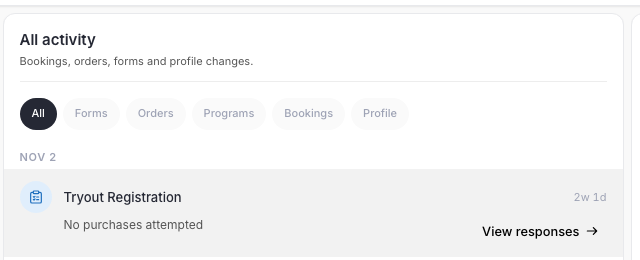

<Info>
  **Where to find this**: open a client › **Activity** › **All activity** (it opens first)
</Info>

**All activity** is the quickest way to see what a client has been doing: "Bookings, orders, forms and profile changes", newest first, grouped by day.

<Frame>
  
</Frame>

## Filter the timeline

Use the row of tabs at the top:

| Tab | Shows |
|---|---|
| **All** | Everything |
| **Forms** | Form submissions, with **View responses** to read their answers |
| **Orders** | Purchases, including attempts that didn't go through |
| **Programs** | Programs they joined or were given |
| **Bookings** | Sessions booked and canceled |
| **Profile** | Changes to their profile: being added, name or phone edits, custom field changes, and tags added or removed. Each entry says who made it; a change made through the Assistant reads "via CoachIQ Assistant", and changes by the CoachIQ team read "By the CoachIQ team" |

Each entry shows what happened and how long ago, for example "2w 1d" (two weeks and one day).

**Tag changes.** When you add or remove a tag for many clients at once, each client whose tags actually changed gets one entry, with the name of the person who made the change. A long tag name wraps onto a second line so you can read all of it.

A client with nothing yet shows **No activity yet**: "New bookings and orders show here."

## What isn't here

- Messages: see [Messages](/people/client-profiles/client-profiles-messages).
- Staff notes and logged calls: see [Notes and calls](/people/client-profiles/client-profiles#notes-and-calls).
- Each credit added or used: see [Credits](/people/client-profiles/client-profiles-credits).

## Common uses

<AccordionGroup>
  <Accordion title="A client says they bought a package">
    Click **Orders** and look for the purchase and its date. For the payment itself, open [Transactions](/people/client-profiles/client-profiles-transactions).
  </Accordion>
  <Accordion title="Did they fill in the registration form?">
    Click **Forms**. Open **View responses** on the entry to read what they answered.
  </Accordion>
  <Accordion title="Is this client still active?">
    Look at the date of the most recent entry, or at **Last activity** in the Clients list. No bookings for a month is worth a check-in message.
  </Accordion>
</AccordionGroup>

## Related articles

<CardGroup cols={3}>
  <Card title="Bookings" icon="calendar-check" href="/people/client-profiles/client-profiles-bookings">
    Upcoming, canceled and past sessions
  </Card>
  <Card title="Credits" icon="coins" href="/people/client-profiles/client-profiles-credits">
    Credit balances and history
  </Card>
  <Card title="Transactions" icon="receipt" href="/people/client-profiles/client-profiles-transactions">
    Payments and refunds
  </Card>
</CardGroup>
