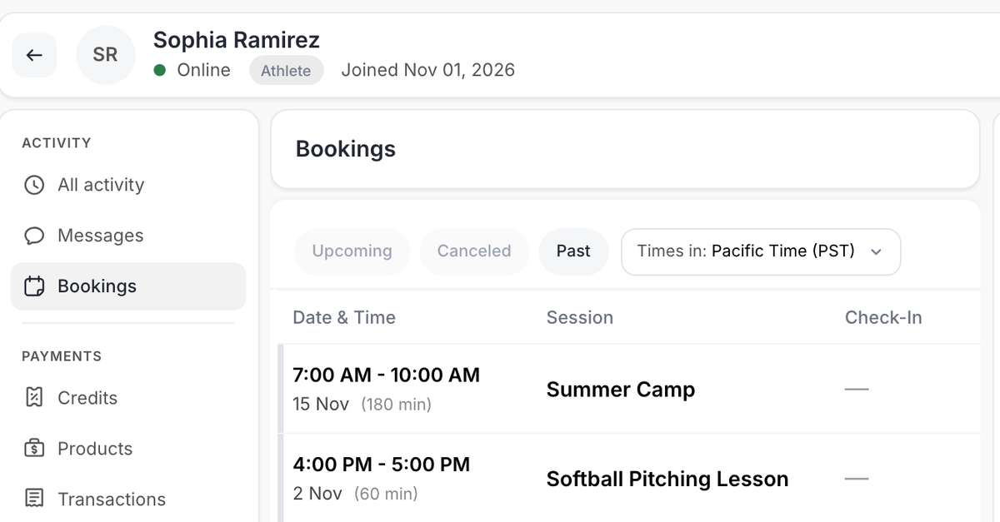

<Info>
  **Where to find this**: Client Profile → **Bookings** tab
</Info>

## What it shows

Every session this client has booked, organized by status:

<Frame>
  
</Frame>

<Tabs>
  <Tab title="Upcoming">
    Future sessions that haven't happened yet.

    **Shows:**

    - Date & time
    - Session name
    - Duration
    - Time zone (PST, EST, etc.)

    **Sorted:** Chronologically (soonest first)
  </Tab>
  <Tab title="Canceled">
    Sessions that were booked then canceled (by you or them).

    **Includes:**

    - Original booking date
    - Session name
    - When it was canceled

    **Useful for:** Tracking no-shows, cancellation patterns, rescheduling needs
  </Tab>
  <Tab title="Past">
    Completed sessions (attendance history).

    **Shows:**

    - When they attended
    - Which sessions
    - Frequency patterns

    **Sorted:** Reverse chronological (most recent first)
  </Tab>
</Tabs>

---

## Who made the booking

When a coach or admin booked the session, a **Booked by** line under the booking names them. If a parent's credits paid for a child's booking, it reads "Booked by (coach) with credits from (parent)". A booking the client made for themselves has no Booked by line, and a booking a parent made for their child names the parent. Bookings made before May 2026 and canceled bookings don't show a staff name.

## Canceling a booking

Canceling a booking from the admin calendar or a bookings list asks you to confirm and names the client and time. **No** keeps the booking. For a booking paid with credits, you still get the choice to refund the credits after confirming.

---

## Parent profiles: bookings grouped by athlete

Open a **Parent** and the Bookings tab shows every session for every athlete connected to that parent, grouped by athlete, rather than only sessions the parent booked for themselves. Open one of the athletes and you see just that athlete's sessions.

This mirrors what the parent sees in their own portal and in the native app, so when a parent calls about "Tuesday's practice" you are both looking at the same list. If a parent's Bookings tab is missing a child's sessions, check **PROFILE** → **Family** on the parent; the athlete must be connected there. See [Family accounts](/app/family-accounts#how-a-parent-sees-their-athletes-bookings).

---

## Time zone selector

The line above the booking list says which time zone the times are in, for example **Times in Central Time (CDT)**, with the right summer or winter label for the dates on screen. Use its menu to show the list in another zone, such as your business's, without changing your computer's time zone. The times reload in that zone, and the note **Also used on your Schedule** appears, because your Schedule uses the same saved choice. Changing the zone only changes how times are shown; no booking moves.

<Tip>
  **Why this matters**: If your client travels or you work with athletes in different states, toggle their time zone to confirm "Yes, 3 PM your time, not mine."
</Tip>

---

## Common uses

<AccordionGroup>
  <Accordion title="When is their next session?">
    1. Make sure you're on **Upcoming** tab
    2. Look at first entry (soonest session)

    Takes 2 seconds. No need to open Calendar.
  </Accordion>
  <Accordion title="How many times have they trained this month?">
    1. Click **Past** tab
    2. Count entries from current month
    3. Look for date patterns (e.g., every Monday/Wednesday)

    Helps assess engagement and commitment.
  </Accordion>
  <Accordion title="Why did they cancel?">
    1. Click **Canceled** tab
    2. Check cancellation frequency
    3. Look for patterns (same day cancellations? specific session types?)

    If you see 5+ cancellations, might be time to check in: "Hey, I noticed you've had to cancel a few times. Is the schedule not working for you?"
  </Accordion>
  <Accordion title="Preparing for their session today">
    1. Check **Upcoming** tab
    2. See session name and time
    3. Open their **Credits** or **All Activity** tab to see recent context
    4. Message them a reminder if needed

    Quick pre-session prep from one profile view.
  </Accordion>
</AccordionGroup>

---

## Empty bookings tab?

If you see no bookings, this client has either:

- Never booked a session (brand new)
- Only booked sessions you later deleted from Calendar
- Booked through a different account. A parent's Bookings tab lists connected athletes' sessions grouped by athlete, so if the parent is empty too, check **PROFILE** → **Family** to confirm the athlete is connected

**Next step**: Click **Book** button to manually schedule their first session.

---

## Pro tip: Spot no-show patterns

If you see:

- Many **Canceled** entries (especially last-minute)
- Long gaps between **Past** bookings
- Sessions booked but zero in **Past** tab

This signals engagement issues. Address it:

1. Check **Messages** tab—did they communicate?
2. Look at **Credits** tab—do they have credits expiring?
3. Send a check-in: "Hey, missed you lately! Everything okay?"

---

## Related articles

<CardGroup cols={3}>
  <Card title="Calendar" icon="calendar" href="/scheduling/calendar-overview-and-navigation">
    Full calendar management
  </Card>
  <Card title="Credits" icon="coins" href="/people/client-profiles/client-profiles-credits">
    See credit redemptions per booking
  </Card>
  <Card title="Manual Booking" icon="calendar-plus" href="/scheduling/manually-booking-athletes">
    How to book clients into sessions
  </Card>
</CardGroup>