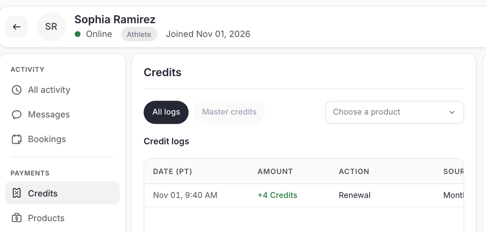
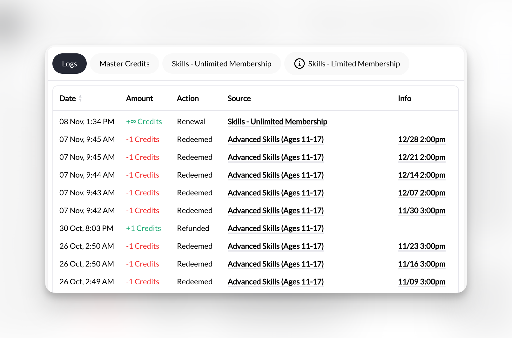

<Info>
  **Where to find this**: Client Profile → **Credits** tab
</Info>

## What it shows

Complete credit transaction history organized by credit type:

**What you can switch between:**

- **All logs**: every credit transaction (all types combined)
- **Master credits**: universal credits that work for any scheduler
- **Choose a product**: pick a credit package from the menu to see only its credits (e.g., "Hybrid Rising Stars/Elite 5 Credit Package")

<Frame>
  
</Frame>

<Note>
  **Number of tabs varies** based on what credit products this client has purchased. New client might only have "Logs" and "Master Credits."
</Note>

---

## Reading the transaction log

Each credit transaction shows:

| Column     | What it means                                                    |
| ---------- | ---------------------------------------------------------------- |
| **Date**   | When transaction occurred, in your time zone. The header names the zone, for example **Date (PT)**; hover a date for the year, seconds and zone |
| **Amount** | Credits added/removed (green = +5, red = -1)                     |
| **Action** | What happened (Redeemed, Expiration, Renewal, Purchased, Set by) |
| **Source** | Where credits came from (product name, admin name, "Unknown")    |
| **Info**   | Additional context (session booked, expiration date)             |

<Frame>
  
</Frame>

Credit Logs and **Payments → Transactions** use the same time zone, so a purchase and the credits it added show the same time.

---

## Credit transaction types explained

<Tabs>
  <Tab title="Redeemed">
    **Action**: Client used a credit to book a session

    **Shows**: `-1 Credits` (red)

    **Source**: Session name (e.g., "Rising Stars Class")

    **When you see this**: Every time they book a credit-based session
  </Tab>
  <Tab title="Purchased">
    **Action**: Client bought a credit package

    **Shows**: `+5 Credits` or `+10 Credits` (green)

    **Source**: Product name (e.g., "Month to Month Rising Stars Membership")

    **When you see this**: After they complete purchase or recurring billing
  </Tab>
  <Tab title="Set by">
    **Action**: You (admin) manually changed the balance

    **Shows**: `Set to 6`, the balance after the change, not the number of credits added or removed. Older manual rows display the same way.

    **Source**: **Manual**, with **Set by** and the staff member's name (e.g., "Russell Reeder")

    **When you see this**: When you give makeup credits, promotions, or adjustments
  </Tab>
  <Tab title="Renewal">
    **Action**: Subscription auto-renewed and added credits

    **Shows**: `+5 Credits` (green)

    **Source**: Subscription product name

    **When you see this**: Monthly when their membership billing succeeds
  </Tab>
  <Tab title="Expiration">
    **Action**: Unused credits expired based on product rules

    **Shows**: `-2 Credits` (red)

    **Source**: Product name with expiration settings

    **When you see this**: When credits hit expiration date and weren't used
  </Tab>
</Tabs>

---

## Credit renewals and expirations

For a membership billed through Stripe, the **Credit Renewals** and **Credit Expirations** dates match the membership's billing date. A membership set to cancel at the end of its period shows no renewal row, and its expiration date matches the cancel date. Memberships added without a Stripe subscription renew the day after, when the overnight run adds the credits.

On a membership whose credits expire each cycle, a session on the renewal day can always be paid with credits: the ending cycle's credits cover sessions up to and including that day, and the new cycle's credits cover it too once the renewal goes through. **Credit Renewals** and **Credit Expirations** show that same day. A pack whose sessions must fall inside its credit window uses the days shown under **Credit Expirations**, in your scheduler's time zone.

The expiration warning on a credit pack counts only credits whose date has passed. Credits used for bookings are not described as expired.

When a booking paid with credits is canceled and the credit is returned, it goes back to the pack that paid for it and keeps that pack's expiration date.

### Held credits

Some older one-time credits that would have expired while a notice to you was still pending are held instead of lost. When your clients have held credits, the **Clients** list shows a banner with how many credits and members are affected and the date they would expire (45 days after your notice). From the banner you can:

- **Message these members** from a ready-made draft, which ends with your name under "Thank you," and can be edited before you send it
- Keep every held credit with one action

To change one batch, open the client's **Credits** tab and extend it to a later date or to no expiry. Kept and extended credits show their new date, they can be booked like any other credit (including credits from a pack bought after its fixed expiry date), and every change is written to the credit history. Nothing expires with the November 2026 release.

### When a membership is inactive

If a membership has ended or is otherwise inactive, its credit tab reads "Membership inactive. The balance is kept but can't be spent." **Credits Redeemable** shows 0, matching what the athlete sees in **Billing**. The balance comes back into use if the membership becomes active again. This is separate from the credit-use toggle described in [Turning off a product's credits](#turning-off-a-products-credits).

---

## Checking current balance

**Quick balance check:**

1. Click the credit tab you want (Master Credits, or a specific product)
2. Look at the **top of the transaction list**—most recent transaction shows running balance
3. Add up green (+) and red (-) entries if you need to verify

<Tip>
  **Fastest way**: Look at the top entry amount. That's usually their current balance unless they just booked something.
</Tip>

---

## Common uses

<AccordionGroup>
  <Accordion title="Do they have enough credits for today's session?">
    1. Click appropriate credit tab (Master or product-specific)
    2. Check most recent balance
    3. If balance ≥ 1, they can book

    **Takes 3 seconds** from their profile.
  </Accordion>
  <Accordion title="Why did their credits disappear?">
    Look for **Expiration** entries in red:

    - Check **Source** column—which product expired?
    - Check **Info** column—shows expiration date
    - Scroll up to see when credits were originally purchased

    **Common scenario**: Client bought a 10-pack in January with 90-day expiration, used 3 credits, then 7 expired in April.
  </Accordion>
  <Accordion title="They claim they never used a credit—verify it">
    1. Go to **Logs** tab (shows all credit types)
    2. Filter mentally or scroll to find **Redeemed** entries
    3. Check **Source** column—shows which session
    4. Cross-reference with **Bookings** tab to confirm attendance

    **Proof**: "You redeemed a credit on Oct 16 for Rising Stars Class at 10:34 AM."
  </Accordion>
  <Accordion title="Manually adding credits (makeup, promotion, gift)">
    1. Open the **Master Credits** tab, or the tab for the product whose credits you want to change
    2. Under **Adjust balance**, use **+** or **−** to enter how many credits to add or remove. It changes the balance by that amount; it isn't a new total
    3. On a membership whose credits expire each cycle, choose **Expire with this cycle** (default) or **Keep until used**
    4. Click **Apply**

    The confirmation gives the new balance (for example "Master Credits balance is now 3."), and Credit Logs show a "Set to" entry with your name.

    [Learn how to add credits →](/payments/credits/managing-athlete-credits#manual-credit-operations)
  </Accordion>
</AccordionGroup>

---

## Turning off a product's credits

Each product-specific credit tab has a toggle that controls whether that product's credits count toward the athlete's spendable balance. Use it to move an athlete off an old plan without deleting anything.

**When you need it:**

- The athlete moved to a new membership and the old one should stop granting bookings
- A coupon zeroed out a membership and left a \$0 product on the account that keeps renewing credits
- You granted the wrong credit product and they've already booked with it

**What the toggle does**

| | Credits ON (default) | Credits OFF |
| --- | --- | --- |
| Athlete can book with these credits | Yes | No |
| Stored balance | Kept | Kept, shown as revoked with 0 redeemable |
| Credit log history | Kept | Kept |
| Other credit tabs | Unaffected | Unaffected |
| Reversible | - | Yes, turn it back on to restore use |

Turning credits off overrides everything else: even if the underlying purchase or Stripe subscription is still active, the athlete can't spend these credits until you turn them back on. Nothing is granted, deducted, or erased either way.

<Steps>
  <Step title="Open the product's credit tab">
    Client Profile → **Credits** → click the tab for the product (not Logs or Master Credits).
  </Step>
  <Step title="Switch credit use off">
    Use the toggle on that tab to deactivate the credits. The balance stays visible but is no longer redeemable.
  </Step>
  <Step title="Add the replacement, if any">
    Grant the new product from the **Products** tab. The athlete books from the new credits only.
  </Step>
</Steps>

<Warning>
  **Toggle or archive?** The toggle stops the credits and keeps the product showing as active. If you want the product retired as well, use **Archive** on the client's Products tab: it removes the remaining credits and keeps the purchase history. See [Archiving a client's product](/people/client-profiles/client-profiles-products#archiving-a-clients-product). Deleting a credit-bearing product outright is still not possible once its credits have been used; that protects the booking and credit records behind it.
</Warning>

<Note>
  If the old product is a paid Stripe subscription, turning off its credits doesn't stop billing. Cancel the subscription as well; see [Managing subscriptions](/payments/manage-subscriptions).
</Note>

---

## Master Credits vs Product Credits

**Master Credits**:

- Work for ANY scheduler you create
- Most flexible
- Typically sold as "10-Pack Universal Credits"

**Product-Specific Credits** (e.g., "Elite Class 5-Pack"):

- ONLY work for schedulers linked to that product
- Useful for tiered membership levels
- Client might have Master Credits AND Elite Credits separately

<Warning>
  **Redemption priority**: When a client books, CoachIQ uses Master Credits first. If more than one product's credits can pay for the session, it uses the credits that expire soonest, and credits that never expire are used last. You can't control this order.
</Warning>

---

## If credits don't load

If a client's balance, credit banks or credit history can't be loaded, the section shows a short message and **Try again** instead of an empty list or a zero balance. A credit bank tied to a membership with a long payment history now loads in seconds.

## Empty credits tab?

If you see no transactions, this client has:

- Never purchased credits
- Never been manually granted credits
- Only paid cash/card for sessions (not credit-based)

**Next step**: Sell them a credit package or manually grant trial credits to get started.

---

## Pro tips

**Watch for expiration dates in "Info" column**: If you see credits expiring soon, send a reminder: "Hey! You have 5 credits expiring on 10/18. Book your sessions before they're gone!"

**"Unknown" source usually means**: Old data before CoachIQ tracked sources, or credits from a deleted product. Not a problem—credits still work.

**A balance can go below zero**: it shows as a minus number. This usually means a membership is set to give fewer credits per cycle than the client books. Check the product's credits per billing cycle, then correct the balance with **Adjust balance** (see [Managing athlete credits](/payments/credits/managing-athlete-credits)).

**Sort mentally by date**: Newest entries at top. Scroll down to see historical patterns (e.g., "They used to buy credits monthly, but stopped 3 months ago").

---

## Related articles

<CardGroup cols={3}>
  <Card title="Products" icon="box" href="/people/client-profiles/client-profiles-products">
    See which credit packages they've bought
  </Card>
  <Card title="Transactions" icon="receipt" href="/people/client-profiles/client-profiles-transactions">
    Financial view of credit purchases
  </Card>
  <Card title="Credit System Guide" icon="book" href="/payments/credits/credit-system-overview">
    Complete guide to how credits work
  </Card>
</CardGroup>