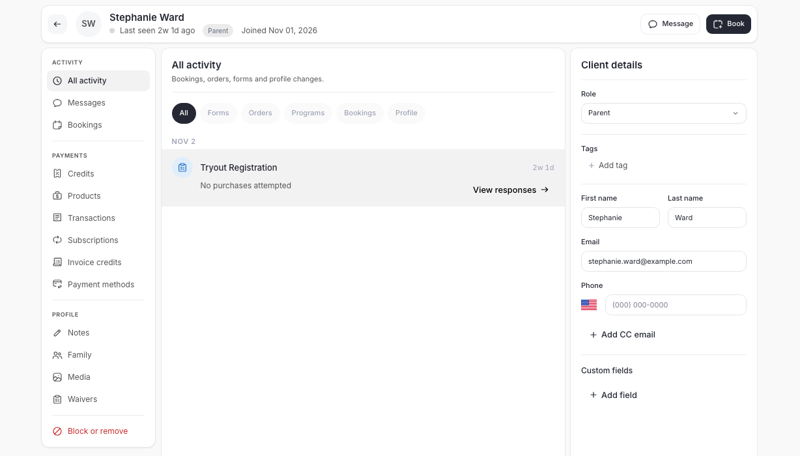
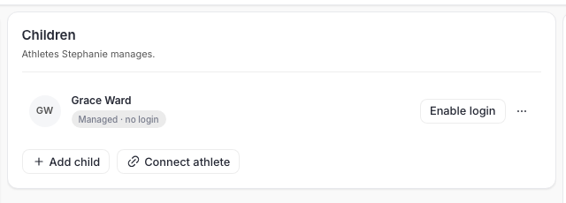

<Info>
  **Where to find this**: **People › Clients**, then click a client. The same profile opens from **People › Staff**, from a booking on the Calendar, and from a conversation in the Inbox.
</Info>

A client's profile answers "what's going on with this person?" without opening five other pages: what they've booked, what they've paid for, how many credits they have, who's in their family and what your staff know about them.

<Frame>
  
</Frame>

## The header

The top of the profile shows the back arrow, their photo or initials, their name, when they were last seen ("Last seen 2w 1d ago", or "Not seen yet"), their role, the date they joined, and markers such as **Managed athlete**.

- **Message** opens a conversation with them.
- **Book** books them into a session. See [Book a client yourself](/scheduling/manually-booking-athletes).

## The sections

The list on the left groups everything about the client. On a narrow screen the profile stacks into one column and the sections become a menu at the top.

| Group | Section | What it shows |
|---|---|---|
| **Activity** | [All activity](/people/client-profiles/client-profiles-activity) | Bookings, orders, forms, programs and profile changes, newest first. Filter with **All**, **Forms**, **Orders**, **Programs**, **Bookings** and **Profile**. |
| | [Messages](/people/client-profiles/client-profiles-messages) | Your in-app and SMS conversation, with a reply box |
| | [Bookings](/people/client-profiles/client-profiles-bookings) | **Upcoming**, **Canceled** and **Past** sessions, with a time zone choice |
| **Payments** | [Credits](/people/client-profiles/client-profiles-credits) | Credit balances and every credit added, used or expired |
| | [Products](/people/client-profiles/client-profiles-products) | What they've bought or been given |
| | [Transactions](/people/client-profiles/client-profiles-transactions) | Payments and refunds, with a date range |
| | [Subscriptions](/people/client-profiles/client-profiles-subscriptions) | Memberships and recurring billing |
| | Invoice credits | Credit you've given toward their future membership invoices |
| | Payment methods | **Saved cards** and **Active subscriptions** |
| **Profile** | [Notes](#notes-and-calls) | Your staff's private notes and logged calls |
| | [Family](#family) | The athletes a parent manages, or an athlete's parents |
| | [Media](/people/client-profiles/client-profiles-media) | Videos and photos shared with this client |
| | [Waivers](/people/client-profiles/client-profiles-waivers) | Which waivers they've accepted |
| | [Block or remove](/people/block-and-remove-athletes) | Remove them from your business, or block them from rejoining |

Where a section has different views of the same thing (activity types, message channels, booking lists, credit logs), you switch them with the row of tabs at the top of the section. A section with nothing in it says so in one short line, for example "No activity yet".

When Stripe isn't connected, the **Products**, **Transactions**, **Subscriptions**, **Invoice credits** and **Payment methods** sections show one notice, "Stripe isn't connected", with a **Connect Stripe** button. Anything already recorded still shows.

<Note>
  Coaches see only the sections their [staff access](/people/staff-access#what-a-blocked-page-also-hides) allows. Blocking **Products**, **Transactions** or **Subscriptions** hides the matching sections, and blocking **Media Hub** hides **Media**. **Credits** always stays visible.
</Note>

## Client details

The panel on the right holds the client's **Role**, **Tags**, name, **Email**, **Phone**, **Add CC email**, **Sign-in** and **Custom fields**. Edit a field and it saves. See [Edit a client's details](/people/adding-editing-clients#edit-a-clients-details) and [Custom fields](/people/adding-editing-clients#custom-fields).

When you limit coaches with [access tags](/people/staff-access#limit-a-coach-to-certain-clients), the profile also shows a **Staff access** section with the client's access tags and the coaches who can see them.

## Family

<Info>
  **Where to find this**: open a parent or athlete › **Profile** › **Family**
</Info>

On a parent's profile, **Family** is titled **Children**, "Athletes [name] manages". Each child shows their name and whether they have their own login, for example **Managed · no login**.

<Frame>
  
</Frame>

**Add a child to a parent:**

- **Add child** creates a new managed athlete with no login. Enter **First name** (required) and **Last name**, then **Create child**. The parent books, pays and gets messages for them.
- **Connect athlete** links an athlete who's already in your business.

On an athlete's profile, **Family** lists their parents, and **Connect parent** links one.

**Each family member** has **Enable login** (for a managed athlete) and a **...** menu for the other actions, with **Remove** or **Disconnect** last.

### Give a managed athlete their own login

Click **Enable login** next to the child and add the email they'll sign in with. They keep their history. From then on they can sign in to your app themselves, and the parent keeps managing them.

If the athlete's sign-in is also used by another business or by a staff account, login can't be turned on here. The message reads: "This athlete's sign-in is also used for another organization or a staff account, so login can't be enabled here." It doesn't name the other business. Ask the family for a different email.

See [Family accounts](/athlete-portal/family-accounts) for how parents add their own children in your app and who gets reminders for a managed child.

## Notes and calls

<Info>
  **Where to find this**: open a client › **Profile** › **Notes**
</Info>

Use **Notes** to keep what your staff know about a family in one place: injuries, goals, who to call about payments, what you talked about at the last session. Notes are staff-only. Clients never see them and they're never sent to families.

- Type in the note box (up to 50,000 characters) and click **Add note**.
- Each note shows who wrote it and when, newest first. **Load older** shows more.
- Calls logged from the Inbox with **Log call** show here too, and can't be edited.
- Notes can't be edited. To correct one, delete it and add it again.

| | Read | Add notes | Delete notes |
|---|---|---|---|
| **Admins** | Yes | Yes | Any note |
| **Coaches** | Yes | Yes, while **Coaches can add notes and log calls** is on | Only their own |

Admins see the **Coaches can add notes and log calls** switch at the top of Notes. It's on by default. When it's off, coaches can still read notes.

The Assistant and a connected ChatGPT or Claude can read, add and delete notes with the same rules, after you approve. A note they add names the staff member who asked.

## Common questions

<AccordionGroup>
  <Accordion title="Can clients see their profile like I do?">
    No. In your app, clients see their own bookings, purchases, credits, programs and messages. They never see your notes, tags, staff access or other clients.
  </Accordion>
  <Accordion title="Why is a section empty or missing?">
    An empty section means there's nothing to show yet, for example no bookings. A missing section usually means your staff access blocks the page it belongs to.
  </Accordion>
  <Accordion title="I can't find the Family section for a parent">
    Check the client's **Role** in **Client details**. If they're set to Athlete, change it to **Parent**.
  </Accordion>
  <Accordion title="What happens to the profile if I remove the client?">
    Their bookings, purchases and payments stay on record. If you add them again later, their history comes back with them. See [Block or remove a client](/people/block-and-remove-athletes).
  </Accordion>
</AccordionGroup>

## Related articles

<CardGroup cols={2}>
  <Card title="Add and edit clients" icon="user-plus" href="/people/adding-editing-clients">
    Client details, custom fields and set-password emails
  </Card>
  <Card title="Family accounts" icon="people-roof" href="/athlete-portal/family-accounts">
    How parents and managed athletes use your app
  </Card>
  <Card title="Credits" icon="coins" href="/people/client-profiles/client-profiles-credits">
    Balances and adjustments
  </Card>
  <Card title="Bookings" icon="calendar-check" href="/people/client-profiles/client-profiles-bookings">
    A client's sessions
  </Card>
</CardGroup>
