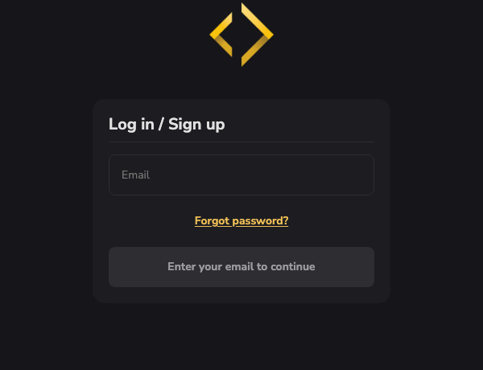

Athletes and parents sign in to your app (web and mobile) and your website with the same account. This page covers what they see and how to help when someone can't get in. What new people fill in when they sign up is set in [Sign-up & Profile](/people/sign-up-and-profile).

## Sign in with email

The sign-in window is titled **Log in / Sign up** and asks for their email first.

- **Someone with an account** enters their password next.
- **Someone new** goes on to create an account with the fields from your [Sign-up & Profile](/people/sign-up-and-profile) settings.
- **Forgot password?** opens your business's own password reset page, from every place a sign-in appears on your site and app.

<Frame>
  
</Frame>

On the **Set New Password** screen, and the first-time "Welcome, set your password" screen, the password rules show in grey before they try, and any problem shows in red in the same spot.

## Sign in with a texted code

On your website's sign-in, families can choose **Text me a code instead**. The code goes to the phone number on their account.

- Someone whose number has no account yet can create one with a texted code and joins your business. This works for US and Canada numbers.
- Phone sign-up shows your terms and text-message consent above the **Continue** button so they can read them first.
- The screen always reads "We sent a code to [number] if it can receive one.", whether or not the number has an account, so it never reveals who's signed up.
- If a number is on several accounts and exactly one of them belongs to your business, the code goes to that account. Otherwise nothing is sent; ask them to sign in with email.
- If a code doesn't arrive, they should check the phone number saved on their account, wait for **Resend**, or sign in with email instead. CoachIQ Support can see why a code text failed.

Coach and admin accounts sign in with email and password.

## Sign in with Google

Where your site offers **Continue with Google**, it first shows a CoachIQ page that names your site and your business, with **Continue with Google** and **Cancel**. Google sign-in only starts from that page.

- If the Google email matches an athlete or parent account that has no password and no texted-code sign-in, Google is added to that account and they get an email telling them so.
- If the account already has a password, they're asked to sign in with it instead. If they've only ever signed in with a texted code, the message tells them to keep using the code.

**Member Login** and **My Account** in a custom website header or section open the same sign-in window, including Google where your site allows it.

<Note>
  Apple sign-in, and Google sign-in for coaches and staff, aren't available yet.
</Note>

## People you added yourself

A client you add from **People › Clients** has no password until they set one. They can set it the first time they sign in, or you can send them a link from their profile with **Send set-password email**. See [Help a new client set their password](/people/adding-editing-clients#help-a-new-client-set-their-password).

A managed athlete (**Managed · no login**) can't sign in until you click **Enable login** on the parent's **Family** section. See [Family](/people/client-profiles/client-profiles#family).

## Signed in but not a member yet

Someone who is signed in but hasn't joined your business sees one card with your logo, "Join" and your business name, and a **Join Now** button. Someone who belongs to another group in your organization gets a choice: go to their own group, or join this one. Removed people lose member menus and announcements straight away.

## When someone can't sign in or sign up

The form says what went wrong and keeps everything they typed. The usual causes:

| What they see | What to do |
|---|---|
| The terms box isn't ticked, or the password is too weak | Tick the box, or follow the password rules shown |
| The phone number is already on another account | Sign in with the email on that account, or use a different number |
| The email already has an account | They're taken to the password step. Use **Forgot password?** if needed |
| "Complete all required fields to continue" | Check your [Sign-up & Profile](/people/sign-up-and-profile) fields: a field marked required must show on the form |

<Tip>
  When a family is stuck, open their profile and look at **Sign-in** in **Client details**: it shows whether they've set a password and when the last set-password link was sent.
</Tip>

## Related articles

<CardGroup cols={2}>
  <Card title="Sign-up & Profile" icon="id-badge" href="/people/sign-up-and-profile">
    Choose what new families fill in
  </Card>
  <Card title="Family accounts" icon="people-roof" href="/app/family-accounts">
    How parents manage their athletes in your app
  </Card>
</CardGroup>
