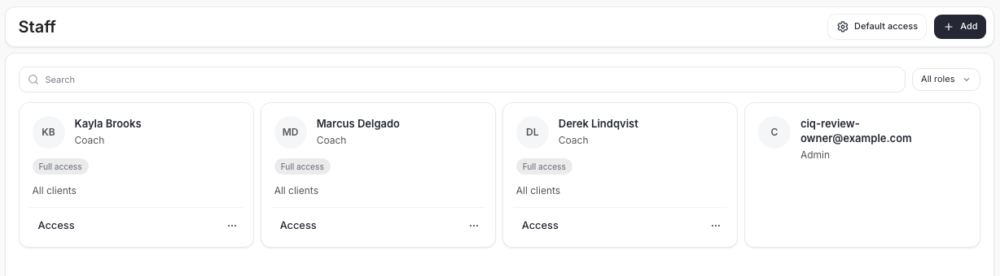
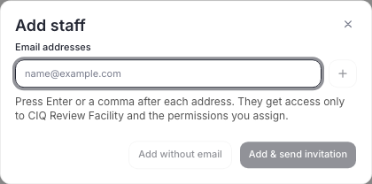

<Info>
  **Where to find this**: **People › Staff**. Only admins see this page.
</Info>

Staff are the people who run your business with you. Each one is either an **Admin** or a **Coach**:

| Role | What they can do |
|---|---|
| **Admin** | Everything: every page, payments, settings, adding staff and setting staff access. Admins can't be limited. |
| **Coach** | Run sessions, work with clients and use the pages their [staff access](/people/staff-access) allows. Coaches never see the Staff page. |

<Tip>
  Make someone an Admin only if you'd trust them with your payments and settings. Most assistant and part-time coaches should be Coaches.
</Tip>

## The Staff page

<Frame>
  
</Frame>

Each staff member has a card with their photo or initials, name and role. A coach's card also shows their access (**Full access** when nothing is blocked) and which clients they see (**All clients**, or the access tags they're limited to). Click anywhere on a card to open their profile.

On a coach's card, **Access** opens that coach's access settings, and the **...** menu has **Open profile** and **Manage access**. **Default access** at the top sets what every coach without their own settings gets. See [Staff access](/people/staff-access).

Use the search box and the **All roles** menu to find someone on a large team.

To choose which pages and clients a coach can see, use [Staff access](/people/staff-access).

## Add staff

<Steps>
  <Step title="Open Add staff">
    On **People › Staff**, click **Add**.
  </Step>
  <Step title="Enter their email addresses">
    Type each email and press Enter or a comma after it. You can add several people at once. They get access only to this business, with the permissions you give them.
  </Step>
  <Step title="Choose how to add them">
    - **Add & send invitation** emails each person a link to set their password and sign in.
    - **Add without email** adds them quietly. Tell them yourself to sign in at the CoachIQ admin with that email.
  </Step>
</Steps>

<Frame>
  
</Frame>

**What happens next:**

- Everyone you add starts as a **Coach** on your **Default coach access**. Open their card to change their role or give them their own access.
- The invitation link works once and expires after 24 hours. Sending a new one replaces the old link. Someone who already has a CoachIQ login gets a sign-in link instead, and their password isn't changed.
- The invitation is sent even when you've paused staff emails for your business.
- If an invitation fails to send, the person is still on your staff. Add the same email again with **Add & send invitation** to resend it; they won't be added twice.

<Note>
  An existing client can't be added from **Add staff**; they show as "Not added". To make a client a coach, open their profile from **People › Clients** and change their **Role** to Coach.
</Note>

## Change a staff member's role

1. Open the person from **People › Staff** (click their card, or **...** › **Open profile**).
2. In **Client details**, change **Role** between **Coach** and **Admin**.

The change is immediate. A coach made an Admin sees everything. A person changed to Coach starts on your Default coach access, and loses any sheets that were shared with them as a coach.

Admins can't change another Admin's role, and can't block or remove another Admin.

## Remove someone from your staff

To stop someone from working in your business, open their profile and use **Block or remove** at the bottom of the section list:

- **Remove from group** takes them out of your business. They lose access straight away.
- **Block user** removes them and stops them from rejoining.

To keep the person as a client (a coach who also trains with you), change their **Role** to Athlete instead.

Their past sessions, messages and the schedulers they built stay. Future sessions they're assigned to stay on the calendar with their name, so reassign or cancel those yourself. See [Block or remove a client](/people/block-and-remove-athletes).

## Staff profiles

A staff member's profile has the same sections as a client's. Coaches see other staff members' details as read-only.

## Staff notifications

Each staff member chooses their own email and push notifications. An Admin can pause staff notification emails for the whole business without changing anyone's choices. See [Staff email notifications](/settings/communication#pause-staff-emails-for-your-group).

## Common questions

<AccordionGroup>
  <Accordion title="What if my coach already has a CoachIQ account?">
    Add them with the email they already use. They sign in as usual and switch to your business from the business menu at the top of the sidebar.
  </Accordion>
  <Accordion title="Can I give different coaches different access?">
    Yes. Every coach starts on **Default access**. Click **Access** on one coach's card to give them their own settings. See [Staff access](/people/staff-access).
  </Accordion>
  <Accordion title="Can coaches see the Staff page?">
    No. Only admins see **People › Staff**.
  </Accordion>
  <Accordion title="Does saving staff access in the mobile app work?">
    Yes. You can save Default coach access and one coach's access from the CoachIQ app as well as the web.
  </Accordion>
</AccordionGroup>

## Related articles

<CardGroup cols={2}>
  <Card title="Staff access" icon="user-lock" href="/people/staff-access">
    Choose which pages and clients each coach sees
  </Card>
  <Card title="Block or remove" icon="ban" href="/people/block-and-remove-athletes">
    Remove or block someone from your business
  </Card>
  <Card title="Hiring and onboarding trainers" icon="user-tie" href="/guides/hiring-onboarding-trainers">
    Bring a new coach on board
  </Card>
  <Card title="Teams" icon="people-group" href="/people/teams/roster-and-staff">
    Give staff a role on a team
  </Card>
</CardGroup>
