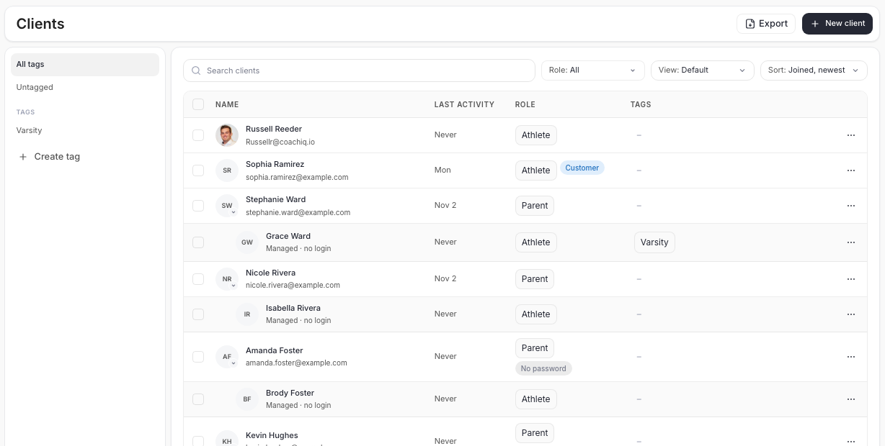

<Info>
  **Where to find this**: **People** in the left sidebar. It opens to **Clients**, **Staff** and **Sign-up & Profile**. When Teams is on for your organization, **Teams** sits as its own item directly under People.
</Info>

People is everyone connected to your business: the athletes you train, the parents who pay and book for them, and the coaches and admins who work with you. Every booking, purchase, message, credit and form answer is tied to a person, so their profile is where you go to answer "what's going on with this family?"

## What's in People

| Page | What you do there | Guide |
|---|---|---|
| **Clients** | Search, sort and tag everyone you work with, add a client, export the list, open a profile | [Add and edit clients](/people/adding-editing-clients), [Find and organize clients](/people/tags-filters) |
| A client's profile | See their activity, messages, bookings, credits, purchases, family, notes, media and waivers, and edit their details | [Client profiles](/people/client-profiles/client-profiles) |
| **Staff** | Add coaches and admins, and choose what each coach can see | [Add and manage staff](/people/managing-staff), [Staff access](/people/staff-access) |
| **Sign-up & Profile** | Choose what new families fill in when they create an account | [Sign-up & Profile](/people/sign-up-and-profile), [How clients sign in](/people/how-clients-sign-in) |
| **Teams** (when on) | Season rosters, team staff, practices, games and registration | [Teams overview](/people/teams/overview) |

<Frame>
  
</Frame>

## Clients, roles and families

**Clients** is the umbrella for everyone in your People list. Each person has a role in your business:

| Role | Who it is | What they see |
|---|---|---|
| **Athlete** | Someone who trains with you | Your app: their bookings, programs, messages and purchases |
| **Parent** | A parent or guardian who books and pays for one or more athletes | Your app, for themselves and the athletes they manage |
| **Coach** | Staff who run sessions | The CoachIQ admin, limited by [staff access](/people/staff-access) |
| **Admin** | You and anyone you trust with everything | The whole CoachIQ admin, including payments and settings |

A **Customer** label appears next to the role of anyone who has bought something from you.

**Families.** A parent and their athletes show together in the Clients list, with the athletes indented under the parent. An athlete with **Managed · no login** has no email or password of their own: the parent books, pays and gets the messages for them. You can give them their own login later from the parent's **Family** section. See [Family on the client profile](/people/client-profiles/client-profiles#family).

<Tip>
  For a parent-paid booking, check both who is attending (the athlete) and who paid (the parent). The athlete's profile holds their bookings and athlete credits; the parent's profile holds the purchase and receipt.
</Tip>

## Who can use People

- **Admins** see every page in People, add staff, change roles and set staff access.
- **Coaches** see the pages their [staff access](/people/staff-access) allows. A coach limited to clients with certain tags sees only those clients, and the Clients page reads **Showing your clients**. Coaches never see the Staff page.
- **Clients** never see other clients. In your app they see only their own account and the athletes they manage.

## Common questions

<AccordionGroup>
  <Accordion title="Can someone be both a client and staff?">
    Each person has one role in your business. A coach who also trains with you is a Coach, and you can still book them into sessions and sell them products from their profile.
  </Accordion>
  <Accordion title="How do I export my client list?">
    On **People › Clients**, click **Export**. The file is named "Clients" and includes the people your current search and filters show. See [Export your client list](/people/adding-editing-clients#export-your-client-list).
  </Accordion>
  <Accordion title="What happens when I remove a client?">
    **Remove client** takes them out of your business. Their account, past bookings and payments stay on record, and you can add them again later. To stop someone from rejoining, block them instead. See [Block or remove a client](/people/block-and-remove-athletes). Cancel any active subscription first: removing a client doesn't stop their billing.
  </Accordion>
  <Accordion title="Where's the sales pipeline?">
    People who haven't joined yet (trials, tryouts, renewals) are tracked in **Sales › Pipeline**. See [Pipeline](/sales/pipeline).
  </Accordion>
</AccordionGroup>

## Related articles

<CardGroup cols={2}>
  <Card title="Add and edit clients" icon="user-plus" href="/people/adding-editing-clients">
    New client, import, client details and custom fields
  </Card>
  <Card title="Client profiles" icon="id-card" href="/people/client-profiles/client-profiles">
    Every section of a client's profile
  </Card>
  <Card title="Staff access" icon="user-lock" href="/people/staff-access">
    Choose which pages and clients each coach sees
  </Card>
  <Card title="Inbox" icon="inbox" href="/inbox/inbox-overview">
    Message one client, a tag or a team
  </Card>
</CardGroup>
