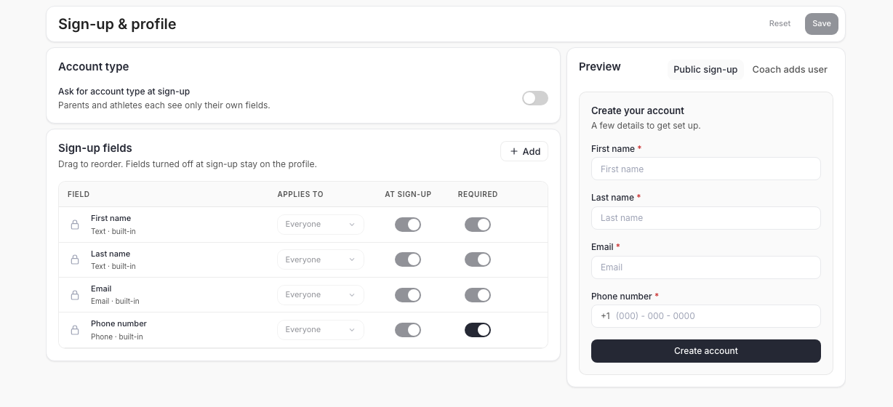

<Info>
  **Where to find this**: **People → Sign-up & Profile**
</Info>

## What you'll accomplish

Shape the account people create when they join you: ask for the right account type, pick the fields they fill in, make the important ones required, and add your own custom fields (jersey size, emergency contact, school) so every profile has what you need from day one.

Everything on this page applies both to **public sign-up** (someone registers through your website, your app, or a form) and to the form you see when you **add a client yourself**.

---

## The page at a glance

The page has three parts:

| Section | What it controls |
|---|---|
| **Account type** | Whether new people choose **Athlete** or **Parent / Guardian** when they sign up |
| **Sign-up fields** | The table of fields on your sign-up form: which appear, which are required, and their order |
| **Preview** | A rendered copy of the form as it will look, with a toggle between **Public sign-up** and **Coach adds user** |

<Frame>
  
</Frame>

---

## Account type

**Ask for account type at sign-up** decides whether new people say who they are before they finish: "Parents and athletes each see only their own fields."

- **On**: the sign-up form asks "I'm signing up as" **Athlete** or **Parent / Guardian**. The answer sets their role and decides which fields they see next. A parent then adds their athletes, and each athlete's last name is optional.
- **Off**: everyone signs up as an athlete with the same fields.

People whose account was created by filling in one of your forms get the same choice the first time they sign in to your app, along with any sign-up fields you've made required for the type they pick.

<Tip>
  Most youth programs turn this on. Parents hold the account, the payment method and the messages, and children don't end up with accounts that have no parent attached. Parents add children from their account, or you add them from the parent's [Family section](/people/client-profiles/client-profiles#family).
</Tip>

---

## Sign-up fields

The **Sign-up fields** table lists every field a new account can carry. Each row has four columns:

| Column | Meaning |
|---|---|
| **FIELD** | The field's label, as the person sees it |
| **APPLIES TO** | Who the field is collected for: **Everyone**, **Parents**, or **Athletes** |
| **AT SIGN-UP** | Show this field on the sign-up form |
| **REQUIRED** | The form can't be submitted until it's filled in |

### Built-in fields

**First name**, **Last name**, **Email**, and **Phone number** are built in (each row shows its type, for example "Text · built-in"). Email is the login credential, so it always stays on the form. **Phone number** starts out required. If you want families to be able to sign up without a phone, turn its **REQUIRED** switch off and save. A profile with no phone number can't receive texts or sign in with a texted code. The phone number is also where athletes and parents receive a sign-in code if they choose to sign in with a texted code. See [How clients sign in](/people/how-clients-sign-in).

The phone field on the sign-up form has a country selector that defaults to **+1** (United States). People outside the US pick their country from the selector; numbers are saved with the country code, so a US number is stored as +1 and not misread as another country's code. Dashes and spaces in the number are accepted.

Toggling a field off at sign-up does not delete it. It still lives on the profile, where you or the client can fill it in later.

### Custom fields

Click **Add** above the table to create your own. Give it a label, pick who it applies to, then switch **AT SIGN-UP** and **REQUIRED** on as needed. Typical custom fields:

- Emergency contact name and number
- Date of birth or graduation year
- Position, handedness, or skill level
- School or club team
- Jersey or T-shirt size for camps

Custom fields appear under **Custom fields** in **Client details** on every client's profile. See [Custom fields](/people/adding-editing-clients#custom-fields).

### Reorder fields

Drag rows up or down to change the order they appear in on the form. Put the fields people always know (name, email) first and the optional extras last.

Nothing applies until you click **Save** at the top of the page. **Reset** throws away changes you haven't saved.

<Warning>
  Every required field is a place someone can abandon your sign-up. Require what you genuinely need on day one and collect the rest later with a [form](/tools/forms/overview) or in the profile.
</Warning>

---

## Preview

The right-hand preview updates as you change fields. Toggle between:

- **Public sign-up** — what a new person sees when they register through your website or app
- **Coach adds user** — what you see under **People › Clients › New client**. It marks only what you really have to enter when you add someone, for example **Email** and **First name** before your group has saved its own settings. A phone number is required when people sign up themselves, not when you add them. The preview follows changes you haven't saved yet and your default account type.

The public preview is titled **Create your account** with the line "A few details to get set up." and ends in a **Create account** button. Use it to check the wording, the order, and that required markers land where you expect before you share a sign-up link.

When a new person's sign-up can't go through, the form says why and keeps everything they typed: the terms box isn't ticked, the password is too weak, the phone number is already on another account, or the email already has an account (they're taken to the password step instead). A successful sign-up signs them in and runs your **New User** automation.

---

## How this connects to the rest of CoachIQ

- **Forms** — a form with **Log in / Sign up** turned on uses these same account settings when a new person submits it. See [Creating Forms](/tools/forms/creating-forms).
- **Products** — guest checkout can create an account at purchase; the account type choice applies. See [Product Builder](/payments/product-builder).
- **Automations** — the **New User** trigger fires after sign-up, so you can welcome people or tag them by a custom field value. See [Triggers and actions](/tools/automations/triggers-actions-reference).
- **Import** — bulk imports through **Settings › Data › Import People** skip the sign-up form entirely. See [Data settings](/settings/data#import-people).

---

## Common questions

<AccordionGroup>
  <Accordion title="Will changing required fields affect existing clients?">
    No. Requirements apply at sign-up. Existing profiles keep whatever they have; you can fill gaps from their profile or ask them to update it in your app.
  </Accordion>
  <Accordion title="Can I have different fields for parents and athletes?">
    Yes. Set **APPLIES TO** on each field. A parent-only field (say, "Preferred contact time") is hidden when an athlete signs up, and vice versa.
  </Accordion>
  <Accordion title="A family says sign-up keeps failing. What should I check?">
    The form now shows the reason above the button. The usual cause is a phone number or email already linked to another account. They can sign in with the email on that account, or use a different phone number.
  </Accordion>
  <Accordion title="Can I delete a custom field?">
    Yes, from the field's menu on any client's profile (**Delete field for everyone**, admins only). That removes the field and its values from every profile, and its sign-up question goes too, so families can still sign up. If you only want to stop asking for it, turn **AT SIGN-UP** off instead.
  </Accordion>
  <Accordion title="Where do I see the answers?">
    In **Client details** on the client's profile, and in the **Clients** list when you export. Coaches whose Staff Access doesn't block Clients can see and edit the values too; only Admins can add or delete a field.
  </Accordion>
</AccordionGroup>

---

## Related articles

<CardGroup cols={2}>
  <Card title="Adding & Editing Clients" icon="user-plus" href="/people/adding-editing-clients">
    Create users yourself and edit any field afterwards
  </Card>
  <Card title="Client Profiles" icon="id-card" href="/people/client-profiles/client-profiles">
    Where custom field values live once an account exists
  </Card>
  <Card title="Bring in New Families" icon="rocket" href="/flows/bring-in-new-families">
    The full first-experience flow from sign-up to first session
  </Card>
  <Card title="Creating Forms" icon="rectangle-list" href="/tools/forms/creating-forms">
    Collect more detail after sign-up without bloating the form
  </Card>
</CardGroup>
