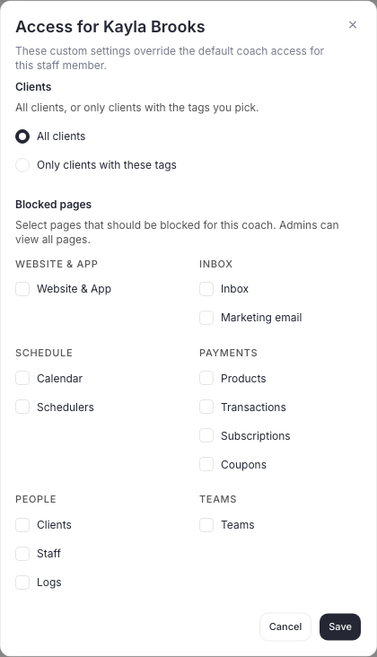

<Info>
  **Where to find this**: **People › Staff**. **Default access** (top right) sets the fallback for every coach. **Access** on a coach's card sets that one coach. Only admins can change staff access, and admins always see everything.
</Info>

Staff access answers two questions for each coach:

1. **Which pages can they open?** You block the pages they don't need.
2. **Which clients can they see?** All clients, or only clients with the access tags you pick.

## Default access for every coach

**Default access** is what every coach gets unless you've given them their own settings. New coaches start on it, including anyone you add from Staff and anyone whose role you change to Coach.

<Steps>
  <Step title="Open Default access">
    On **People › Staff**, click **Default access**. The window is **Default coach access**: "These settings are the fallback for coaches without custom access."
  </Step>
  <Step title="Tick the pages to block">
    Under **Blocked pages**, tick each page coaches shouldn't open. Pages are grouped the way your sidebar is: Website & App, Inbox, Schedule, Payments, People, Teams, Content, Tools and Sales. The line at the bottom counts what's blocked, or reads **No pages blocked**.
  </Step>
  <Step title="Save">
    Click **Save**. Coaches on the default get the change the next time they load a page.
  </Step>
</Steps>

Client limits aren't part of the default. They're set on each coach, and a coach without one sees all clients.

<Tip>
  Make the default the tightest set you're comfortable with, then open things up for the coaches who need more. A new coach then starts locked down until you decide otherwise.
</Tip>

## Access for one coach

<Steps>
  <Step title="Open the coach's access">
    On **People › Staff**, click **Access** on the coach's card (or **...** › **Manage access**). The window is **Access for** and the coach's name: "These custom settings override the default coach access for this staff member."
  </Step>
  <Step title="Choose their clients">
    Under **Clients**, pick **All clients**, or **Only clients with these tags** and choose one or more access tags. See [Limit a coach to certain clients](#limit-a-coach-to-certain-clients).
  </Step>
  <Step title="Choose their blocked pages">
    Tick the pages to block for this coach. These settings replace the default for this coach only.
  </Step>
  <Step title="Save">
    Click **Save**. The coach's card now shows their access and which clients they see.
  </Step>
</Steps>

<Frame>
  
</Frame>

## Limit a coach to certain clients

Use this when a coach should only see their own athletes, for example a pitching coach who works with the Pitching group.

<Steps>
  <Step title="Make an access tag">
    On **People › Clients**, click **Create tag**, name it and set **Kind of tag** to **Staff access tag**. To use a tag you already have, open the tag's menu on the left and choose **Staff access settings**. Access tags can't sit inside another tag.
  </Step>
  <Step title="Tag the clients">
    Give the tag to every client that coach should see. For a family, tag the athlete.
  </Step>
  <Step title="Limit the coach">
    On **People › Staff**, click **Access** on the coach's card, choose **Only clients with these tags**, pick the tag and click **Save**. A live count shows how many clients they'll see.
  </Step>
</Steps>

**What a limited coach sees:**

- The Clients page reads **Showing your clients** and lists only clients with their access tags. Opening anyone else shows **You don't have access to this client**.
- **Content**, **Programs**, **Video Analysis**, **Products** and **Sheets** stay open, but only show their own clients' names. For example, Programs lists every program with only their own athletes enrolled, and Products shows only purchases where everyone on the purchase is their client.
- The **Calendar** and **Schedulers** stay open unless you block them, and form answers show on their own clients' bookings.
- A client's profile shows a **Staff access** section with their access tags and the coaches who can see them.

**Pages that are always off while a coach is limited:** Website & App, Inbox, Transactions, Subscriptions, Coupons, Logs, Teams, Forms, Automations and Pipeline. In the access window these show as ticked and read **Off while clients are limited**. A limited coach also can't add clients, invite staff or block anyone, and doesn't see **New client**.

<Warning>
  Turning off or deleting an access tag changes what coaches see straight away. The warning before you do it says how many clients have the tag.
</Warning>

### Share a sheet with a limited coach

Admins can share a single sheet with chosen coaches as **Can view** or **Can edit**. When you share with a limited coach, the Share window shows how many of the sheet's rows that coach will see and which tags give them access, for example "Coach · sees 21 rows (Pitching)". See [Sheets](/tools/sheets/overview).

## What a blocked page also hides

Blocking a page closes more than its sidebar item. A blocked coach can't open the page from a saved link or a builder link either; they land on the first page they can use.

| Blocked page | Also hidden or refused |
|---|---|
| **Calendar** | Booking pages, the booking editor and its links (for example, from a credit history row), cancelling a booking, and the booking assistant. |
| **Schedulers** | Scheduler and availability builders, even from a direct link. |
| **Inbox** | Sending a group email, text or in-app message to several people, a tag or a role, from the web or the CoachIQ app. Calendar notices still work: see below. |
| **Products** | The **Products** section on client profiles, product links in credit history (names show as plain text), and **Edit product** shortcuts. |
| **Transactions** | The **Transactions** section on client profiles, saved cards under **Payment methods**, and the dashboard's Orders figures and **View Payments** buttons. |
| **Subscriptions** | The **Subscriptions** section on client profiles and subscription rows under **Payment methods**. |
| **Coupons** | The **Coupons** page and its shortcuts. |
| **Logs** | The dashboard **Orders** tile and filter, which need both **Transactions** and **Logs**. |
| **Media Hub** | The **Media** section on client profiles and **Upload/Edit Media** in a website gallery. |
| **Programs**, **Video Analysis**, **Forms**, **Automations** | Their builders, even from a direct link. |
| **Website & App** | The website and app builders. Your live site keeps working. |

A client's **Credits** section always stays visible. **Payment methods** shows when either Transactions or Subscriptions is allowed. The history of every email, text and push message your business has sent is for admins only, whatever a coach's access.

The Assistant follows the same blocks: a question about a blocked area gets a note to ask an admin, while other questions are still answered. ChatGPT or Claude connected to a coach's account follow their blocks too.

### Session notices without the Inbox

When a coach cancels a session time, moves it, or changes its length or location, the Calendar sends its own notice to the people booked and the assigned coaches, as an in-app message, announcement or text. This works for a coach whose Inbox is blocked. A coach without Inbox access can send up to 25 of these notices a day.

## Common questions

<AccordionGroup>
  <Accordion title="A coach says a page disappeared. What happened?">
    Check their card on **People › Staff**. If it shows their own access, open **Access** and look at the blocked pages and the Clients setting. If not, check **Default access**. A coach limited to tagged clients always loses the pages listed above.
  </Accordion>
  <Accordion title="Can I limit an admin?">
    No. Admins see every page and every client. To limit someone, make them a Coach.
  </Accordion>
  <Accordion title="Do team roles like Head coach give extra access?">
    No. A team responsibility doesn't change what a coach can open. Staff access decides that.
  </Accordion>
</AccordionGroup>

## Related articles

<CardGroup cols={2}>
  <Card title="Add and manage staff" icon="users-gear" href="/people/managing-staff">
    Add coaches, send invitations and change roles
  </Card>
  <Card title="Find and organize clients" icon="tags" href="/people/tags-filters">
    Create tags and staff access tags
  </Card>
</CardGroup>
